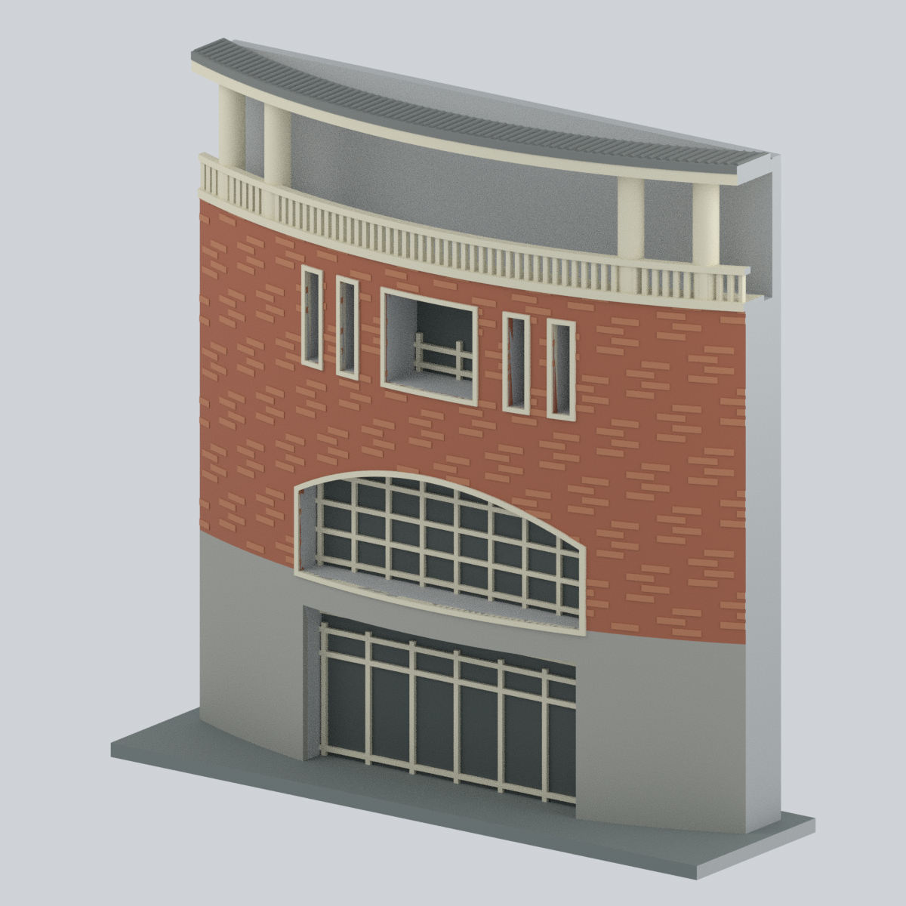
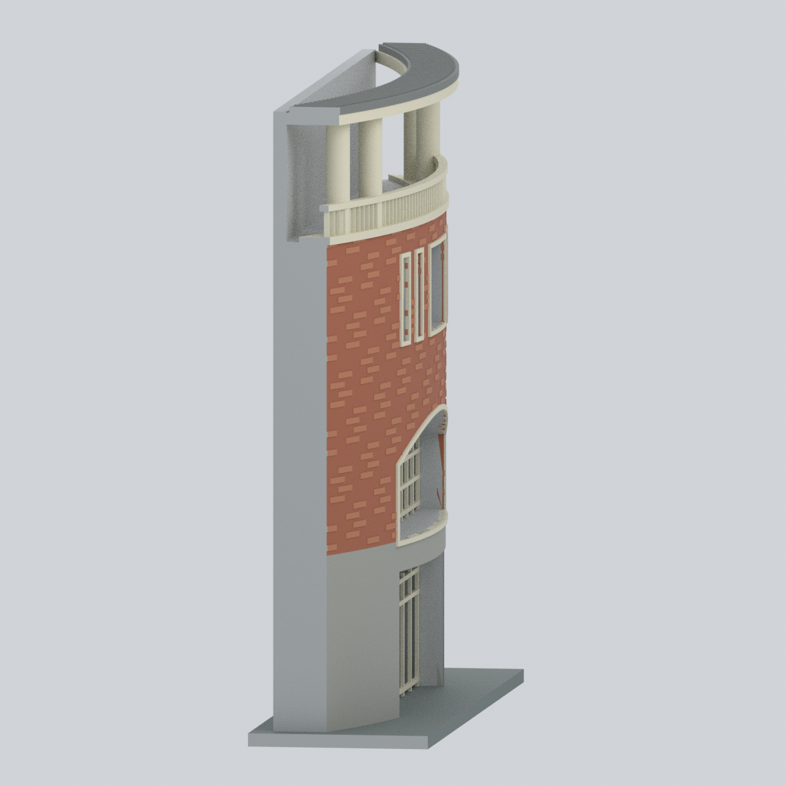
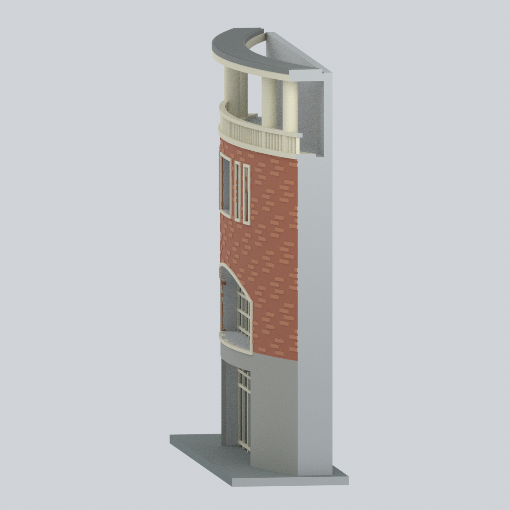
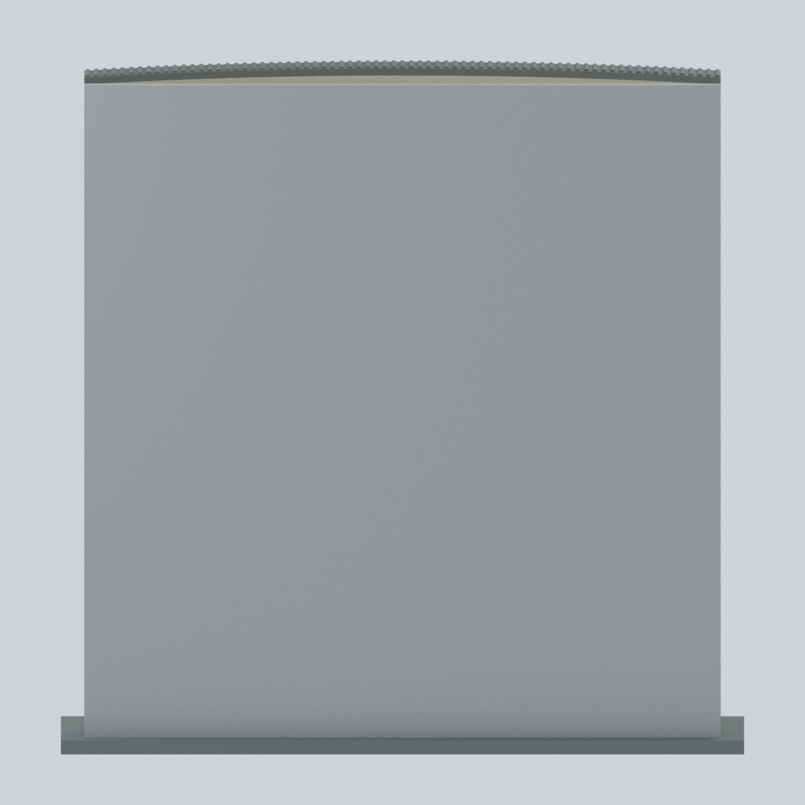
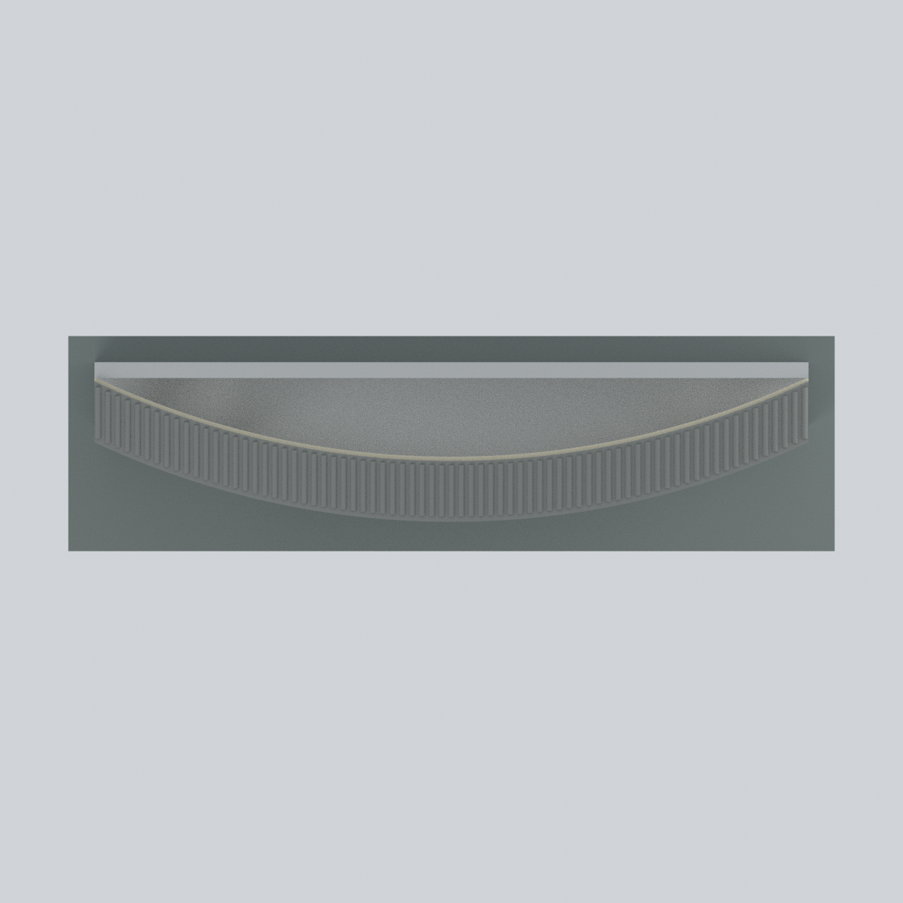

# 國立金門大學圓樓・正面中央入口立面段

**局部、照片近似；不是整棟圓樓，也不代表全校完成。** 本件是金寧校本部圓樓學生餐廳的中央入口立面，與楊清廉圖資大樓銃樓段不同。只保留三張官方來源正面照片重複可見的入口、淺拱窗、上層五開口組、兩對圓柱、欄杆及正面簷口。沒有繞成一整圈。

## 模型預覽

以下均為本件實際材料網格的渲染，非來源照片或概念生成圖。局部座標「前／後／左／右」不是地理方位。後方平牆與側切面是中性灰的**人工裁切／列印支撐**，不是建築實際背面；頂視的空缺表示未建模範圍，**不是圓樓有露天中庭的證據**。

| 正面 | 斜前方 | 左側切面 |
|---|---|---|
|  |  |  |

| 右側切面 | 人工背襯 | 頂視：只有前簷條帶 |
|---|---|---|
|  |  |  |

## 下載與編輯

- [STL：單一封閉列印網格](nqu-roundhouse-entrance-facade.stl) — STL 不存顏色。
- [Blender：可編輯彩色場景](nqu-roundhouse-entrance-facade.blend) — 主網格及材料可編輯；另有隱藏的 `EDITABLE authored components` 組件集合。原始組件在布林聯集前互相重疊，**不可直接全部當作列印件匯出**。
- [3MF：實際三角面基礎材料](nqu-roundhouse-entrance-facade.3mf) — 8 組材料，並非只改副檔名；未預設任何機型、擠出機或線材映射。
- [參數化幾何腳本](build_model.py)、[場景／渲染腳本](render_model.py)、[3MF 匯出腳本](export_3mf.py)。重建不需要來源圖像。

模型含底座外包尺寸約 **146 × 41 × 145.15 mm**；這是為展示與列印選定的模型尺寸，**不宣稱 1:100 或任何已測定比例尺**。曲率、開口深度、段寬、背襯深度及底座皆非實測。文獻的建物高度 15 m 與樓地板面積 2715.59 m² 只作背景資料；面積不是占地面積，也沒有用來反算圓樓直徑。

## 外觀依據與有意省略

| 部位 | 已見依據／本件處理 | 不確定與限制 |
|---|---|---|
| 入口與淺拱窗 | 實際凹入入口、寬淺拱形窗及淡色框架；不是平貼色塊 | 深度、框厚、分格數簡化，玻璃用不透明暗色代替 |
| 上層五開口 | 中央近方形開口，左右各兩道窄直開口 | 依照片比例，非施工尺寸；內部欄杆簡化 |
| 上方柱欄帶 | 兩對、共四支圓柱，曲面淡色欄杆 | 只做直接可見中央段，不延展成 360° 柱廊 |
| 牆面 | 橘紅磚色上部與灰色下部；淡暖色線腳 | 自行編排的淺浮雕磚紋，非逐磚復刻；照片非校色資料 |
| 簷口 | 僅直接可見的灰色前簷瓦條帶 | 瓦數與曲率近似，沒有完整屋頂、屋頂中央或設備 |
| 後、側與底部 | 中性灰封閉背襯、平直側切、展示底座 | 全部是模型裁切／支撐，不是假定的建築牆、地形或基礎 |

未建完整環形外殼、未見的側／背面窗、兩側大陽台、宿舍連接、室內格局與動線。省略各時期變動的店招與商標、樹木、人車、路燈和旗幟。點雲截圖的缺點／空洞不是屋頂開口；DWG 雖有官方公開檔案，但本件未能解讀，**沒有從 DWG 提取尺寸**。照片拍攝日期均不明，不聲稱是 2026 現況。

## 原始來源與權利

檢視日期：2026-10-24。文件日期與照片曝光日期不同；完整引文與使用範圍見 [sources.json](sources.json)。

1. [國立金門大學《金門大學生活圈》](https://nqucs.nqu.edu.tw/var/file/28/1028/img/756671392.pdf)，PDF 第 19 頁，2020 年建立的文件：正面斜視、入口和材料族群。
2. [國立金門大學 114 學年度線上說明會簡報](https://teach.nqu.edu.tw/var/file/1/1001/img/120/708982945.pdf)，PDF 第 69 頁，2025 年文件：同一中央入口組合；第 54、66 頁僅供校園位置背景。
3. [林老生、施宇鴻：以三維共軛覘標提昇三維雷射掃描儀掃描建物效益之研究](https://ws.moi.gov.tw/001/Upload/OldFile_NLSC/up_page/file/%E6%9C%9F%E5%88%8A/%E5%9C%8B%E5%9C%9F%E6%B8%AC%E7%B9%AA%E8%88%87%E7%A9%BA%E9%96%93%E8%B3%87%E8%A8%8A%E6%9C%9F%E5%88%8A7-1.pdf)，2019 年第 7 卷第 1 期，PDF 第 22 頁／印刷第 20 頁圖 2：較少遮擋的正面；第 30–31 頁點雲截圖不作完整屋頂依據。
4. [總務處校園配置圖下載頁](https://ga.nqu.edu.tw/p/405-1015-5582,c1087.php?Lang=zh-tw)：DWG 未解讀；面積表合併宿舍與餐廳，不能分配為本建築尺寸。
5. [總務處校園平面圖](https://ga.nqu.edu.tw/p/405-1015-13287,c1087.php?Lang=zh-tw)：確認餐廳位於兩宿舍之間；示意圖不是測量圖。
6. [圓樓三樓學生社團活動空間使用管理要點](https://osa.nqu.edu.tw/var/file/2/1002/img/78/267059452.pdf)，2021 年：確認三樓用途，不提供立面尺寸。

官方網站公開不等於允許再散布圖片或 CAD。本模型未取得來源像素／CAD 的可重用授權，因此**只發布自行建立的幾何、色彩材料及模型渲染**，不附來源照片、掃描頁、地圖像素或投影貼圖。引文不代表來源單位認可本模型。

## 列印與數位檢查

本件使用實體網格而非只有表面的殼。數位檢查包含 STL 重新讀取的邊與頂點連結、正體積和一致繞序；3MF 以 lib3mf 嚴格讀取及往返重寫，逐面核對材料；Blender 重開與材料編輯測試；另一輸出資料夾的重建比對。結果分別在 [qa](qa/) 中。這些檢查**不是切片器的實際刀路驗證或實體試印**，也不是建築工程或尺寸合格證明。

- 入口跨度、上方欄杆與突出前簷有橋接／懸空風險，須在所選切片器決定支撐與朝向；不宣稱免支撐。
- 欄杆與窗框加厚至約 1 mm，縮小可能失去細節。淺磚紋是附著在牆體上的浮雕，不是獨立薄牆。
- 0.2 mm 水平截面及 0.8／1.2 mm 形態篩檢只提示薄處／截面成長，不能證明所有壁厚或支撐條件。
- 預覽採直立展示方向；最適列印方向不等於展示方向。此尺寸約需 146 × 41 mm 的平面範圍，仍須計入裙邊／支撐與機器淨空。

## 重建

使用 Python 的 `numpy`、`trimesh`、`manifold3d`、`shapely`，以及 lib3mf 2.5.0；場景以 Blender 4.3.2 建立。可使用已備妥相依套件的不同 Python 環境，不需要下載模型庫或來源圖像。

```sh
python build_model.py --out ./rebuilt
python validate_model.py --out ./rebuilt
python export_3mf.py --out ./rebuilt
blender --background --factory-startup --python render_model.py -- --out ./rebuilt
blender --background ./rebuilt/nqu-roundhouse-entrance-facade.blend --python verify_blend.py
python verify_path_buffers.py --blend ./rebuilt/nqu-roundhouse-entrance-facade.blend
```

色票及各組件的來源／近似程度可見 [editable-parts.json](editable-parts.json)；修改材料色票後重建，或在 Blender 材料面板調整。若改變幾何、縮放、合併或匯出設定，請重新執行檢查並重新切片。
