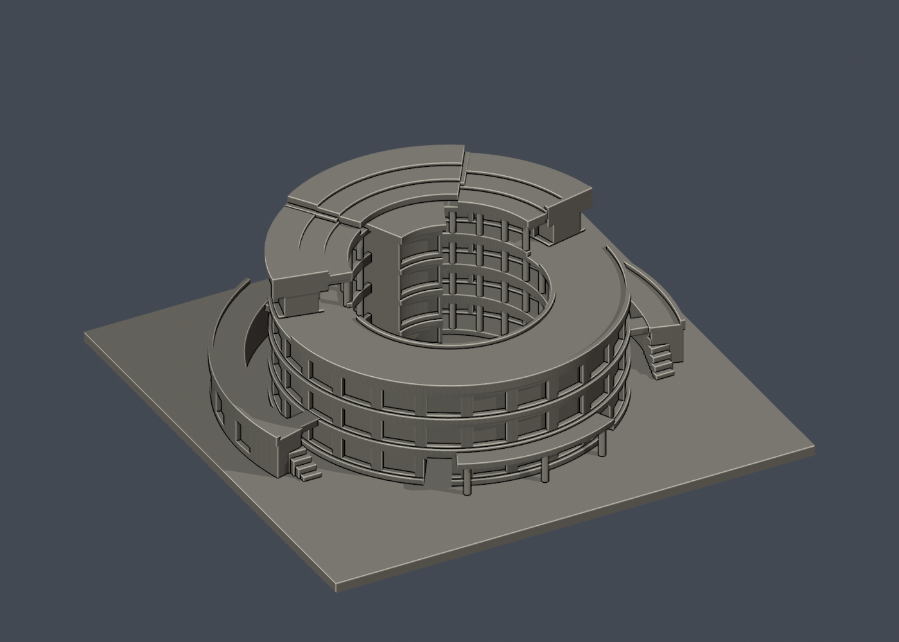
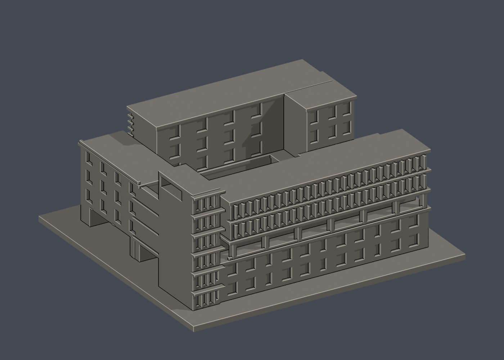
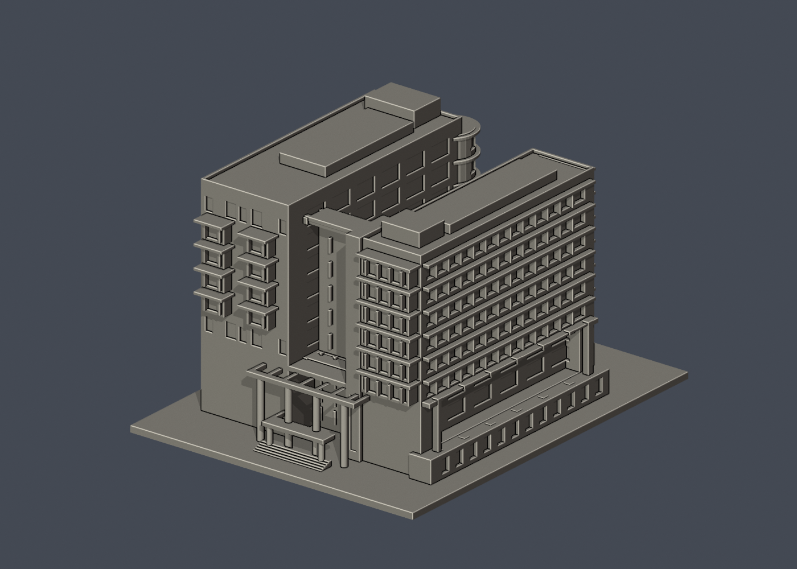

# 國立陽明交通大學｜校園建築外觀模型

目前5件：六家圓樓、歸仁致遠樓、陽明圖書資訊暨研究大樓主量體外觀近似，與光復浩然圖書資訊中心廣場立面段，另新增研三舍雙翼外觀量體（遮蔽連接簡化）。全校未完成；浩然段不等於全館，陽明圖資未見的外側立面保留簡化。

| 建物 | 建物 | 建物 |
|---|---|---|
|    [客家文化學院圓樓](六家校區/buildings/nycu-hakka-round-building/) |    [浩然圖書資訊中心・廣場立面段](光復校區/buildings/nycu-haoran-library-front/) |    [致遠樓產學共創中心](歸仁校區/buildings/nycu-chihyuan-coinnovation/) |
|    [圖書資訊暨研究大樓](陽明校區/buildings/nycu-yangming-library-research/) |  **[研三舍雙翼外觀量體（遮蔽連接簡化）](光復校區/buildings/nycu-graduate-dormitory-3/README.md)** 雙折翼外觀近似；已知三樓連接空間因遮蔽而省略，南側外牆保留素面，非完整測繪 |  |

[光復校區](光復校區/) · [六家校區](六家校區/) · [歸仁校區](歸仁校區/) · [陽明校區](陽明校區/) · [覆蓋範圍](coverage.json) · [續接清單](research-handoff/)

每件依公開實拍自建，含底座最大150毫米，各件獨立比例。附STL、可編輯Blend網格、參數腳本、實際STL正背／俯視圖、來源URL與可重跑QA。來源原照片與PDF不重新散布。

數位QA通過不等於實體試印或Cura／Prusa工具路徑驗證；深挑空與棚頂可能需要支撐。未知部位、攝影日期不明與局部範圍逐件明列。

## 新增研三舍的限定覆核

本件已通過[指定版本獨立限定條件數位覆核](inventory/qa/nycu-graduate-dormitory-3-fresh-v2-review.md)。保留 137 筆原始嚴格法向失敗與指定角點根部證據，不能解讀為全方向壁厚合格。已知三樓連接空間省略、南側外牆素面等限制均在模型內明列；尚未實體試印。
