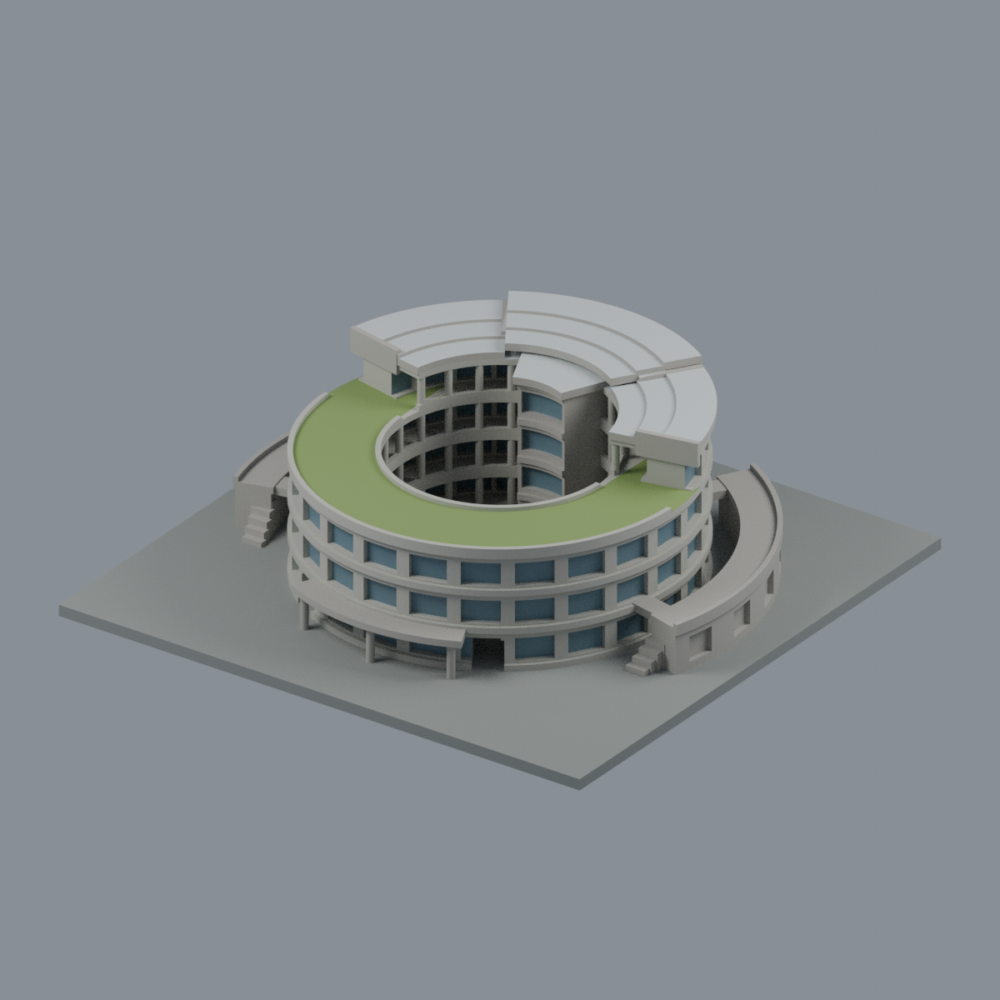
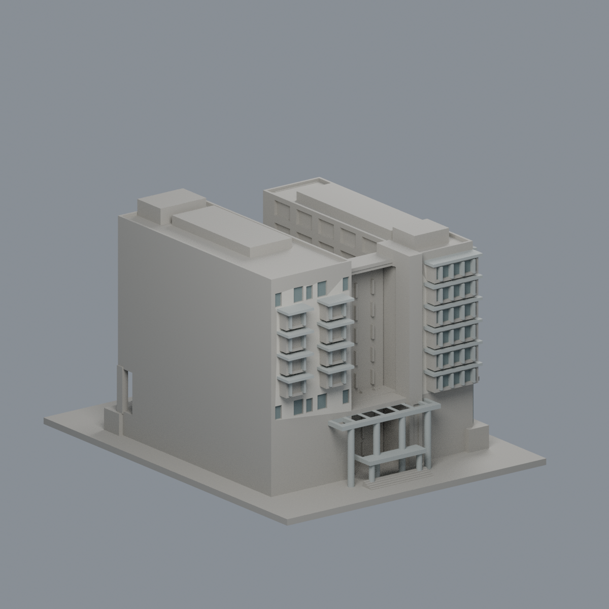
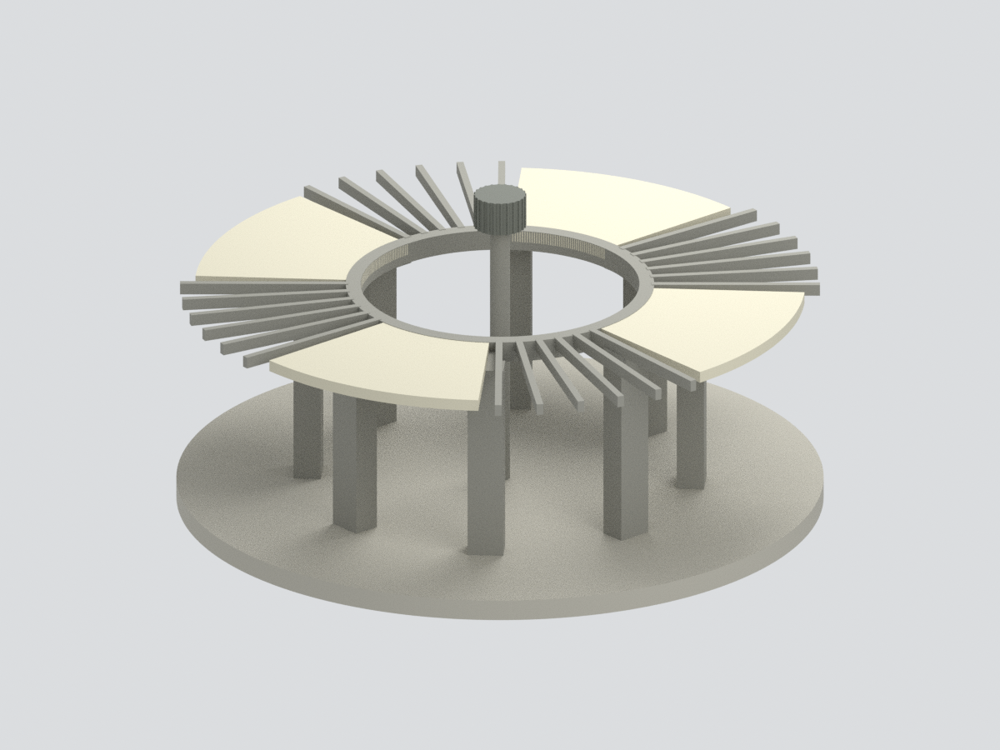

# 國立陽明交通大學｜校園建築外觀模型

現行收錄 **11 套模型包**；數量不等於完整建築棟數，亦非全校／校區完成。新件與既有件的年代、截段範圍及未試印限制請閱各模型頁。

### 既有批次來源與列印限制（數量為各批歷史範圍，非現行總數）

當批10件：六家圓樓、歸仁致遠樓、陽明圖書資訊暨研究大樓主量體外觀近似，與光復浩然圖書資訊中心廣場立面段，另有蜷蜷亭完整可見外觀近似與研三舍雙翼外觀量體（遮蔽連接簡化）。新增南大門／工程六館旁候車亭2020完整地景式外觀近似（白網狀態）。新增竹湖／北門候車亭2007白色鋼玻璃完整外觀近似（竹棧），與南門2020為不同建築。新增炎松之圓2024完整獨立紀念看臺／舞臺外觀近似，7排透空座臺、左7半階與照片06的41個座墊；非科學三館或全中庭。另收台積電交大能源教育館（2017新竹永久版蘭花屋）完整單棟外觀近似；園區二路101號台積新竹廠區為校外產學教育研究場域，非光復校區，亦非2014法國原型。全校未完成；浩然段不等於全館，陽明圖資未見的外側立面保留簡化。

| 建築模型 | 建築模型 | 建築模型 |
| :---: | :---: | :---: |
|  **[客家文化學院圓樓](六家校區/buildings/nycu-hakka-round-building/)** |  **[浩然圖書資訊中心・廣場立面段](光復校區/buildings/nycu-haoran-library-front/)** |  **[致遠樓產學共創中心](歸仁校區/buildings/nycu-chihyuan-coinnovation/)** |
|  **[圖書資訊暨研究大樓](陽明校區/buildings/nycu-yangming-library-research/)** |  **[研三舍雙翼外觀量體（遮蔽連接簡化）](光復校區/buildings/nycu-graduate-dormitory-3/README.md)** 雙折翼外觀近似；已知三樓連接空間因遮蔽而省略，南側外牆保留素面，非完整測繪 |  **[國立陽明交通大學｜光復校區｜蜷蜷亭（2024）](光復校區/buildings/nycu-rolling-pavilion-2024/README.md)** |
|  **[陽明交通大學光復校區｜南大門／工程六館旁候車亭（2020）](光復校區/buildings/nycu-south-gate-bus-shelter-2020/README.md)** |  **[陽明交大｜竹湖／北門候車亭（2007，竹棧）](光復校區/buildings/nycu-north-gate-bus-shelter-2007/README.md)** |  **[陽明交通大學光復校區｜炎松之圓（2024）](光復校區/buildings/nycu-huang-courtyard/README.md)** |
|  **[台積電交大能源教育館（2017永久版蘭花屋）](新竹科學園區教育研究場域/buildings/nycu-tsmc-energy-education-center/README.md)** |  **[陽明交大光復校區振吾亭｜歷史照片時期本體](光復校區/buildings/nycu-zhenwu-pavilion-historical/README.md)** |  |

[光復校區](光復校區/) · [六家校區](六家校區/) · [歸仁校區](歸仁校區/) · [陽明校區](陽明校區/) · [新竹科學園區教育研究場域](新竹科學園區教育研究場域/) · [覆蓋範圍](coverage.json) · [續接清單](research-handoff/)

原5件依公開實拍自建，含底座最大150毫米；蜷蜷亭展示底板244毫米寬，南大門候車亭底板246毫米寬，竹湖北門候車亭底板206毫米寬，炎松之圓盤徑約160毫米，各件獨立比例。附STL、可編輯Blend網格、參數腳本、實際STL正背／俯視圖、來源URL與可重跑QA。來源原照片與PDF不重新散布。

數位QA通過不等於實體試印或Cura／Prusa工具路徑驗證；深挑空與棚頂可能需要支撐。未知部位、攝影日期不明與局部範圍逐件明列。

## 新增研三舍的限定覆核

本件已通過[指定版本獨立限定條件數位覆核](inventory/qa/nycu-graduate-dormitory-3-fresh-v2-review.md)。保留 137 筆原始嚴格法向失敗與指定角點根部證據，不能解讀為全方向壁厚合格。已知三樓連接空間省略、南側外牆素面等限制均在模型內明列；尚未實體試印。

[浩然圖資廣場立面段外觀與來源界線](光復校區/buildings/nycu-haoran-library-front/appearance/README.md)

[陽明圖資暨研究大樓有限配色外觀與來源界線](陽明校區/buildings/nycu-yangming-library-research/appearance/README.md)
