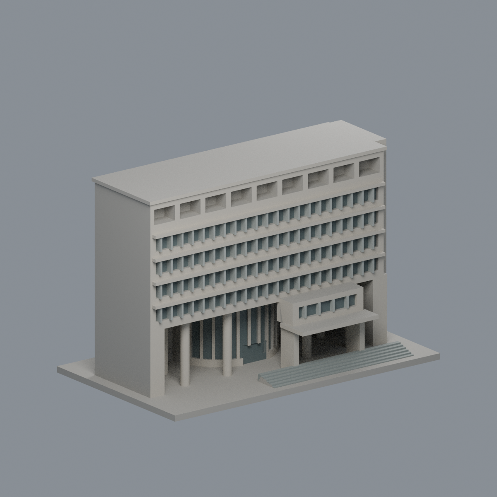
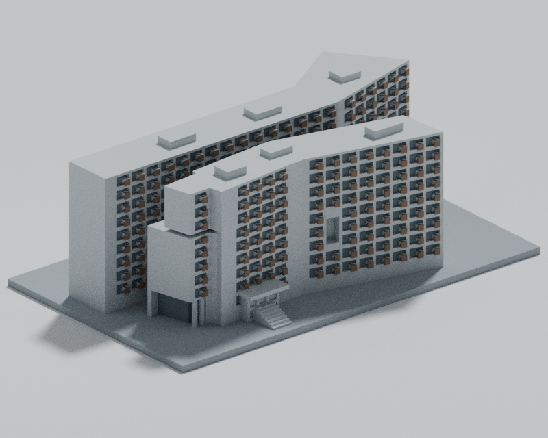
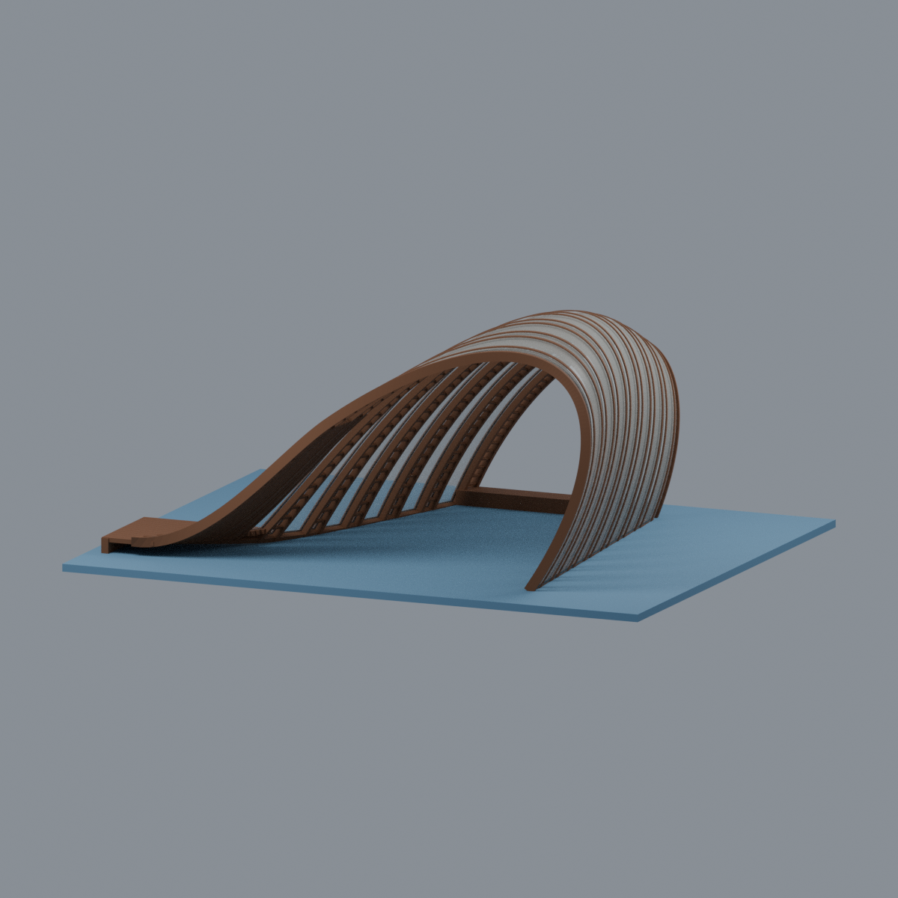
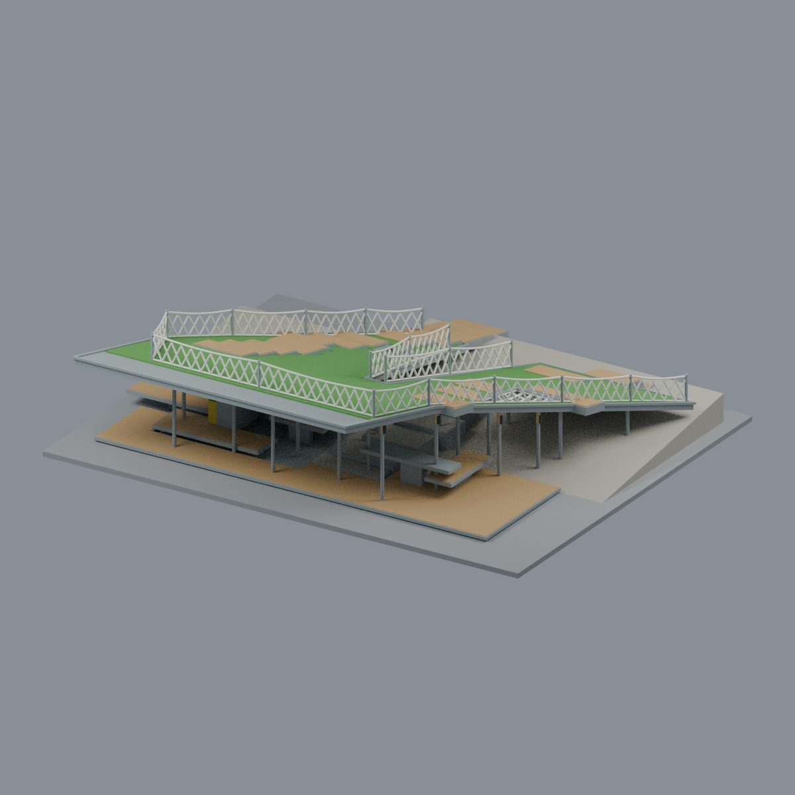
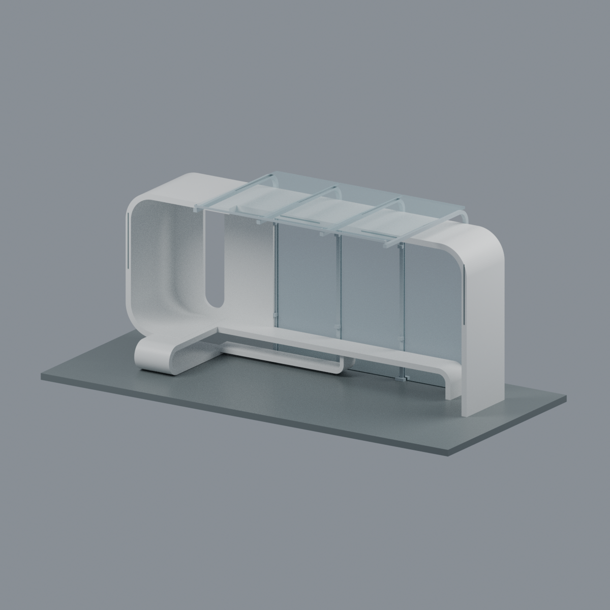
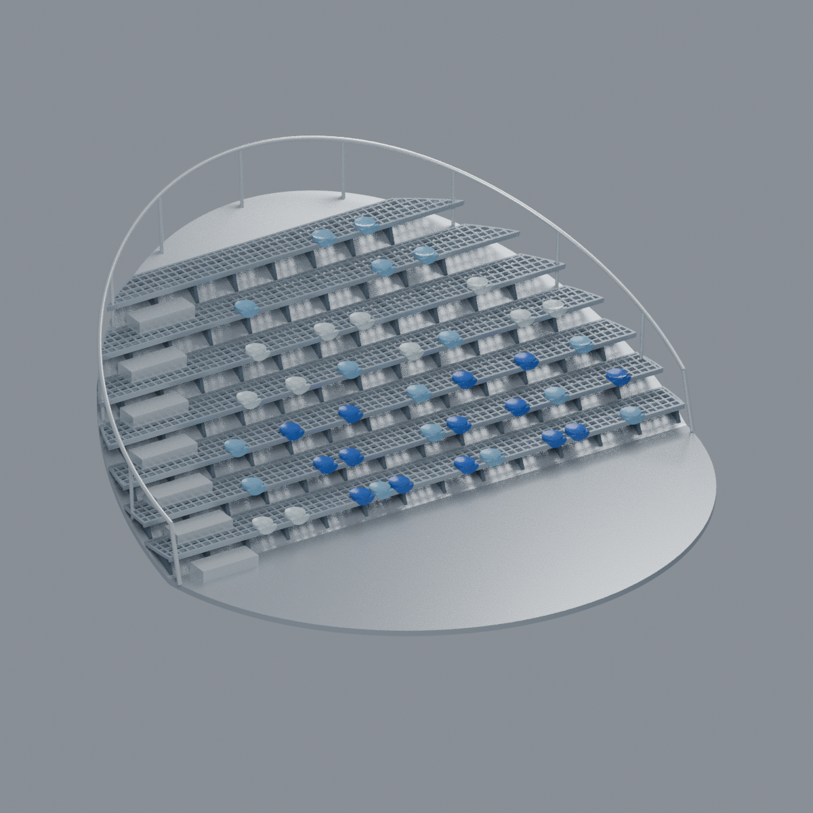

# 光復校區

目前收錄 6 件有界外觀研究模型，收錄蜷蜷亭、南門候車亭2020及竹湖／北門候車亭2007完整可見外觀近似（兩亭年代與形體不同），另收炎松之圓2024完整獨立紀念看臺／舞臺（7排透空格柵、左7半階、照片06共41座墊；非科學三館全棟），全校區未完成。浩然圖資為廣場立面段；研三舍省略受遮蔽的已知三樓連接，並非完整建築測繪。

| 建築模型 | 建築模型 | 建築模型 |
| :---: | :---: | :---: |
|    [浩然圖書資訊中心・廣場立面段](buildings/nycu-haoran-library-front/) |  **[研三舍雙翼外觀量體（遮蔽連接簡化）](buildings/nycu-graduate-dormitory-3/README.md)** 雙折翼外觀近似；已知三樓連接空間因遮蔽而省略，南側外牆保留素面，非完整測繪 |  **[國立陽明交通大學｜光復校區｜蜷蜷亭（2024）](buildings/nycu-rolling-pavilion-2024/README.md)** |
|  **[陽明交通大學光復校區｜南大門／工程六館旁候車亭（2020）](buildings/nycu-south-gate-bus-shelter-2020/README.md)** |  **[陽明交大｜竹湖／北門候車亭（2007，竹棧）](buildings/nycu-north-gate-bus-shelter-2007/README.md)** |  **[陽明交通大學光復校區｜炎松之圓（2024）](buildings/nycu-huang-courtyard/README.md)** |

研三舍的[指定版本獨立覆核](../inventory/qa/nycu-graduate-dormitory-3-fresh-v2-review.md)保留 137 筆原始嚴格失敗與限定根部證據；未實體試印，不保證免支撐或所有方向壁厚。

[回學校圖鑑](../README.md)
