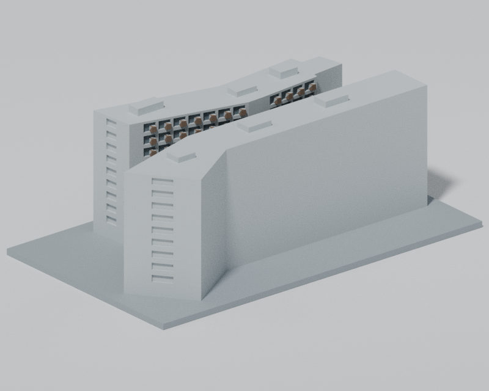

# 國立陽明交通大學｜研三舍雙翼外觀量體（遮蔽連接簡化）

本版依列示來源重新建模，已完成來源外觀複核及**限定條件下的獨立幾何與重現檢查**。原始嚴格法向檢查的 137 筆失敗完整保留；特定角點的連續根部證據不代表所有方向壁厚通過，也不保證免支撐列印。獨立複核結果請由學校目錄的 QA 連結查閱。

## 實際 STL 預覽

| 東北側正面 | 西南側背面 |
|---|---|
|  |  |

[北上俯視](top.png)・[北立面](elevation.png)・[東北細節](northeast-detail.png)

預覽由同一實際 STL 渲染；材質只標示既有幾何的背襯凹窗、凸出遮陽盒與底座。未使用來源照片貼圖或生成影像。STL 是單一材料網格，Blend 保留可編輯三角形、材質與相機。

## 模型與檔案

- 底座 150 × 90 × 2.4 mm，模型總高約 53.24 mm；單位 mm。
- [model.stl](model.stl)：單一實體列印模型。
- [scene.blend](scene.blend)：從實際 STL 建立並重新開啟核對的場景；另有明確命名的渲染地面，不屬於列印模型。
- [build_model.py](build_model.py) 與 [parameters.json](parameters.json)：可重建程式與完整建模輸入。
- [QA.md](QA.md)、[qa-summary.json](qa-summary.json)、[SHA256SUMS](SHA256SUMS)：完整檢查方法、報告與檔案雜湊。

## 來源支持的範圍

以建築師雜誌、施工方照片、官方西端照片、公開空拍及屋頂影像，表現兩個不對稱折翼、上部翼間開放空間、北側入口、北翼東端退台／懸挑、下部退縮玻璃及兩根主要圓柱。主立面採寬而有背襯的水平窗凹帶、連續白色樓板線、細直框及局部凸出遮陽盒；各模數仍是照片近似。

主要高度採建築師雜誌的地上 10 層、35.9 公尺；OSM 的 11 層標記不採用。來源未明定高度基準，模型以本地地面為起點。

## 明確限制

- **來源記載通往三樓大廳的連接空間，但其被遮蔽的完整平面未知，因此本模型省略該連接。** 共用列印底座連接兩翼；模型間隙不能解讀為真實建築一至十樓全部貫通。
- 南側外牆缺乏清晰完整來源，保持素面，沒有鏡射北面細節。
- 內緣、窗格／樓板線、入口、柱位、24 公尺退台、25 公尺懸挑底及屋頂機房高度均為照片估計，不是測量值。局部柱、框及樓板厚度為列印穩健性作簡化。
- 北翼低端南界保守收回約 y=3.03 m；OSM 單一外圍的 y≈−4.05 m 轉接點並未被拉高為近跨翼實牆。沒有先前不受來源支持的西南內側 V 凹口或北外牆高處大洞。
- 不包含地下室、室內、地形、鄰棟及細小百葉。衛星影像有明顯屋頂視差，只用於量體關係，不作精密地面測繪。
- 幾何篩查不是切片器或實體試印。底座平放；退台、懸挑及入口的下表面需要自行檢視支撐與機台設定，不保證免支撐列印或全域最小壁厚。

## 重建與完整檢查

Python 3.12、[requirements.txt](requirements.txt) 所列鎖定版本，以及 Blender 4.3.2 / C++17 編譯器；本次實際版本見 [environment.json](environment.json)。

    python -m pip install -r requirements.txt
    python build_model.py
    MALLOC_ARENA_MAX=2 LP_NUM_THREADS=1 OMP_NUM_THREADS=1 OPENBLAS_NUM_THREADS=1 blender -b --factory-startup -t 1 --python-exit-code 1 --python render_model.py
    python run_checks.py

本版保留 **137 筆**短於 0.8 mm 的原始法向診斷。完整命令保留原始 strict dense 的 false / exit 1 結果，另逐筆檢驗限定來源角點的真實邊、根部支持、完整材料／空氣區間及全網格點控制。它們不是通用的角點豁免。獨立結論只適用於本版精確 STL 與所列限定條件；原始診斷不因通過限定複核而改寫。

## 來源與資料授權

完整網址及各項依據見 [sources.json](sources.json)。

外圍座標部分衍生自 [OpenStreetMap way 1095872562](https://www.openstreetmap.org/way/1095872562)、version 5、2023-04-18T15:09:48Z。© OpenStreetMap contributors；[來源及著作權說明](https://www.openstreetmap.org/copyright)，[ODbL 1.0](https://opendatacommons.org/licenses/odbl/1-0/)。此聲明適用於 OSM 原始及衍生輪廓資料；照片獨立判讀的估計幾何另列，不替整個儲存庫新增概括授權。

照片、空拍及衛星截圖只作私人研究參考，不隨公開模型包分發。
