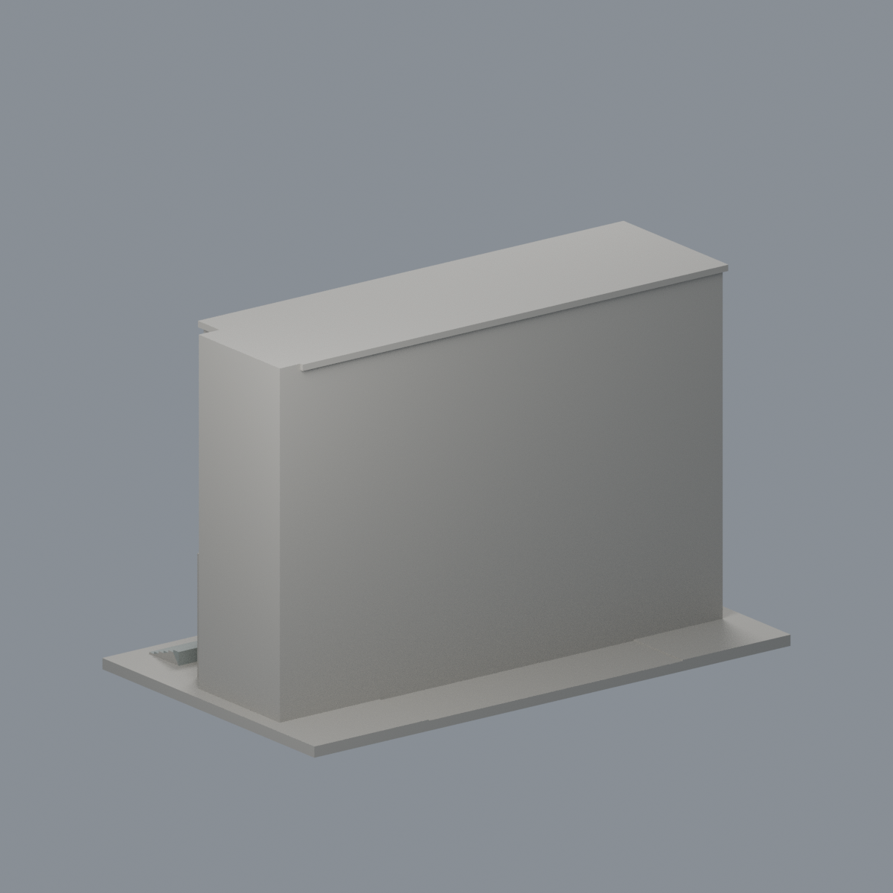
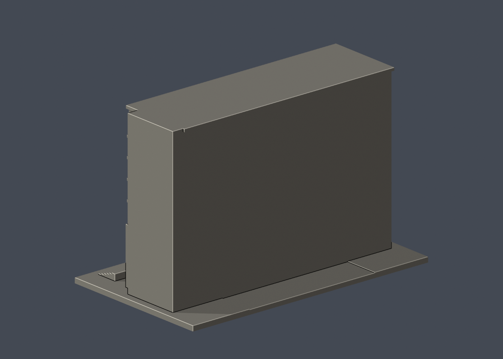

# 浩然圖書資訊中心・廣場立面段

## 5 材質外觀版（2026-10-21）

| 正面與來源支持區域 | 未見外側背面中性 |
|---|---|
|  |  |

[來源界線與四視角](appearance/README.md) · [表面色 3MF](appearance/nycuhaoran-appearance.3mf) · [可編輯場景](appearance/scene.blend)

採日間米灰磁磚與灰暗玻璃代理，夜景僅註冊立面分界、不烘焙黃燈。頂部開廊非玻璃，未知屋頂及截斷背面中性。 原 STL 與歷史 QA 不變；這是外觀改善，不是新增幾何。[原單色正面](previews/front.png)／[原單色背面](previews/rear.png)

國立陽明交通大學｜光復校區。廣場側主立面、前廊與曲面門廳段；非全棟模型，背面為範圍截斷平面。

| 實際 STL 正面 | 實際 STL 背面 |
|---|---|
|  |  |

[俯視](previews/top.png) · [STL](model.stl) · [可編輯 Blender 網格](scene.blend) · [參數重建](build_model.py)

## 範圍與來源

- 跨多層的大深度挑空與圓柱群
- 後退的曲面玻璃門廳
- 四條水平窗帶與加粗窗框
- 頂層九個深凹大開口與偏心入口凸部

- 背面平板是模型範圍截斷，不代表真實館舍背立面
- 館舍真實全深、後部側翼與完整屋頂設備未建模
- 前部窗框間距、門廳弧率與柱徑為視覺推估
- 已於2020年拆遷的小園呈秀、館內書庫及臨時招牌不包含

[來源與支持特徵](sources.json) 包含精確公開 URL、查閱日及照片年代不確定性。第三方原照片／PDF不隨本模型散布。這是自建的外觀近似，非測繪、非精密尺寸資料。色彩僅為網格預覽材質。

## 列印與比例

- 單位：毫米；含底座尺寸 150.00 × 89.00 × 97.00 mm，最大邊150 mm，各館獨立比例。
- 底座朝下；不要用切片軟體自動修補來掩蓋幾何問題。請自行檢查工具路徑與首層。
- 深挑空、走廊、棚頂及窗洞上緣可能需要局部支撐。細柱、窗框與低欄牆已為縮印加粗；搬運與拆支撐仍需小心。
- 0.2 mm輪廓檢查採固定 z=0.071 mm 起始以避開共面退化，本件共 485 層全部degree 2閉合、個別及組合Polygon有效，無修補輸入輪廓。
- canonical thin v2以1 mm層距、0.8 mm參考寬度形態opening作輔助篩檢，最大面積損失 0.069%。此數值不是全面最小壁厚或噴嘴可印保證。
- 數位QA不等於Cura／Prusa真實工具路徑，未做實體試印，不宣稱免支撐或保證可印。

## 重建與验证

Python 3.12，先依 [requirements.txt](requirements.txt) 安裝套件，另需Blender 4.3.2或相容版本。

依序執行 python build_model.py、blender -b -t 2 -P render_preview.py、python validate_model.py、python check_layers.py、python check_valid_sections.py、python thin_canonical_v2.py。建模階段將CSG輸出在float32精度下正規化；驗證直接讀原始交付STL，不作修復。

- [原STL、重建SHA及Blend對比](validation.json)
- [0.2 mm閉合輪廓](layer-check.json) · [有效Polygon](valid-sections.json)
- [thin v2報告](thin-feature-check.json) · [QA合併摘要](qa-summary.json)
- [逐檔SHA256](SHA256SUMS.txt)

scene.blend由實際交付STL匯入，內含可編輯三角網格；完整參數來源是build_model.py。預覽亦由同一STL生成。
