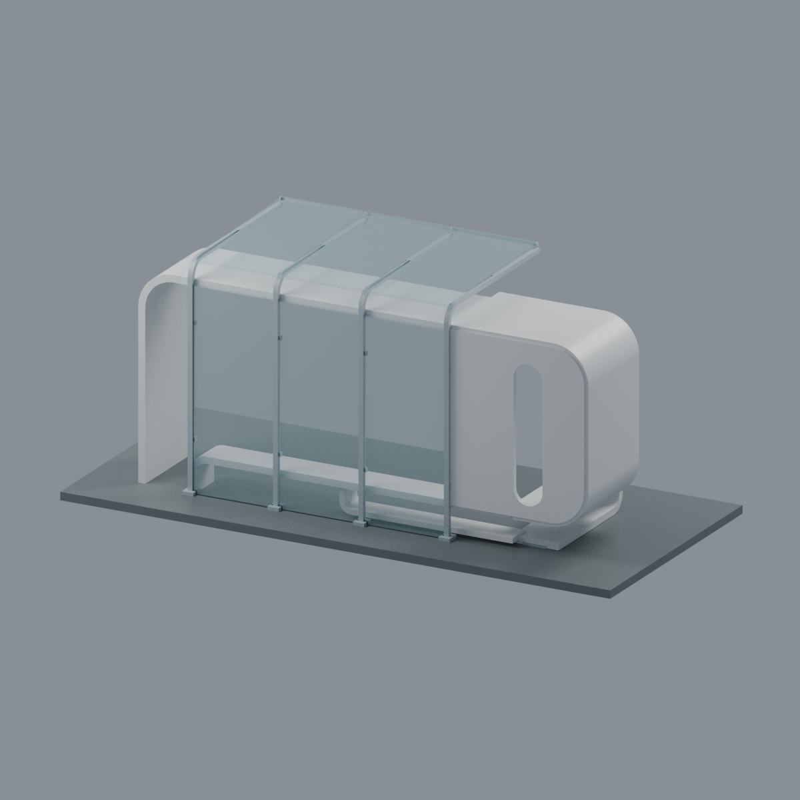
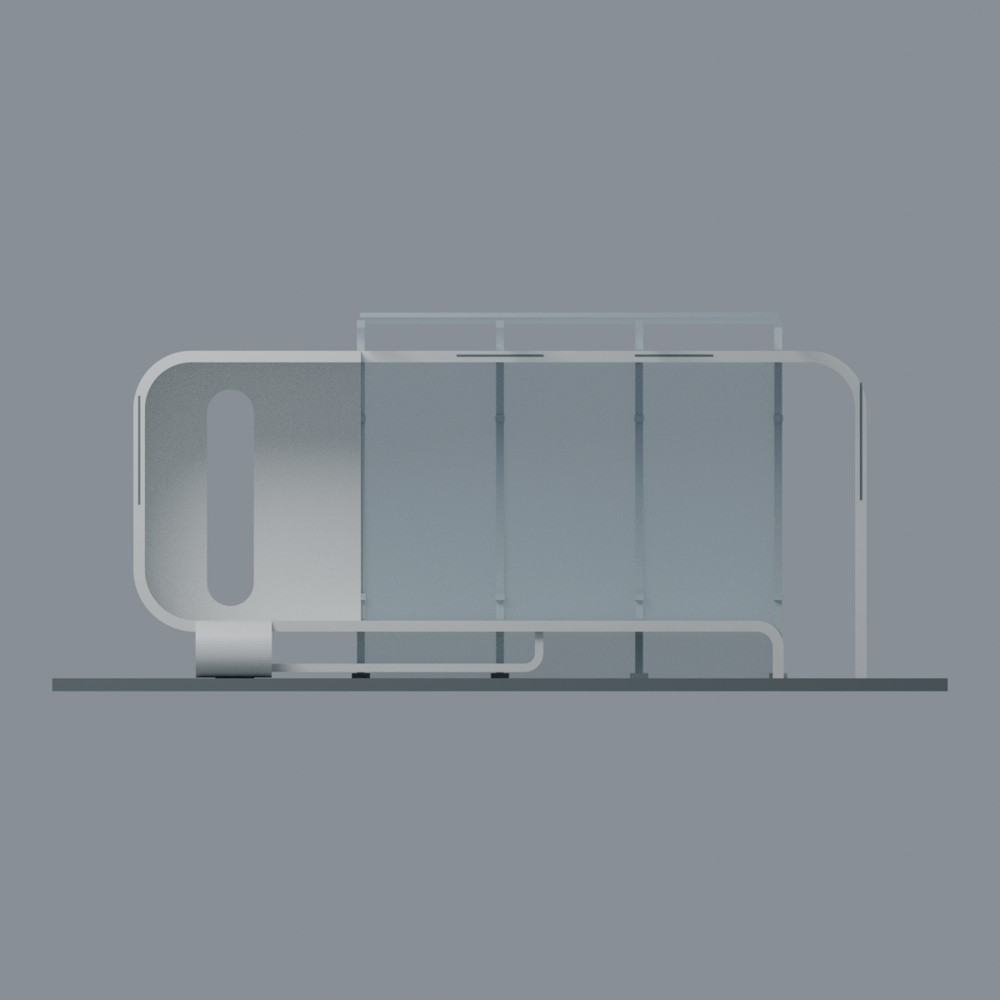
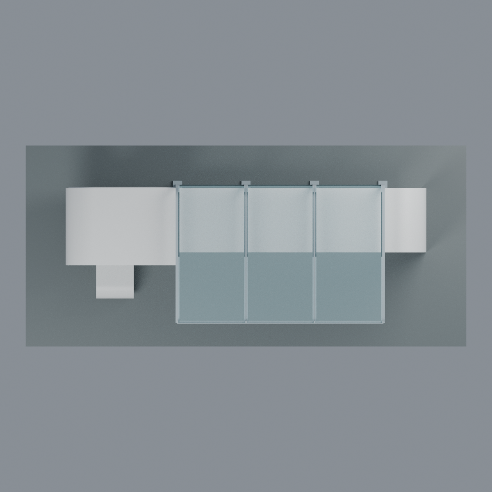
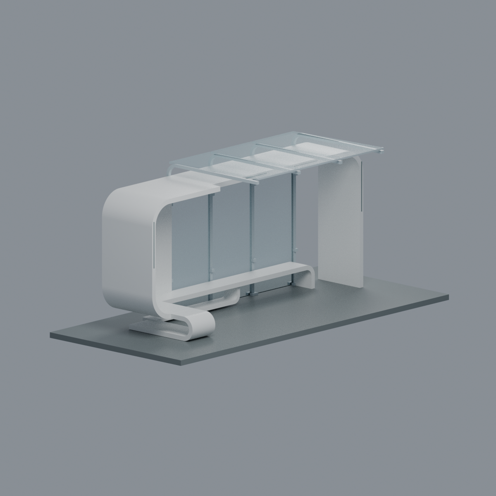

# 陽明交大｜竹湖／北門候車亭（2007，竹棧）

## 模型預覽

| 模型預覽 | 模型預覽 | 模型預覽 |
| :---: | :---: | :---: |
|  |  |  |

**光復校區，來源限定的完整外觀近似模型。不是2020南大門／工程六館旁的植草地景候車亭，也不是2024蜷蜷亭。** 本模型依2007專案公開照片與平面／爆炸圖重建；不是測繪、施工圖、結構分析，也不宣稱2026現況或實印成功。

## 已保留的辨識形體
- 有實際進深的不對稱白色厚帶殼、大圓角與屋頂前緣錯位；左端懸空彎下接向前回捲座，右端直接落地，沒有左右鏡像。
- 左後白色局部板上的長圓豎向通孔；左回捲座下水平通空。白板只佔左側一格，不以白牆代替中／右玻璃。
- 沿後玻璃前方的長座與左側構成L形；長座右端彎下，中央支承向下再向左回折，座下仍通空。
- **4根後骨架／前伸臂、3片後玻璃及3片頂玻璃**；道路側入口保持開放。
- 簡化夾具、腳座與暗色燈線。燈線是薄附面表示，不宣稱精確凹槽或完整LED施工系統。

## 透明、顏色與STL的區別

`scene.blend`以實際最終三角網格渲染，**玻璃材質Alpha = 46/255**；透明後板可以看到後方支架／底座，不是塗白厚牆。`model.3mf`含同樣5種逐面材質，玻璃`displaycolor`帶Alpha `2E`。部分切片器會忽略3MF顯示Alpha，不能保證所有軟體都以相同透明效果顯示。

**STL只保存幾何，不保存顏色或透明。** `model.stl`保留6片加厚至1.1mm的玻璃形體；使用不透明耗材時，這6片必然印成不透明實片，不能把本預覽當成單色實印效果。若目標是透明實物，需另行選擇透明材質、製程，或編輯玻璃材質區製作分件／薄片裝配方案；此包沒有驗證這些方案。3MF與Blend仍為一個融合網格，材質分區可選取編輯，**不是預先分好的6片獨立零件**。

## 尺寸、近似與列印風險

成品外包尺寸 **206 × 94 × 87.2 mm**（含3mm新增展示底板）。這些是模型尺寸，不是實物量測或精確比例尺。來源提到玻璃高3.2m及覆殼3mm，但沒有足以校準完整亭體的施工尺寸，故不將其強行套為精確比例。

白殼2.6mm、後框約1.8×1.65mm、玻璃1.1mm均為展示／列印強化；曲線、進深、玻璃坡度、板縫、後板孔比例、燈線位置與內部隱藏鋼構為近似。玻璃端邊附簡化細框，夾具與地腳不是工程細節。底板只是新增的連通展示板，不是現場完整水泥鋪面。省略湖、水、坡地、樹、道路、人、地下基礎與管線；不會把施工拼圖中的原舊亭加入新亭。

**未實印，不保證免支撐。** 大屋面底部、玻璃懸挑、長座與左回捲均有懸空／橋接；細燈線和斜面末端有0.8mm切層侵蝕警告。全局切層合格區域也不能證明所有局部細節可印。請閱讀[QA](QA.md)，在實際縮放、材料、設備與擺向下再切片測試；下向面積不是自動支撐耗材估算。

## 交付檔案

| 檔案 | 用途 |
|---|---|
| `model.stl` | 原始單閉合網格，毫米，不含顏色／透明 |
| `model.3mf` | 與STL逐三角相同，5組顏色／Alpha材質 |
| `scene.blend` | 可編輯幾何、材質、相機、燈光；沒有外部照片資產或內嵌執行腳本 |
| `build_model.py`、`render_model.py` | 原始參數生成及正式五視圖渲染 |
| `mesh.json`、`palette.json` | 精確幾何與逐面材質對照 |
| `qa_model.py`、`check_features.py`、`verify_*.py` | 原始拓樸、切層、局部／空氣、格式與hash驗證 |
| `rebuild.py` | 在全新資料夾重建核心檔案及五圖，逐檔bytes比較 |
| `QA.md`、`qa/`、`qa-*.json` | 真實數值與風險，不抹除薄件警告 |
| `SOURCES.md`、`sources.json` | 來源、作者、日期界線與逐圖用途；不含原始圖紙／照片 |
| `SHA256SUMS` | 全交付檔案hash清單 |

## 五個最終網格視圖

[正面斜視](previews/front.png) · [後斜視](previews/rear.png) · [正立面](previews/elevation.png) · [俯視](previews/top.png) · [左前斜視](previews/left_oblique.png)

| 模型預覽 | 模型預覽 | 模型預覽 |
| :---: | :---: | :---: |
| 後斜視<br> | 正立面<br> | 俯視<br> |
| 左前斜視<br> |  |  |

全部為同一最終網格與5材質，沒有用原照片合成或生成示意圖替代模型。透明為材質表現，不代表STL或單色列印透明。

## 重建與驗證

Python 3.12與Blender 4.3.2環境驗證；依`requirements.txt`準備Python套件，Blender另裝。請由此資料夾執行：

```bash
python build_model.py
python qa_model.py
python check_features.py
python verify_exchange.py
blender -b -t 8 --python-exit-code 1 --python render_model.py
blender -b -t 8 --python-exit-code 1 --python verify_scene.py
blender -b -t 8 --python-exit-code 1 --python verify_render.py
python rebuild.py --output ../independent-new --threads 8
python verify_package.py
```

`verify_exchange.py`會重建核心檔案並核對bytes。`rebuild.py`要求全新目錄，不覆寫交付資料夾；CPU Cycles、seed0、128 samples、不降噪，PNG僅移除文字／日期metadata，未做像素後製。跨Blender版本／不同計算環境不承諾相同渲染bytes。更改任何模型或材質後，須重跑全部QA與獨立來源視覺審查，既有QA不能沿用。

原始產生物授權範圍見[LICENSE](LICENSE)；建築及第三方來源權利不因此轉移。
