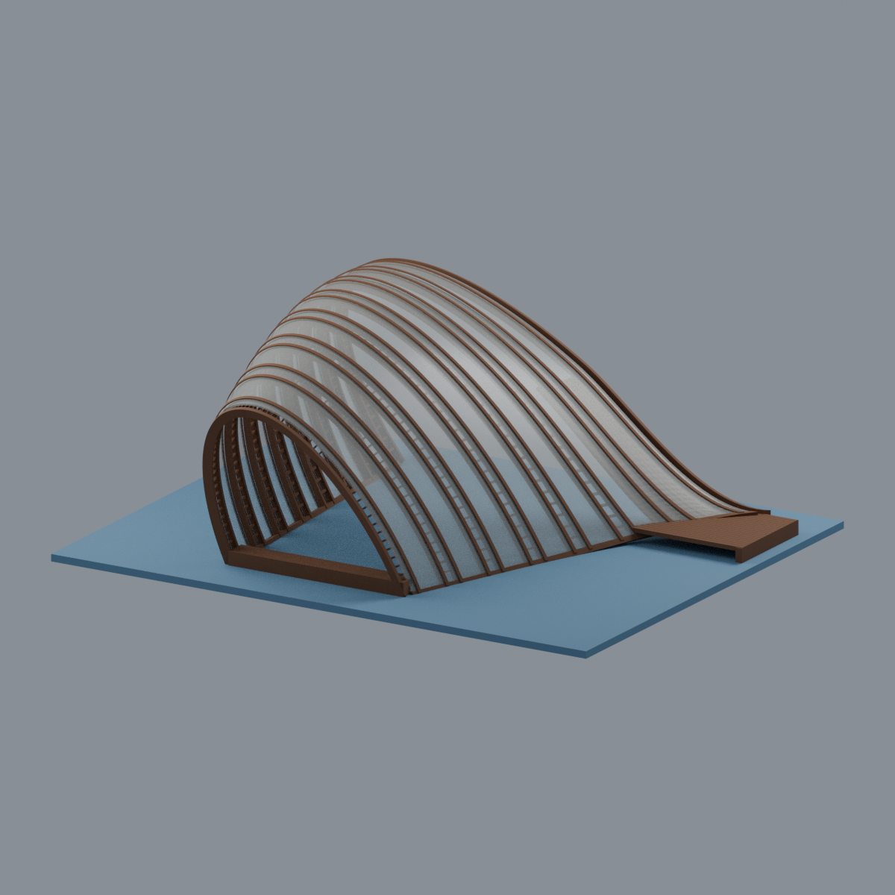
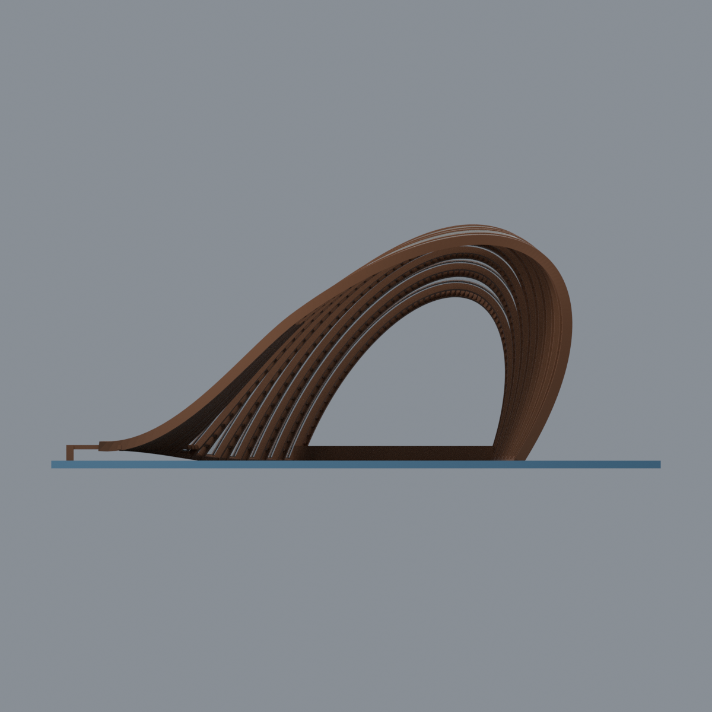
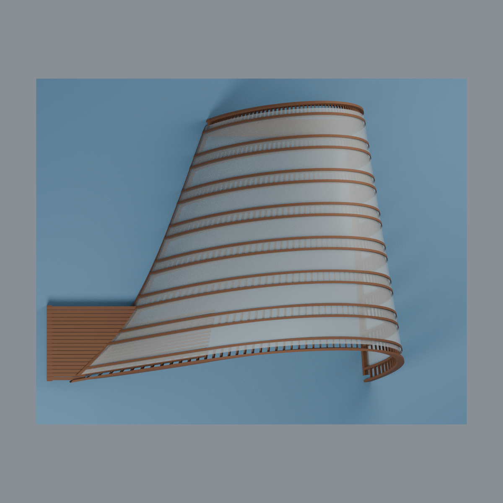
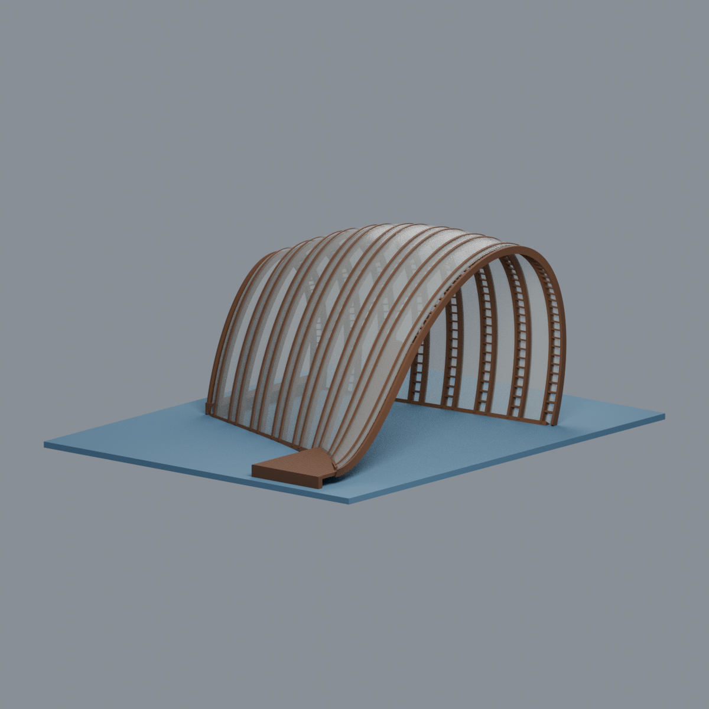

# 國立陽明交通大學｜光復校區｜蜷蜷亭（2024）

> **完整可見外觀的觀察近似，不是精確 NURBS、測繪或施工模型。** 藍色薄底板是展示底座，不是現場基礎。

| 模型預覽 | 模型預覽 | 模型預覽 |
| :---: | :---: | :---: |
|  |  |  |

依偶然設計第一方照片與官方獎項文字，重建偏斜開放竹肋殼、較小的反側開口、前緣蜷曲座席與後端低橫凳。保留成帶的雙竹邊與帶內短橫條，而非把整個殼改為密格柵。原照片不隨包公開。

## 下載
- [彩色可編輯 Blender](scene.blend)
- [彩色 3MF](model.3mf)／[單色 STL](model.stl)
- [可重建生成程式](build_model.py)／[色盤](palette.json)
- [來源及界線](SOURCES.md)／[測試結果與限制](QA.md)／[檔案雜湊](SHA256SUMS)

## 幾何與材質限制
- 官方文字記載跨距 8 m、高度 4.8 m；8 m 不是整體外包寬。模型約 1:50 的展示尺度，曲線及平面尺寸以照片估計，不作測量精度承諾。
- 八組主要肋帶是照片判讀，不是文獻確認施工數；每帶雙長邊與減量短橫條，不能把竹片層數當獨立框數。精確 NURBS、竹節、綁紮、螺栓和細竹總數未知，均簡化。
- 農業膜以 0.9 mm 厚殼替代，Blender 用可編輯半透明展示材質；它不是實體不透光屋面。3MF 色彩不保證透明度／多料機配置；STL 單色不含透明性。
- 前蜷曲座與後低橫凳不對稱；不新增後牆、門、中央柱、相鄰建築、樹木或地下基礎。照片可見根部保留，未推定隱藏鋼構尺寸。
- 藍色展示底板只用於模型連通。膜、肋條、椅面、屋頂懸垂仍需評估加工、方向與支撐；**未實際列印，不宣稱直接可印、免支撐或結構安全。**

## 五張實際網格預覽
| 正斜視 | 反側 | 正投影 |
|---|---|---|
|  |  |  |

| 模型預覽 | 模型預覽 | 模型預覽 |
| :---: | :---: | :---: |
| 俯視  | 左斜視  |  |

所有預覽由交付模型渲染，不以來源照片或概念圖冒充。原創模型／程式／自渲染圖採 CC0；來源照片權利不轉移。
