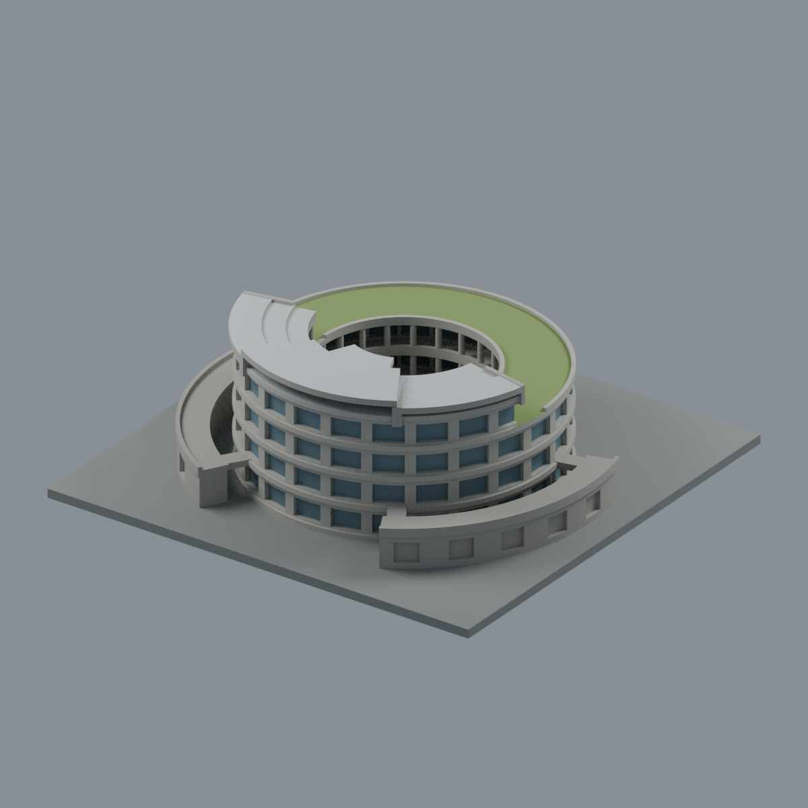

# 客家文化學院圓樓

國立陽明交通大學｜六家校區。完整主圓樓及相連外圈低翼之外觀近似；非測繪，鄰近古厝與永昌宮不包含。

## 最新六材質外觀版（2026-10-20）

| 正面原幾何配色 | 後側與高扇形屋頂 |
|---|---|
|  |  |

[來源界線與四視角](appearance/README.md) · [表面色 3MF](appearance/hakka-appearance.3mf) · [可編輯場景](appearance/scene.blend)

依官方內院與空拍照片登錄後扇形屋頂、主環凹窗和前露臺草坪代理；不假造草地與步道精細邊界，外圈低翼混合面中性。原STL與歷史QA不變，不是新增幾何。[原單色正面](previews/front.png)／[原單色背面](previews/rear.png)

[俯視](previews/top.png) · [STL](model.stl) · [可編輯 Blender 網格](scene.blend) · [參數重建](build_model.py)

## 範圍與來源

- 開放環形中庭與各層真實凹入走廊
- 前低環3層與後高環4層，中央扇屋頂抬高
- 後方突出會議／攝影棚空間、錯高扇形棚頂
- 外圈分離低翼、短連橋、側階梯與前入口棚

- 外圈低翼背面個別門窗未逐扇調查，已簡化
- 屋頂扇形分段與坡度為實拍視覺估計，未重建精確鋼構
- 空調、細欄杆、植栽、地下空間及校外古蹟不包含

[來源與支持特徵](sources.json) 包含精確公開 URL、查閱日及照片年代不確定性。第三方原照片／PDF不隨本模型散布。這是自建的外觀近似，非測繪、非精密尺寸資料。色彩僅為網格預覽材質。

## 列印與比例

- 單位：毫米；含底座尺寸 150.00 × 147.00 × 50.40 mm，最大邊150 mm，各館獨立比例。
- 底座朝下；不要用切片軟體自動修補來掩蓋幾何問題。請自行檢查工具路徑與首層。
- 深挑空、走廊、棚頂及窗洞上緣可能需要局部支撐。細柱、窗框與低欄牆已為縮印加粗；搬運與拆支撐仍需小心。
- 0.2 mm輪廓檢查採固定 z=0.071 mm 起始以避開共面退化，本件共 252 層全部degree 2閉合、個別及組合Polygon有效，無修補輸入輪廓。
- canonical thin v2以1 mm層距、0.8 mm參考寬度形態opening作輔助篩檢，最大面積損失 0.142%。此數值不是全面最小壁厚或噴嘴可印保證。
- 數位QA不等於Cura／Prusa真實工具路徑，未做實體試印，不宣稱免支撐或保證可印。

## 重建與验证

Python 3.12，先依 [requirements.txt](requirements.txt) 安裝套件，另需Blender 4.3.2或相容版本。

依序執行 python build_model.py、blender -b -t 2 -P render_preview.py、python validate_model.py、python check_layers.py、python check_valid_sections.py、python thin_canonical_v2.py。建模階段將CSG輸出在float32精度下正規化；驗證直接讀原始交付STL，不作修復。

- [原STL、重建SHA及Blend對比](validation.json)
- [0.2 mm閉合輪廓](layer-check.json) · [有效Polygon](valid-sections.json)
- [thin v2報告](thin-feature-check.json) · [QA合併摘要](qa-summary.json)
- [逐檔SHA256](SHA256SUMS.txt)

scene.blend由實際交付STL匯入，內含可編輯三角網格；完整參數來源是build_model.py。預覽亦由同一STL生成。
