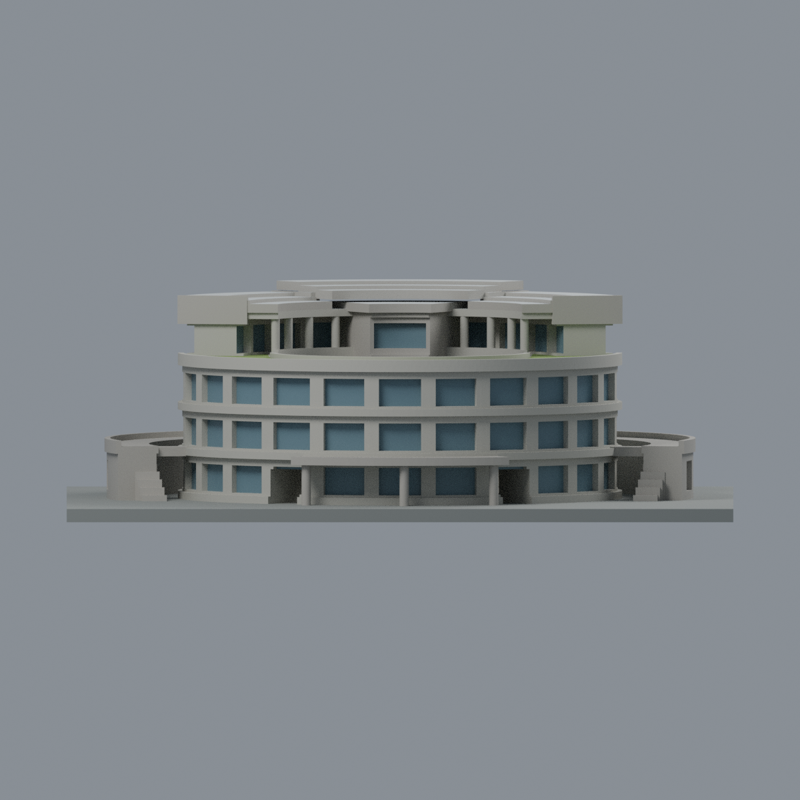
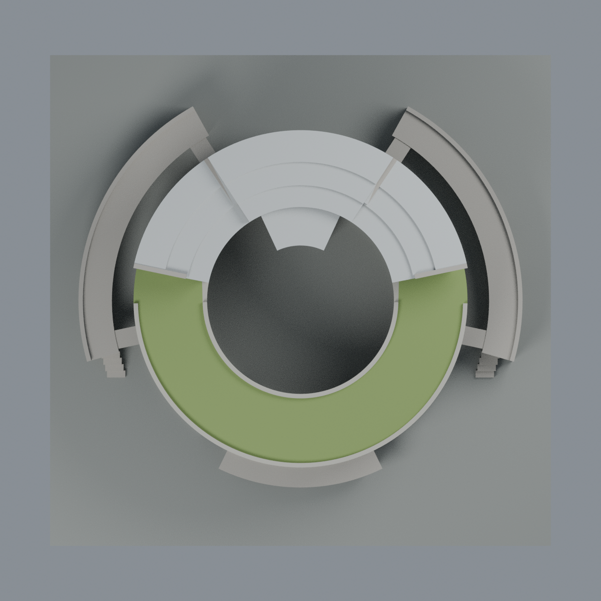

# 客家學院圓樓：六材質外觀版

沿用原 **35,084 三角面／17,374 頂點**，不改原 STL 位元、座標、面序或幾何；這是既有模型外觀改版，不增加模型包數。

| 正面 | 後側與高扇形屋頂 |
|---|---|
|  |  |
|  |  |

[表面色 3MF](hakka-appearance.3mf) · [可編輯 Blender](scene.blend) · [材質色表](palette.json) · [逐面指派與依據](face-materials.json) · [原 STL](../model.stl)

## 來源與配色邊界

親自查看[陽明交大官方校園景色頁](https://www.nycu.edu.tw/nycu/ch/app/artwebsite/view?id=314&module=artwebsite&serno=a78dc404-e439-4dd8-80fc-68f946a5d222)的[客家學院內院照片](https://www.nycu.edu.tw/userfiles/nycuch/images/20230920124555631.jpg)與[客家學院圓樓空拍](https://www.nycu.edu.tw/userfiles/nycuch/images/20230920124608504.jpg)。檔名數字與頁尾版權年份不是拍攝日期；精確拍攝時刻未確認，不宣稱 2026 現況。來源影像不隨模型或備份散布。

- 依空拍登錄高後扇形屋頂、較低前半圓露臺與中央向內突出會議鼓室；只給原有扇形屋頂上表面銀灰色，未新增屋縫、設備或太陽能板。
- 前露臺草坪色僅限既有女兒牆之間的頂面；牆頂、立面和展示底板不染綠。**原三角形跨越草坪與窄步道，草坪色是整片露臺的粗略代理，不聲稱精確草地／鋪面邊界**。不細分原網格，也不追造紅橘步道。
- 外側低翼頂面的原三角形橫跨草地與鋪面，無法在原面級精度內可靠分離，故**整個低翼頂面保持中性**，不為了綠屋頂效果整片染綠。中央庭院地坪與周邊草地亦未新增。
- 原實際徑向凹窗的背面給低飽和藍灰玻璃代理，包括可辨識的中央鼓室內向凹窗；並非把整個環形牆帶都當玻璃。窗數、層數與曲率仍沿用原簡化模型，不代表測量。
- 環形梁板、柱與主環牆體採混凝土近似色；可見內院材料延續至原重複環形構件屬明示的重複構造推估，不宣稱每一面都有照片。未分離的木色面板、欄杆細線及隱蔽區域不新增細節。
- 色值未校正，不能當建材色票；玻璃為不透明展示代理，非透明材質或採光模擬。沒有新增文字、招牌、植栽、設備與精細紋理。

[原完整來源](../sources.json) · [原幾何與年代界線](../README.md) · [本次來源覆核](qa/source-review.json)

## 重建與核驗

安裝 [依賴](source/requirements.txt)，Blender 使用 4.3.2。由本資料夾上層提供原 model.stl：

1. `python appearance/source/build_appearance.py`
2. `python appearance/source/verify_exchange.py`
3. `blender -b -t 3 --python-exit-code 1 -P appearance/source/render_appearance.py`
4. `blender -b -t 3 --python-exit-code 1 -P appearance/source/verify_scene.py`

[獨立重建 ZIP](rebuild-source.zip)含原 STL、四支程式及依賴，不含第三方照片；不取代原建模腳本。[逐檔 SHA256](SHA256SUMS)

[交換／拓撲 QA](qa/exchange-validation.json)核對原座標與面序、全部面材質、單連通、有向水密邊、頂點 link 單環、正體積與零退化／重複面；lib3mf 嚴格讀取零警告，實際編輯單材質再存讀，其他材質及面指派不變。SDK 六位小數量化誤差另列。

[Blender 存讀與編輯](qa/scene-validation.json) · [渲染記錄](qa/render-manifest.json) · [獨立重建](qa/rebuild-validation.json)

## 製造限制照舊

尺寸仍為 150 × 147 × 50.4 mm；原 STL、建模程式、場景及歷史 QA 保留。原層檢與薄特徵檢查本次未重跑，不能由材質 QA 代替。

3MF 是同一網格的表面色，不是六個封閉分色實體、切片專案、噴頭映射或 G-code。切片 GUI、多材料路徑與實體列印未測；環形露臺、內院欄板、扇形挑簷及細柱仍須評估材料、支撐及拆除風險，沒有保證可印或免支撐。
