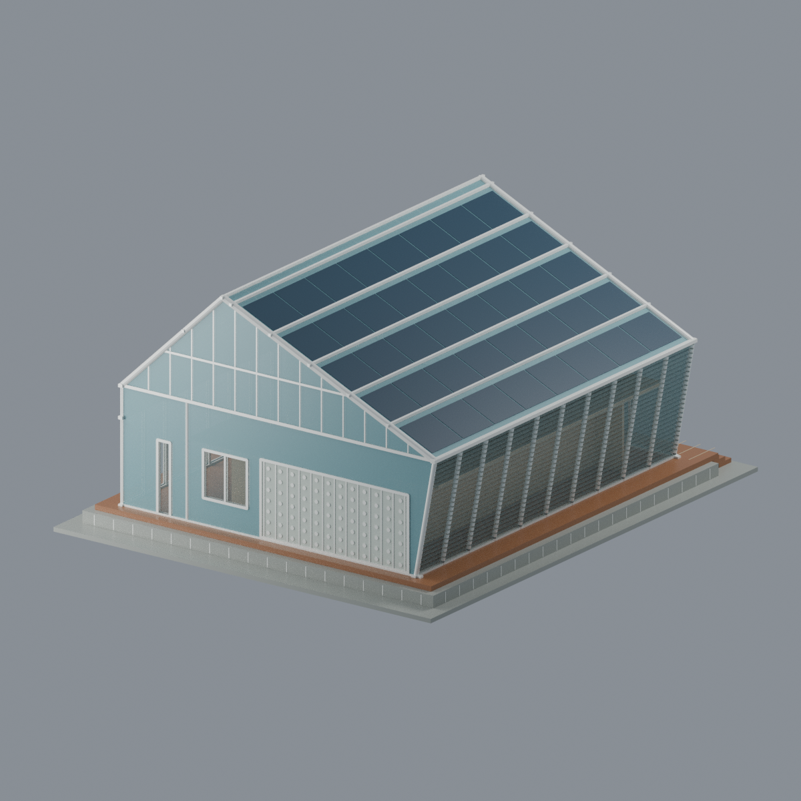
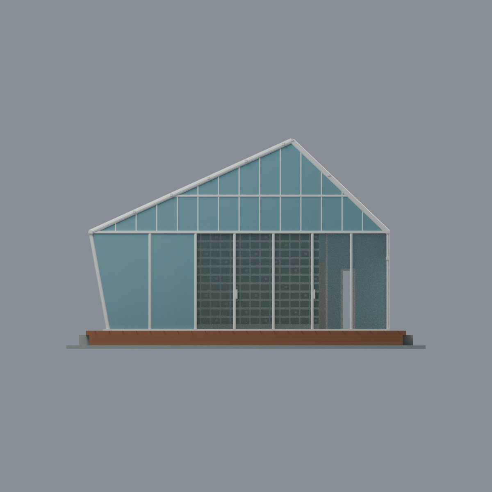
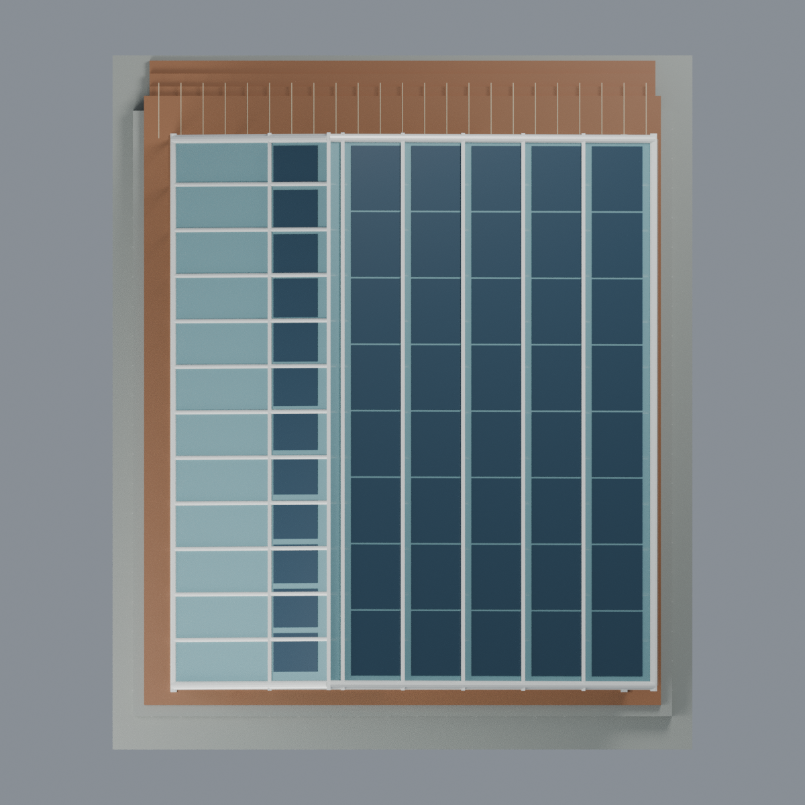
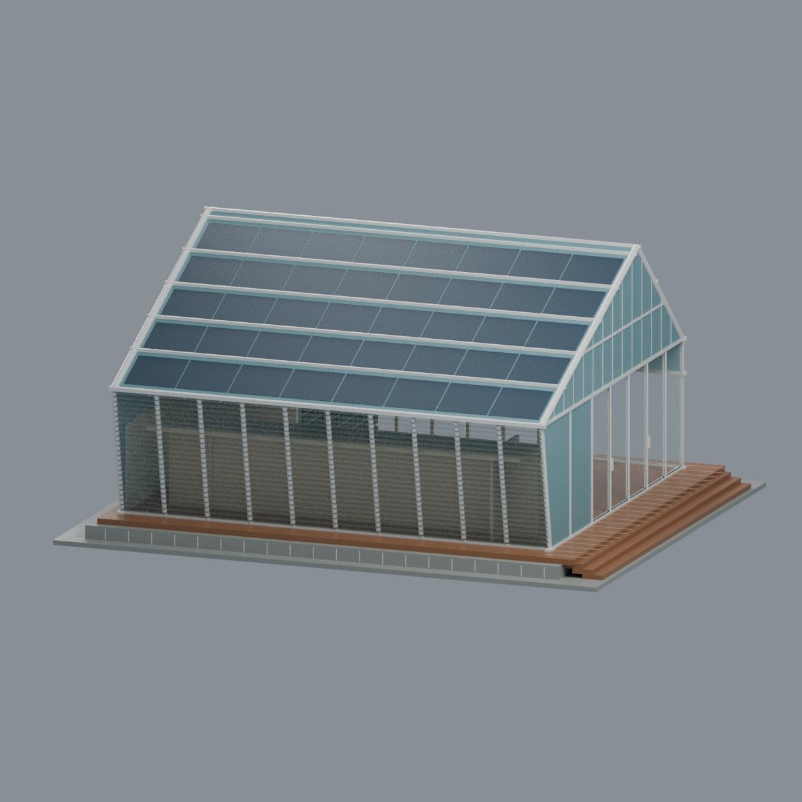

# 台積電交大能源教育館（2017永久版蘭花屋）

## 模型預覽

| 模型預覽 | 模型預覽 | 模型預覽 |
| :---: | :---: | :---: |
|  |  |  |

**國立陽明交通大學｜新竹科學園區校外教育研究場域的完整單棟外觀近似。** 館址為新竹市園區二路101號、台積新竹廠區，**不是光復校區**。採館方提供的完成照片與建築研究團隊論文所示的臺灣永久版；不是2014年法國凡爾賽競賽暫設原型，也不是2026年現況測繪。


## 保留的完整外部構成

- 白框玻璃外殼、矩形主要輪廓與**偏脊非對稱雙坡**：北坡較短較陡，南坡較長較緩，不是對稱人字棚。
- 東入口山牆下部為寬滑門玻璃面及旁側透光面；採**滑門關閉**的展示狀態，保留木露臺、寬階及石色台基。
- **北長面直立**，下層玻璃與上部連續橫向採光帶分明；**南長面上緣向外傾斜**，白色斜柱與水平百葉之間保留真實幾何間隙，不以厚牆代替。
- 西背山牆不同於東入口：保留窄直開口、小雙分窗及較寬的瓶磚式透光帶；不是盲牆，也沒有套用南側的開放百葉。窄直開口的確切用途未獲證實，未稱為特定服務門。
- 兩屋面各有不同的深色能源面板／透光分區。**完成空拍優先於論文剖切示意**，沒有把示意圖的全部格數或開孔當成竣工事實。
- 透明外殼內留有簡化的**L形低生活核、挑高綠核及植生牆**，不是空棚，也沒有將全棟填成實心塊。

## 尺度與近似界線

全部長寬高、屋脊偏移、斜角、柱厚與構件位置均由照片比例推估。程式使用毫米作**顯示／輸出單位，不代表經量測的建築比例尺**。官方列出的183.7㎡是樓地板面積，不能據此宣稱已測得外長、外寬或高度；最終網格尺寸見[QA](QA.md)。

模型目前以**25片南側百葉、5條南長坡深色帶（每條8個近似模組）及北短坡上緣12個近似深色模組**表現分區。這些是可編輯的模型細分，**不是來源證實的實物精確數量**。窗框、瓶磚圓端、木板／石縫、植栽密度及花色也作規則化簡化，不宣稱逐格復原。室內家具、設備、微小五金、文字標示、機電及不可見基礎未重建。

最下方另加一片薄矩形列印底板；**它不是實際基地界線或土地形狀**。原建築的木露臺與石色台基則保留。背景灰色巨大鄰棟、停車場、周邊公共藝術、整個園區與即時IoT／監控系統不在模型範圍內。

2017-04-21是永久館啟用日期；2021是論文刊載年代。**兩者都不是每張來源照片的拍攝日期。** 四張館方照片無EXIF日期，論文照片的個別拍攝日期亦未知；2026-10-22僅為研究取得資料日期，不保證當日建築現況。[來源及界線](SOURCES.md)。

## 材質、編輯與列印限制

Blend與3MF保留10種逐面材質，包含玻璃／透光板的Alpha。**透明感只是顯示材質：全部玻璃仍有實體厚度，STL無顏色亦無透明度。** 不同3MF檢視器或切片器可能忽略Alpha，實際材料是否透光另取決於列印方法；不能把閉合玻璃面當作幾何空氣。

交付為融合網格，可編輯頂點、逐面材質及生成參數，**不是已拆分可動門窗或零件的裝配套件**。若改動幾何或材質，應重新生成五圖並更新相關驗證與hash，不沿用舊審查結果。

**未實印，不保證免支撐。** 百葉、薄玻璃殼、屋面、窗格、瓶磚花紋及內部板件存在薄件、橋接、懸挑與支撐拆除風險。原始拓樸、全局0.2mm切層、局部薄件／空氣佔據與懸挑報告保留警告；水密或單連通不等於強度、支撐或實印認證。請依設備、材料、縮放與擺向自行切片並測試。[完整QA](QA.md)。

## 交付內容

| 檔案 | 用途 |
|---|---|
| `model.stl` | 毫米網格，無色、無透明度 |
| `model.3mf` | 相同幾何及10種逐面材質，含顯示Alpha |
| `scene.blend` | 可編輯網格、材質、相機及燈光；無來源照片貼圖 |
| `build_model.py`、`render_model.py` | 參數生成及實際交付mesh五視圖 |
| `mesh.json`、`palette.json` | 幾何及材質對照 |
| `qa_model.py`、`check_features.py`、`verify_*.py` | 原始拓樸、切層、局部薄件／空氣及交換格式驗證 |
| `rebuild.py` | 隔離重建四個核心檔及五PNG，逐檔比較bytes |
| `QA.md`、`qa/`、`qa-*.json` | 數值證據、警告及最終來源終審 |
| `SOURCES.md`、`sources.json` | 來源、日期、用途及私有原圖hash，不含原圖 |
| `SHA256SUMS` | 包內檔案SHA256清單 |

## 五個最終網格實渲圖

[東北前斜視](previews/front.png) · [西南背斜視](previews/rear.png) · [東入口立面](previews/elevation.png) · [俯視／屋面分區](previews/top.png) · [東南斜視／外傾百葉](previews/left_oblique.png)

| 模型預覽 | 模型預覽 | 模型預覽 |
| :---: | :---: | :---: |
| 西南背斜視<br> | 東入口立面<br> | 俯視／屋面分區<br> |
| 東南斜視／外傾百葉<br> |  |  |

五圖來自同一交付網格，不是來源照片拼貼、AI概念圖或實印成品照。

## 重建與驗證

環境與版本見`requirements.txt`，Blender為另行安裝的可執行程式。使用相同依賴、Blender版本與CPU渲染設定，從模型目錄執行：

```bash
python build_model.py
python qa_model.py
python check_features.py
blender -b -t 8 --python-exit-code 1 --python render_model.py
python verify_exchange.py
blender -b -t 8 --python-exit-code 1 --python verify_scene.py
blender -b -t 8 --python-exit-code 1 --python verify_render.py
python rebuild.py --output ../independent-rebuild-new --blender blender --threads 8
python verify_package.py
```

`rebuild.py`要求不存在的新輸出目錄，並比較`model.stl`、`model.3mf`、`mesh.json`、`palette.json`與全部五個PNG的bytes。最終來源審查另以STL及五PNG的hash綁定，不是建築實測證書；數值結果以交付的QA檔為準。

原設計、攝影及論文之權利仍屬原權利人；本包不附來源影像、PDF、裁圖或HTML。模型授權見`LICENSE`，不移轉第三方素材權利。
