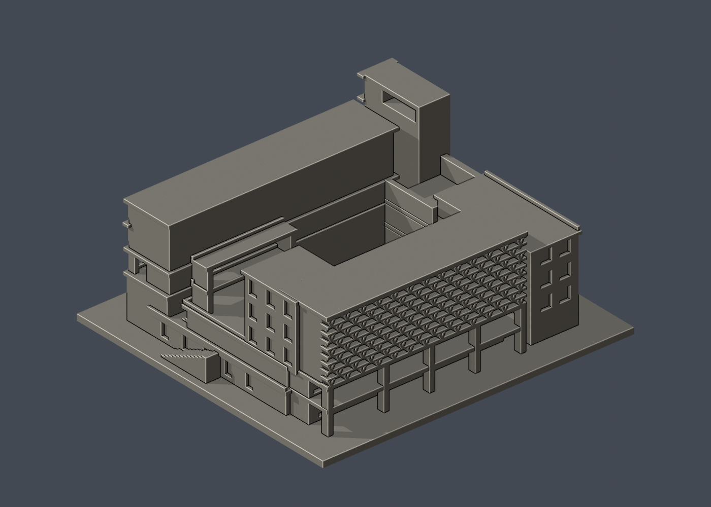

# 致遠樓產學共創中心

## 模型預覽

| 模型預覽 | 模型預覽 | 模型預覽 |
| :---: | :---: | :---: |
| 實際 STL 正面  | 實際 STL 背面  |  |

國立陽明交通大學｜歸仁校區。主雙翼、相連翼樓、露天中庭及錯層露臺之外觀近似；非測繪，局部內院立面與上層連橋位置/深度推估。

[俯視](previews/top.png) · [STL](model.stl) · [可編輯 Blender 網格](scene.blend) · [參數重建](build_model.py)

| 模型預覽 | 模型預覽 | 模型預覽 |
| :---: | :---: | :---: |
| 俯視  |  |  |

## 範圍與來源

- 街道面雙層豎向遮陽、側邊突出六層梯塔
- 另一翼三層高的九排水平折板遮陽，截短加厚細尖端
- 兩層真柱廊挑空、中央露天院落
- 不同高低翼、錯層露臺、側邊大風廊開口與室外階梯

- 量體以公開首層平面與竣工實拍推估；未測繪各層面積和精確深度
- 未見的主要翼內院窗式不鏡像補造，保留簡化牆面
- 上層橋位、連接柱與小露臺深度為照片近似；不作精確構造或工程用途
- 細欄杆以連接的低矮加厚牆替代；植栽、地下室、室內機電、太陽光電與完整景觀不包含
- 正背為本模型相反兩面視角，未聲稱地理南北

[來源與支持特徵](sources.json) 包含精確公開 URL、查閱日及照片年代不確定性。第三方原照片／PDF不隨本模型散布。這是自建的外觀近似，非測繪、非精密尺寸資料。色彩僅為網格預覽材質。

## 列印與比例

- 單位：毫米；含底座尺寸 150.00 × 140.00 × 63.40 mm，最大邊150 mm，各館獨立比例。
- 底座朝下；不要用切片軟體自動修補來掩蓋幾何問題。請自行檢查工具路徑與首層。
- 深挑空、走廊、棚頂及窗洞上緣可能需要局部支撐。細柱、窗框與低欄牆已為縮印加粗；搬運與拆支撐仍需小心。
- 0.2 mm輪廓檢查採固定 z=0.071 mm 起始以避開共面退化，本件共 317 層全部degree 2閉合、個別及組合Polygon有效，無修補輸入輪廓。
- canonical thin v2以1 mm層距、0.8 mm參考寬度形態opening作輔助篩檢，最大面積損失 0.311%。此數值不是全面最小壁厚或噴嘴可印保證。
- 數位QA不等於Cura／Prusa真實工具路徑，未做實體試印，不宣稱免支撐或保證可印。

## 重建與验证

Python 3.12，先依 [requirements.txt](requirements.txt) 安裝套件，另需Blender 4.3.2或相容版本。

依序執行 python build_model.py、blender -b -t 2 -P render_preview.py、python validate_model.py、python check_layers.py、python check_valid_sections.py、python thin_canonical_v2.py。建模階段將CSG輸出在float32精度下正規化；驗證直接讀原始交付STL，不作修復。

- [原STL、重建SHA及Blend對比](validation.json)
- [0.2 mm閉合輪廓](layer-check.json) · [有效Polygon](valid-sections.json)
- [thin v2報告](thin-feature-check.json) · [QA合併摘要](qa-summary.json)
- [逐檔SHA256](SHA256SUMS.txt)

scene.blend由實際交付STL匯入，內含可編輯三角網格；完整參數來源是build_model.py。預覽亦由同一STL生成。
