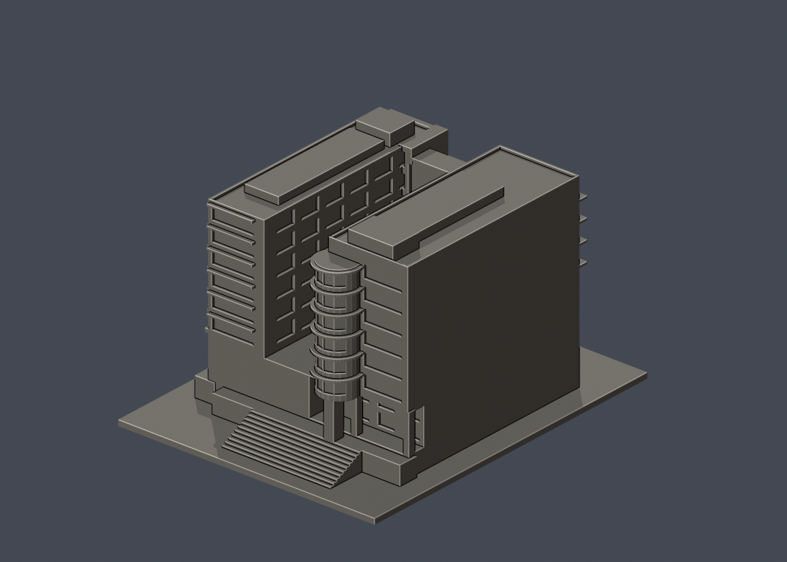

# 圖書資訊暨研究大樓

國立陽明交通大學｜陽明校區。完整主量體的公開照片外觀近似；入口、球場側與階梯端細節有實拍支持，未見的外侧長立面及後中段保留簡化牆面，非完整立面紀錄或測繪。

| 實際 STL 正面 | 實際 STL 背面 |
|---|---|
|  |  |

[俯視](previews/top.png) · [STL](model.stl) · [可編輯 Blender 網格](scene.blend) · [參數重建](build_model.py)

## 範圍與來源

- 寬窄、高低不同的兩翼研究量體與三層圖書館基座
- 主入口三層高穿空棚架、圓柱及較低的第二雨棚
- 正面兩列凸出窗盒與六層窗帶、球場侧真凹進柱廊
- 階梯端弧形凸出梯塔在寬翼內側後端、下方柱廊挑空與寬階梯；非旁邊生物醫學大樓的大弧形玻璃塔
- 上部高架中庭保留深空間，第三層頂採光頂不填滿整個中庭高度

- 雙翼進深、前端玻璃連廊、內院窗距、階梯長度與地形高差皆由照片推估，沒有平面測繪資料
- 未見的外側長立面及未見區域刻意不補對稱窗陣；簡化牆面不代表原建築沒有窗
- 屋頂細機電、室內、地下室、景觀與樹木不包括；小雨遮/窗框為縮印加厚
- 原校方生科院資料稱2006年落成啟用，建築師項目頁列2009完成；並列而不任選其中之一作精確竣工年
- 各實拍未標完整摄影日期；網站2024媒體路徑、2022上傳日均不當拍攝日
- 正背為模型的相對視角，沒有宣稱地理南北正射投影

[來源與支持特徵](sources.json) 包含精確公開 URL、查閱日及照片年代不確定性。第三方原照片／PDF不隨本模型散布。這是自建的外觀近似，非測繪、非精密尺寸資料。色彩僅為網格預覽材質。

## 列印與比例

- 單位：毫米；含底座尺寸 119.66 × 150.00 × 92.36 mm，最大邊150 mm，各館獨立比例。
- 底座朝下；不要用切片軟體自動修補來掩蓋幾何問題。請自行檢查工具路徑與首層。
- 深挑空、走廊、棚頂及窗洞上緣可能需要局部支撐。細柱、窗框與低欄牆已為縮印加粗；搬運與拆支撐仍需小心。
- 0.2 mm輪廓檢查採固定 z=0.071 mm 起始以避開共面退化，本件共 462 層全部degree 2閉合、個別及組合Polygon有效，無修補輸入輪廓。
- canonical thin v2以1 mm層距、0.8 mm參考寬度形態opening作輔助篩檢，最大面積損失 0.071%。此數值不是全面最小壁厚或噴嘴可印保證。
- 數位QA不等於Cura／Prusa真實工具路徑，未做實體試印，不宣稱免支撐或保證可印。

## 重建與验证

Python 3.12，先依 [requirements.txt](requirements.txt) 安裝套件，另需Blender 4.3.2或相容版本。

依序執行 python build_model.py、blender -b -t 2 -P render_preview.py、python validate_model.py、python check_layers.py、python check_valid_sections.py、python thin_canonical_v2.py。建模階段將CSG輸出在float32精度下正規化；驗證直接讀原始交付STL，不作修復。

- [原STL、重建SHA及Blend對比](validation.json)
- [0.2 mm閉合輪廓](layer-check.json) · [有效Polygon](valid-sections.json)
- [thin v2報告](thin-feature-check.json) · [QA合併摘要](qa-summary.json)
- [逐檔SHA256](SHA256SUMS.txt)

scene.blend由實際交付STL匯入，內含可編輯三角網格；完整參數來源是build_model.py。預覽亦由同一STL生成。
