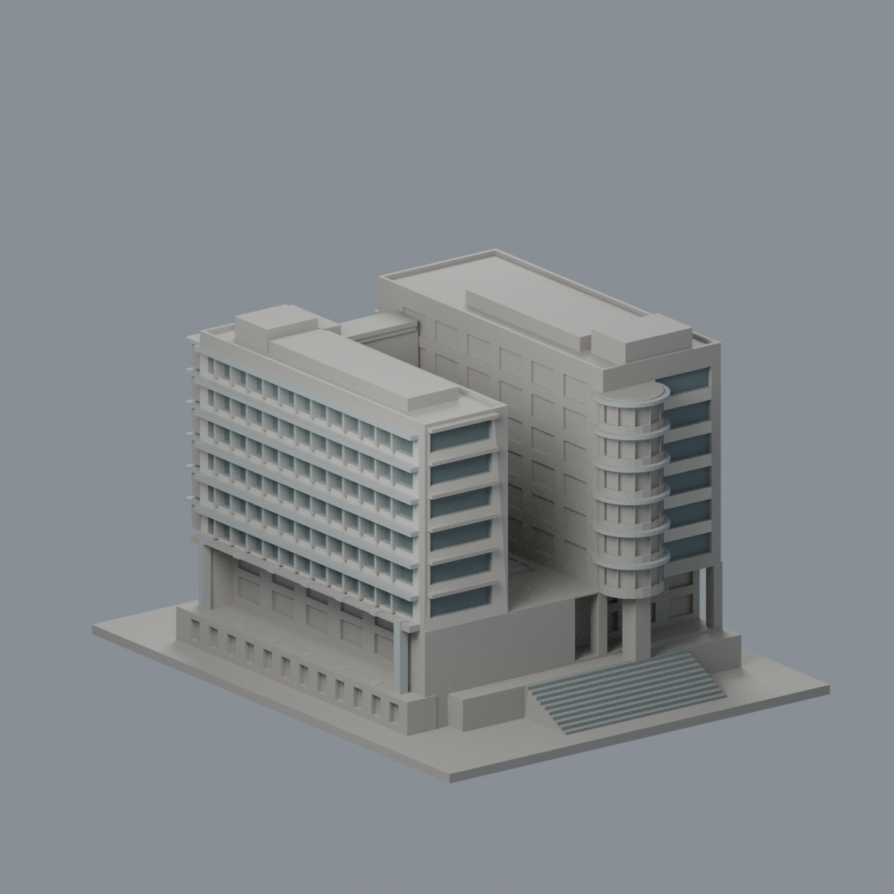
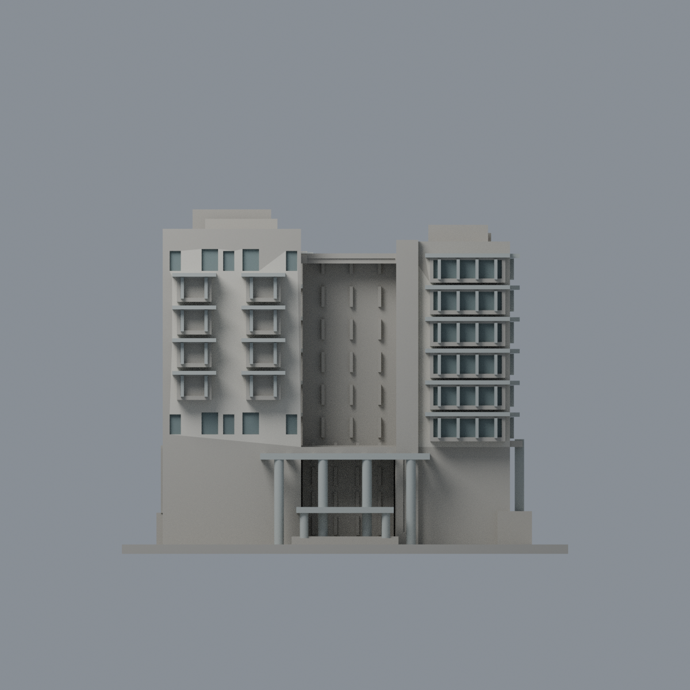
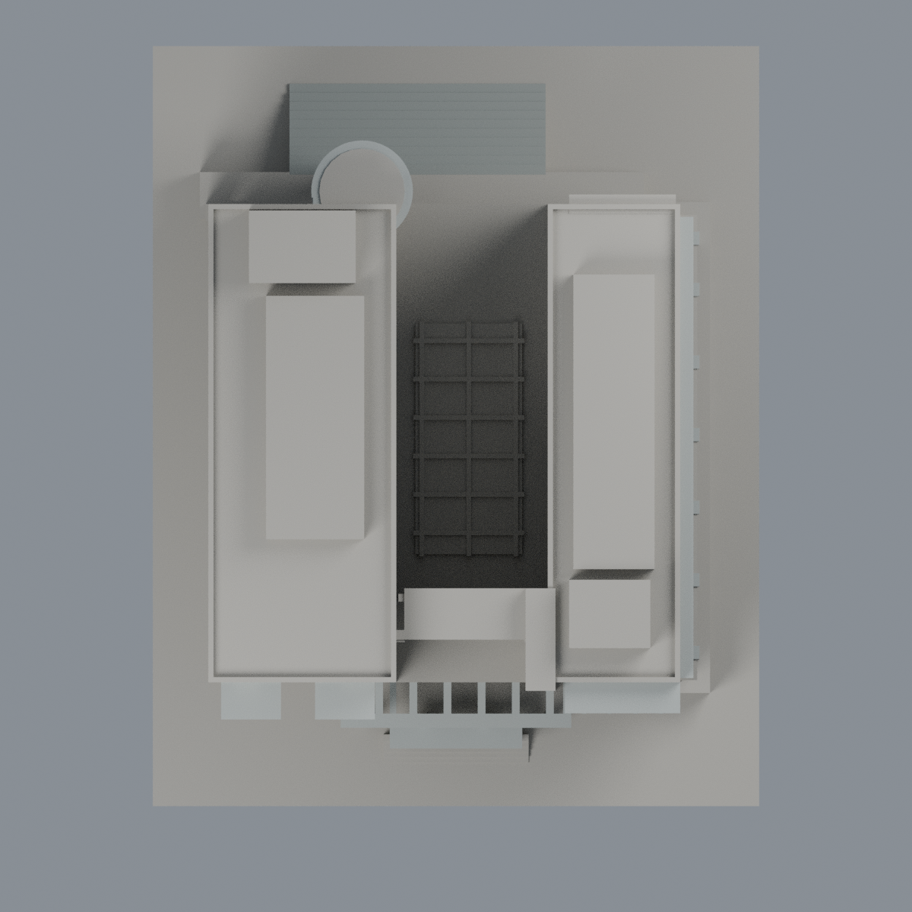

# 陽明交大陽明圖資暨研究大樓有限配色：五材質外觀版

沿用原 **11,988 三角面／5,890 頂點**，不改原 STL 位元、座標、面序或幾何；這是既有模型外觀改版，不增加模型包數。

| 正面 | 來源支持後端／混合窗區中性 |
|---|---|
|  |  |
|  |  |

[表面色 3MF](nycuyangming-appearance.3mf) · [可編輯 Blender](scene.blend) · [材質色表](palette.json) · [逐面指派與依據](face-materials.json) · [原 STL](../model.stl)

## 來源與配色邊界

親看 EDS 建築師五張完整實拍、原單色網格與生成器。[精確 URL、SHA 與日期欄](qa/source-review.json)。五照均無 EXIF Original／修改日期；媒體路徑 2024/08 不是拍攝日。原歷史文件之建築師工程 2002–2009 與校方圖書館 2006 啟用敘述並列保留，不能由此推定照片日期或宣稱 2026 現況。照片私有研究，不入包。

- 日間鳥瞰支持低飽和暖灰／象牙色磁磚，不將另兩張偏紫色調烘焙成紫牆。僅可註冊前端、右長側與實拍後端原牆面採此代理；未見左外長牆、隱蔽連接面、屋頂與設備中性。
- 右前突出窗、右長窗帶、前窄小窗及後端離散窗的原凹背採灰綠窗區代理，不聲稱逐玻璃量測或實景所有細框均已建出；原窗梃、遮陽唇、入口高低圓柱與鏤空棚採銀灰，同構件向未見面作有界材料延伸。
- **左前凸窗凹背含實窗裙、中央 spine、院內窗廊、下層長玻璃／實裙混面及圓塔窗背保持中性**，不一律染玻璃。圓塔只有原已分離遮陽圓盤採銀灰。院內照片屋頂採光罩是圓頂，原模型是扁平板，故不以玻璃色冒充相同形狀。
- 後端照片支持原磁磚牆、離散窗與灰階梯；下方原粗窗區包含實牆而保守中性。所有材料只指派原完整三角面，不新增切面，不以重心產生斜色界，也不補磁磚縫、文字、設備與人物。
- 現有翼寬、層高、框線及樓梯為原照片近似，非實測。這是有限外觀改善，非新幾何或製造放行。

[原幾何與歷史來源限制](../README.md)

## 重建與核驗

安裝 [依賴](source/requirements.txt)，Blender 使用 4.3.2。由本資料夾上層提供原 model.stl：

1. `python appearance/source/build_appearance.py`
2. `python appearance/source/verify_exchange.py`
3. `blender -b -t 3 --python-exit-code 1 -P appearance/source/render_appearance.py`
4. `blender -b -t 3 --python-exit-code 1 -P appearance/source/verify_scene.py`

[獨立重建 ZIP](rebuild-source.zip)含原 STL、四支程式及依賴，不含第三方照片；不取代原建模腳本。[逐檔 SHA256](SHA256SUMS)

[交換／拓撲 QA](qa/exchange-validation.json)核對原座標與面序、全部面材質、單連通、有向水密邊、頂點 link 單環、正體積與零退化／重複面；lib3mf 嚴格讀取零警告，實際編輯單材質再存讀，其他材質及面指派不變。SDK 六位小數量化誤差另列。

[Blender 存讀與編輯](qa/scene-validation.json) · [渲染記錄](qa/render-manifest.json) · [獨立重建](qa/rebuild-validation.json)

## 製造限制照舊

尺寸仍為 119.66 × 150 × 92.36 mm；原 STL、建模程式、場景及歷史 QA 保留。原層檢與薄特徵檢查本次未重跑，不能由材質 QA 代替。

3MF 是同一網格的表面色，不是各材質各自封閉的分色實體、切片專案、噴頭映射或 G-code。切片 GUI、多材料路徑與實體列印未測；柱頭、屋簷、窗框及薄邊仍須評估材料、支撐及拆除風險，沒有保證可印或免支撐。
