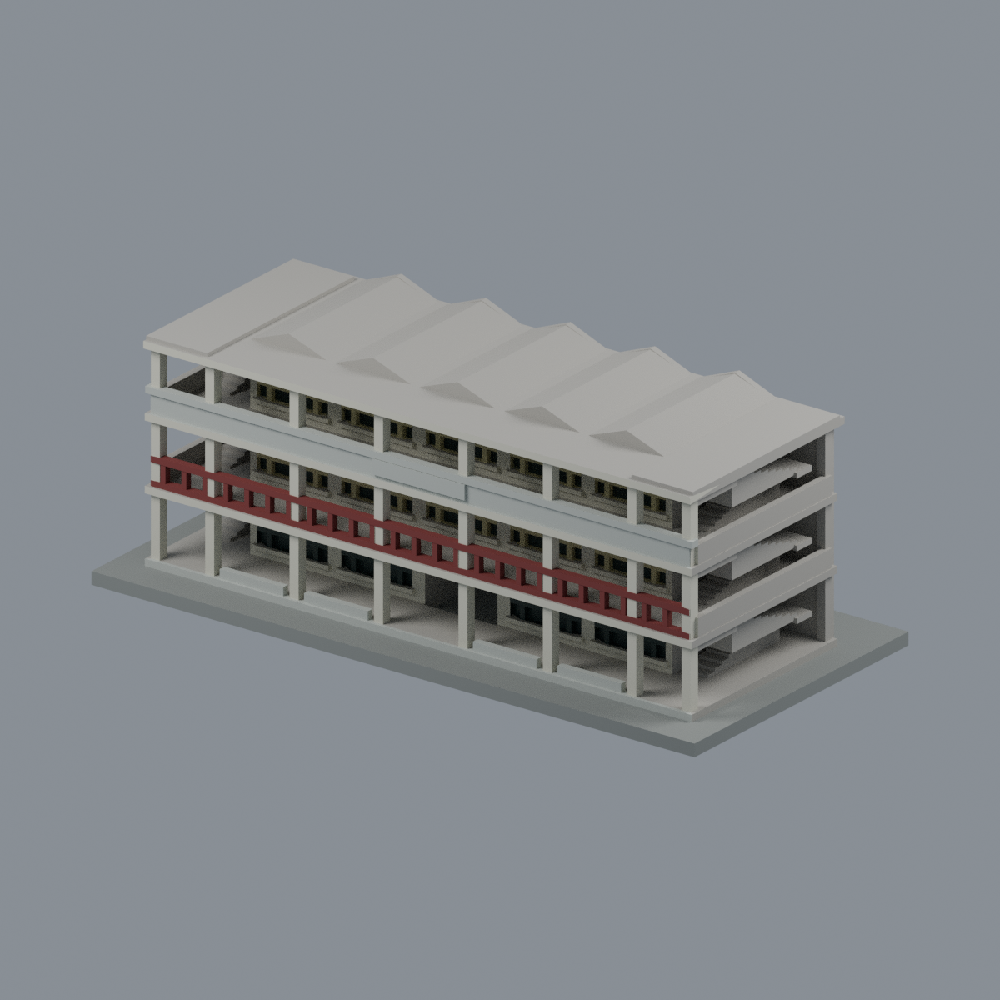
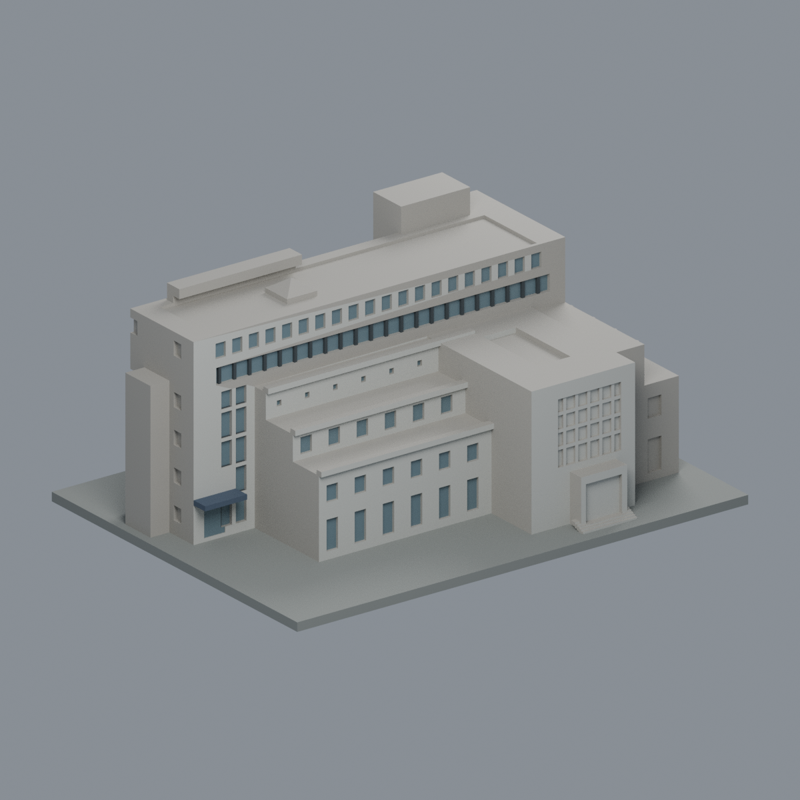
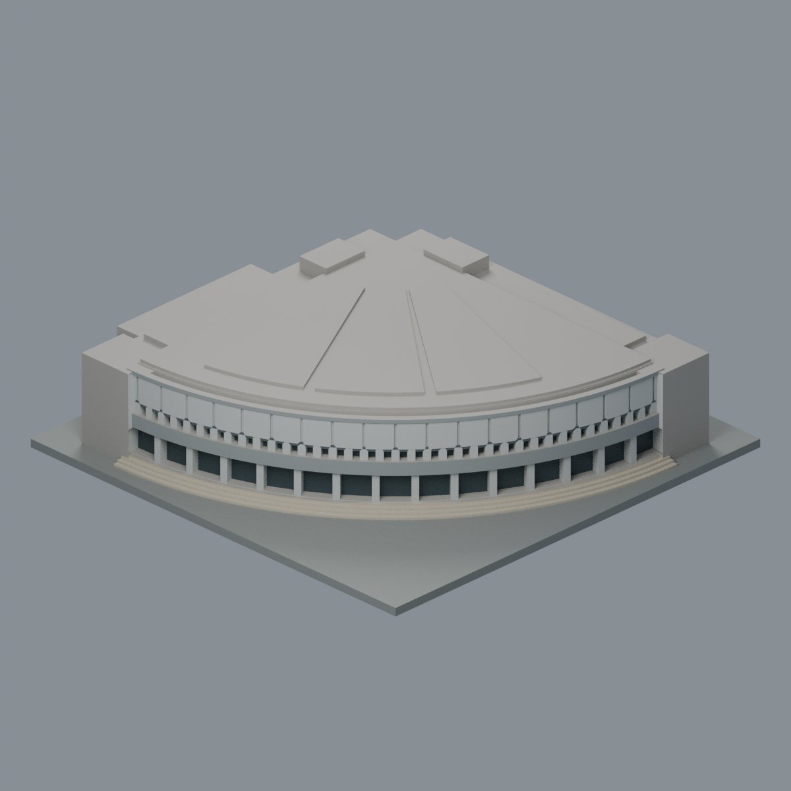
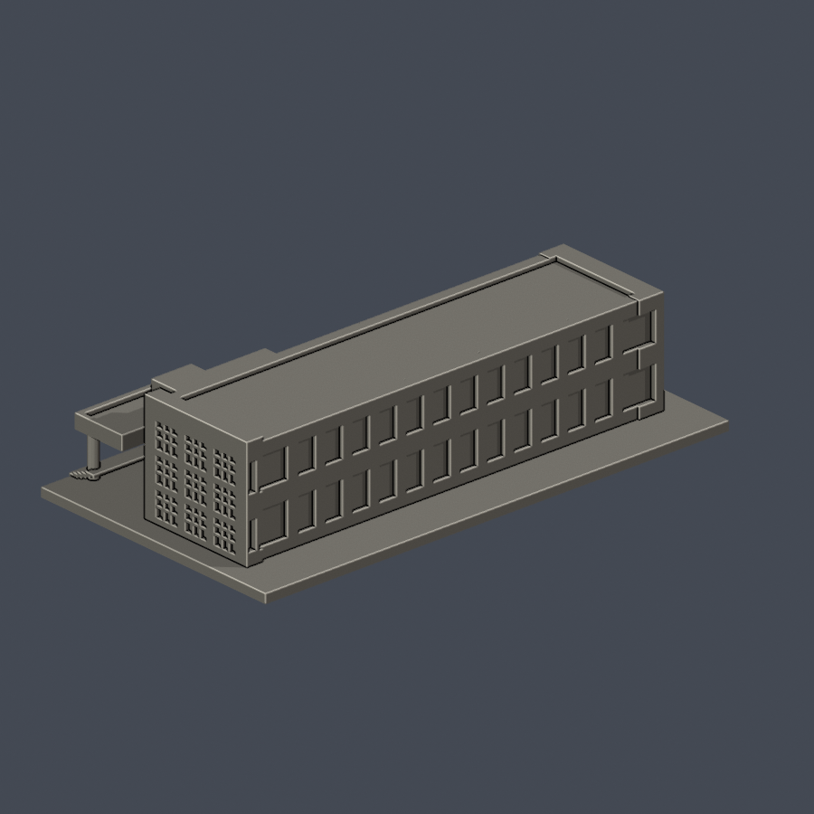
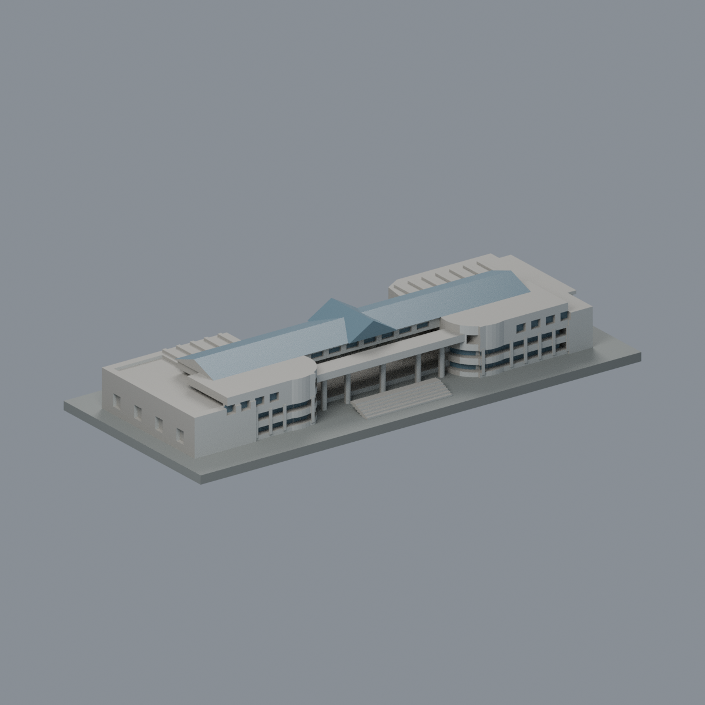

# 國立雲林科技大學

目前6件公開資料自建外觀模型，尚未全校完成。每件含底座最長150毫米、獨立比例，附參數腳本、可編輯Blender網格及數位QA。

[斗六校區](斗六校區/README.md) · [模型索引](model-index.json) · [研究續接清單](coverage/README.md)

| 模型 | 模型 | 模型 |
| :---: | :---: | :---: |
|  [觀雲閣（水塔）](斗六校區/buildings/yuntech-clouds-pavilion/README.md) |  [雲旭樓主樓段](斗六校區/buildings/yuntech-yunsyu-main-block/README.md) |  [圖書館暨藝術中心建築群](斗六校區/buildings/yuntech-library-art-center/README.md) |
|  [雲泰表演廳](斗六校區/buildings/yuntech-yuntay-hall/README.md) |  [資訊大樓雙層辦公翼與入口段](斗六校區/buildings/yuntech-computing-office-wing/README.md) |  [學生活動中心（含相連表演廳）](斗六校區/buildings/yuntech-student-activity-center/README.md) |

每格是不同模型；各資料夾附同件正背並排、頂視、STL、Blend、來源與QA。

## 已做範圍與限制
- 觀雲閣未見基座背面按對稱近似；雲旭樓只做主樓段，斜廊／工場與附屬群待續作。
- 圖書館暨藝術中心同群一件，依2008–2014照片及2021空拍；雲泰依2021整修後2022／2024照片。
- 資訊大樓僅雙層辦公翼及入口段，排除三層長翼、國際會議廳；2015外觀，背向窗高近似。
- 學生活動中心包含相連表演廳，與雲泰廳不同；依2014／2017兩面及2021空拍，2024相簿續核可見形態。
- 113年度報告所列圖書館新增光電、觀雲閣微水力設備仍省略；114年度報告所列資訊大樓屋頂光電亦未納入。不以報告年度當精確施工完成日。
- 原4件STL、Blend、腳本、實際渲染與QA沿用已核版本；這批新增2件，未宣稱全校完成。
- 55個研究項目不是55棟；使用單位、宿舍群、局部段和範圍項不可直接加總建物棟數。

## 列印與QA
毫米，底座朝下；門廊、橋廊、簷口、階梯與凹空可能需支撐。各件已核原STL法向／拓樸、重建SHA、Blend幾何、每0.2毫米有效輪廓及canonical v3薄特徵篩檢。數位檢查不等於實體試印或Cura／Prusa工具路徑，不保證免支撐。參考照片和PDF不隨包散布，sources只保留公開URL。
