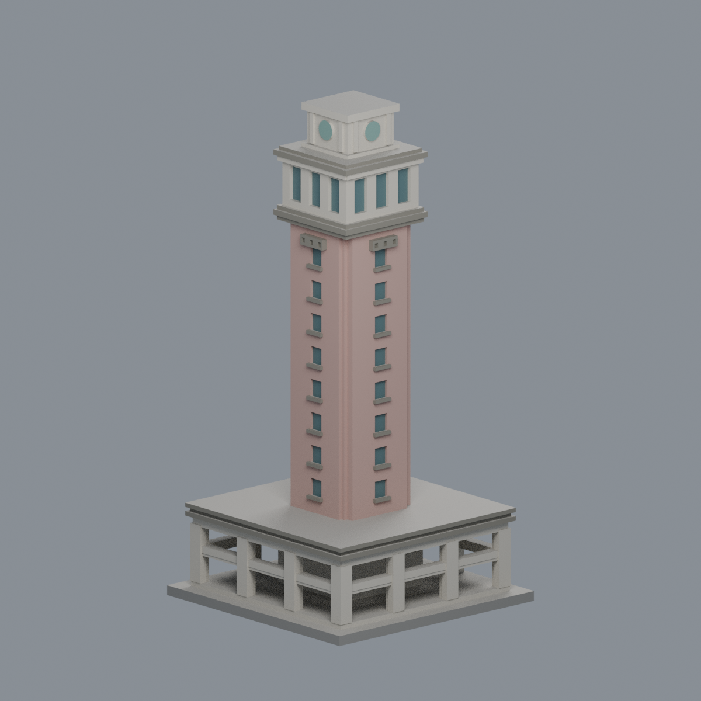
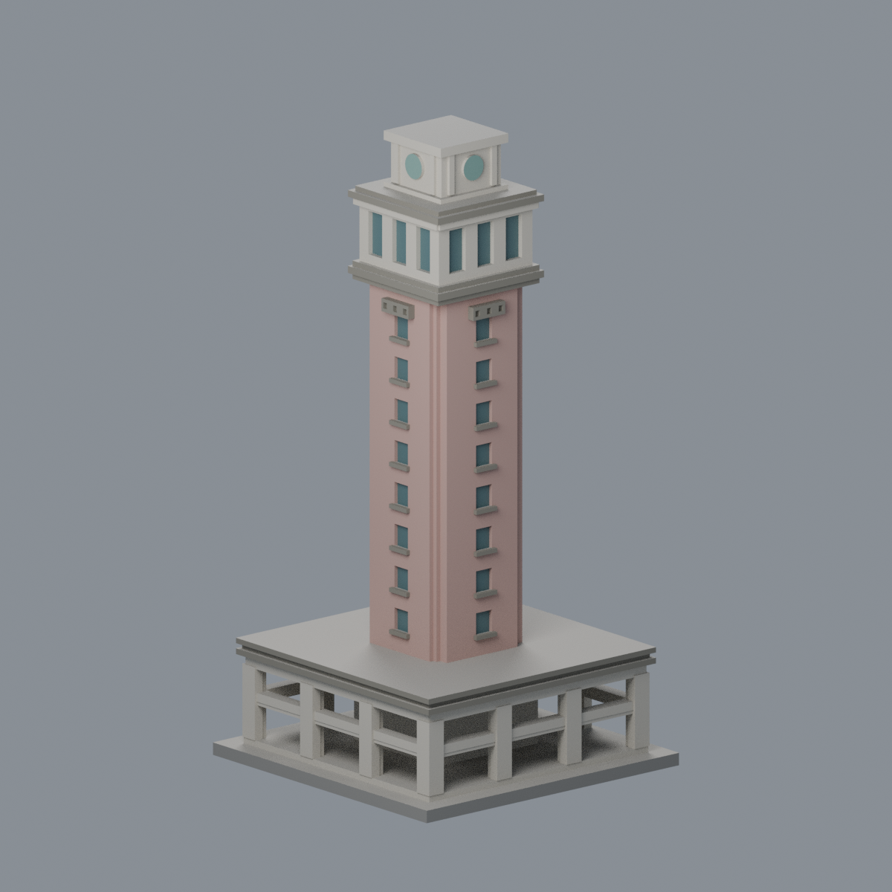
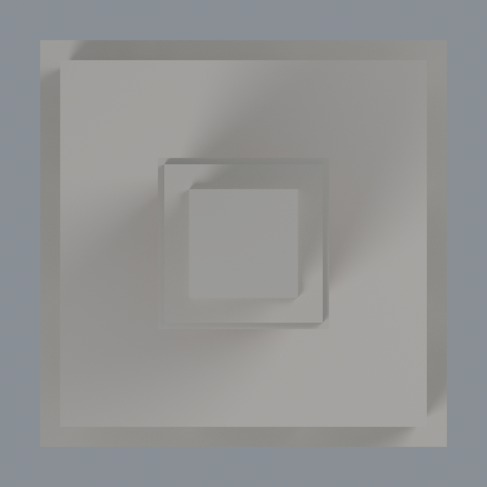

# 觀雲閣（水塔）

## 模型預覽

| 模型預覽 | 模型預覽 | 模型預覽 |
| :---: | :---: | :---: |
|  |  |  |

國立雲林科技大學／斗六校區。本件為公開來源推估的外觀縮模，不是測繪成果。涵蓋範圍：全塔外觀近似，含底層柱廊；不含天線、機電內部或周邊宿舍。

## 最新七材質外觀版（2026-10-20）

[七材質外觀說明與來源界線](appearance/README.md) · [表面色 3MF](appearance/yuntech-appearance.3mf) · [可編輯材質場景](appearance/scene.blend) · [背面](appearance/previews/rear.png) · [頂視](appearance/previews/top.png)

| 模型預覽 | 模型預覽 | 模型預覽 |
| :---: | :---: | :---: |
| 背面  | 頂視  |  |

只增加外觀材質；原 STL、幾何、原場景與歷史 QA 均保留。背面屬有限對稱配色外推，不是新測繪。3MF 非已完成切片或保證可印。

### 原單色預覽（保留歷史）
原正背合圖（歷史檔案留存，不作本頁預覽） · 原頂視圖（歷史檔案留存，不作本頁預覽） · 原正面大圖（歷史檔案留存，不作本頁預覽） · 原背面大圖（歷史檔案留存，不作本頁預覽）

## 下載與重建
- [可列印模型 model.stl](model.stl)：單位毫米，含底座最大邊不超過150毫米，本件尺寸約 76 × 76 × 150 毫米。
- [可編輯場景 scene.blend](scene.blend)：直接匯入交付STL的可編輯網格；[參數建模腳本](build_model.py)是幾何重建來源。
- [依賴版本](requirements.txt) · [來源及年代](sources.json) · [逐檔SHA256](SHA256SUMS)

Python 3.12安裝 requirements.txt 後執行 python build_model.py。Blender 4.3.2執行 blender -b -t 2 -P render_preview.py，會由實際STL生成正、背、頂視圖並保存scene.blend。各建物獨立縮放，不能直接視為共同校園比例。

## 保留的外觀
- 依校方865公分塔身與510公分上層平面比例建立階退角方塔。
- 保留基座三跨柱廊、塔身單窗列、水平簷線、上層三直窗與縮退水箱。
- 校徽以實心背板上的圓形位置標記簡化，沒有虛構時鐘或文字。

## 推估與範圍限制
- 後續設備界線：同一113年度（2024年度）決算總說明第14頁列有觀雲閣5kWp微水力設備。此件省略該機電系統；未取得其改變可見外形的證據，不憑推測新增外殼。報告年度不當作精確施工／完工日。 [校方決算總說明](https://acxweb1.yuntech.edu.tw/webppr/P11319GENINFO_C.PDF#page=14)
- 樓高與柱廊進深為公開照片的比例估計，沒有宣稱測繪尺寸。
- 塔身各面窗位參照逐層平面；底座未見面的柱廊、開口與低牆採已見面的對稱近似。
- 最頂部細長天線省略，窗櫺、校徽細筆畫與管線省略；不能由模型判讀設備或內部。

## 列印與驗證
底座朝下、STL單位選毫米。底層柱廊與上層出簷有懸空，通常需支撐或調整列印策略；勿宣稱免支撐。塔體細長，搬取時請抓底座。 數位檢驗並不等於Cura／PrusaSlicer實際工具路徑或實體試印，沒有保證可印或免支撐。

- [原STL／重建／Blend驗證](validation.json)：原始面法向、繞序、正體積、水密、每邊兩面、頂點link單環、單一連通表面及無分離內腔殼均通過。
- [逐層驗證](layer-check.json)：z=0.071毫米起，每0.2毫米共750層；節點degree2、各環與合成Polygon均valid，遇invalid會失敗退出，沒有buffer(0)或make_valid修補。
- [0.8毫米參考寬度薄特徵篩檢](thin-feature-check.json)：每1毫米取樣，0.4毫米半徑opening最大面積損失 0.760%。只屬局部平面輔助篩檢，不是全面最小壁厚分析。
- [總結](qa-summary.json) · [原網格驗證腳本](validate_model.py) · [0.2毫米輪廓腳本](check_layers.py) · [薄篩腳本](check_thin_features.py)

驗證命令依序為 python validate_model.py、python check_layers.py、python check_thin_features.py。只有三項exit 0且validation／layer-check的checks全true才算這一版通過。

參考照片、平面與PDF的權利仍屬各原作者／機關，本資料夾只分享自建幾何、腳本、實際STL渲染與來源連結。

