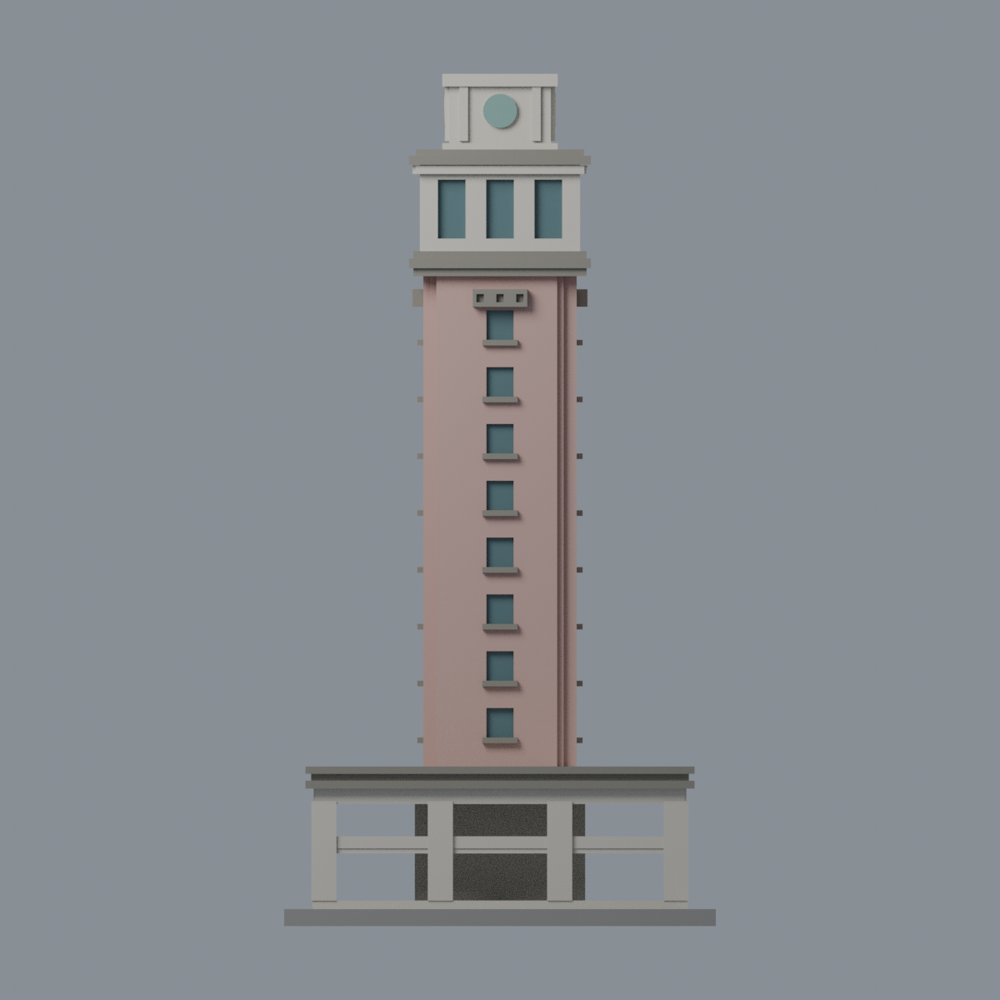

# 觀雲閣：七材質外觀交換版

由既有觀雲閣 STL 的實際三角面製作，不改輪廓、不加構件、不增加模型包數。**原 STL 位元保留；2,013 頂點／4,118 三角面的座標及面序完全不變，沒有細分。** 原底座與柱廊仍為簡化幾何，不是實景完整重建。

| 模型預覽 | 模型預覽 | 模型預覽 |
| :---: | :---: | :---: |
| 正面：粉陶塔身與石色基座  | 背面：對稱近似外推  |  |

| 模型預覽 | 模型預覽 | 模型預覽 |
| :---: | :---: | :---: |
| 正立面  | 頂視：未見屋面保持中性  |  |

## 下載與編輯

[表面色 3MF](yuntech-appearance.3mf) · [可編輯 Blender 場景](scene.blend) · [材質色表](palette.json) · [逐面材質與分類依據](face-materials.json) · [原 STL](../model.stl)

七個具名材質為：未確認中性色、淺石色、粉陶塔身、灰色檐口／窗臺、灰藍玻璃代理、低飽和青綠圓盤、展示底板。色數不限制為四色。3MF 是單一網格的表面材質，不是已拆成七個封閉色塊的列印工程；沒有噴頭映射、機器設定或 G-code。切片軟體未必能直接把顯示色轉成多材料列印，GUI 匯入未測。

## 來源與適用界線

本次實際查看[雲科大官方觀雲閣頁](https://view.yuntech.edu.tw/YunView9.html)及其[全塔照片 ID42.png](https://view.yuntech.edu.tw/static/img/ID42.png)。照片拍攝日期未知，顏色未校正；色表只是外觀近似，不是實測建材色票。原照片不隨本包公開散布。

- 照片呈現兩個相鄰立面，可辨識粉陶色塔身、較淺石色基座與上層觀景室、灰色檐口、灰藍窗，以及少量青綠細部。模型座標不代表已測定的地理方位。
- 塔身與基座材質沿用原模型四面對稱設定，背面及未見部分是**有限的同構造配色外推**，不是另有背面照片證明。基座實照與原簡化柱廊不完全相同，此次只換材質，不藉配色宣稱已修正幾何。
- 灰藍色只放在原本封實窗凹口的背平面，並非把陰影當黑漆，也沒有新增玻璃體積、窗櫺或透明物理效果。
- 原有灰色檐線與窗臺作照片支持的石色近似；小陽臺浮雕仍沿用原幾何，不新增飾紋。
- 青綠色只放在原有抽象圓盤正面，**不重製或捏造校徽、文字、時鐘**。實照的細頂緣不另外加幾何，沒有把整片屋頂塗綠。
- 向上的屋面、臺面保持中性色；展示底板不是實景地面。照片遮住或未呈現的材料細節不增補。
- 舊 sources.json 的其他相簿、平面及年度報告屬原幾何來源，本次未全部重新讀取，不拿它們冒充本次配色覆核。原有年代／設備省略限制繼續有效。

[本次來源覆核](qa/source-review.json) · [原完整來源](../sources.json) · [原模型與幾何限制](../README.md)

## 可重建與驗證

安裝 [依賴](source/requirements.txt)，由本資料夾上層提供原 model.stl，執行：

1. python appearance/source/build_appearance.py
2. python appearance/source/verify_exchange.py
3. blender -b -t 4 -P appearance/source/render_appearance.py
4. blender -b -t 4 -P appearance/source/verify_scene.py

也可下載[獨立外觀重建包](rebuild-source.zip)，其中包含原 STL、外觀程式及說明，不含第三方照片；該包不取代原幾何建模程式。

[交換與幾何驗證](qa/exchange-validation.json)確認原面序／座標、所有面材質、水密有向邊、頂點 link 單環、單一表面、正體積、零退化與零重複面。lib3mf 嚴格讀取無警告，實際改一個材質並存讀，其他材質與面指派不變；SDK 六位小數存檔的量化誤差另列，測試編輯檔不作正式交付。

[場景存讀驗證](qa/scene-validation.json) · [渲染檔案](qa/render-manifest.json) · [獨立重建核對](qa/rebuild-validation.json) · [逐檔 SHA256](SHA256SUMS)

## 原製造限制保留

尺寸仍為 76 × 76 × 150 mm。底層柱廊及上層出檐有懸空，塔體細長；需要自行評估支撐、材料、層高及搬取方式，不能宣稱免支撐或保證可印。原歷史 QA 的 750 層閉合檢驗與 0.8 mm 參考寬度薄特徵篩檢（最大面積損失約 0.760%）**未在本次重新執行**；不以配色 QA 覆寫它們。[原 QA 總結](../qa-summary.json)、[原層檢](../layer-check.json)、[原薄特徵](../thin-feature-check.json)保持原檔。沒有 Cura／PrusaSlicer 工具路徑或實體試印。
