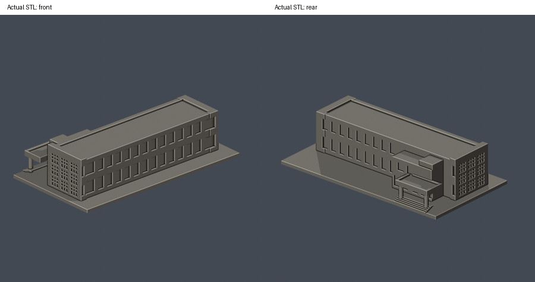
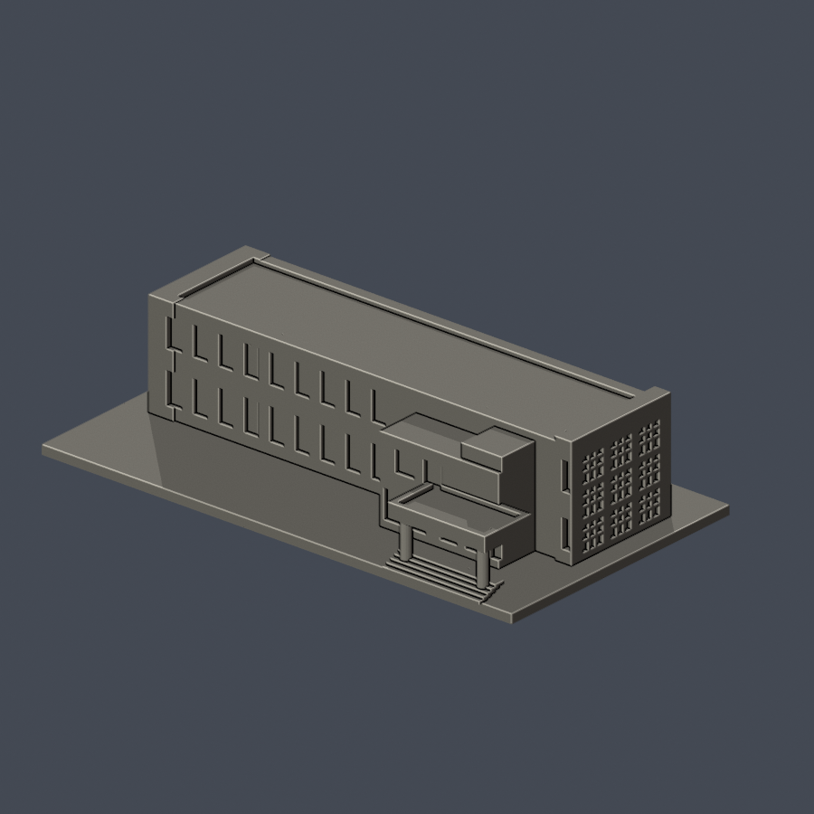

# 資訊大樓雙層辦公翼與入口段

國立雲林科技大學／斗六校區。本件為公開來源推估的外觀縮模，不是測繪成果。涵蓋範圍：官方1F平面101–105及2F平面201–205所屬雙層辦公翼、玻璃磚端牆、相鄰入口雨棚與門廳局部；排除三層教室長翼、國際會議廳及其餘連廊。

| 模型預覽 | 模型預覽 | 模型預覽 |
| :---: | :---: | :---: |
|  |  |  |

[頂視圖](previews/top.png) · [正面大圖](previews/front.png) · [背面大圖](previews/rear.png)

| 模型預覽 | 模型預覽 | 模型預覽 |
| :---: | :---: | :---: |
| 頂視圖  | 正面大圖  | 背面大圖  |

## 下載與重建
- [可列印模型 model.stl](model.stl)：單位毫米，含底座最大邊不超過150毫米，本件尺寸約 150 × 82.7 × 36.2 毫米。
- [可編輯場景 scene.blend](scene.blend)：直接匯入交付STL的可編輯網格；[參數建模腳本](build_model.py)是幾何重建來源。
- [依賴版本](requirements.txt) · [來源及年代](sources.json) · [逐檔SHA256](SHA256SUMS)

Python 3.12安裝 requirements.txt 後執行 python build_model.py。Blender 4.3.2執行 blender -b -t 2 -P render_preview.py，會由實際STL生成正、背、頂視圖並保存scene.blend。各建物獨立縮放，不能直接視為共同校園比例。

## 保留的外觀
- 長直辦公立面保留每列12個窄窗與兩端寬窗，共14個主開口；不把玻璃分格當主柱跨。
- 入口端牆保留3×3個玻璃磚大群組，實際密玻璃磚細格改為加粗、全背襯的3×3單元。
- 雙層辦公平屋頂、端樓梯局部突出、低入口雨棚、兩根圓柱與台階。

## 推估與範圍限制
- 本件是局部段，不是完整資訊大樓，也不以資訊中心與國際會議廳名稱重複計棟；未完成三層長翼及會議廳，仍列續接。
- 可見立面依2015-09-08校方實拍，平面圖本原始年代未標；層高及未見背向窗高、遠端小窗為近似。
- 114年度（2025年度）決算PDF第19頁／印頁14列明資訊大樓等屋頂已設光電；本件未納入光電板及支架，也未把報告年度當精確施工完成日。
- 省略屋頂機電、植栽、文字與無法在此比例可靠保留的玻璃磚細格、雨棚底細板、窗中梃及欄杆。

## 列印與驗證
底座朝下、STL單位選毫米。入口雨棚、細柱周邊、端牆凹格及台階需於切片軟體檢查支撐與列印方向；凹窗／玻璃磚紋理有實體背襯。 數位檢驗並不等於Cura／PrusaSlicer實際工具路徑或實體試印，沒有保證可印或免支撐。

- [原STL／重建／Blend驗證](validation.json)：原始面法向、繞序、正體積、水密、每邊兩面、頂點link單環、單一連通表面及無分離內腔殼均通過。
- [逐層驗證](layer-check.json)：z=0.071毫米起，每0.2毫米共181層；節點degree2、各環與合成Polygon均valid，遇invalid會失敗退出，沒有buffer(0)或make_valid修補。
- [0.8毫米參考寬度薄特徵篩檢](thin-feature-check.json)：每1毫米取樣，0.4毫米半徑opening最大面積損失 0.109%。只屬局部平面輔助篩檢，不是全面最小壁厚分析。
- [總結](qa-summary.json) · [原網格驗證腳本](validate_model.py) · [0.2毫米輪廓腳本](check_layers.py) · [薄篩腳本](check_thin_features.py)

驗證命令依序為 python validate_model.py、python check_layers.py、python check_thin_features.py。只有三項exit 0且validation／layer-check的checks全true才算這一版通過。

參考照片、平面與PDF的權利仍屬各原作者／機關，本資料夾只分享自建幾何、腳本、實際STL渲染與來源連結。
