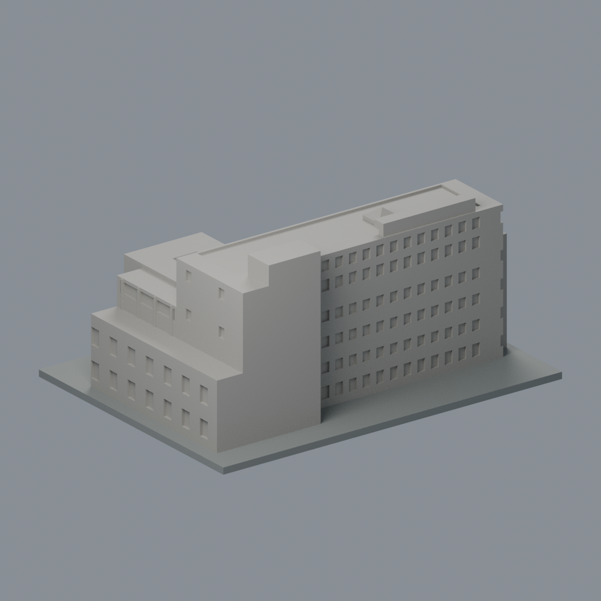
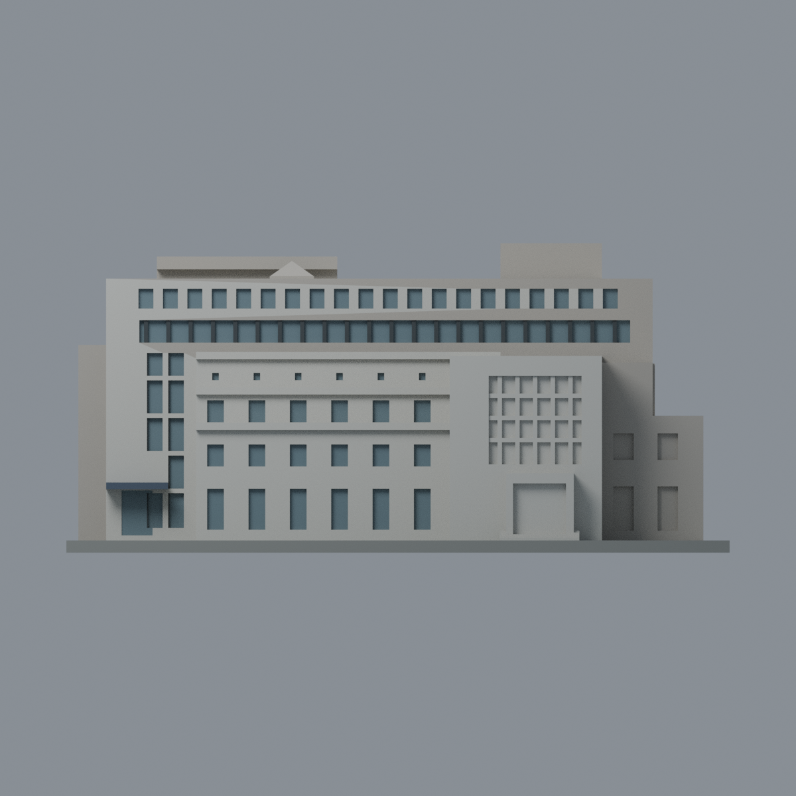
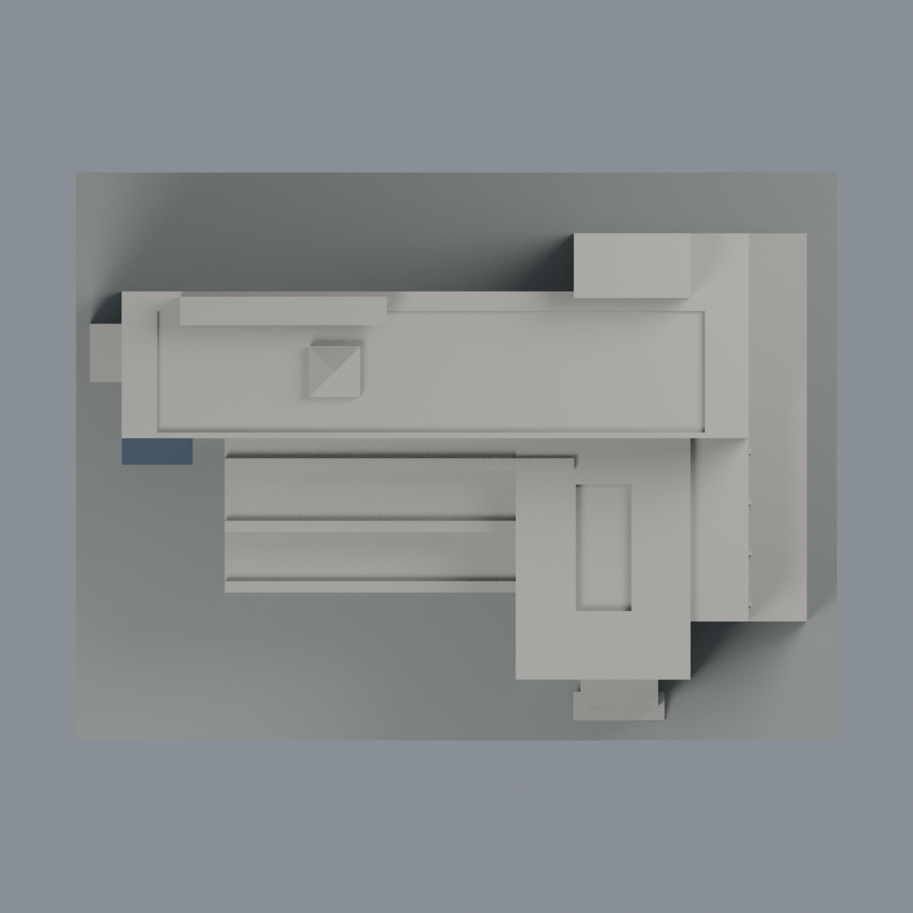

# 圖書館暨藝術中心：2008 來源限定前立面六材質外觀版

沿用原 **4,164 三角面／2,082 頂點**，不改原 STL 位元、座標、面序或幾何；這是既有模型外觀改版，不增加模型包數。

| 正面 | 背面保持中性 |
|---|---|
|  |  |
|  |  |

[表面色 3MF](library-appearance.3mf) · [可編輯 Blender](scene.blend) · [材質色表](palette.json) · [逐面指派與依據](face-materials.json) · [原 STL](../model.stl)

## 來源與配色邊界

本次主登錄影像是[雲科大典藏頁 2311](https://gallery.yuntech.edu.tw/media/2311)的[左端藝術中心入口照片 13013](https://gallery.yuntech.edu.tw/sysdata/album/1419/99e47137cc0c6078060f124847162f86_xl.jpg)。親自查看其左端小雨棚、高玻璃帶、上層方窗／長窗帶及右側退縮量體，對應既有模型負 X 端與前面。EXIF DateTimeOriginal 為 2008-11-14 08:42:44，不是 2026 現況。典藏圖片標題署名梁靜文；頁面最近修訂為 2023-09-14，不混作拍攝年。

也看過同頁另一張 [13012](https://gallery.yuntech.edu.tw/sysdata/album/1419/2a625398bf17379d49bba7536b6c8139_xl.jpg)，其畫面右端小棚沒有足夠證據直接登錄至本模型左棚，故**沒有鏡像來源或以它強行推翻／修改原幾何**。本次色面由 13013 登錄。

- 只改善前高量體與中央退縮立面：淺灰石面、灰藍凹窗背面、可分離的既有深色窗梃及左端深灰雨棚。
- 格數、窗形、柱寬全沿用舊模型，沒有為配色加幾何細線。原三角面若跨越可辨識材質界線，不細分或把一大片石牆染黑；因此部分窗周構件仍保守維持石色。
- 前面同組窗背材質採有限連續推定；蔓藤、樹影、窗簾或照片陰影不當建材色。色值未校正，不是實測色票，玻璃是灰藍不透明展示代理。
- 右方突出圖書館入口、兩端側面、背面、露臺頂與屋頂機電／採光幾何保持中性；原圖書館入口玻璃磚不憑此張被樹遮擋的照片補色。
- 不補招牌文字、布條、雕像、植栽或設備。底板仍是展示底座，不代表草地或實際地坪。
- 原幾何混合 2008–2014 立面來源與 2021 屋頂來源，本次保留跨年近似邊界，不宣稱某一年完整復原。原照片不隨公開包或備份散布。

[原完整來源](../sources.json) · [原幾何與年代界線](../README.md) · [本次來源覆核](qa/source-review.json)。舊平面及屋頂資料未在本次全部重讀，不當成本次配色的新覆核。

## 重建與核驗

安裝 [依賴](source/requirements.txt)，Blender 使用 4.3.2。由本資料夾上層提供原 model.stl：

1. `python appearance/source/build_appearance.py`
2. `python appearance/source/verify_exchange.py`
3. `blender -b -t 3 --python-exit-code 1 -P appearance/source/render_appearance.py`
4. `blender -b -t 3 --python-exit-code 1 -P appearance/source/verify_scene.py`

[獨立重建 ZIP](rebuild-source.zip)含原 STL、四支程式及依賴，不含第三方照片；不取代原建模腳本。[逐檔 SHA256](SHA256SUMS)

[交換／拓撲 QA](qa/exchange-validation.json)核對原座標與面序、全部面材質、單連通、有向水密邊、頂點 link 單環、正體積與零退化／重複面；lib3mf 嚴格讀取零警告，實際編輯單材質再存讀，其他材質及面指派不變。SDK 六位小數量化誤差另列。

[Blender 存讀與編輯](qa/scene-validation.json) · [渲染記錄](qa/render-manifest.json) · [獨立重建](qa/rebuild-validation.json)

## 製造限制照舊

尺寸仍為 150 × 112 × 70 mm；原 STL、建模程式、場景及歷史 QA 保留。原層檢與薄特徵檢查本次未重跑，不能由材質 QA 代替。

3MF 是同一網格的表面色，不是六個封閉分色實體、切片專案、噴頭映射或 G-code。切片 GUI、多材料路徑與實體列印未測；雨棚、退縮露臺、窗洞及階梯仍須評估材料、支撐及拆除風險，沒有保證可印或免支撐。
