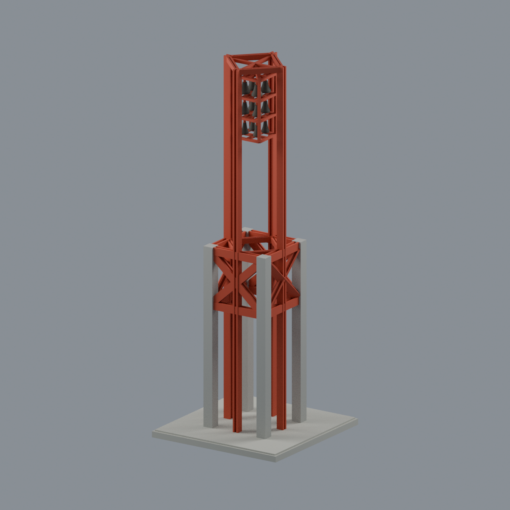
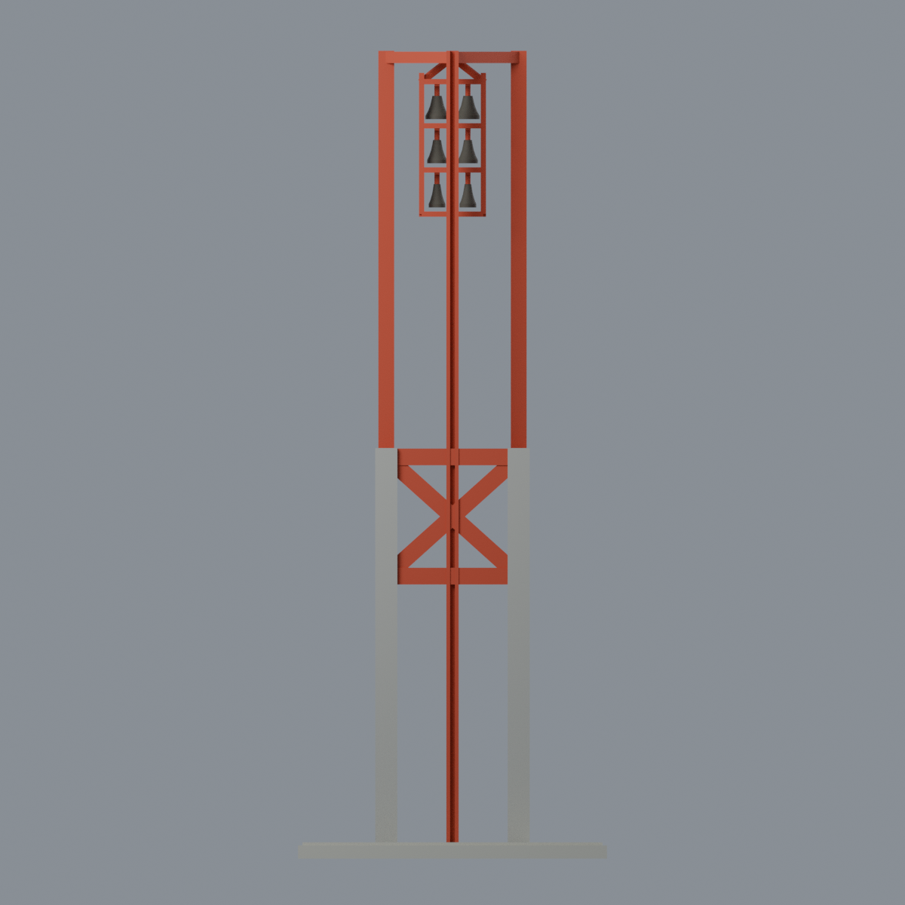
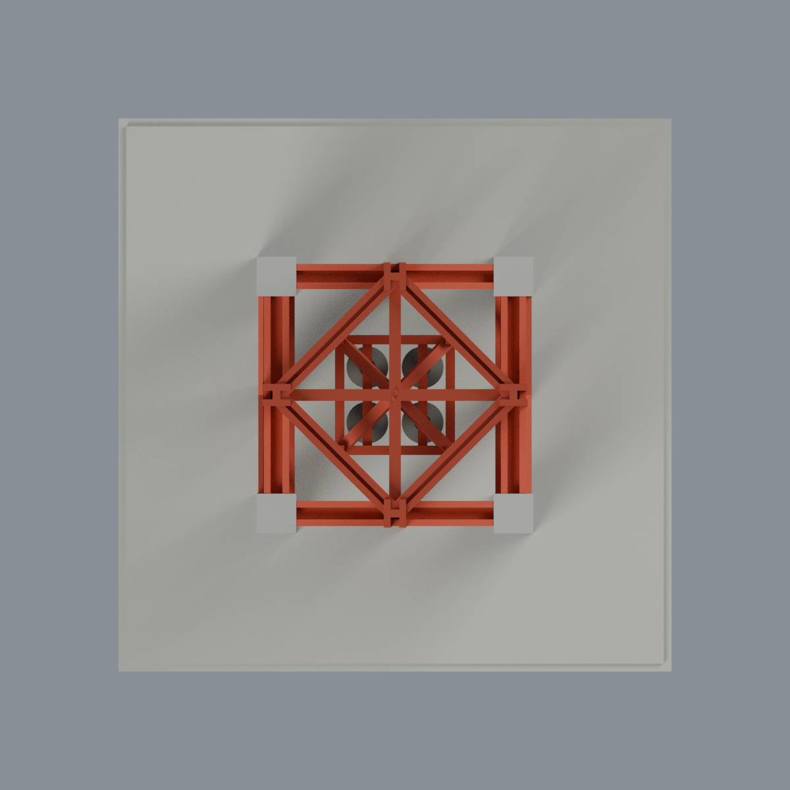
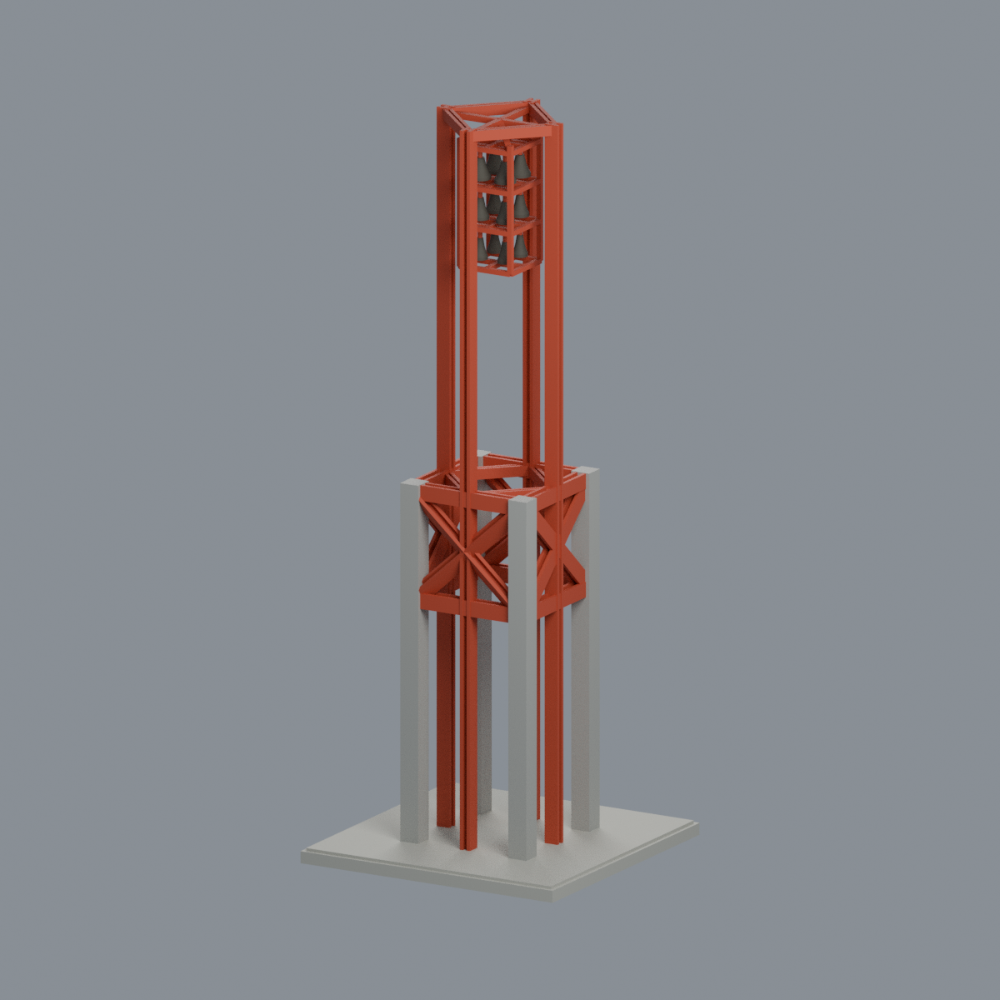

# 國立雲林科技大學｜雲科精神鐘塔

斗六校區，雲泰表演廳旁獨立鐘塔。完整地上主體的公開照片近似模型，非實測復原；2017、2018、2020校方照片外觀，不宣稱目前狀況。

## 下載／編輯
- [STL列印幾何](model.stl)：70×70×183 mm，單一封閉連通網格。
- [彩色3MF](model.3mf)：四組逐面材質，顯示顏色不是多料噴頭設定。
- [Blender可編輯場景](scene.blend)：相同實際網格、材質、五視角攝影機流程；沒有來源照片或外部貼圖。
- [生成程式](build_model.py)、[來源](SOURCES.md)、[驗證與限制](QA.md)。

四灰混凝土角柱、開放下半部、紅色圈梁與四面X斜撐、四根旋轉方框鋼立柱、上方鐘籠。最低四鐘口直接可見；**三層共12個代表鐘為視覺推定，並非官方確切數量**。鐘體實心、固定、形狀近似。70mm方底座是模型支承，不表示真實廣場邊界；不含禮堂、整片廣場階梯或植栽。

## 列印限制
I型鋼翼板0.85mm、腹板1mm，鐘籠桿1.2mm，細長鋼柱與懸吊鐘有脆弱／懸垂風險。必須自行檢查切片、方向、支撐及材料設定；不能宣稱免支撐或通過實體試印。縮小模型可能使細節消失。STL沒有色彩。

## 重建
Python套件見requirements.txt：`python build_model.py`、`python qa_model.py`、`python check_features.py`。Blender以`blender -b --python-exit-code 1 --python render_model.py`生成五張圖與scene.blend，再執行verify_scene.py及verify_render.py。官方lib3mf Python SDK供verify_exchange.py；BUILD_PYTHON指定具manifold3d等套件的Python。驗證報告及SHA256SUMS綁定交付檔案，不是列印認證。

## 其他視角

模型與程式依LICENSE；官方來源照片權利不在此授權內，未重新散布。
