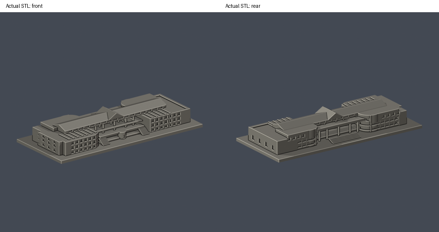

# 學生活動中心（含相連表演廳）

國立雲林科技大學／斗六校區。本件為公開來源推估的外觀縮模，不是測繪成果。涵蓋範圍：學生活動中心與東側相連表演廳同建築群外觀；不包括雲夢湖對岸員生餐廳、湖面景觀及北校區雲泰表演廳。

[頂視圖](previews/top.png) · [正面大圖](previews/front.png) · [背面大圖](previews/rear.png)

## 下載與重建
- [可列印模型 model.stl](model.stl)：單位毫米，含底座最大邊不超過150毫米，本件尺寸約 150 × 65 × 23 毫米。
- [可編輯場景 scene.blend](scene.blend)：直接匯入交付STL的可編輯網格；[參數建模腳本](build_model.py)是幾何重建來源。
- [依賴版本](requirements.txt) · [來源及年代](sources.json) · [逐檔SHA256](SHA256SUMS)

Python 3.12安裝 requirements.txt 後執行 python build_model.py。Blender 4.3.2執行 blender -b -t 2 -P render_preview.py，會由實際STL生成正、背、頂視圖並保存scene.blend。各建物獨立縮放，不能直接視為共同校園比例。

## 保留的外觀
- 保留道路入口雙圓弧翼、中央五根主柱與高架廊橋、階梯及大凹空。
- 長向雙坡採光屋頂與中央橫向山牆，兩翼平屋頂及屋面肋梁；未把屋面格線當新增樓層。
- 湖側地下層／一樓／二樓的三列主要開口，中央圓形突出、兩側台階、低露臺與退縮高窗帶。
- 相連表演廳與另一端辦公翼採不同平面外緣，整群作一件。

## 推估與範圍限制
- 湖側主要依EXIF 2014-05-11，入口依EXIF 2017-04-17，屋頂核2021空拍；2024相簿全景用來續核可見湖側量體，該照片未保存EXIF拍攝日，不宣稱2026逐窗現況。
- 官方圖本未標原始年代；層高、屋頂坡度與樹後側端小窗為照片近似；室內用途與最新門窗整修不據此保證。
- 玻璃窗門的細中梃、欄杆、內部廊道、屋頂球場線、機電、植栽、標誌及招牌省略；主開口加粗為背襯凹窗，不是透明室內模型。
- 圖面及實拍支持長斜面採光屋頂，本件不憑藍色屋面外觀認定特定太陽能設備配置。
- 本件相連表演廳不是雲泰表演廳；員生餐廳在湖對岸，沒有納入或重複計件。

## 列印與驗證
底座朝下、STL單位選毫米。中央柱廊、大跨橋廊、屋簷與凹空上方可能需支撐；先檢查橋接跨度、細柱與階梯，不宣稱免支撐。 數位檢驗並不等於Cura／PrusaSlicer實際工具路徑或實體試印，沒有保證可印或免支撐。

- [原STL／重建／Blend驗證](validation.json)：原始面法向、繞序、正體積、水密、每邊兩面、頂點link單環、單一連通表面及無分離內腔殼均通過。
- [逐層驗證](layer-check.json)：z=0.071毫米起，每0.2毫米共115層；節點degree2、各環與合成Polygon均valid，遇invalid會失敗退出，沒有buffer(0)或make_valid修補。
- [0.8毫米參考寬度薄特徵篩檢](thin-feature-check.json)：每1毫米取樣，0.4毫米半徑opening最大面積損失 0.259%。只屬局部平面輔助篩檢，不是全面最小壁厚分析。
- [總結](qa-summary.json) · [原網格驗證腳本](validate_model.py) · [0.2毫米輪廓腳本](check_layers.py) · [薄篩腳本](check_thin_features.py)

驗證命令依序為 python validate_model.py、python check_layers.py、python check_thin_features.py。只有三項exit 0且validation／layer-check的checks全true才算這一版通過。

參考照片、平面與PDF的權利仍屬各原作者／機關，本資料夾只分享自建幾何、腳本、實際STL渲染與來源連結。
