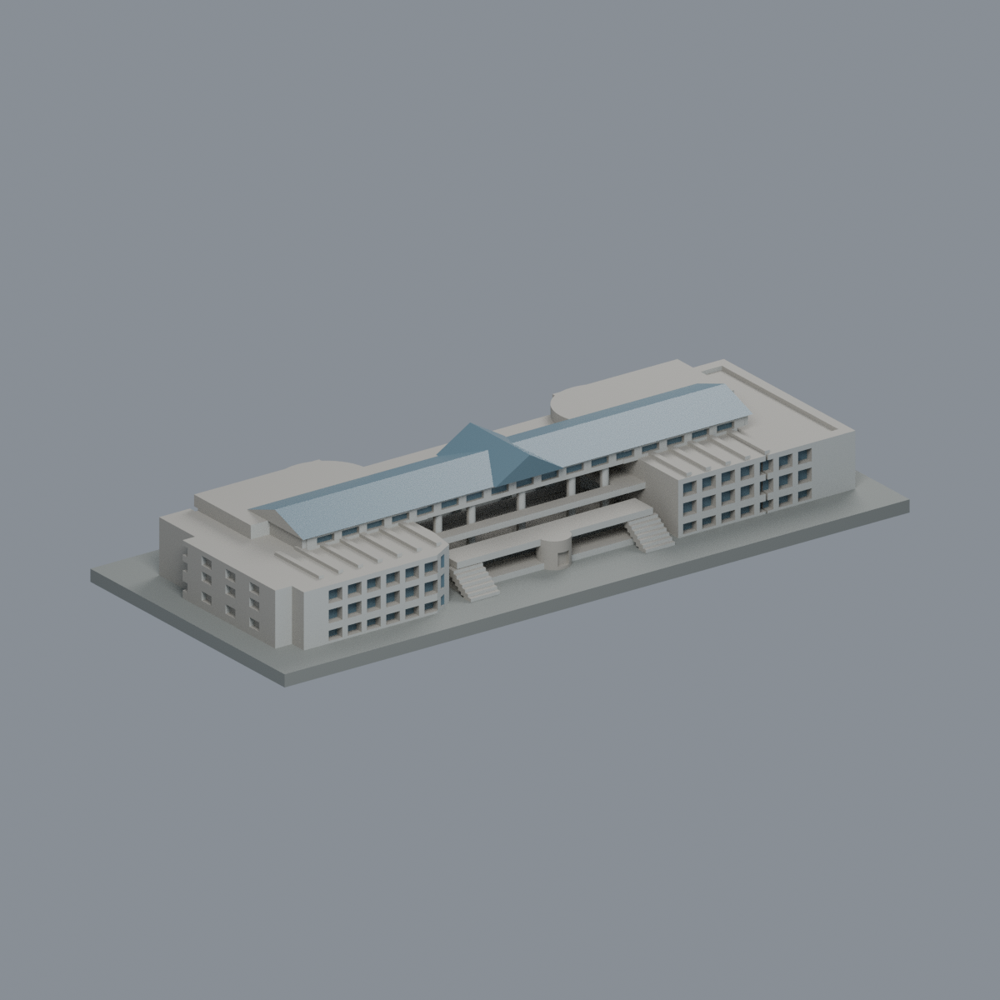
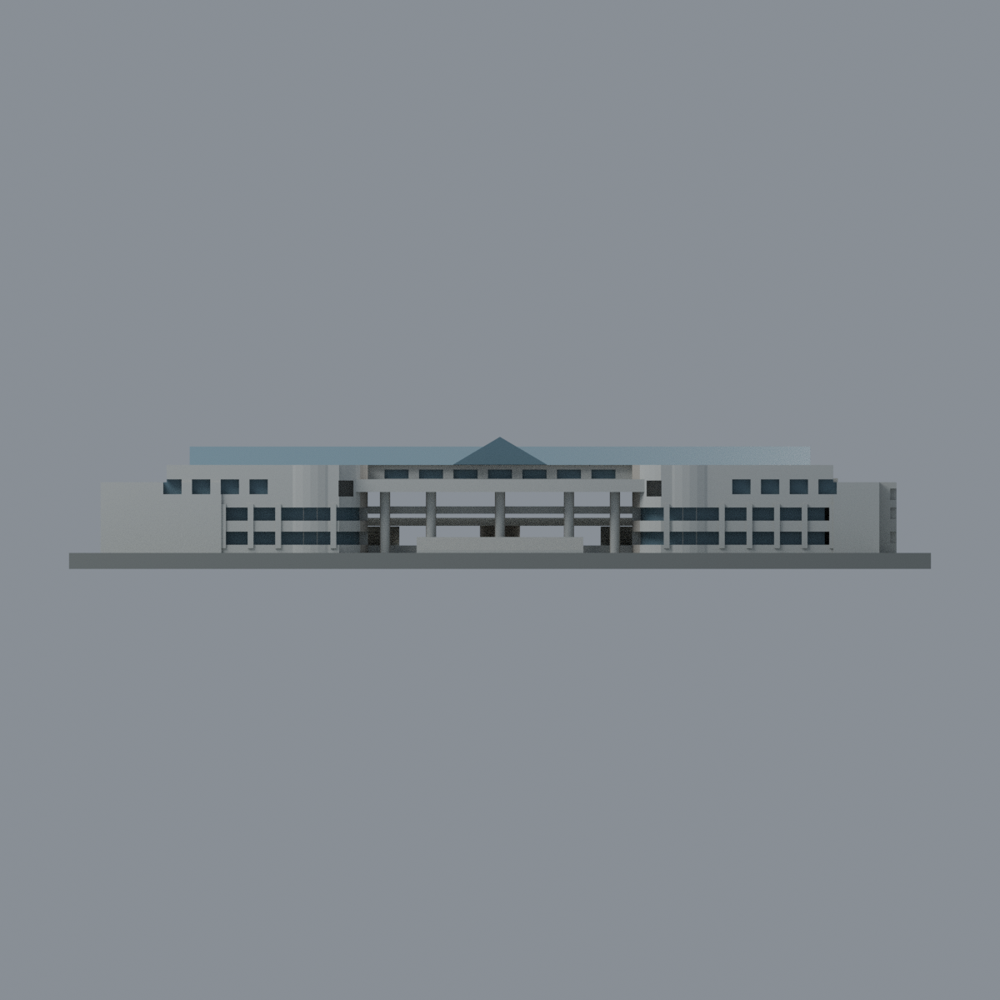
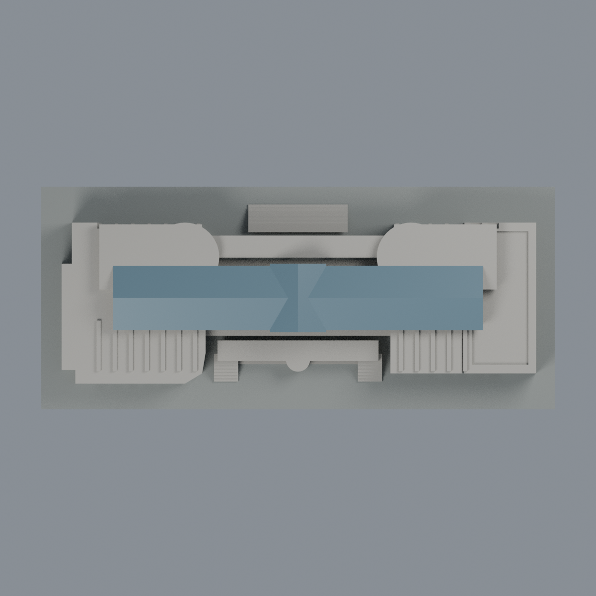

# 學生活動中心：2014／2017 雙立面四材質外觀版

沿用原 **6,782 三角面／3,333 頂點**，不改原 STL 位元、座標、面序或幾何；這是既有模型外觀改版，不增加模型包數。

| 模型預覽 | 模型預覽 | 模型預覽 |
| :---: | :---: | :---: |
| 道路入口面  | 湖側面  |  |
|  |  |  |

[表面色 3MF](student-appearance.3mf) · [可編輯 Blender](scene.blend) · [材質色表](palette.json) · [逐面指派與依據](face-materials.json) · [原 STL](../model.stl)

## 來源與配色邊界

親自查看兩張官方典藏照片：

- [道路入口典藏頁2055](https://gallery.yuntech.edu.tw/media/2055)／[113482照片](https://gallery.yuntech.edu.tw/sysdata/album/1453/7152f8f0471001209b860365af15f93c_xl.jpg)，EXIF DateTimeOriginal **2017-04-17 15:39:23**。
- [湖側典藏頁258](https://gallery.yuntech.edu.tw/media/258)／[13795照片](https://gallery.yuntech.edu.tw/sysdata/album/1450/f442d05bf3e32caa7fb7821130b303bb_xl.jpg)，EXIF DateTimeOriginal **2014-05-11 17:11:25**。

這是跨年來源近似，不是 2026 現況認證。軟體儲存／典藏修訂時間與拍攝記錄分開看；原照片不隨公開包或備份散布。

- 配色限兩個主要立面與玻璃屋頂：灰白石面、灰藍原凹窗背面及坡面／交叉山牆玻璃。連續窗組與被樹部分遮擋的同立面石面採有限材質連續推定，未逐點測量。
- **坡屋頂是玻璃採光頂，不是太陽能板。** 原模型沒有細分玻璃格線，本次不畫黑網假裝新增格條，也不加照片未有的PV或設備。
- 照片深窗框細於原模型粗支撐，直接全染支撐會把石腰帶一併染黑，故保留支撐中性色／石色，不細分原面追造細框。
- 原中央圓筒高度與分段是簡化體，不能把整支筒等同照片局部玻璃磚；保持中性。照片銀欄杆沒有完整對應原幾何，未憑色線補造。
- 未見東西端面、平屋頂、機電與底部陰影保持中性；不把透空柱廊塗黑成封牆，也不新增招牌、字樣、布條、植栽或室內。
- 材質為四種：中性、石面、玻璃、底座；光照明暗不是額外材質。色票未校正，玻璃採不透明展示代理。底板不代表真實紅磚廣場或草地。
- 原來源包含2014/2017/2021/2024照片與校方平面，此次只針對兩張已查看照片配色，不宣稱整組歷史資料重新覆核。相連表演廳仍是原模型範圍，不混作另一棟雲泰表演廳。

[原完整來源](../sources.json) · [原幾何與年代界線](../README.md) · [本次來源覆核](qa/source-review.json)

## 重建與核驗

安裝 [依賴](source/requirements.txt)，Blender 使用 4.3.2。由本資料夾上層提供原 model.stl：

1. `python appearance/source/build_appearance.py`
2. `python appearance/source/verify_exchange.py`
3. `blender -b -t 3 --python-exit-code 1 -P appearance/source/render_appearance.py`
4. `blender -b -t 3 --python-exit-code 1 -P appearance/source/verify_scene.py`

[獨立重建 ZIP](rebuild-source.zip)含原 STL、四支程式及依賴，不含第三方照片；不取代原建模腳本。[逐檔 SHA256](SHA256SUMS)

[交換／拓撲 QA](qa/exchange-validation.json)核對原座標與面序、全部面材質、單連通、有向水密邊、頂點 link 單環、正體積與零退化／重複面；lib3mf 嚴格讀取零警告，實際編輯單材質再存讀，其他材質及面指派不變。SDK 六位小數量化誤差另列。

[Blender 存讀與編輯](qa/scene-validation.json) · [渲染記錄](qa/render-manifest.json) · [獨立重建](qa/rebuild-validation.json)

## 製造限制照舊

尺寸仍為 150 × 65 × 23 mm；原 STL、建模程式、場景及歷史 QA 保留。原層檢與薄特徵檢查本次未重跑，不能由材質 QA 代替。

3MF 是同一網格的表面色，不是四個封閉分色實體、切片專案、噴頭映射或 G-code。切片 GUI、多材料路徑與實體列印未測；雨棚、退縮露臺、窗洞及階梯仍須評估材料、支撐及拆除風險，沒有保證可印或免支撐。
