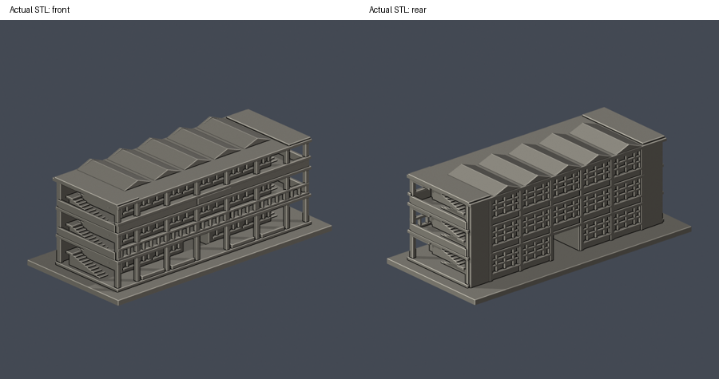
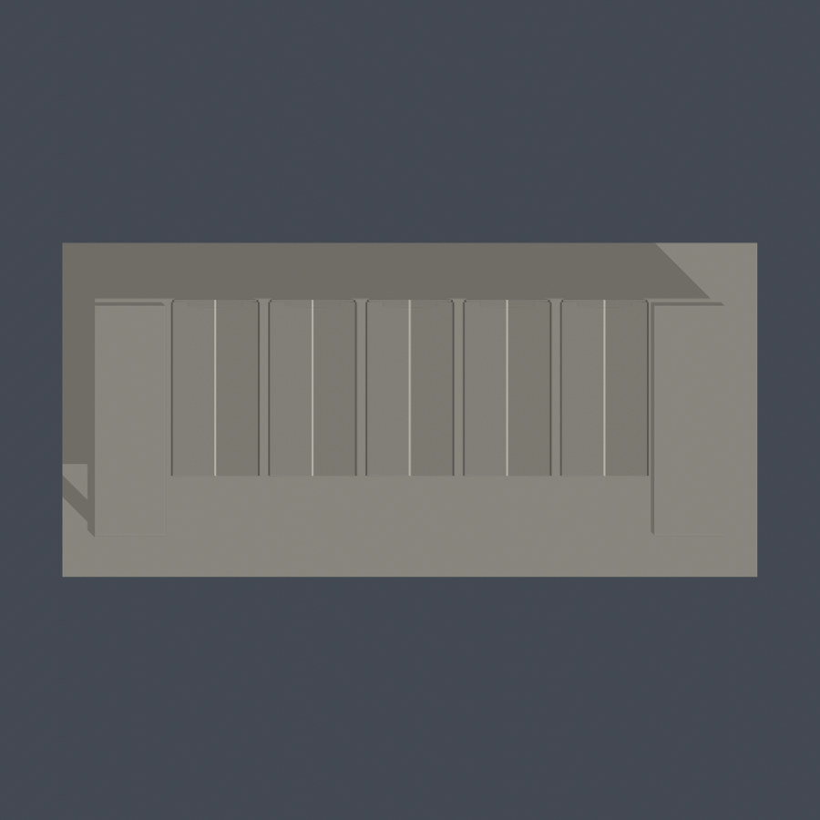
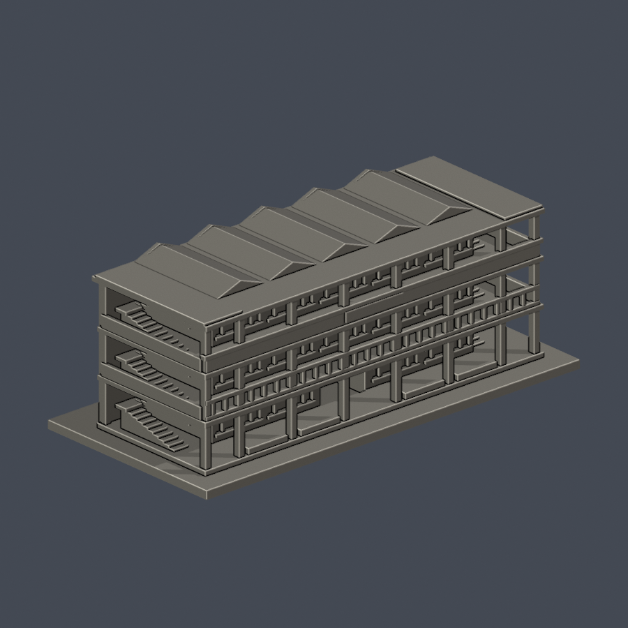
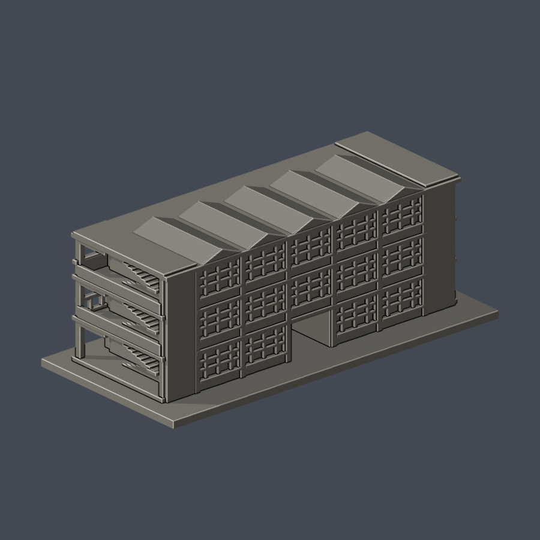

# 雲旭樓主樓段

國立雲林科技大學／斗六校區。本件為公開來源推估的外觀縮模，不是測繪成果。涵蓋範圍：古蹟群中三層主樓與兩端樓梯；不含斜接連廊、工場、附屬房舍及後增電梯。

## 最新修復後正面七材質外觀版（2026-10-20）

| 模型預覽 | 模型預覽 | 模型預覽 |
| :---: | :---: | :---: |
|  |  |  |

[配色、來源界線與四視角](appearance/README.md) · [表面色 3MF](appearance/yunsyu-appearance.3mf) · [可編輯場景](appearance/scene.blend)

只改善2023修復後照片可登錄的主樓正面；背面、深處端梯及折板屋頂保持中性。原STL與歷史QA保留，不是新增幾何。[原單色正背合圖](previews/front-rear.png)

| 模型預覽 | 模型預覽 | 模型預覽 |
| :---: | :---: | :---: |
| 原單色正背合圖  |  |  |

[頂視圖](previews/top.png) · [正面大圖](previews/front.png) · [背面大圖](previews/rear.png)

| 模型預覽 | 模型預覽 | 模型預覽 |
| :---: | :---: | :---: |
| 頂視圖  | 正面大圖  | 背面大圖  |

## 下載與重建
- [可列印模型 model.stl](model.stl)：單位毫米，含底座最大邊不超過150毫米，本件尺寸約 150 × 72 × 55.6 毫米。
- [可編輯場景 scene.blend](scene.blend)：直接匯入交付STL的可編輯網格；[參數建模腳本](build_model.py)是幾何重建來源。
- [依賴版本](requirements.txt) · [來源及年代](sources.json) · [逐檔SHA256](SHA256SUMS)

Python 3.12安裝 requirements.txt 後執行 python build_model.py。Blender 4.3.2執行 blender -b -t 2 -P render_preview.py，會由實際STL生成正、背、頂視圖並保存scene.blend。各建物獨立縮放，不能直接視為共同校園比例。

## 保留的外觀
- 主樓五個約450公分結構開間，連同兩端樓梯，參照校方2024年平面。
- 保留五跨折版屋頂、三層前廊、深退室內牆面與底層中央貫通入口。
- 保留二樓透空欄杆、三樓實心欄板、端部梯間，窗框加粗並接回實體牆。

## 推估與範圍限制
- 這是局部主樓段，不是完整雲旭樓古蹟群或全校模型。
- 官方2023年修復後正面照片與2024年平面支持主要造型；未取得修復後近距離背面實拍，背面窗高、分格與局部立面為近似。
- 折版頂高、樓高、欄杆厚度為比例估計；背面窗格按平面開口位置簡化，不能當作歷史測繪圖。
- 斜接連廊、原工藝工場、傳達室、保健室／廚房、新增電梯、雕像、庭園及2025新停車場未納入此件。

## 列印與驗證
底座朝下、STL單位選毫米。前廊長跨、端部樓梯與門廊需要檢查支撐；欄杆已加粗至1.2毫米，但仍需小心處理與試印。 數位檢驗並不等於Cura／PrusaSlicer實際工具路徑或實體試印，沒有保證可印或免支撐。

- [原STL／重建／Blend驗證](validation.json)：原始面法向、繞序、正體積、水密、每邊兩面、頂點link單環、單一連通表面及無分離內腔殼均通過。
- [逐層驗證](layer-check.json)：z=0.071毫米起，每0.2毫米共278層；節點degree2、各環與合成Polygon均valid，遇invalid會失敗退出，沒有buffer(0)或make_valid修補。
- [0.8毫米參考寬度薄特徵篩檢](thin-feature-check.json)：每1毫米取樣，0.4毫米半徑opening最大面積損失 0.294%。只屬局部平面輔助篩檢，不是全面最小壁厚分析。
- [總結](qa-summary.json) · [原網格驗證腳本](validate_model.py) · [0.2毫米輪廓腳本](check_layers.py) · [薄篩腳本](check_thin_features.py)

驗證命令依序為 python validate_model.py、python check_layers.py、python check_thin_features.py。只有三項exit 0且validation／layer-check的checks全true才算這一版通過。

參考照片、平面與PDF的權利仍屬各原作者／機關，本資料夾只分享自建幾何、腳本、實際STL渲染與來源連結。
