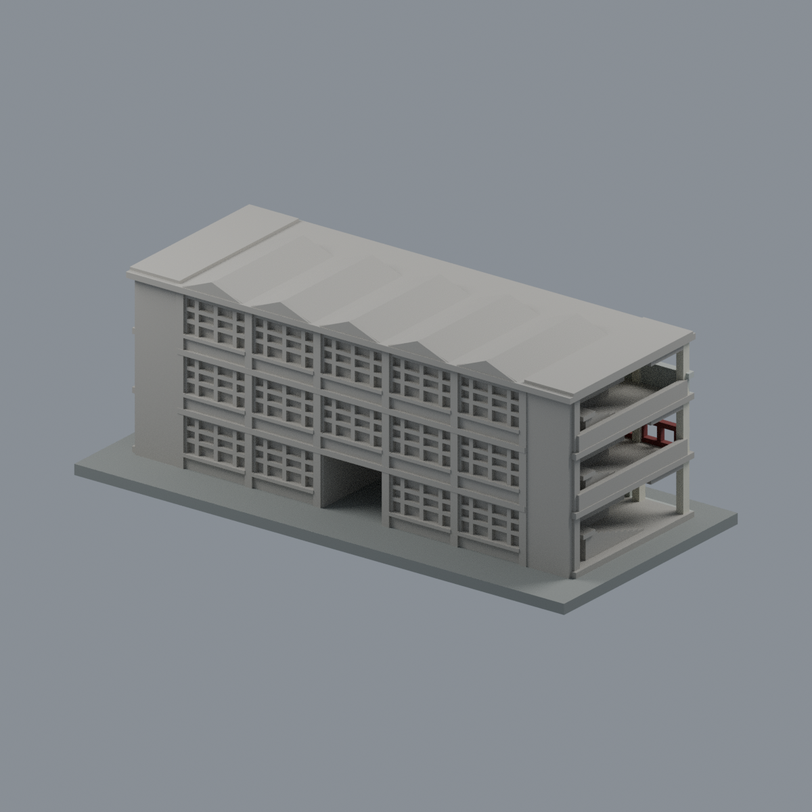
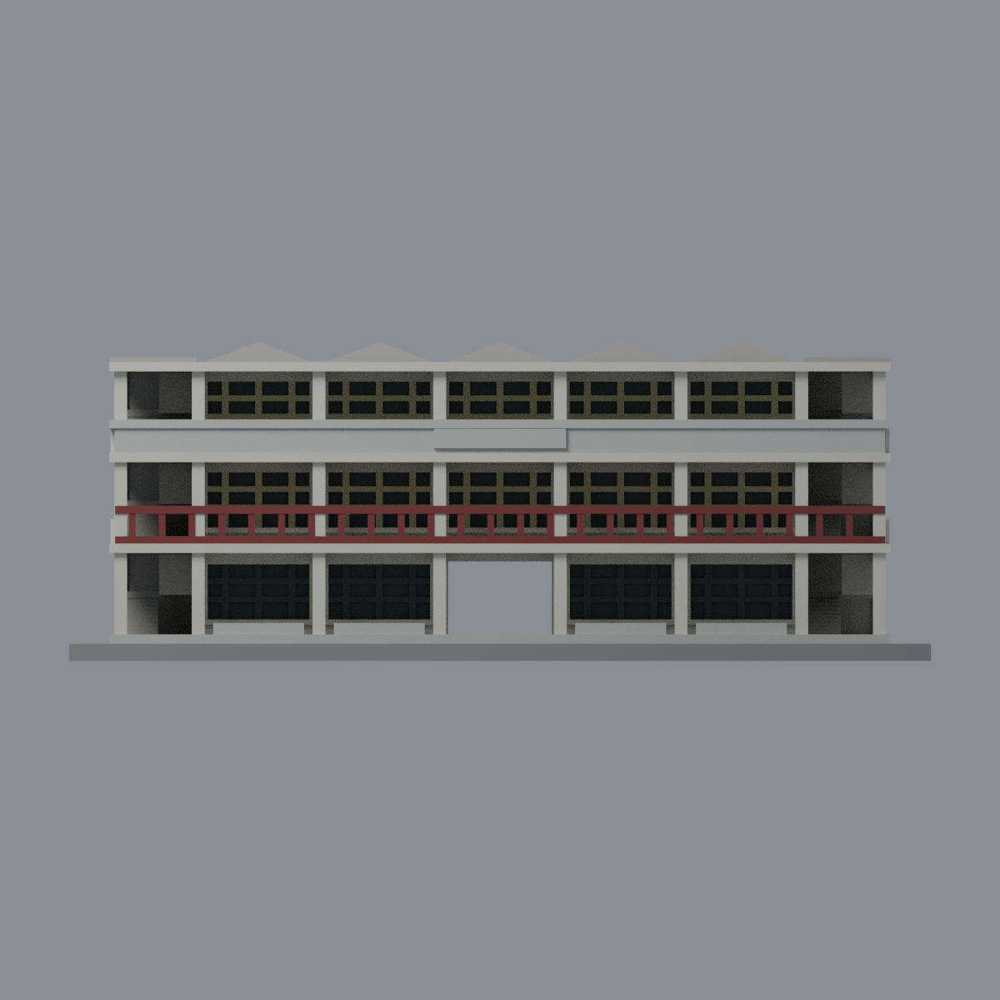
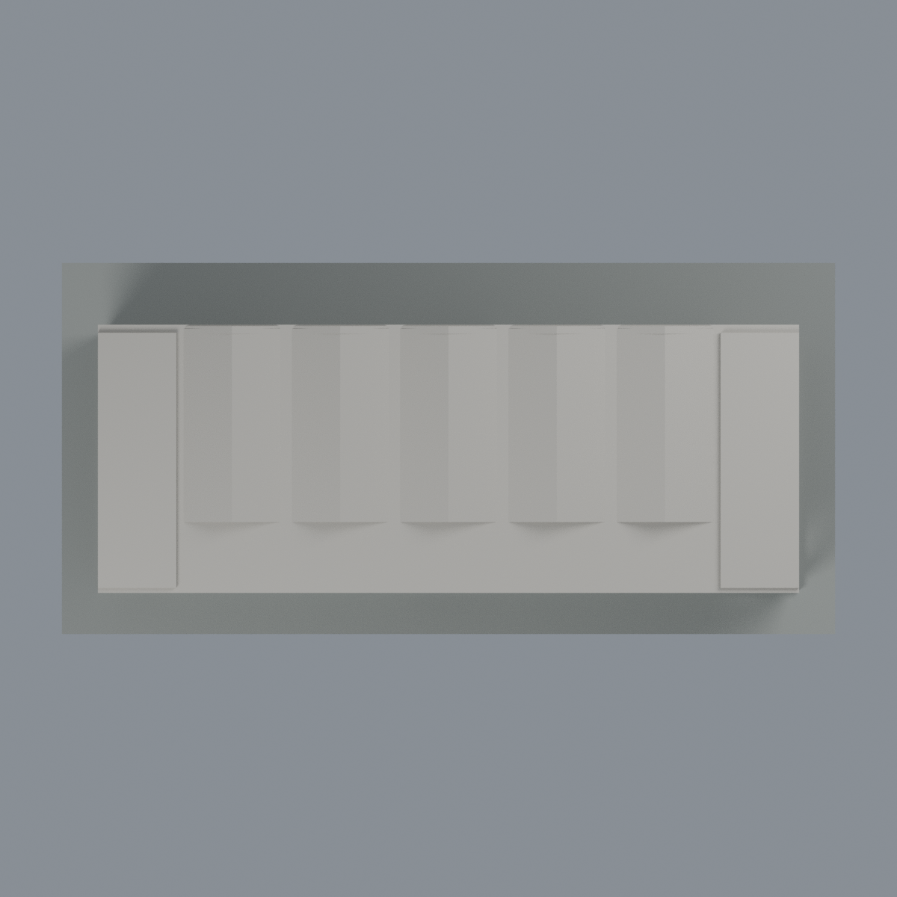

# 雲旭樓主樓段：2023 修復後正面七材質外觀版

沿用原 **11,892 三角面／5,842 頂點**，不改原 STL 位元、座標、面序或幾何；這是既有模型外觀改版，不增加模型包數。

| 正面 | 背面保持中性 |
|---|---|
|  |  |
|  |  |

[表面色 3MF](yunsyu-appearance.3mf) · [可編輯 Blender](scene.blend) · [材質色表](palette.json) · [逐面指派與依據](face-materials.json) · [原 STL](../model.stl)

## 來源與配色邊界

查看[校方 2023 雲旭樓古蹟日報導](https://www.yuntech.edu.tw/index.php/2019-04-10-08-06-20/2019-04-10-08-06-21/2019-04-10-08-06-67/2019-04-10-08-06-73/item/9156-2023)及其[修復後正面照片](https://www.yuntech.edu.tw/images/post_content/campus/2023/09/1120922-10.jpeg)。報導發布 2023-09-22，活動為 2023-09-19 至 21；圖片確切拍攝時刻未證實，不宣稱 2026 現況。來源照片不隨模型公開或備份散布。

- 僅登錄主樓正面：米白結構、淺灰石面上欄板與下層矮牆、紅褐色第二層透空欄杆、淡黃色上層窗梃、深色下層窗梃及原窗凹口背面。
- 既有每段窗梃及欄杆採同一立面有限連續材質推定；照片棕櫚樹遮住的同類構件不是逐點實測。色值未校正，不代表建材標準色票。
- 深色是原凹窗背面的不透明展示玻璃代理，不把柱廊陰影塗黑；不增造窗格、門扇、室內、照片人群或植栽。
- 上層原空白凸牌仍空白，不補字、標誌或浮雕。背面、端梯深處及屋頂保持中性，不憑正面照片推測背窗或折板頂材質。
- 右方藍灰色附屬雨棚／電梯及斜接連廊不在既有主樓幾何範圍，未補入。兩端側欄板也不改造成照片未完整顯露的紅色欄杆。
- 底板仍是展示底座，不代表草地或真實地坪。

[原完整來源](../sources.json) · [原幾何與年代界線](../README.md) · [本次來源覆核](qa/source-review.json)。舊平面及歷史文獻保留為原幾何依據，本次未重讀全部歷史來源，也未據此重建。

## 重建與核驗

安裝 [依賴](source/requirements.txt)，Blender 使用 4.3.2。由本資料夾上層提供原 model.stl：

1. `python appearance/source/build_appearance.py`
2. `python appearance/source/verify_exchange.py`
3. `blender -b -t 3 --python-exit-code 1 -P appearance/source/render_appearance.py`
4. `blender -b -t 3 --python-exit-code 1 -P appearance/source/verify_scene.py`

[獨立重建 ZIP](rebuild-source.zip)含原 STL、四支程式及依賴，不含第三方照片；不取代原建模腳本。[逐檔 SHA256](SHA256SUMS)

[交換／拓撲 QA](qa/exchange-validation.json)核對原座標與面序、全部面材質、單連通、有向水密邊、頂點 link 單環、正體積與零退化／重複面；lib3mf 嚴格讀取零警告，實際編輯單材質再存讀，其他材質及面指派不變。SDK 六位小數量化誤差另列。

[Blender 存讀與編輯](qa/scene-validation.json) · [渲染記錄](qa/render-manifest.json) · [獨立重建](qa/rebuild-validation.json)

## 製造限制照舊

尺寸仍為 150 × 72 × 55.6 mm；原 STL、建模程式、場景及歷史 QA 保留。原層檢與薄特徵檢查本次未重跑，不能由材質 QA 代替。

3MF 是同一網格的表面色，不是七個封閉分色實體、切片專案、噴頭映射或 G-code。切片 GUI、多材料路徑與實體列印未測；欄杆、屋簷、窗洞及階梯仍須評估材料、支撐及拆除風險，沒有保證可印或免支撐。
