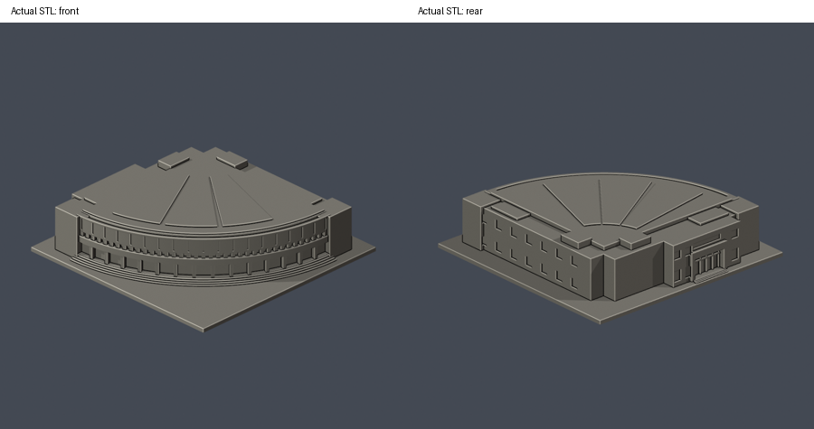
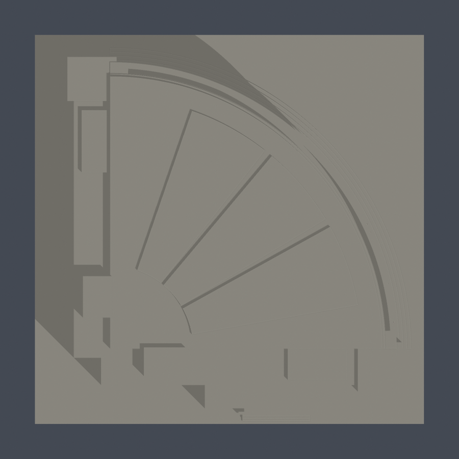
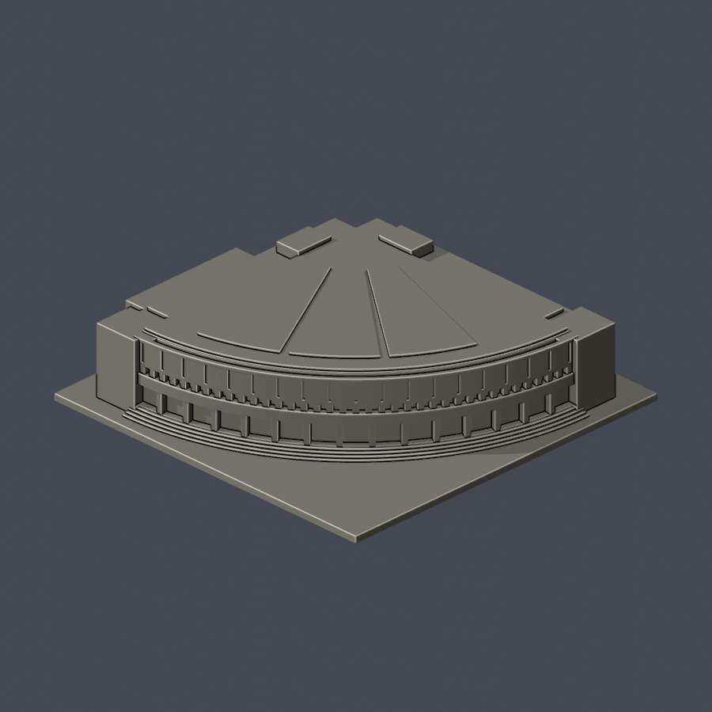
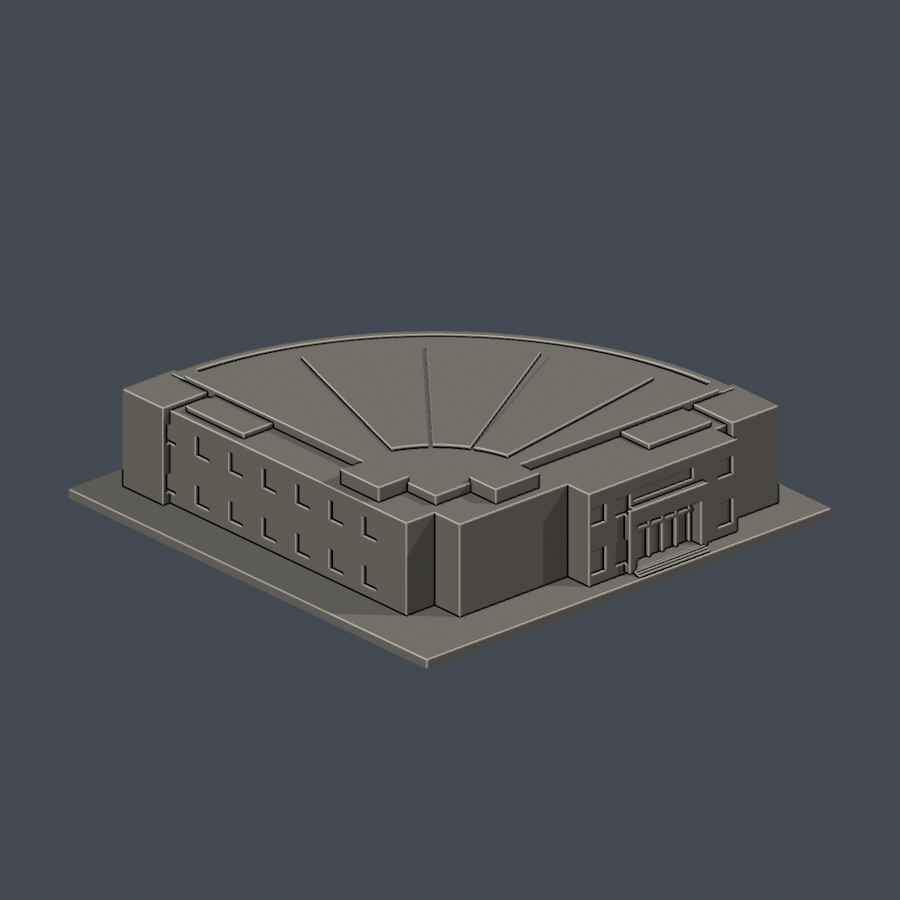

# 雲泰表演廳

國立雲林科技大學／斗六校區。本件為公開來源推估的外觀縮模，不是測繪成果。涵蓋範圍：扇形禮堂主體、弧形展演迴廊、街道入口與兩個直角後台翼；不含旁側雲科精神鐘塔及廣場景觀。

## 最新曲面正立面七材質外觀版（2026-10-20）

| 模型預覽 | 模型預覽 | 模型預覽 |
| :---: | :---: | :---: |
|  |  |  |

[配色、來源界線與四視角](appearance/README.md) · [表面色 3MF](appearance/yuntay-appearance.3mf) · [可編輯場景](appearance/scene.blend)

只改善2024照片可登錄的弧形立面；直角翼、屋頂及原機電／太陽能簡化體保持中性。原STL與歷史QA保留，不是新增幾何。[原單色正背合圖](previews/front-rear.png)

| 模型預覽 | 模型預覽 | 模型預覽 |
| :---: | :---: | :---: |
| 原單色正背合圖  |  |  |

[頂視圖](previews/top.png) · [正面大圖](previews/front.png) · [背面大圖](previews/rear.png)

| 模型預覽 | 模型預覽 | 模型預覽 |
| :---: | :---: | :---: |
| 頂視圖  | 正面大圖  | 背面大圖  |

## 下載與重建
- [可列印模型 model.stl](model.stl)：單位毫米，含底座最大邊不超過150毫米，本件尺寸約 150 × 150 × 35.5 毫米。
- [可編輯場景 scene.blend](scene.blend)：直接匯入交付STL的可編輯網格；[參數建模腳本](build_model.py)是幾何重建來源。
- [依賴版本](requirements.txt) · [來源及年代](sources.json) · [逐檔SHA256](SHA256SUMS)

Python 3.12安裝 requirements.txt 後執行 python build_model.py。Blender 4.3.2執行 blender -b -t 2 -P render_preview.py，會由實際STL生成正、背、頂視圖並保存scene.blend。各建物獨立縮放，不能直接視為共同校園比例。

## 保留的外觀
- 保留官方75.40×77.25公尺平面中的四分之一扇形主體、兩條直角後台翼及圓弧前階。
- 曲面立面保留深退門廊、水平腰帶、密集上排小窗、上層寬面板與環形屋頂分界。
- 街道側採2021年底整修後的大型凹入口、上方橫窗與側翼雙層窗；大禮堂／雲泰表演廳為前後名稱，不與學生中心東側表演廳混同。

## 推估與範圍限制
- 曲面及街道入口有2022與2024實拍；另一條直角側翼被樹遮蔽，窗距與局部開口高度是平面配合可見側近似，未宣稱每個後窗已核。
- 樓高、曲面牆的退凹深度及屋頂微坡是照片估計。屋頂採2021空拍與官方屋頂平面，省略個別太陽能電池格、機電設備及細排水構件。
- 屋面太陽能區只以三個厚實貼合的扇形片標記大範圍；不是板片逐格配置或設備模型。
- 外牆文字、旗桿、前階燈柱、欄杆細件、獨立鐘塔、雕塑和景觀不納入。

## 列印與驗證
底座朝下、STL單位選毫米。弧形門廊、腰帶、入口橫梁與屋頂分界槽應先檢查支撐及橋接；長弧面易顯示層紋，模型尚未實體試印。 數位檢驗並不等於Cura／PrusaSlicer實際工具路徑或實體試印，沒有保證可印或免支撐。

- [原STL／重建／Blend驗證](validation.json)：原始面法向、繞序、正體積、水密、每邊兩面、頂點link單環、單一連通表面及無分離內腔殼均通過。
- [逐層驗證](layer-check.json)：z=0.071毫米起，每0.2毫米共178層；節點degree2、各環與合成Polygon均valid，遇invalid會失敗退出，沒有buffer(0)或make_valid修補。
- [0.8毫米參考寬度薄特徵篩檢](thin-feature-check.json)：每1毫米取樣，0.4毫米半徑opening最大面積損失 0.078%。只屬局部平面輔助篩檢，不是全面最小壁厚分析。
- [總結](qa-summary.json) · [原網格驗證腳本](validate_model.py) · [0.2毫米輪廓腳本](check_layers.py) · [薄篩腳本](check_thin_features.py)

驗證命令依序為 python validate_model.py、python check_layers.py、python check_thin_features.py。只有三項exit 0且validation／layer-check的checks全true才算這一版通過。

參考照片、平面與PDF的權利仍屬各原作者／機關，本資料夾只分享自建幾何、腳本、實際STL渲染與來源連結。
