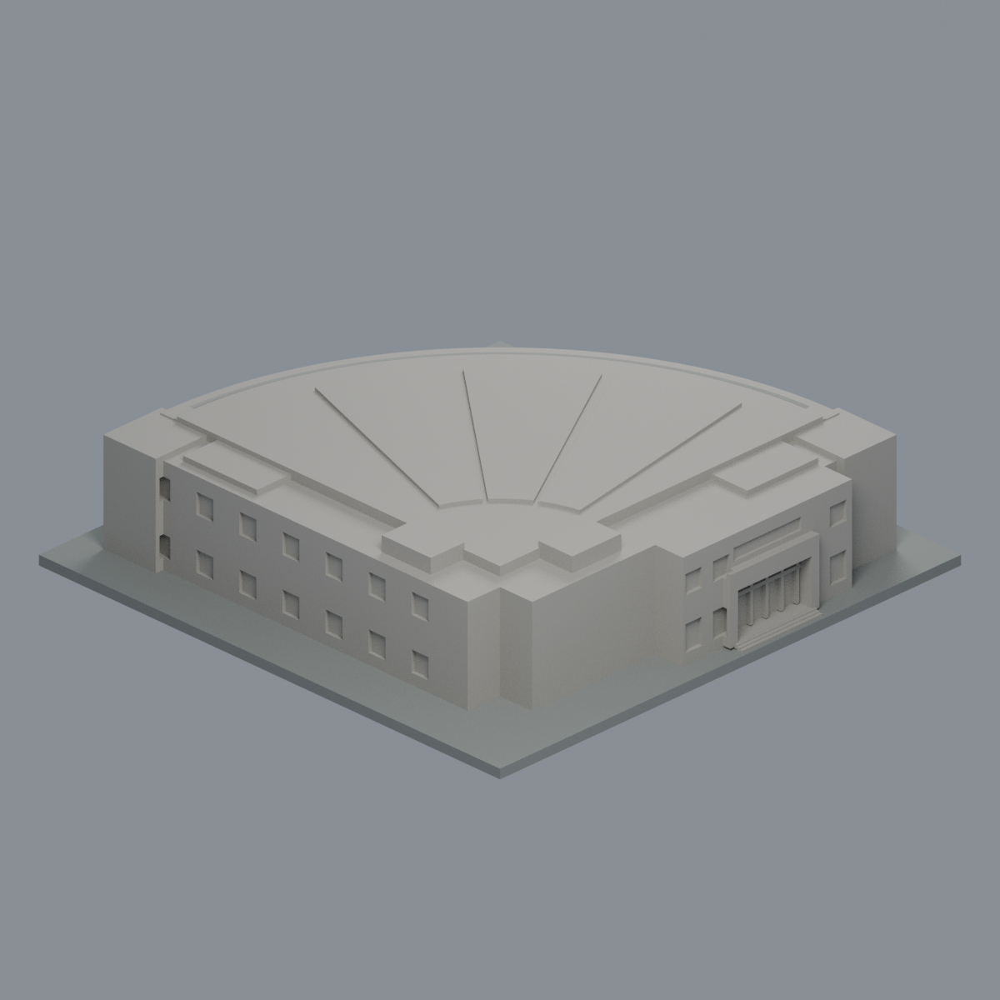
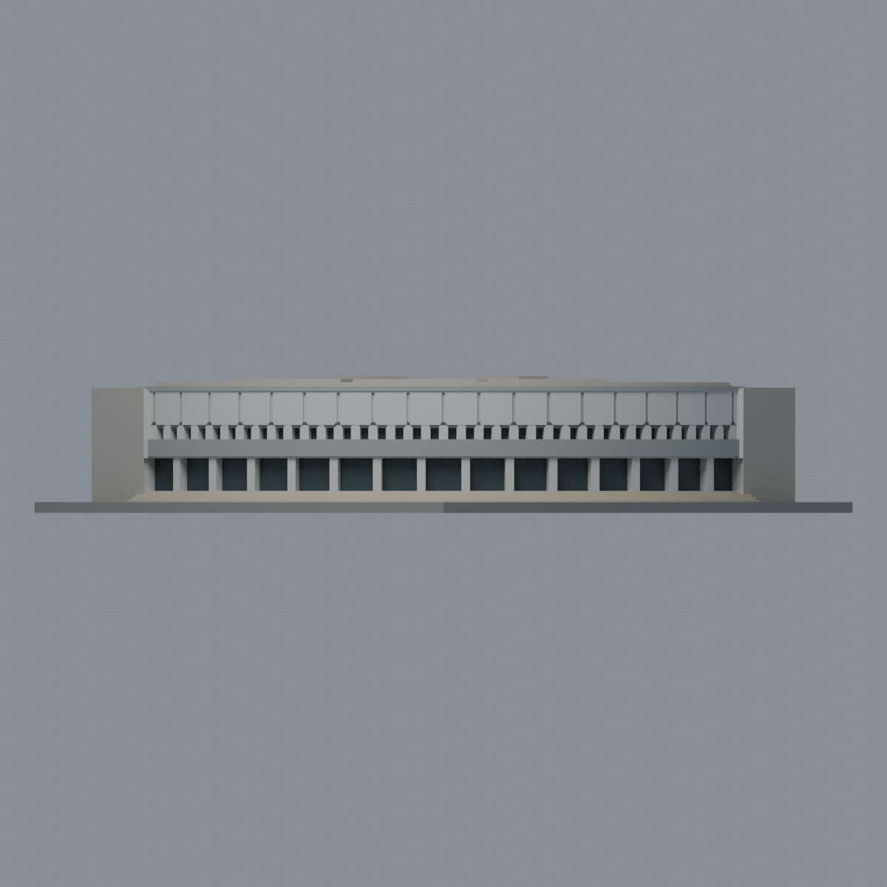
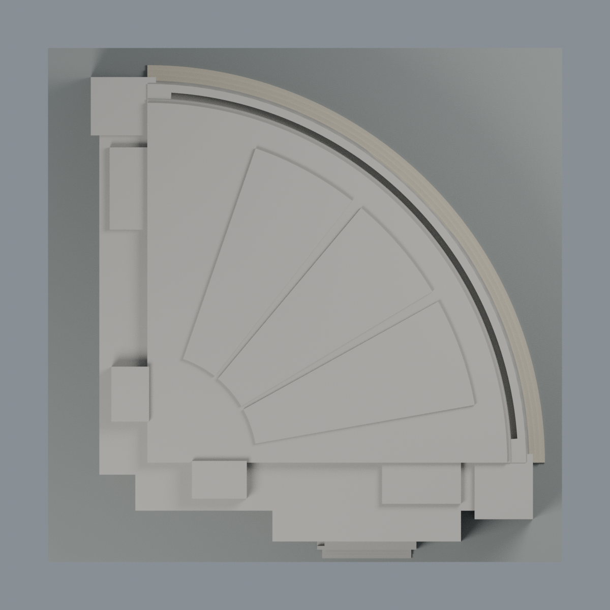

# 雲泰表演廳：2024 曲面正立面七材質外觀版

直接在原有 **12,890 三角面／6,445 頂點**配置材質，不改座標、面序、幾何或原 STL 位元，不細分，也不增加模型包數。這是既有有界縮模的外觀改版，不是重新測繪或新增建築。

| 模型預覽 | 模型預覽 | 模型預覽 |
| :---: | :---: | :---: |
| 曲面正立面  | 後方直角翼保持中性  |  |
|  |  |  |

[表面色 3MF](yuntay-appearance.3mf) · [可編輯 Blender](scene.blend) · [材質色表](palette.json) · [逐面指派與依據](face-materials.json) · [原 STL](../model.stl)

## 此次實際使用的來源

查看[雲科大數位影像典藏〈雲泰表演廳〉](https://gallery.yuntech.edu.tw/media/4249)及其[高解析正面照片](https://gallery.yuntech.edu.tw/sysdata/album/3698/b71a4fb2d8a4ad5075fc8858b71d837b_xl.jpg)。頁面分類為「2024校園」，Created 為 2024-08-22，Last Updated 為 2025-02-24；**照片 EXIF DateTimeOriginal 記錄 2024-08-12 16:47:42 +08:00**。這些日期分別是編目／更新／檔案拍攝時間記錄，不混作 2026 現況保證。

頁面 Author 欄為王照欽；影像 EXIF Artist/Copyright 為 Min-Kuang Shih，兩種欄位分列於 [來源覆核](qa/source-review.json)，不推定編目者就是攝影者。原照片不隨模型公開散布。

- 只對與照片登錄的四分之一圓弧正立面配色：淺灰寬面板／柱墩、較深灰腰帶與頂檐、窄深灰水平帶、深色門窗背面，以及暖淺石色前階。
- 深色限原有下層門廊及上排窗凹口的背平面；不把陰影當黑色塗料，也不新增細門框、透明玻璃或室內設施。
- 面板的原有淺縫保留幾何與陰影，沒有加黑線假裝更深的伸縮縫。七材質色值未校正，不能當作實測建材色票。
- **兩條直角後台翼、街道入口、屋面與機電塊保持中性**，不憑這張正面照推測樹後窗色。這些部位的舊幾何來源與近似仍保留。
- 原屋面三塊太陽能陣列簡化體是既有模型內容，本次不改動，也不以此正面照確認其顏色、數量或 2026 現況；全部保持中性。未增添燈柱、欄杆、雕像、植栽或相鄰建築。
- 展示底板不代表照片草地或實際地坪。照片可見的暖石階材質僅套到原有曲面前階，未重新推算真實級數或坡度。

[原完整來源](../sources.json) · [原幾何與年代界線](../README.md)。其他舊圖說／屋頂空拍未在本次全部重讀，不當成本次配色覆核。

## 重建與核驗

安裝 [依賴](source/requirements.txt)，Blender 使用 4.3.2。由本資料夾上層提供原 model.stl：

1. `python appearance/source/build_appearance.py`
2. `python appearance/source/verify_exchange.py`
3. `blender -b -t 4 --python-exit-code 1 -P appearance/source/render_appearance.py`
4. `blender -b -t 4 --python-exit-code 1 -P appearance/source/verify_scene.py`

[獨立重建 ZIP](rebuild-source.zip)含原 STL、此四支程式及依賴說明，不含第三方照片；不取代原幾何建模腳本。[逐檔 SHA256](SHA256SUMS)

[交換／拓撲 QA](qa/exchange-validation.json)確認全部原座標與面序、所有面材質指派、單連通、有向水密邊、頂點 link 單環與正體積，零退化／重複面；lib3mf 嚴格讀取零警告，實際單材質編輯、寫出再讀回，其他材質與面指派不變。SDK 六位小數存檔的量化誤差另列。

[Blender 存讀與編輯](qa/scene-validation.json) · [渲染記錄](qa/render-manifest.json) · [獨立重建核對](qa/rebuild-validation.json)

## 製造限制照舊

尺寸仍為 150 × 150 × 35.5 mm；原 STL、建模程式、場景及歷史 QA 未改。原層檢／薄特徵等歷史檢驗本次未重跑，不由材質 QA 代替。

3MF 是同一網格的表面顯示色，不是七個封閉分色實體、切片專案、噴頭映射或 G-code。切片 GUI 匯入、多材料工具路徑與實體列印未測；出檐與凹門廊仍需自行評估材料／支撐／拆除風險，沒有保證可印或免支撐。
