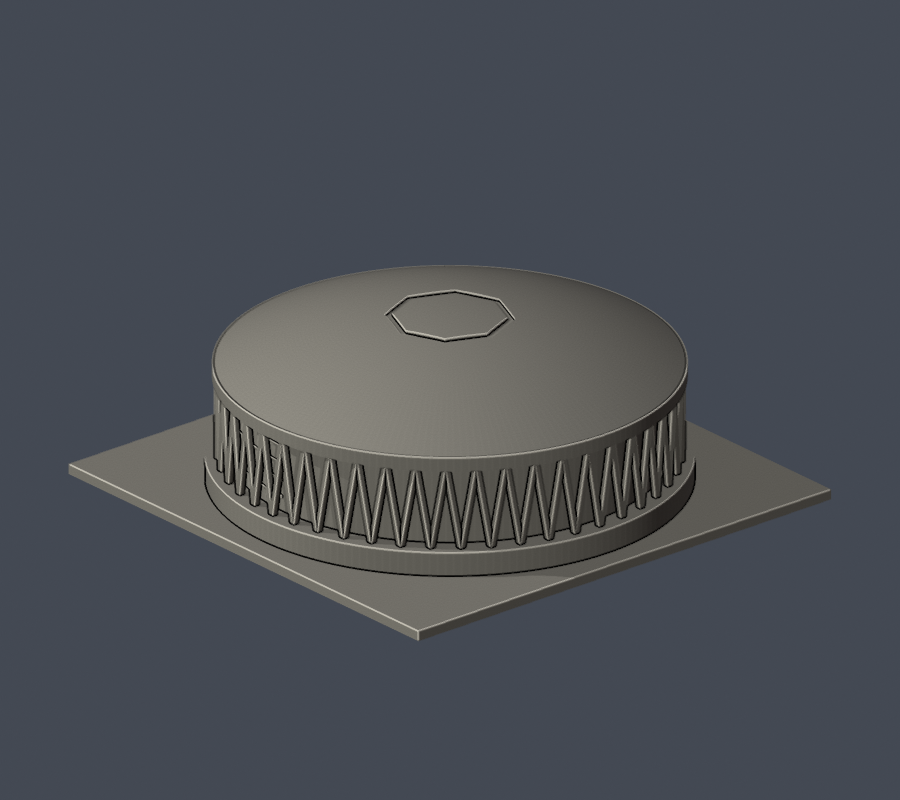
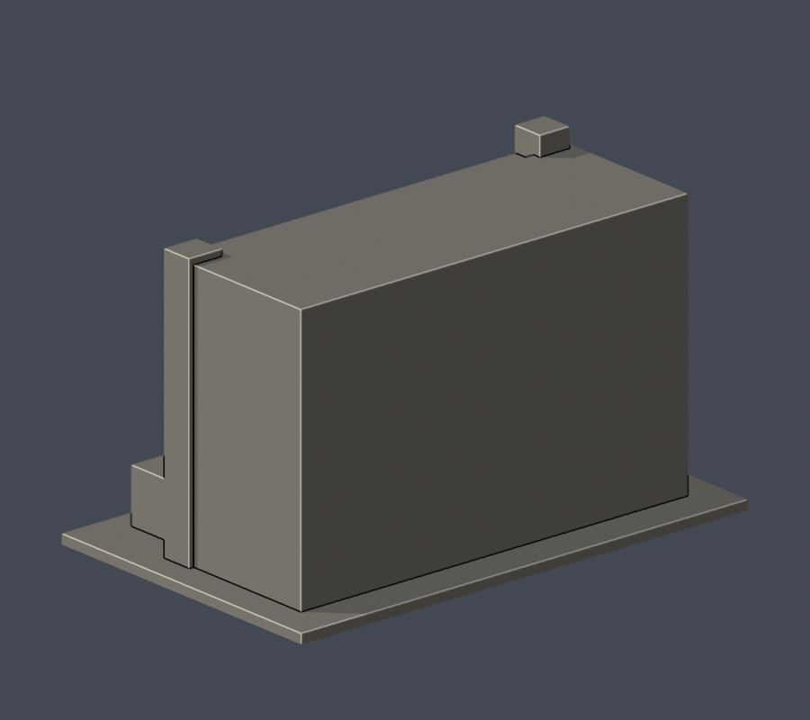

# 國立體育大學

桃園市龜山區文化一路250號；National Taiwan Sport University（NTSU）。不是臺中的國立臺灣體育運動大學。

## 校園建築圖鑑｜初批3件

每欄為不同建築，正背同欄。1件全形近似、2件局部段；圖書館與體育博物館同棟，只計1件。全校尚未完成。

| 綜合體育館 | 行政教學大樓 | 圖書暨體育博物館 |
|---|---|---|
|  [綜合體育館](桃園校區/buildings/ntsu-arena/README.md) |  [行政教學大樓中央入口段](桃園校區/buildings/ntsu-administration-entrance-section/README.md) |  [圖書暨體育博物館前側段](桃園校區/buildings/ntsu-library-front-section/README.md) |

[桃園校區與續接清單](桃園校區/README.md)

全部為自行參數建模，最大含底座150mm。來源年代、後側未知、修繕狀態與列印限制見個件README；不是測繪或現況保證。第三方原照片／PDF不隨公開檔案散布。
