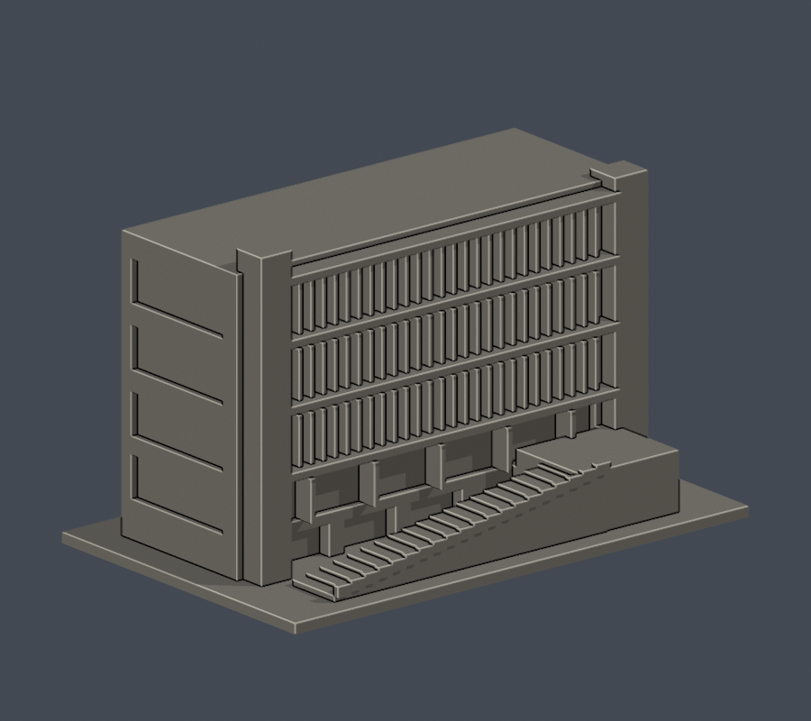
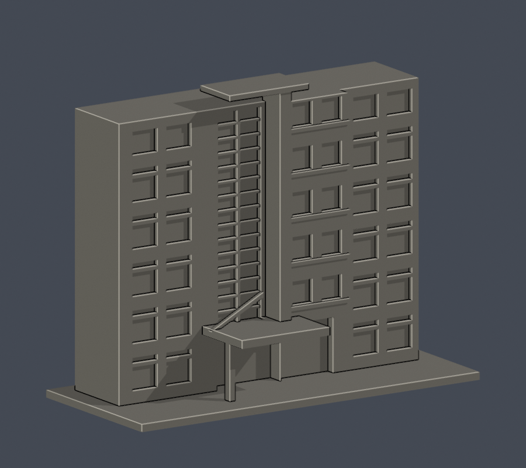
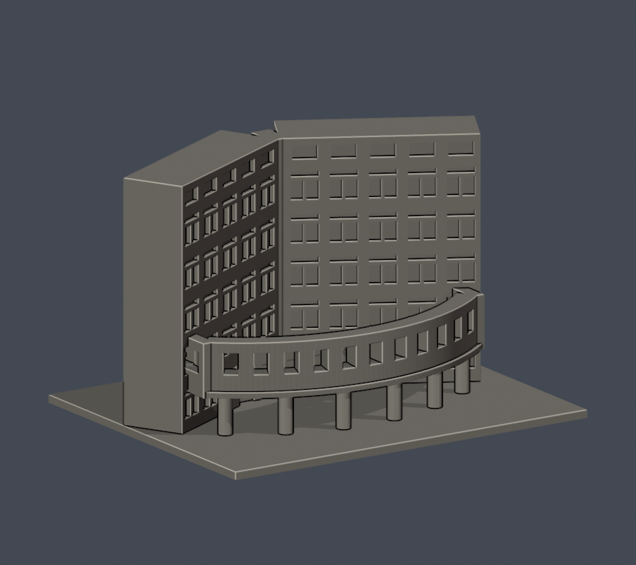
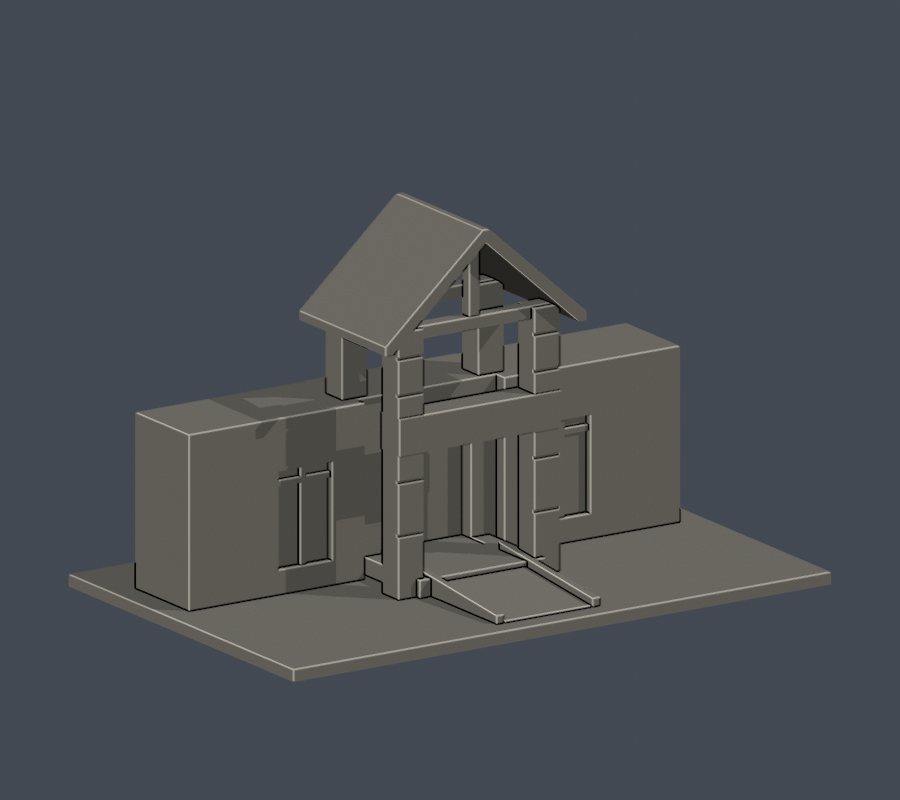

# 國立體育大學｜桃園校區

累計6個不同建築，含5個局部段，並非全校完成。

## 模型圖鑑

| 模型預覽 | 模型預覽 | 模型預覽 |
| :---: | :---: | :---: |
| 綜合體育館  | 行政教學大樓中央入口段  | 圖書暨體育博物館前側段  |
| 教學研究大樓中央前立面段  | 綜合科技大樓弧廊及內凹立面段  | 室內網球館中央門樓段  |

- [綜合體育館](buildings/ntsu-arena/README.md)｜既有外觀全形近似（後勤細節未核）
- [行政教學大樓中央入口段](buildings/ntsu-administration-entrance-section/README.md)｜局部段，非全棟
- [圖書暨體育博物館前側段](buildings/ntsu-library-front-section/README.md)｜局部段，圖書館與博物館合計一棟

[校區續接清單與來源](coverage.json)

[下一批建物與精確來源續接](NEXT-STEPS.md)

- [教學研究大樓中央前立面段](buildings/ntsu-teaching-central-section/README.md)｜局部，非全館

- [綜合科技大樓弧廊及內凹立面段](buildings/ntsu-science-portico-section/README.md)｜局部，非全館

- [室內網球館中央門樓段](buildings/ntsu-tennis-entry-section/README.md)｜局部，非全館
