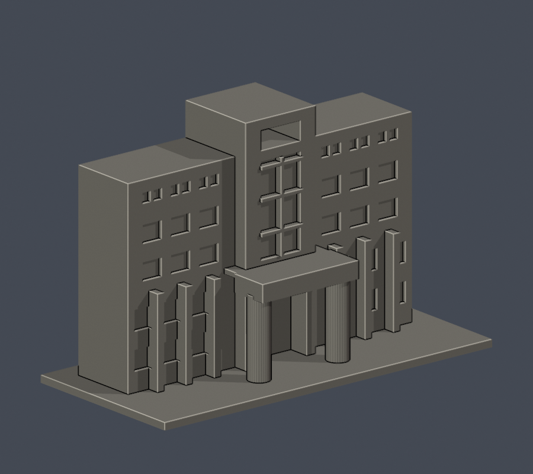
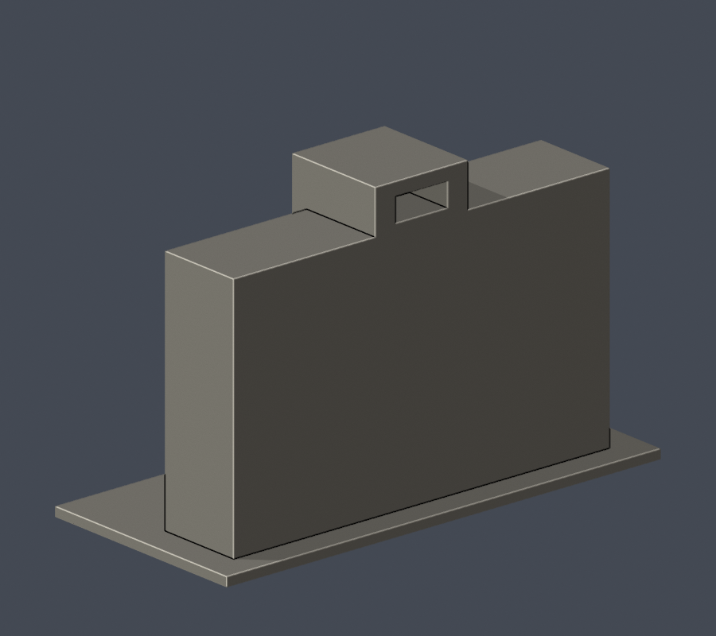

# 國立體育大學｜行政教學大樓中央入口段

## 模型預覽

| 模型預覽 | 模型預覽 | 模型預覽 |
| :---: | :---: | :---: |
| 正面 actual STL  | 背面 actual STL  |  |

**範圍：局部段，非全棟。此為自建可列印外觀近似，不是测繪成果。**

## 幾何與來源界線
保留中央高塔、上方鏤空孔、中央玻璃分格、雙圓柱深門廊與兩側各三跨立面。未涵蓋完整左右側翼、庭院與後棟。

入口進深、側翼截取寬度及高度均依照片近似。未知背側採平整切面，沒有補造規則窗陣。

官方2023年9月校圖確認本校為桃園市龜山區文化一路250號的國立體育大學（NTSU），不是臺中的國立臺灣體育運動大學（NTUS）。來源照片攝影日期未載；PDF、頁面與上傳日期不能代替拍攝日期。2026工程文件是預定進度，不證明當日施工或完成狀態。後側未知的出入口與後勤附屬物均未補造。

## 檔案與重建
- [model.stl](model.stl)：毫米，底座朝下；最長含底座150 mm，各館独立近似比例。
- [scene.blend](scene.blend)：由交付STL匯入，可編修的網格；不是外觀照片的合成效果。
- [build_model.py](build_model.py)：參數化Python原始碼，自建形體，未下載第三方3D模型。
- [requirements.txt](requirements.txt)：重建環境套件版本；Blender 4.3.2用於渲染。
- [render_preview.py](render_preview.py)：由實際STL生成front、rear、elevation、top PNG與Blend。
- [sources.json](sources.json)：URL、可支持特徵與來源年代限制。第三方原照片、PDF不在公開包。

執行 Python build_model.py；再執行 blender -b -t 2 -P render_preview.py。

## 列印限制
雙圓柱門廊頂板、中央高塔鏤空與深入口上緣可能需支撐。

支撐是否需要及放置位置須由切片軟體與印表機設定判斷。此模型有實體內芯以避免封閉內腔，並不模擬室內觀眾席或可進入建築空間。細部與玻璃以加粗浮雕／實體凹槽表達。建議先看實際工具路徑，再試印小範圍。**數位QA不等於Cura／Prusa工具路徑或實體試印，不保證免支撐或保證列印成功。**

## 可重跑QA
- [validate_model.py](validate_model.py) → [validation.json](validation.json)：原始STL法向／繞序、每邊兩面、vertex link單環、水密、正體積、單一表面殼、來源重建SHA與Blend/STL幾何一致。
- [check_contour_validity.py](check_contour_validity.py) → [contour-validity-check.json](contour-validity-check.json)：z=.071起，每0.2mm檢查閉合degree2及個別／組合Polygon valid，遇到invalid直接失敗，無repair fallback。
- [check_thin_features.py](check_thin_features.py) → [thin-feature-check.json](thin-feature-check.json)：canonical fail-closed v3，每1mm、0.8mm opening參考寬度篩檢。這不是全面最小壁厚或切片分析。
- [qa-summary.json](qa-summary.json)：逐程式退出碼与數位QA摘要。
- [SHA256SUMS.txt](SHA256SUMS.txt)：此件交付逐檔校驗。
