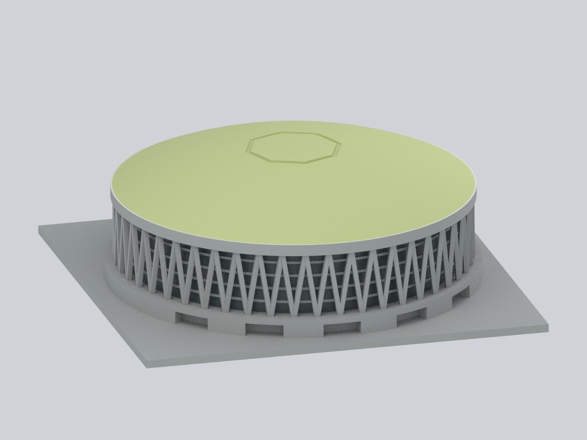
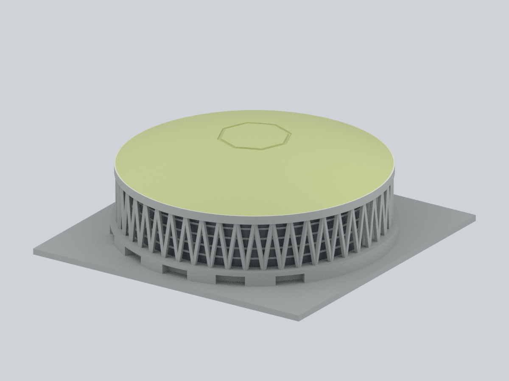
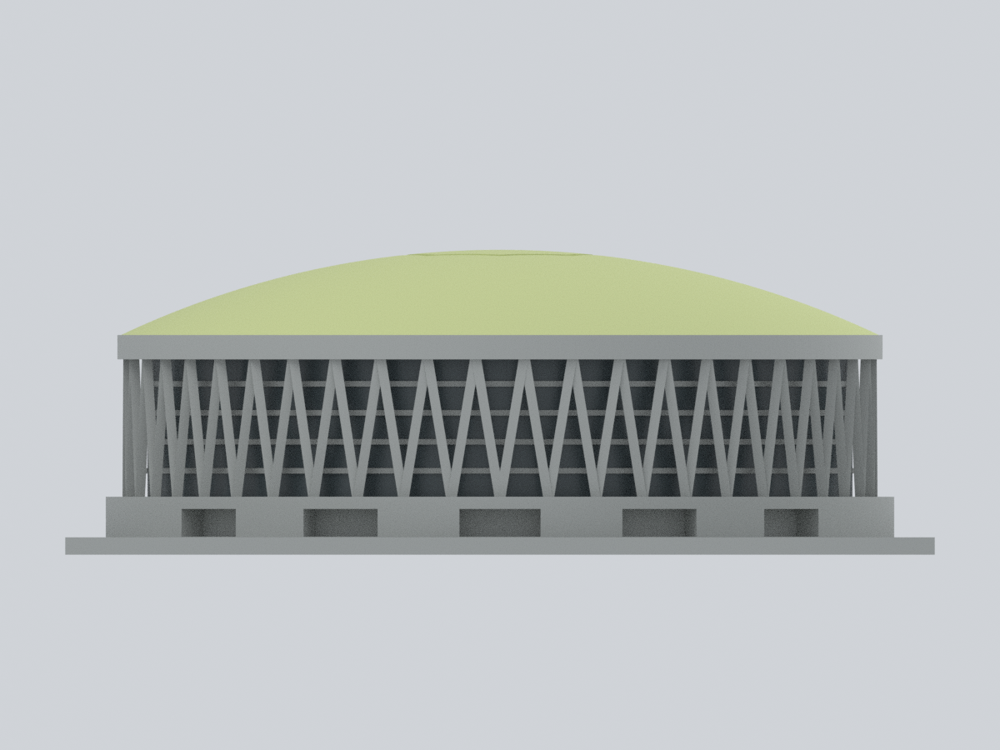
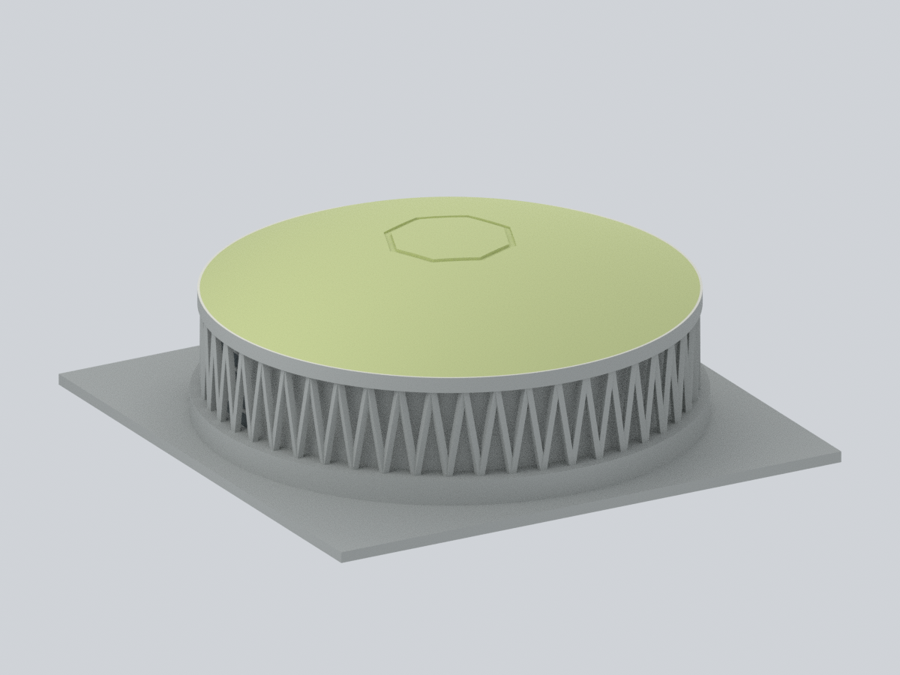
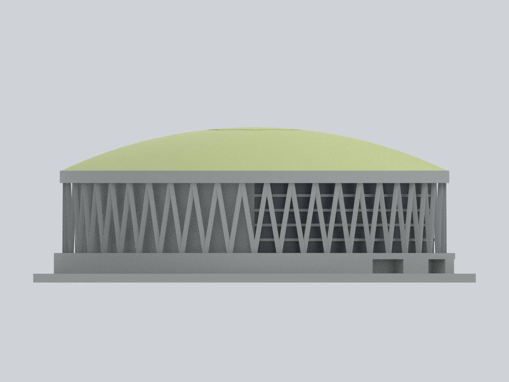
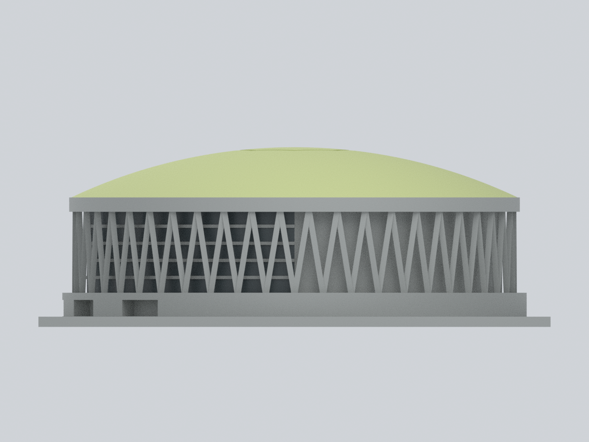
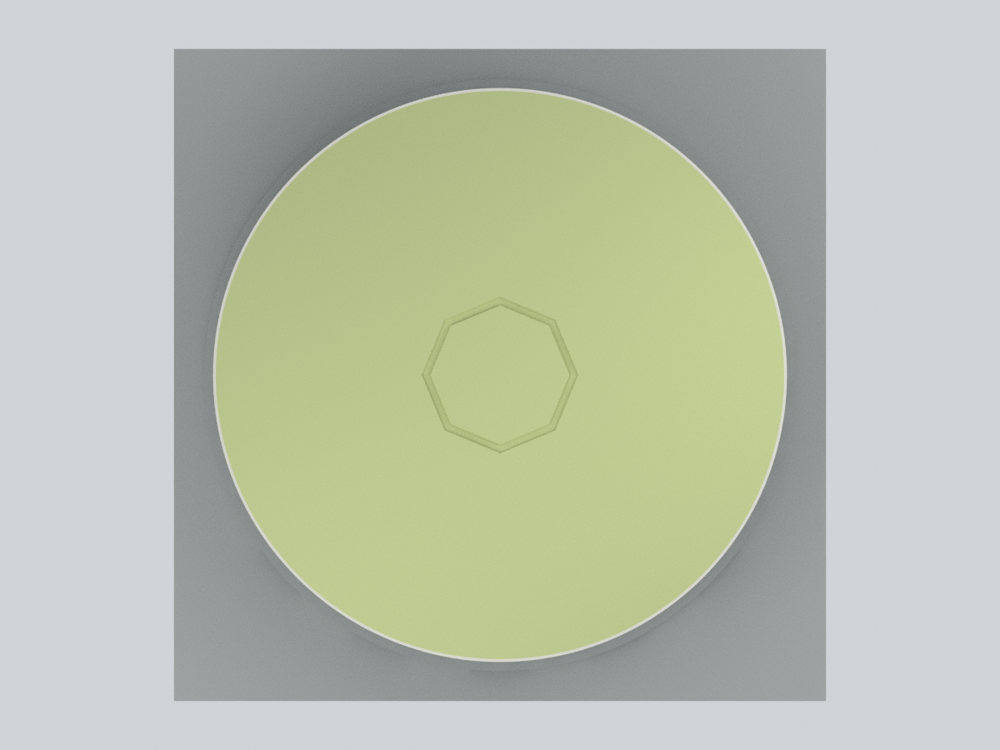
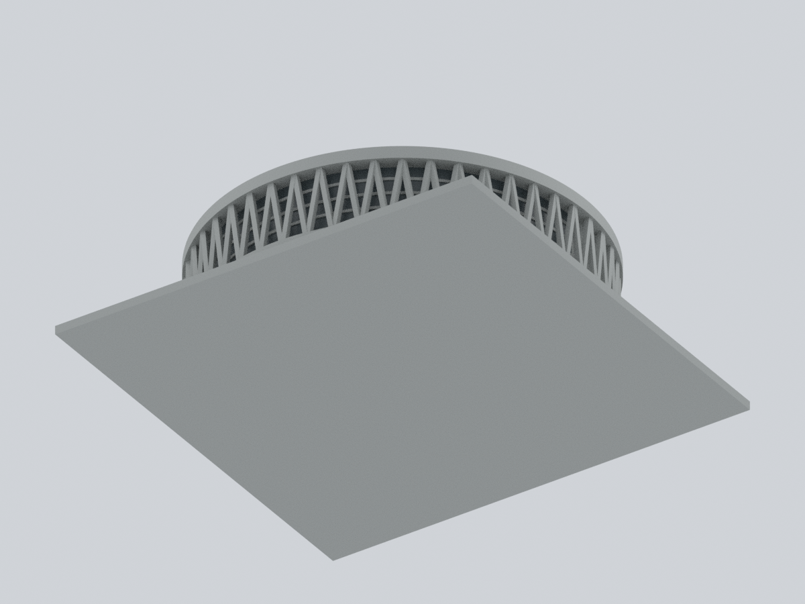
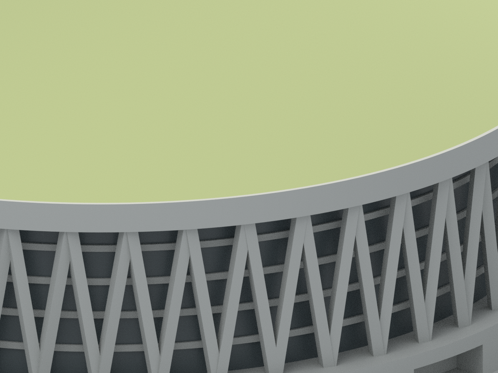

# 國立體育大學綜合體育館｜有限材料色系示意

桃園校區，**NTSU，不是臺中的 NTUS**。本層只對既有模型的原三角面指定材料色系：**23,862 面有核定代表色、6,786 面維持未知中性；全 30,648 面幾何、面序、角點順序與 float32 座標完全保留。** 原 STL、原 Blend、舊預覽和既有幾何 QA 不修改；不是新增建物。

不是整棟配色完成、測繪模型、歷史精準原色、2017 完整復原或 2026 現況認證。色碼未經照片色彩校正，不是塗料規格或材料化學鑑定。灰色代表本次未核的範圍，**不是認定實物真的灰色**。

## 九張實際模型預覽

全部由同一個可編修網格直接渲染；無照片貼圖、生成影像、UV 塗色或額外構件。前方為模型 −Y，非地理方位。近景只調整相機。

| 左前斜視 | 右前斜視 | 正立面 |
| :---: | :---: | :---: |
|  |  |  |

| 後側：玻璃仍中性 | 左側 | 右側 |
| :---: | :---: | :---: |
|  |  |  |

| 頂視：完整主拱頂 | 底視：保持中性 | 屋頂水平唇邊近景 |
| :---: | :---: | :---: |
|  |  |  |

## 可編修交付與精確對應

- [原 STL](../model.stl)：1,532,484 bytes；SHA-256 `d79ad8b995cfafb3c89d01d6a8f7401f3e068c8d7193ce3ac83e64ff0f132f2a`。本層只讀，不另交付重複 STL。
- [彩色 3MF](ntsu-arena-appearance.3mf)：毫米、單一原網格、4 個標準 base materials，每面均明確指定材料屬性。
- [可編修 Blender](ntsu-arena-appearance.blend)：15,134 個頂點、30,648 個原三角面、4 個材質槽、`original_stl_triangle_index` 面索引；無修飾器、UV、頂點彩繪、外部圖像或內嵌腳本。相機和燈光保留供重新渲染。
- [逐面材料表](face-materials.csv)、[數值面 ID／指紋合約](parameters.json)、[固定色盤](palette.json)、[來源與日期](sources.json)、[逐檔雜湊](SHA256SUMS)。

面 ID 是 binary STL 原始 record 的 **0 起算順序**，不盲信匯入器索引。所有面都做保朝向指紋及完整 ordered corner stream 驗證：**面重排、角點循環重排、座標移動均拒絕**，不是只比面集合或包圍盒。頂點表去重／重編號僅在重建的原序三角座標 bytes 完全相同時允許；不切面、補面、修補、細分或新增幾何。

## 材料範圍與未核部分

| 原面區域 | 面數 | 面積 mm² | 代表色 |
| :--- | ---: | ---: | :--- |
| 完整主要拱頂 `main_dome` | 22,518 | 14,241.598502 | 淡黃綠 `#C6CF90` |
| 水平屋頂唇邊 `horizontal_roof_rim_lip` | 384 | 260.936705 | 暖白 `#E0DED2` |
| 前側幕牆 `observed_front_glazing` | 960 | 3,800.905903 | 不透明灰藍 `#495356` |
| **有代表色合計** | **23,862** | **18,303.441110** | 底板以上表面積的 38.1269% |
| 全部其餘原面 `unknown_neutral` | **6,786** | — | 未知中性 `#A9ACA9` |

- 白綠交界沿原網格 192 條共邊，交界 z=`37.900001525878906`；跨界三角面 0。**白色只到水平唇邊，不延伸到垂直環梁、簷底或 V 柱。**
- 前側由既有負 Y 五個入口、四道凸橫帶及原前視相機共同辨識。前幕牆不含凸橫帶／V 柱；後側 208 面玻璃仍中性。y=0 只是本次證據範圍的界線，**不宣稱實物有前後異色接縫**。
- 環臺頂 872 面仍中性：原幾何未分出紅褐地坪與白女兒牆／頂蓋的材料界線，不能整圈塗紅。
- 垂直環梁、V 柱、前凸橫帶、入口、底座與其餘面全部中性；不因局部照片或圓形對稱擴張配色。
- 原有八角凹線維持屋頂同色，不畫假修補灰條；屋頂細肋、設備、藍柱、旗幟、文字、道路與景觀均不新增。玻璃 alpha=1、metallic=0、transmission=0，並非透明室內模型。

## 來源、日期與權利

2026-10-24 取回核對；完整 URL、取回 UTC、檔案 SHA 與用途限制見 [sources.json](sources.json)。

1. [國體官方鳥瞰原圖](https://www.ntsu.edu.tw/var/file/0/1000/img/1179/644329861.png)及[介紹頁](https://www.ntsu.edu.tw/p/412-1000-3.php?Lang=zh-tw)：支持主要淡黃綠拱頂、淺白外緣和前玻璃家族。畫面有 TAIPEI 2017 活動識別；**攝影日期不明，標識不是精確拍攝日期**。
2. [國體綜合體育館簡介 PDF](https://phk.ntsu.edu.tw/var/file/8/1008/img/1439/147422320.pdf)，第 1–2 頁及第 2 頁較高視角屋頂照片：與近鳥瞰互補，可見整片主拱頂；不是由前面鏡像推定屋頂背半。PDF metadata 建立於 2022-08-10，**不等於各照片拍攝日**；後玻璃細節仍不足。
3. [宗邁建築師作品頁](https://fca.com.tw/portfolio/林口體育館/)與[前廣場實拍](https://fca.com.tw/wordpress/wp-content/uploads/2016/04/04-1.jpg)：交叉辨識前入口與幕牆。1986-09 是完工資訊，2016/04 是 URL 上傳路徑，**都不是照片已驗證拍攝日**。
4. [官方租借說明](https://ntsuarena.ntsu.edu.tw/user/rent/site)：只用於身份與圓周玻璃文字，不當後側配色證據。[2026 工程計畫](https://general.ntsu.edu.tw/p/450-1028-34256,c0.php)是預定工作，不能證明當日施工進度、完工或現況顏色。

官方／建築師照片、PDF 和裁圖未確認公開再散布授權，**本包不含其像素或檔案**。建築師頁保留版權；官方來源不自動等於可再發布照片。所有預覽為本模型的原創渲染。

## 僅用公開輸入乾淨重建

需 CPython 3.12、[requirements.txt](source/requirements.txt)套件與 Blender 4.3.2。用新空目錄，**不覆寫本包／原 STL**。只需原公開 STL、Python、parameters.json、palette.json；不需照片、網路、已有 Blend／3MF／PNG 或其他研究資料。

```sh
python -m pip install -r source/requirements.txt
python source/rebuild.py --stl ../model.stl --out /path/to/new-empty-output --blender blender
python source/compare_rebuild.py . /path/to/new-empty-output --report /path/to/rebuild-comparison.json
python source/verify_package.py .
```

不要用 `python -O` 停用斷言；流程會拒絕最佳化模式。重建包括 3MF、CSV、Blend、9 PNG、原生重開、真實材質／頂點編修副本測試、17 項負向測試、7 項實際 3MF 檔案反例及完整 Blend 路徑緩衝區檢查。參數和色盤有固定 SHA，變更面範圍或色盤會失敗關閉；本文件沒有授權擴張材料證據。

3MF 使用標準 XML 以可精確還原 float32 的十進位座標輸出，lib3mf 2.5.0 strict reopen 為 0 警告。該版本 writer 設 15 位精度仍使此例 **6,336 頂點**漂移，最大 `3.814697265625e-6 mm`；精確檢查確實拒絕，因此交付未用該幾何 writer。真實 native `SetDisplayColor` 編修後只序列化被改的 `displaycolor`，所有頂點／面字串保持不變，再 strict reopen 確認。第三方任意重存須重驗，不以「很小」漂移豁免。

## 驗證與列印限制

- [完整幾何保留](qa/geometry-preservation.json)、[3MF 原生重開與真實材料編修](qa/3mf-validation.json)、[Blend 重開與真實材料／頂點編修](qa/blend-validation.json)。編修只在臨時副本，原交付檔未改。
- [失敗關閉](qa/fail-closed.json)：STL／座標竄改、增減／錯指面、指紋變更、漏中性面、額外材料、透明玻璃、面重排與角點循環重排等 17 個反例均拒絕。單純頂點表重編號且原序座標流不變的正向控制通過。
- [實際 3MF 負向控制](qa/3mf-negative-controls.json)：中性面塗白、後玻璃著色、白緣塗綠、透明玻璃、面重排、角點循環重排和座標漂移的儲存檔都由原生驗證器拒絕。
- [乾淨重建](qa/clean-rebuild.json)：9 PNG bytes／pixels、3MF bytes、逐面表和幾何／材質報告一致。Blend 整檔含非語義工作階段資料，不要求整檔 bytes 相同；兩份均真實重開檢查。
- [渲染設定](qa/render-manifest.json)、[全長固定路徑緩衝區](qa/path-buffer-audit.json)、[私密性控制](qa/privacy-validation.json)、[外觀自檢](qa/visual-self-check.json)。

原模型含底座最大 150 mm，高約 52.597 mm；不同來源 132／122 m 直徑及 47.61／47.71 m 高度有差異，**不採固定測繪縮尺**。仍沿用近似 48 個 V 支撐節奏、實體內芯及簡化幕牆／屋頂；不模擬室內觀眾席或可進入空間。

**材料屬性不等於多色列印分件或切片指令。** V 柱、平台懸挑、入口橫梁和屋簷仍可能需支撐；八角凹線仍是原有約 2 mm 寬、0.5–0.8 mm 深背襯凹線。底座朝下，先檢查實際工具路徑並小範圍試印。未新增 Cura／Prusa 切片驗證、材料映射相容性或實體試印；不保證免支撐、可印或多色列印成功。完整原限制見[原 README](../README.md)與[原幾何 QA](../validation.json)。
