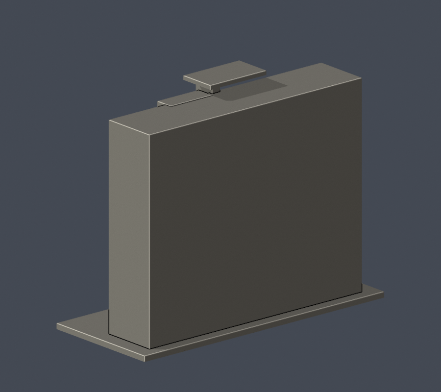

# 國立體育大學｜教學研究大樓中央前立面段

**局部外觀近似，非全館測繪。** 桃園市龜山區文化一路250號，NTSU；不是臺中國立臺灣體育運動大學NTUS。

| 前側 actual STL | 後側 actual STL |
|---|---|
|  |  |

## 製作範圍
中央高玻璃帶、直立主柱、右側突出窗跨、兩側各兩個窄翼窗跨與深雨遮入口。六列立面帶依照片逐列核對，沒有用樓層用途數代替窗列。

全棟左右翼、後面、進深、屋頂太陽光電與2024新增空調美化細部均未重建。背面與兩側斷面留白；本件不是全棟。玻璃小分格適度加粗並留在凹面內。

來源照片攝影日期未載；網頁更新、PDF上傳與本次讀取日期不是照片年代。科技大樓外牆2021年整修，行政／教學／科技立面空調美化2024-05-28完工；規劃中的網球館屋頂光電和2026室內工程不當作已完成外觀。**模型不聲稱2026當下實況。** 精確適用範圍與日期在 [sources.json](sources.json)。

## 檔案與重建
- [model.stl](model.stl)：毫米；含底座最長150mm，各件獨立近似比例。底座朝下。
- [scene.blend](scene.blend)：由實際交付STL匯入的可編修網格；與STL幾何核對。
- [build_model.py](build_model.py)：自建參數原始碼，沒有下載第三方3D模型。建立原始mesh時去除float32量化造成的零面積冗餘三角片，再assert封閉；交付STL不經修復直接驗證。
- [requirements.txt](requirements.txt)：版本與重建套件。
- [render_preview.py](render_preview.py)：由實际STL輸出front/rear/elevation/top PNG，Blender 4.3.2。

執行 Python build_model.py，再執行 blender -b -t 2 -P render_preview.py。每個PNG都由該件STL產生，不是替代模型的效果圖。原照片／PDF只供私有對照，不隨公開包重散布。

## 列印注意
雨遮挑出、斜拉桿及入口上方可能需支撐。

窗框、欄杆及屋緣做適量加粗或簡化。未知背部是有厚度實體切面，並非零厚面。數位QA不等於Cura／Prusa實際工具路徑或實體試印；不保證免支撐、完整最小壁厚或每種機器都能成功。請檢查切片後先試印。

## fail-closed QA
- [validate_model.py](validate_model.py) → [validation.json](validation.json)：原STL法向與繞序、原始面、每邊兩面、vertex link單環、水密、正體積、單一表面殼、150mm、獨立重建SHA及Blend/STL一致。
- [check_contour_validity.py](check_contour_validity.py) → [contour-validity-check.json](contour-validity-check.json)：固定z=.071起，每0.2mm，全層degree2閉合、個別及組合Polygon valid與0.8mm opening。invalid直接失敗；無buffer(0)或make_valid修補。
- [check_thin_features.py](check_thin_features.py) → [thin-feature-check.json](thin-feature-check.json)：原樣canonical fail-closed v3輔助檢查。正式薄件判斷採上列每0.2mm全層結果，不只看1mm抽樣。
- [check_depth_rays.py](check_depth_rays.py) → [depth-ray-check.json](depth-ray-check.json)：原始二進位STL射線验证入口／弧廊空隙；只量模型，非實建測量。
- [qa-summary.json](qa-summary.json)：逐程式exit0、全部checks與全0.2mm薄件摘要。
- [SHA256SUMS.txt](SHA256SUMS.txt)：逐檔SHA。
