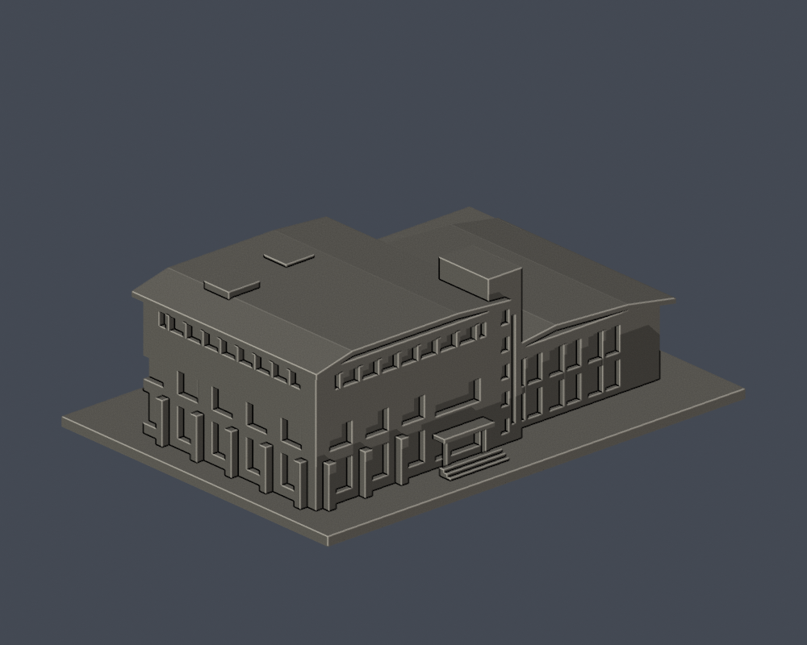
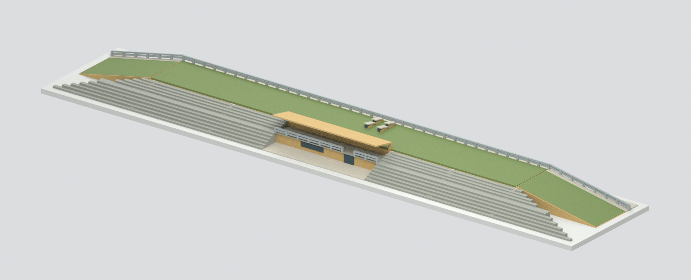
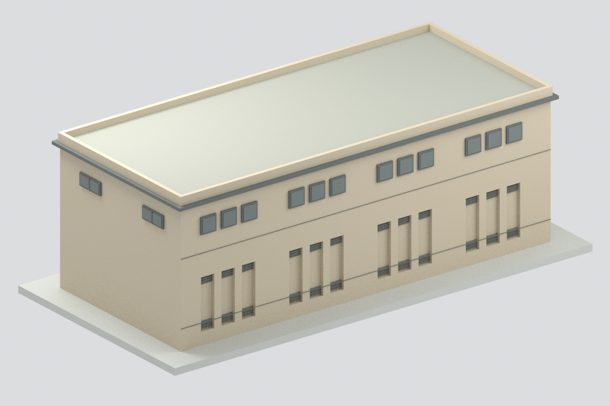
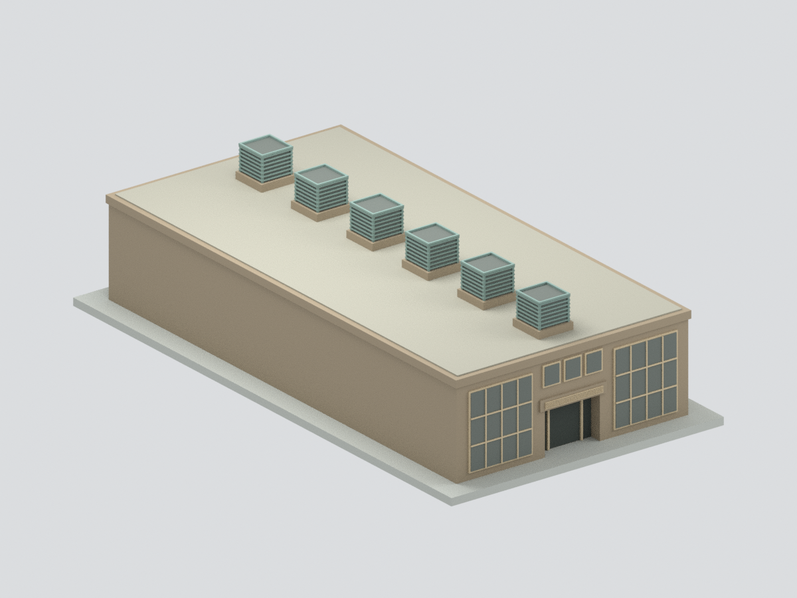
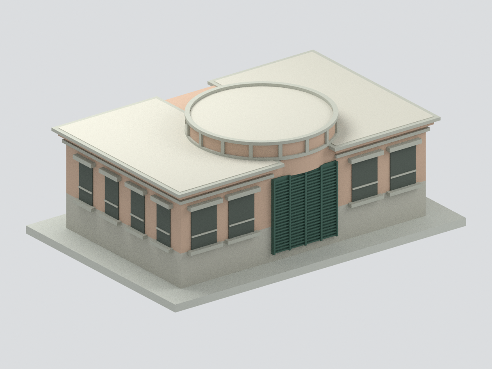
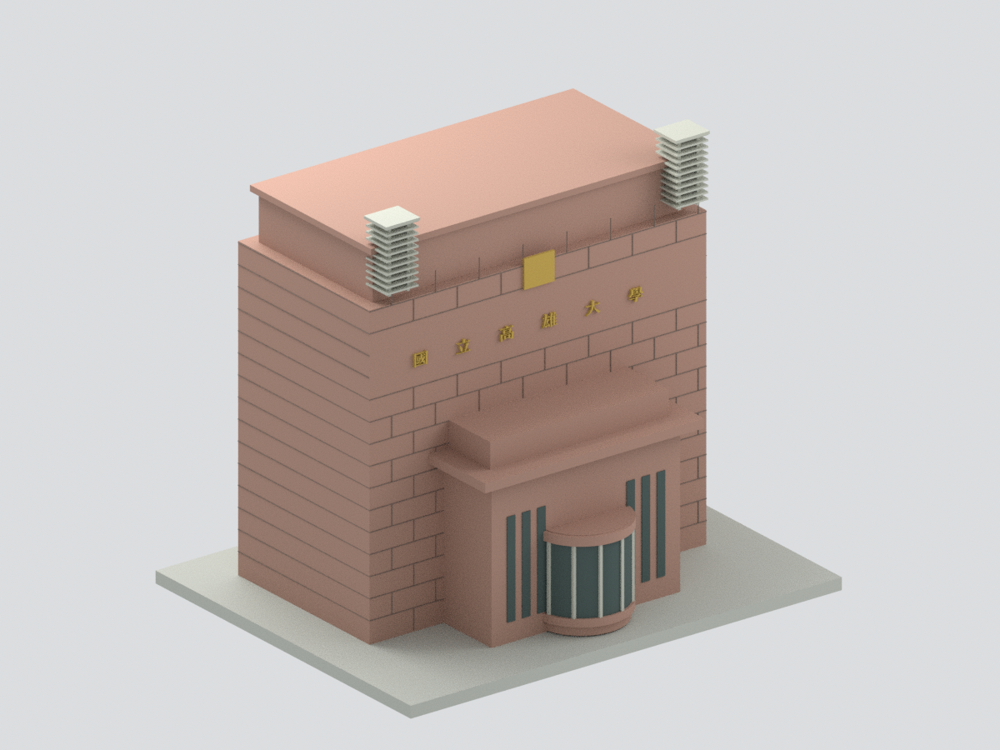
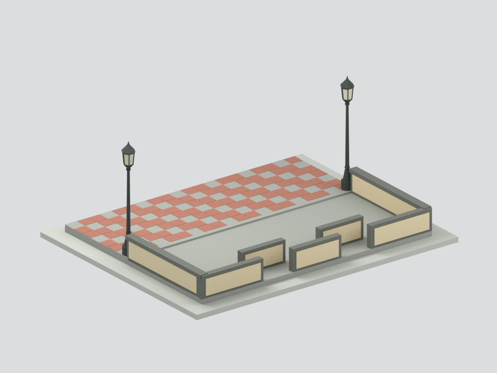

# 楠梓校本部

高雄市楠梓區高雄大學路700號。現收錄9件自主外觀近似模型；圖資仍只涵蓋主棟及裁切階台，人社以A/B相連主樓和獨立C棟分成兩個模型；本校區尚未全做。

總配電站為照片支持外觀近似，未知背面與另一短端中性封閉，尺寸估計、短端映射示意，不是全棟精確還原。

污水及中水處理場僅地上主建物歷史外觀近似；長側中性、另一短端局部推定、尺寸估計，非整場區或現況測繪。

實驗廢水處理場僅地上主建物歷史外觀近似；未見背面／另一端中性、尺寸估計，不含地下設施與廣場，非整場區或現況。

正門僅中央警衛室與門塔歷史近似，不含外側長牆／道路；背面中性、尺寸估計、替代校名字型，非完整校門或現況。

東門僅入口低牆與鋪面核心歷史近似，非獨立館舍；尺寸與燈飾／磚格估計，不含道路或背景建物。

| 建築模型 | 建築模型 | 建築模型 |
| :---: | :---: | :---: |
|  **[圖書資訊大樓主棟](buildings/nuk-library-main/README.md)** |  **[體育健康休閒多功能教學大樓](buildings/nuk-sports-leisure/README.md)** |  **[人文社會科學院 A/B 主樓](buildings/nuk-humanities-ab/README.md)** |
|  **[國立高雄大學人文社會科學院 C 棟](buildings/nuk-humanities-c/README.md)** |  **[國立高雄大學總配電站：歷史照片有界外觀近似](buildings/nuk-power-station/README.md)** |  **[國立高雄大學污水及中水處理場主建物：歷史照片外觀近似](buildings/nuk-sewage-main/README.md)** |
|  **[國立高雄大學實驗廢水處理場主建物：歷史照片外觀近似](buildings/nuk-lab-wastewater-main/README.md)** |  **[國立高雄大學正門中央警衛室及門塔](buildings/nuk-main-gate-core/README.md)** |  **[國立高雄大學東門入口低牆及鋪面核心](buildings/nuk-east-gate-core/README.md)** |

[回學校入口](../README.md) · [逐項未完成範圍](../remaining-buildings.md)

## 人文社會科學院 A/B 主樓範圍

人文社會科學院完整相連 A/B 主樓：A三層大U／B二層小U錯向90度角接、內降斜接屋面、共六凹平台與各棟一水箱服務區、高A低B灰框寬簷、角部玻璃、真斜頂教室及可見車道凹入口。242×256×34mm，5材質Blend/3MF/STL、5實mesh圖；11144面單閉殼、170層與局部探針、格式真編存讀及乾淨九檔重建通過。發包圖＋早期官照外觀近似，非竣工測繪或2026現況；C分離低長體、完整地景、地下延伸與室內排除。微型厚化、需支撐評估、未實體試印。 [模型與來源](buildings/nuk-humanities-ab/README.md) · [QA警告](buildings/nuk-humanities-ab/QA.md)。既有圖資與體健休模型及其範圍不變。
