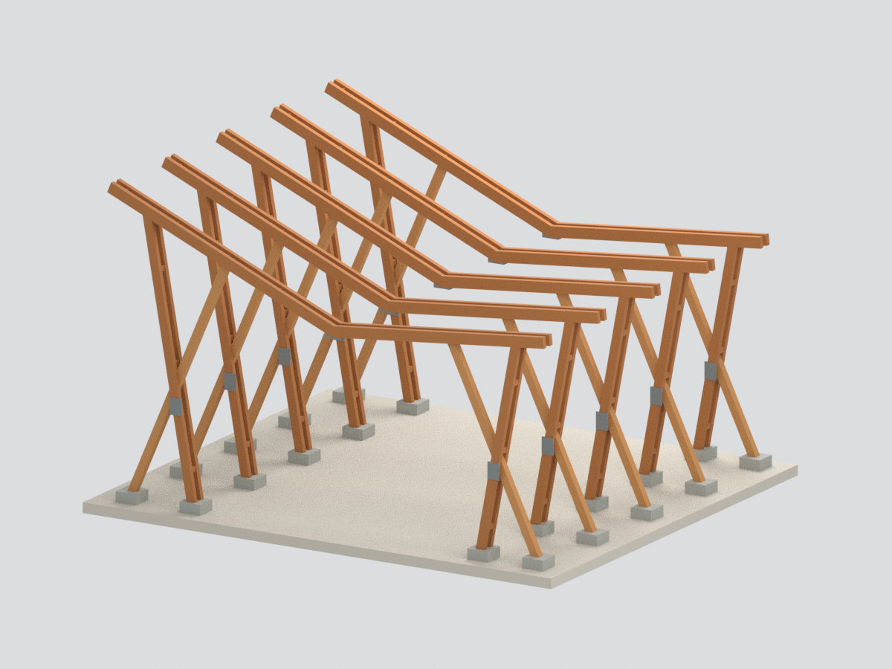
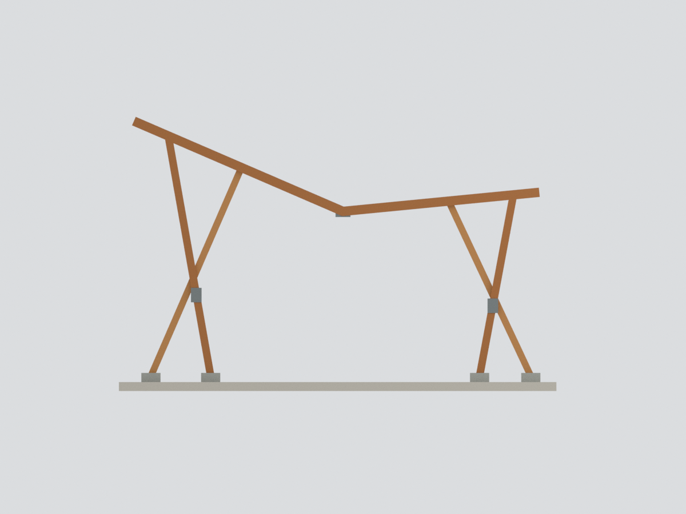
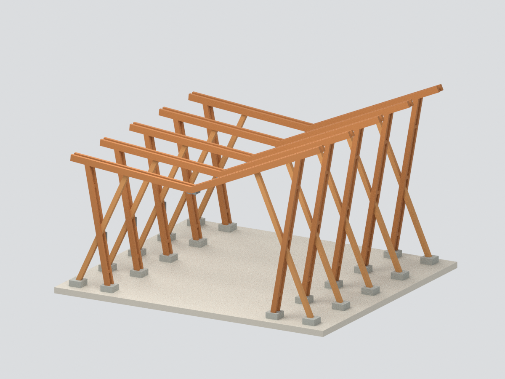
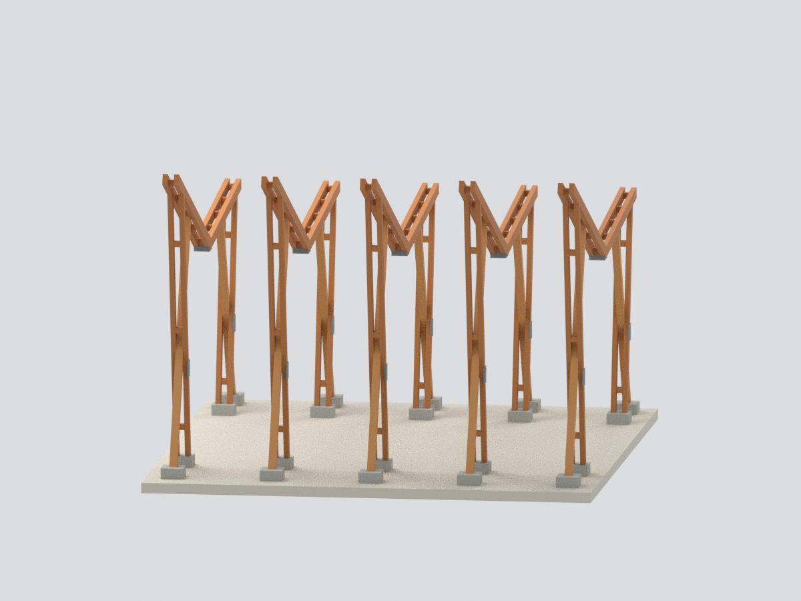
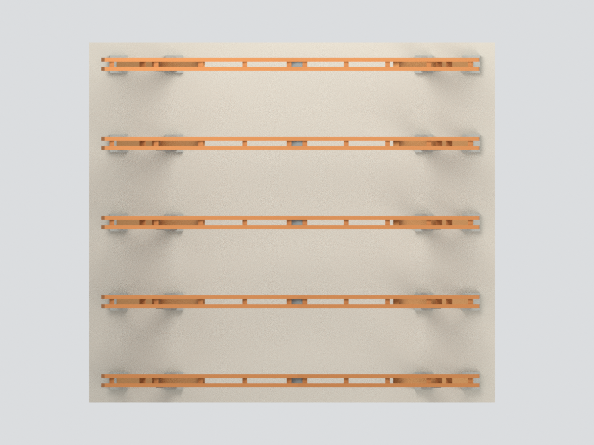
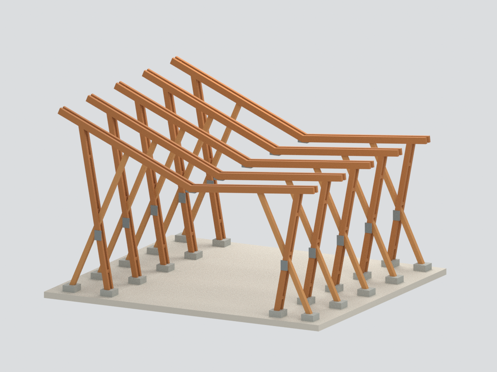

# 國立高雄大學木構造實驗展示屋：2014 施工期主木構架研究

本件呈現承造團隊公開施工照片中的 **五道完整主木構架**，不是竣工示範屋，也不是現況模型。照片當時尚未鋪設屋面；本模型沒有刻意漏掉竣工屋頂，而是選定尚未鋪屋面的施工階段。沒有混入其他年份的黑色側幕、白色百葉、室內實驗單元或展示牆。

## 範圍與可信度
- 保留五道高低不等的 V 形屋架、兩側 X 形柱系統、主要雙拼木梁／柱及柱腳。
- 建築設計者公開文章記載南向屋面傾斜 23.5°；本研究將此角度用於高翼主梁。地理方向未測繪，模型的前後左右只是局部座標。
- 其餘尺寸、低翼坡度、框距、柱腳及連接板為照片比例研究，**不是施工圖、測量復原或工程尺寸**。沒有利用建築面積倒推未見尺寸。
- 細螺栓、吊裝臨時支撐、散置木件、圍籬、人物、施工車與後期增建均排除。
- 底部連續薄板為作者新增的展示／單件連通支撐，並非真實基地鋪面；柱座大小與金屬片也作名義簡化。
- 參考照片僅供私人研究，未嵌入 Blender、3MF 或公開包內；公開可讀不表示授權再散布。

## 檔案
`model.stl` 單一封閉網格；`model.3mf` 含簡化材料色；`scene.blend` 含統一網格及隱藏可編輯構件；`build_model.py` 為可重建源碼。

模型尺寸：143.5 × 127.4 × 90.0418 mm；4,248 三角面。暖木、灰金屬與混凝土色為照片觀察近似，非校色資料。

## 六視圖

## 驗證與製造限制
幾何／格式 QA、乾淨目錄逐頂點逐面逐材料重建、Blender 綁定及渲染視角檢查由隨附程式執行。通過水密與單連通 **不等於通過實體試印**：屋架懸臂長、雙拼縫與細板可能需要支撐、改變擺放或放大列印；沒有宣稱無支撐列印、建築結構安全或構件真實承載能力。

來源與年代區隔見 [SOURCES.md](SOURCES.md)，重建見 [REBUILD.md](REBUILD.md)。
