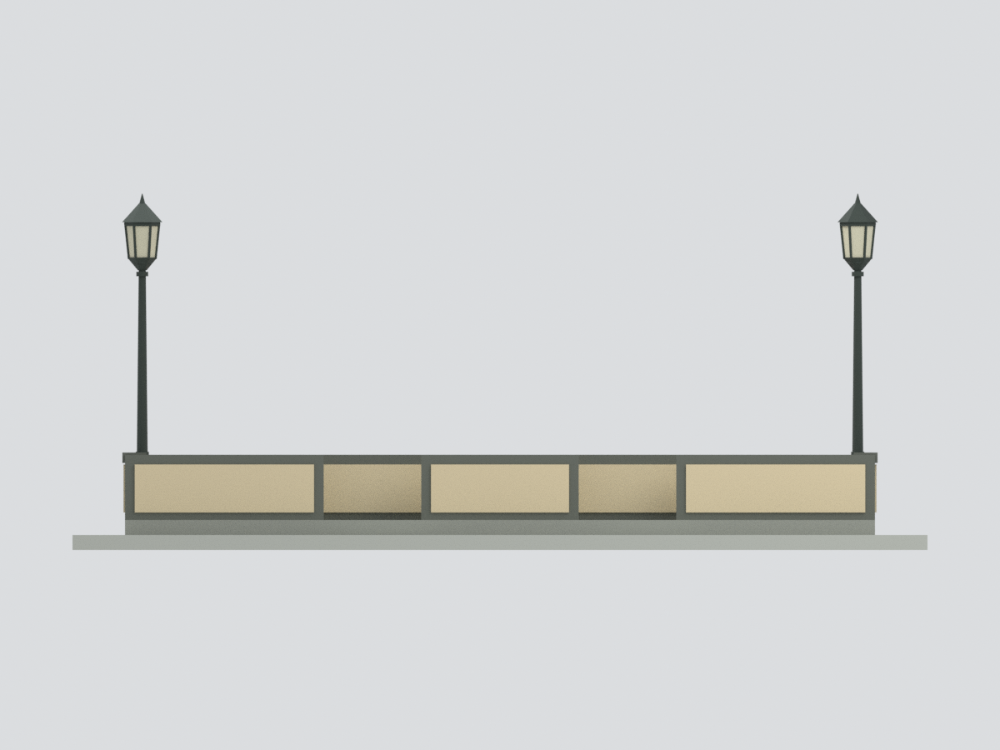
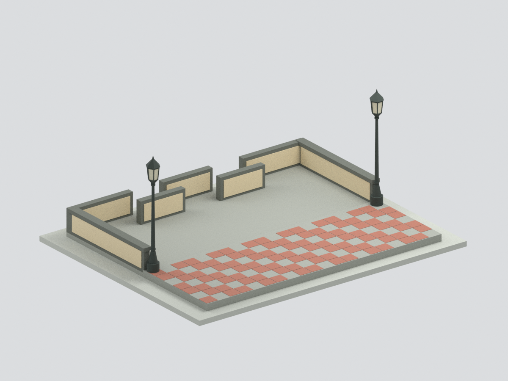
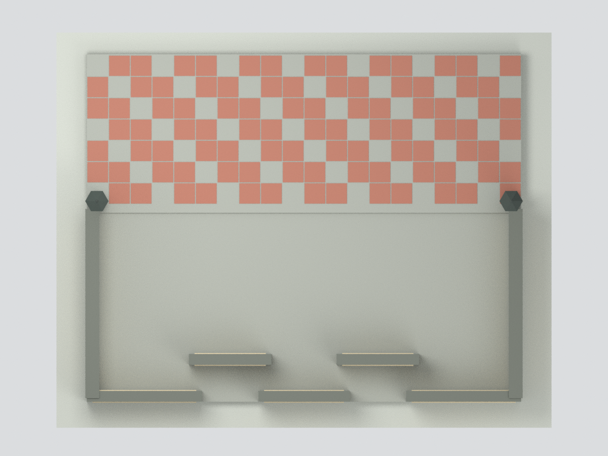
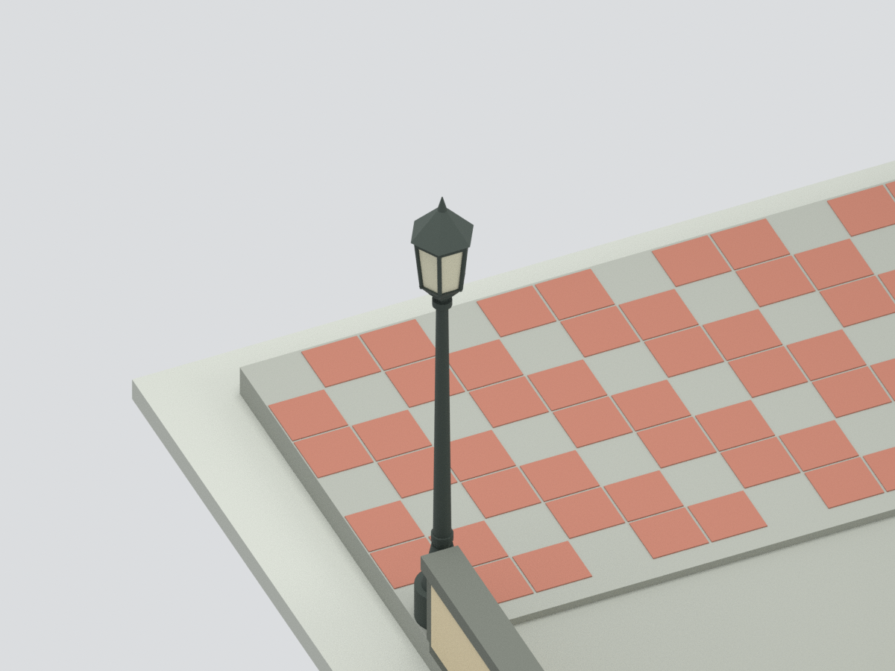

# 國立高雄大學東門入口低牆及鋪面核心

依舊版校園規劃小組四張照片製作的入口構造外觀近似，不是獨立館舍，也不是照片背景的住宅或遠方校舍。只涵蓋五件交錯低屏牆、兩側轉折矮牆、局部鋪面及兩盞燈。照片未標攝影日，不能當2026現況。

| 實際模型預覽 | 實際模型預覽 | 實際模型預覽 |
| :---: | :---: | :---: |
|  |  |  |
|  |  |  |

## 下載
[STL](model.stl) · [七色3MF](model.3mf) · [Blender](scene.blend) · [建模程式](build_model.py) · [SHA256](SHA256SUMS)

## 範圍與可信度
- 已見：道路側三片與校園側錯後兩片低牆、兩端L形回折、灰深框與米黃板、灰水泥低平台、校內紅灰鋪面及一對古典黑燈。
- 五個擋牆件以底座連成單一網格；交錯間隙保留，不變成連續封閉U牆。
- 尺寸全為照片比例估計，模型含底座171×136.5×71.25mm，非測繪比例認證。通道寬度、低階差與側翼深度無量測。
- 燈罩六邊截面、燈柱粗細、窗格及鋪磚節奏為製模簡化；方形局部燈座不能當整條台階，模型只作單淺階差。
- 不含路邊螺紋圓柱、道路、排水、草地樹木、遠方雕塑或建物；不能聲稱東門整個景觀或校園完成。

## 幾何與列印限制
單一封閉連通，4898三角面；STL/3MF/BLEND值與實際渲染核對。這只證明幾何及檔案完整，不證明現地精確或列印成功。尚未實體試印，燈頂/燈框及窄柱需評估加粗、支撐與斷裂風險；不保證免支撐/全域壁厚。七色為核心3MF面材質，未驗證各廠切片器自動分配料槽。

## 重建
使用Python含numpy、trimesh、manifold3d執行build_model.py，再以Blender執行render_model.py；validate_model.py與verify_scene.py分別核對網格和重開場景。Blender含隱藏的原創組件方便編輯，未聯集的隱藏件不是獨立可列印成品。

[來源與證據](SOURCES.md) · [幾何QA](QA.json) · [外觀QA](visual-review.json)
