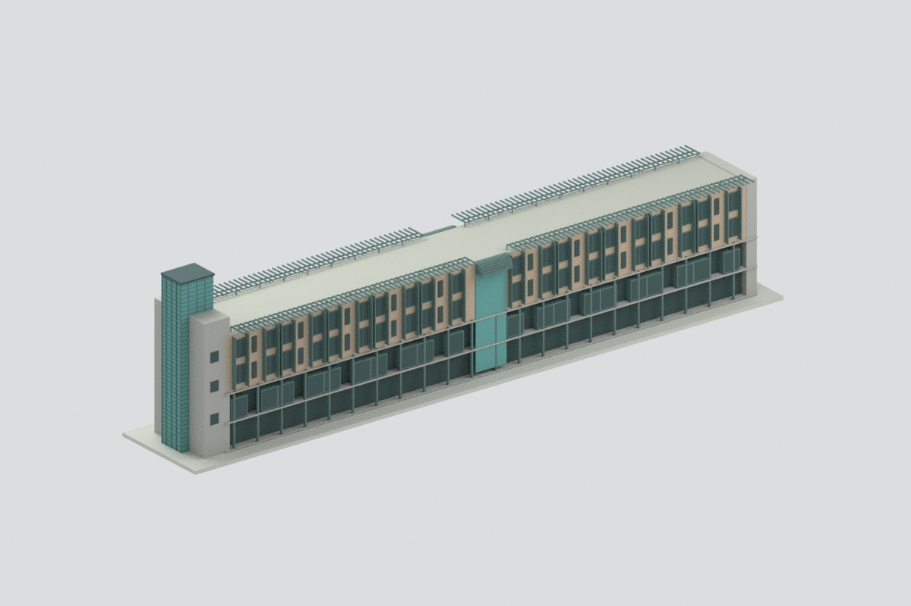
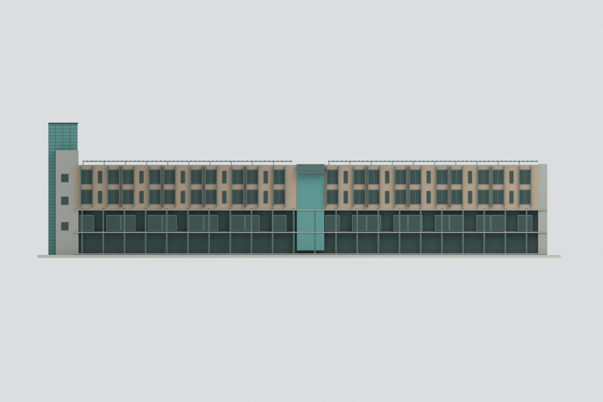
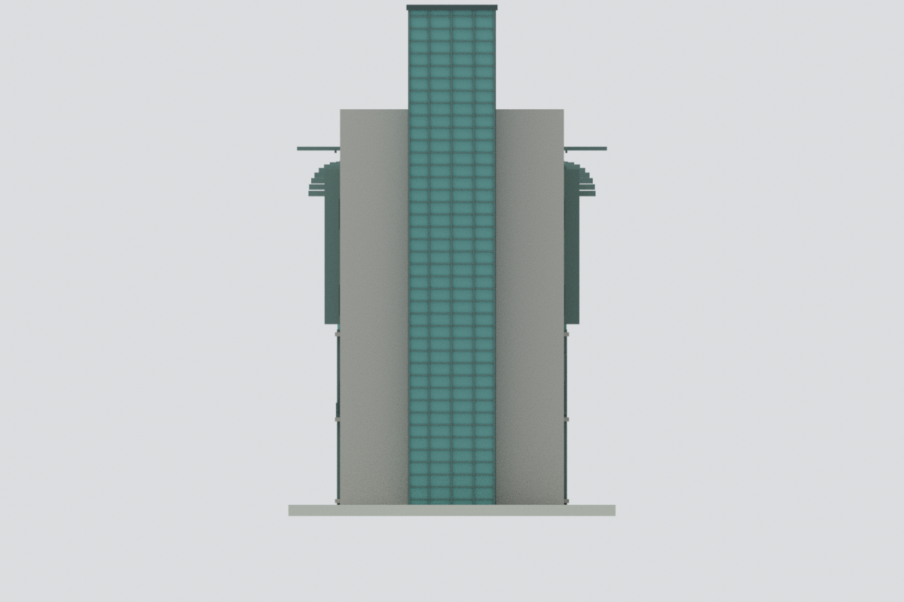
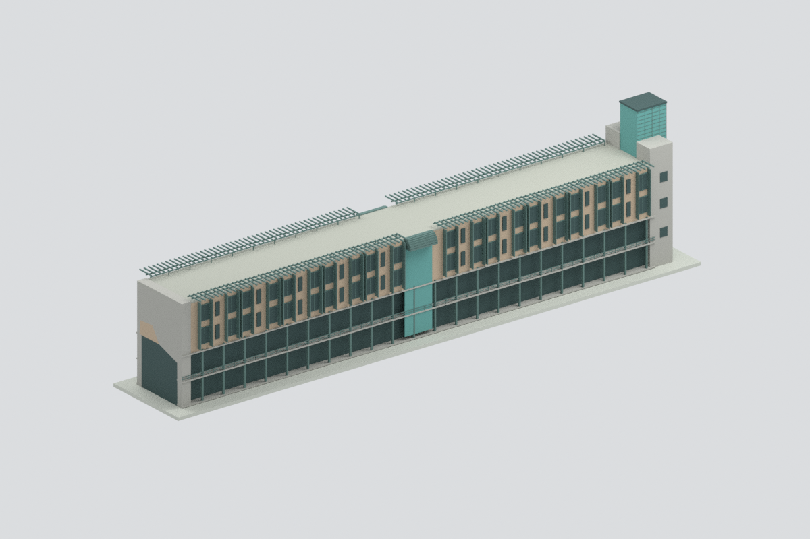
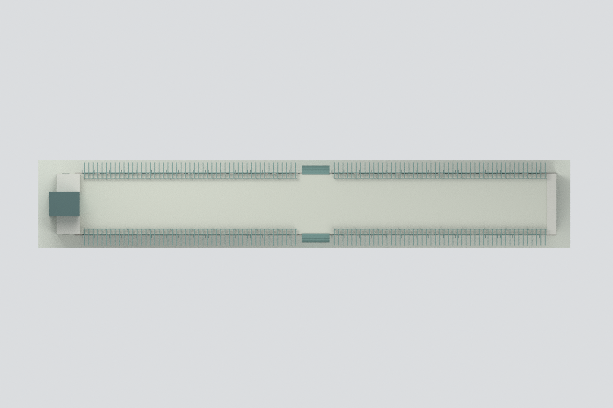
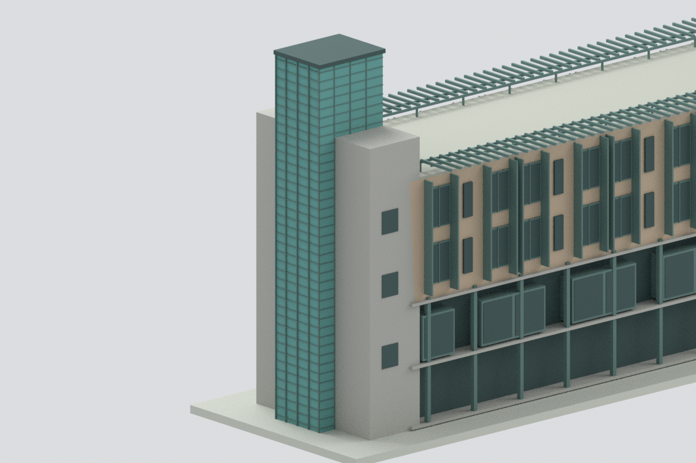

# 國立高雄大學綜合第一大樓主長翼及端部玻璃塔

## 模型預覽

| 實際模型 | 實際模型 | 實際模型 |
| :---: | :---: | :---: |
|  |  |  |
|  |  |  |

依官方歷史照片與宿舍改善平面製作的外觀近似。僅主長翼及高玻璃端塔，不含另一端相連大廳、地下餐廳完整外露、下沉廣場、道路或背景樓。不是全棟現況測繪。

## 下載
[STL](model.stl) · [七色3MF](model.3mf) · [Blender](scene.blend) · [建模程式](build_model.py) · [SHA256](SHA256SUMS)

## 範圍與可信度
- 保留細長分兩段翼、中央梯廳節奏與端部青綠玻璃塔，灰色側牆低於玻璃塔；另一端不複製高塔。
- 上兩層的每側20主房間及10窄衛浴格來自2024改善平面；窗大小/分格/與竪遮陽仍為照片近似，不把房間數當已完整逐窗測量。
- 下兩層在街側與內側分開表現：凹廊/框架、欄杆與窗帶不直接鏡射。樹遮住的細部中性化，室內和通行淨空不建模認證。
- 屋頂是分段開放外挑格柵，不做成實心巨大拱頂；中段綠色彎緣以離散板片簡化，屋頂設備未確認則不補。
- 端塔校名字樣、圓徽、細天線及石板小接縫未刻出。端塔幕牆格數、實際材色、絕對尺寸與遠端立面均有近似。含底座約230×38×59.46mm，非測繪比例認證。原照片年代未知，不等於2026現況。

## QA與列印限制
STL逐三角、3MF頂點/三角/材質、單封閉連通及Blender重開分別核對；這是幾何/格式，不是全棟實景或實體試印。
未試印。細遮陽、欄杆、玻璃分格與屋頂挑梁在此尺度非常細，部分設計分格厚度僅約0.11–0.28mm，可能不足常見FDM線寬；須放大、加粗、切片並評估支撐，不保證全域最小壁厚或免支撐。3MF面材質不保證自動配置廠牌料槽。隱藏預聯集部件供編輯，非已分件列印成品。

## 重建
以具numpy/trimesh/manifold3d的Python執行build_model.py，再用Blender執行render_model.py。validate_model.py與verify_scene.py核對幾何及場景。相依版本見manifest。

[來源](SOURCES.md) · [幾何QA](QA.json) · [外觀QA](visual-review.json)
