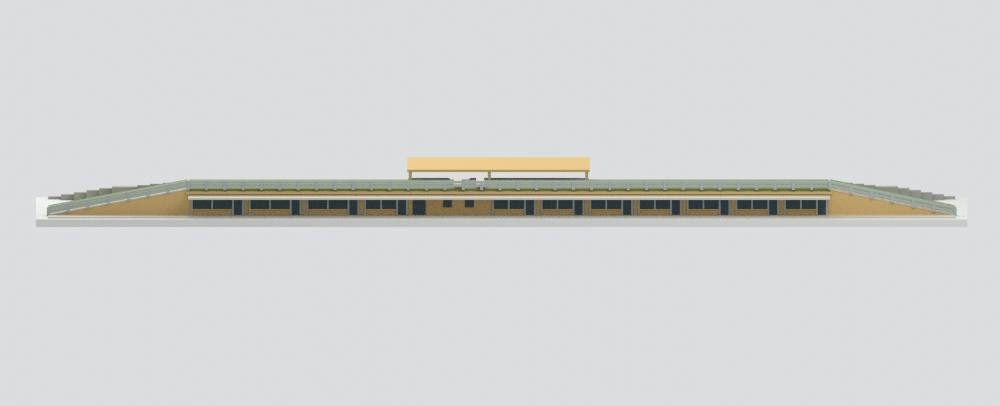
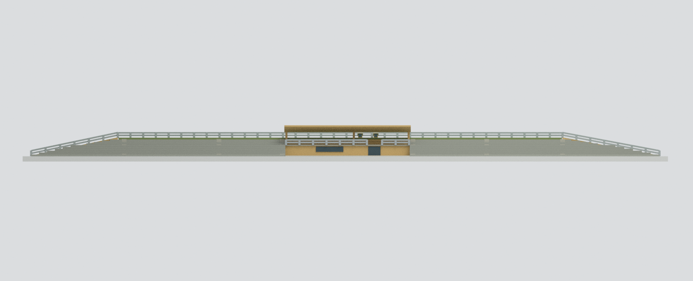
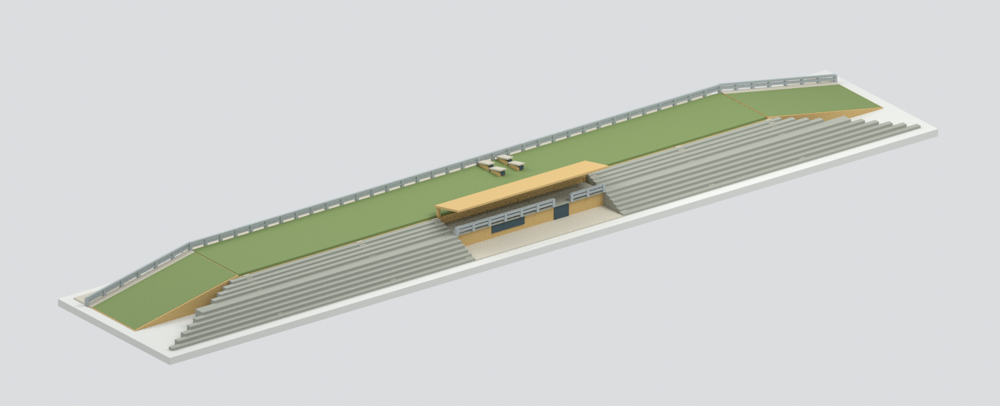
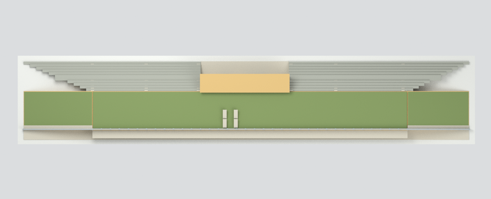
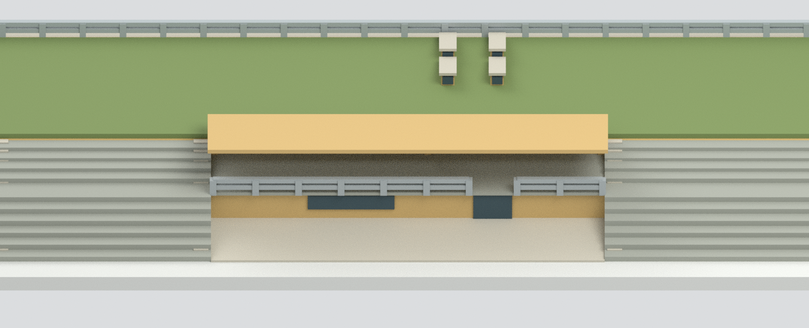

# 國立高雄大學人文社會科學院 C 棟

國立高雄大學｜楠梓校本部｜`nuk-humanities-c`

**獨立 C 棟**微型彩色外觀模型；範圍不包含 A/B 棟。依校方發包設計 CAD、C 棟施工照片與後續空間圖重建低長教室體、植草屋頂、兩端上屋頂坡道、戶外看臺及中央上揚雨棚。不是竣工測繪或 2026 現況保證。

## 模型預覽

| 代表斜視 | 教室側 | 看臺側正立面 |
| :---: | :---: | :---: |
|  |  |  |
| 另一側斜視 | 俯視 | 中央看臺細節 |
|  |  |  |

全部是交付網格的實際 Blender Cycles 渲染，不是 AI 示意圖。代表斜視採 yaw 36.87°、elevation 23.43°，完整底座入鏡。`front` 是本模型選定的看臺側代表視角，不聲稱地理正北或原照片「正面」。另附 `grandstand_overview.png` 與 `rear_detail.png`。

## 檔案

- `model.stl`：單一封閉、單一連通的列印外觀網格；STL 無顏色。
- `model.3mf`：同一網格，毫米單位，逐面 7 色基礎材質。
- `scene.blend`：同一可見網格、7 材質；另藏 377 個命名可編輯生成構件。**隱藏構件是 union 前會互相重疊的編輯副本，不是另外一組可直接列印零件。** 無嵌入執行腳本、無外部照片貼圖。
- `build_model.py`、`parameters.json`：可調比例及核心尺寸的原始建模程式；不依賴私有原圖或舊 A/B 幾何。
- `render_model.py`、`validate_model.py`、`verify_scene.py`：實際渲染與交換／場景核對程式。

成品約 **244.90 × 47.50 × 13.80 mm**（精確數值見 `build-summary.json`）；名目每設計米 1.6 模型毫米。支撐底板只是模型用底板，不是校園測量地形。

## 保留與近似

CA–CM 軸線 105.50m、兩端坡面長 23.00/20.55m、教室深 12.80m；單層主體、屋頂覆草、四個狹長自然通風口、教室側長窗門與薄出簷、另一側雙段階梯看臺、中間抬高看臺及向外升高的屋棚、坡道水平金屬欄杆。

房間用實心外觀代理，不復原室內。前後不是鏡像窗牆。細窗分格、欄杆根數、階梯／座階剖面及中央服務室細節簡化；欄杆、立柱及框加粗。為穩定浮點幾何，生成構件採 1/32 設計米格點（最大每軸約 0.025 模型毫米位移），材質分組 union 後簡化容差約 0.008mm。土黃、草綠、銀灰及不透明藍灰玻璃為來源支持的近似色，非現場校色。

## 列印注意

未實體試印。中央雨棚、教室側長出簷和欄杆需要支撐／薄件評估；部分簷板約 0.45–0.60mm、窗框約 0.5mm、欄杆約 0.6mm，應由切片器依噴嘴與材料檢查。封閉／連通不等於免支撐、耐摔或全域最小壁厚保證。多色 3MF 是面材質，不是已完成的多料切片設定。

## 重建

Python 需 `numpy`、`trimesh`、`manifold3d`；Blender 4.3.2。

```sh
python build_model.py
python validate_model.py
blender -b -t 4 --python-exit-code 1 --python render_model.py
blender -b -t 4 --python-exit-code 1 --python verify_scene.py
```

詳見 `SOURCES.md`、`QA.md` 與 `qa/`。原 DWG、PDF、官照、來源圖面渲染及裁圖不在本交付資料夾，亦不得混入公開模型包。
