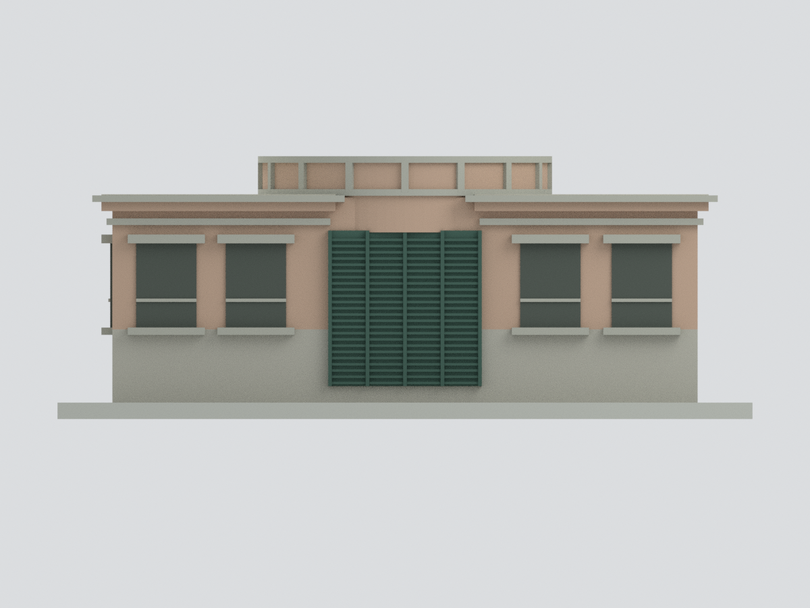
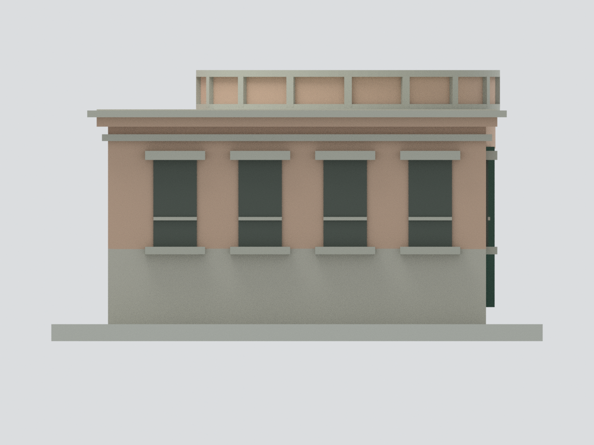
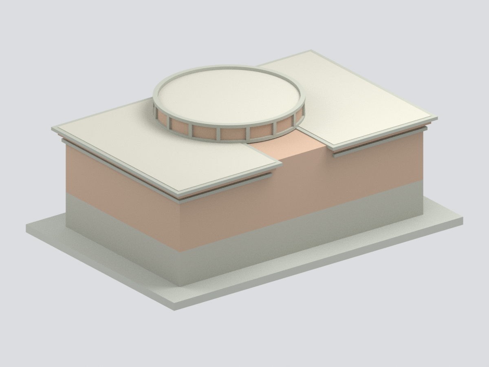
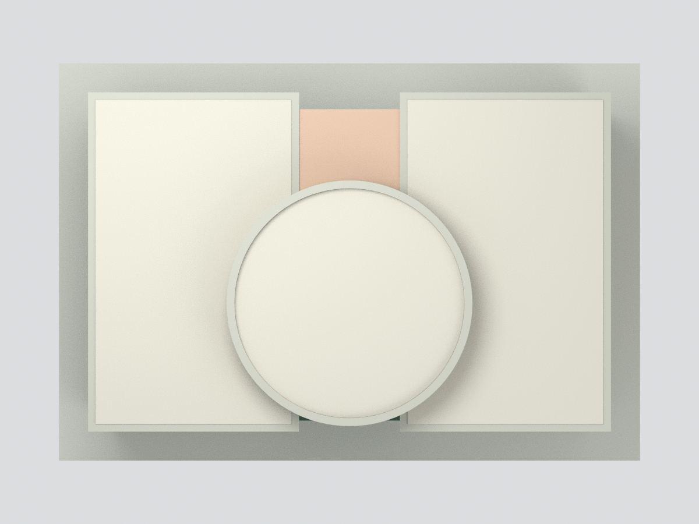
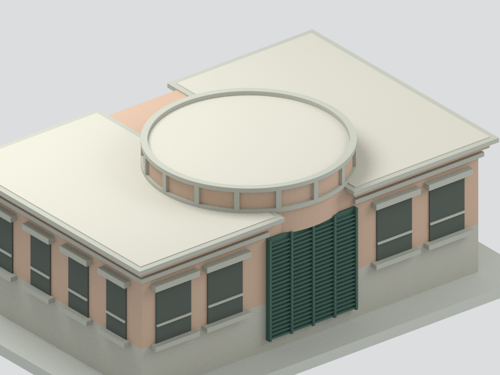

# 國立高雄大學實驗廢水處理場主建物：歷史照片外觀近似

## 模型預覽

| 主視角 | 正立面 | 已見短端 |
|---|---|---|
|  |  |  |
| 未見背面中性處理 | 頂視圖 | 圓形屋突 |
|  |  |  |

僅呈現官方舊頁所見的地上主建物，非整座實驗廢水處理設施、現況測繪或精確全棟復原。不含地下池槽、機電、管路、旁側貨櫃屋及前方整片廣場／擋土牆。未見背面和另一短端以中性封閉處理，不能把空白牆當作已確認無窗。

## 已見與近似範圍
- 正面兩側各兩個長窗、中央深綠百葉、已見短端四窗；灰色突出窗帽與窗台、下灰上粉褐的雙色牆面。
- 圓形屋突與灰色頂／底圈、兩側低平屋頂和外挑簷口。屋突格數採16等分作顯示近似，並非完整逐格實測；圓體直徑、後部位置及未見頂面為比例推定。
- 已見正面與短面來自四張不同角度的官方照片，但它們不是完整四面立面；未見兩面不鏡射已見窗列。
- 百葉採24條實心浮雕、窗格簡化，沒有重建可運作設備。完整地坪／地下場區沒有納入模型。

## 尺度、格式及限制
- 主體參考16×10×5.6公尺、屋突頂6.73公尺，全部為照片比例估計，非實測尺寸。
- 每估計公尺縮為7毫米；含展示底座約133×91×50.26毫米。底座是原創展示支撐，不代表實際擋土牆。
- 官方頁面沒有照片拍攝日期，不以頁面查閱日當攝影日期，不主張為2026年現況。
- 未實體試印或切片驗證。細窗框、百葉、外挑簷和頂圈須依材料、機器及比例評估；封閉連通並非最小壁厚或列印成功保證。
- 七色3MF是core基礎材質，已比對XML頂點／面／材料，未宣稱lib3mf全規格驗證；切片器可能需要自行分配線材。
- BLEND預設顯示的是與STL／3MF相同的合併網格。隱藏原始建構部件可編輯但仍互相重疊，非已拆分列印零件。

## 模型與實際預覽
[STL](model.stl) · [七色3MF](model.3mf) · [Blender](scene.blend) · [來源](SOURCES.md) · [幾何QA](QA.json)

重建：以numpy、trimesh、manifold3d執行build_model.py；Blender 4.3執行render_model.py。validate_model.py核對幾何及交換格式；以Blender重開scene.blend執行verify_scene.py。模型單位mm。
