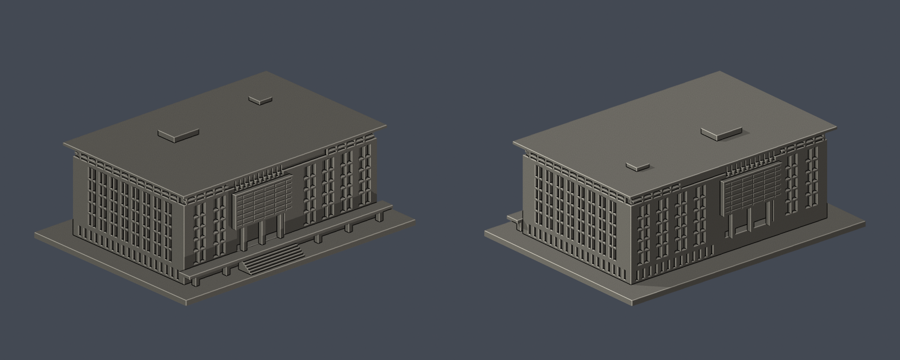
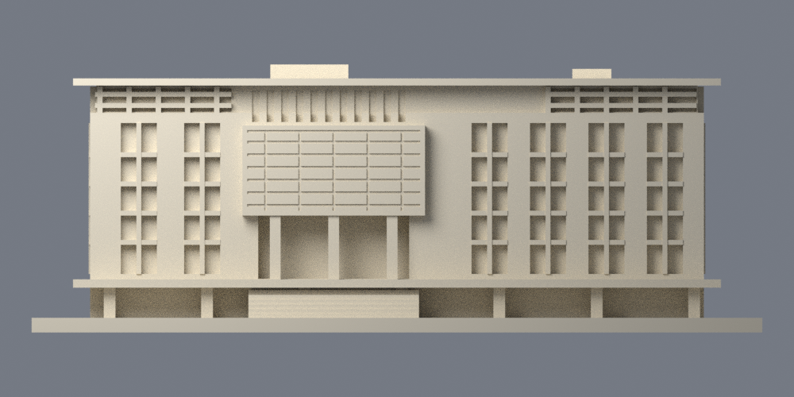
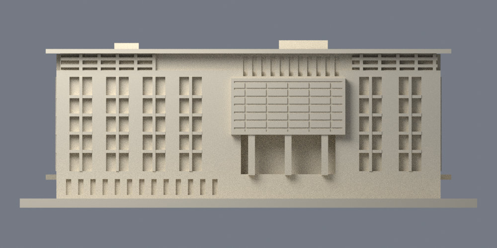

# 圖書資訊大樓主棟

國立高雄大學／楠梓校本部。自主建立的照片外觀近似模型；不是測繪、竣工BIM或全校完成。

| 模型預覽 | 模型預覽 | 模型預覽 |
| :---: | :---: | :---: |
|  |  |  |

[STL](model.stl) · [可編修Blender網格](scene.blend) · [正投影](previews/elevation.png) · [反面正投影](previews/rear_elevation.png) · [頂視](previews/top.png)

| 模型預覽 | 模型預覽 | 模型預覽 |
| :---: | :---: | :---: |
| 正投影  | 反面正投影  | 頂視  |

## 建模範圍與來源限度
- 只做長方形圖資主棟與相鄰的裁切入口台階，未做低層入口館/國際會議廳量體、長天橋與完整入口廣場。不能以本件宣稱全圖資複合體已完成。
- 保留：兩個相對長立面的大凸屏及2+4／4+2窗組排列、短側玻璃幕牆、上端格柵、薄平屋簷、白色窄槽基座、入口柱廊及階梯。兩面大屏按各側實拍取偏置；正反視角左右反轉不是多製一件。
- 長寬深、高度、窗框厚度、屋頂小機電位置均為近似。相對長面的端部與低層連接在照片中受樹木遮擋，沒有把被遮擋處宣稱精測。省略字牌、樹木、外燈與獨立欄杆；細格柵改為有背托的加粗淺細節。
- 主要外觀來源是官方舊版「校舍現況」四張實拍，攝影日期未標。2016年6月館訊提供另一張高視角實拍輔助屋頂。115年官方校圖僅確認館名/位置仍列示，不是2026拍攝的證據。本模型不宣稱最新設備或小改建已全部核對。
- [逐來源、立面與年代](sources.json)。不散布第三方原照片；未使用他人的3D網格。

## 列印提示
- STL座標單位：毫米；含底座 150 × 112 × 55 mm，最長150mm。每館獨立比例，不是全校統一縮尺。
- 底座朝下，厚3mm。柱廊、前平台底部、外伸平簷及凸屏下緣有懸空/橋接，應檢查支撐；柱約2.2mm、格柵/窗槅有背托且約1.0mm。最薄屋頂片設計1.45mm。
- 請在實際切片器檢查層高、線寬、橋接、支撐接觸及細部解析；縮小會使窗框與屋簷變薄。
- 沒有實體試印或Cura/Prusa工具路徑測試。數位QA不保證任意印表機/材料都能直接列印，亦不宣稱無需支撐。

## 自行重建
Python 3.12與[requirements.txt](requirements.txt)，Blender 4.3.2。先執行python build_model.py，接著blender -b -t 2 -P render_preview.py，執行blender -b -t 2 -P render_elevations.py補渲染正反正投影，再執行python run_all_checks.py。參數script從基本布林幾何重建STL/OBJ；scene.blend是匯入實際STL的可編修三角網格，並包含拍攝相機。

## 驗證
- [validation.json](validation.json)：原STL法向/繞序、每邊兩面、頂點link單一環、水密、單一連通表面殼、正體積、150mm含底座、獨立重建SHA及saved Blend和STL幾何一致。
- [valid-sections.json](valid-sections.json)：z=0.071mm起，每0.2mm截面，275層；逐段degree2、個別Polygon與組合Polygon均需有效，沒有buffer(0)修補或吞掉錯誤。
- [thin-feature-check.json](thin-feature-check.json)：canonical固定方向邊插值，1.0mm節距，以0.8mm參考寬度形態opening輔助篩檢，55層、最高面積損失0.1079%。此結果不是全面最小壁厚保證；尖角損失亦包含其中。
- [qa-summary.json](qa-summary.json)彙總。任一子檢查非0退出或checks出現false就拒絕通過。[逐檔SHA](SHA256SUMS)
