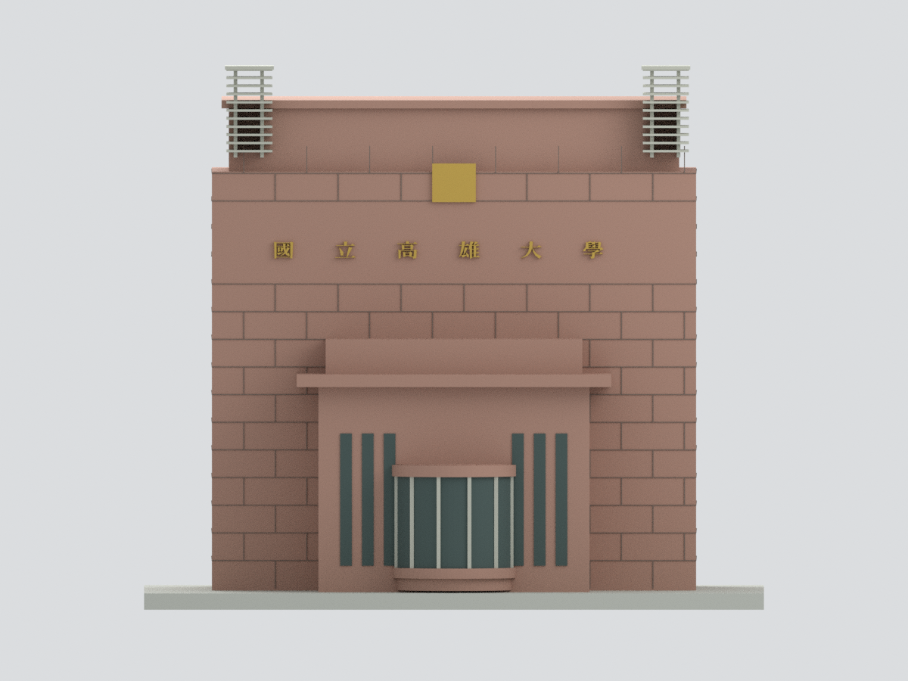
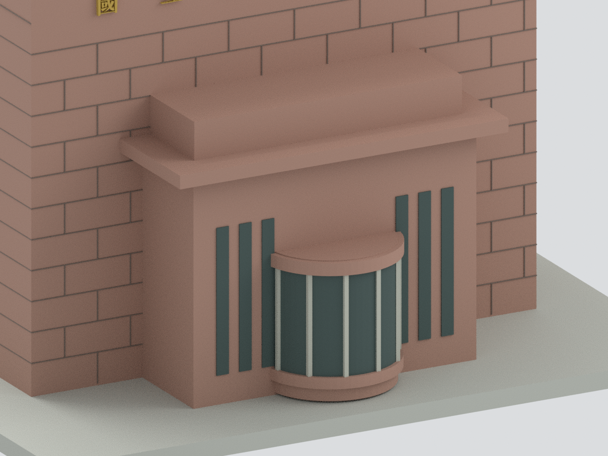
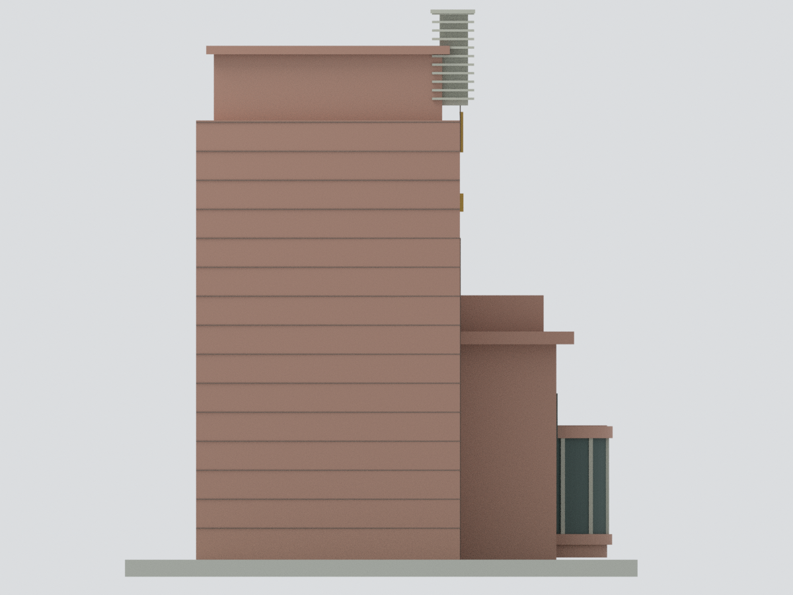
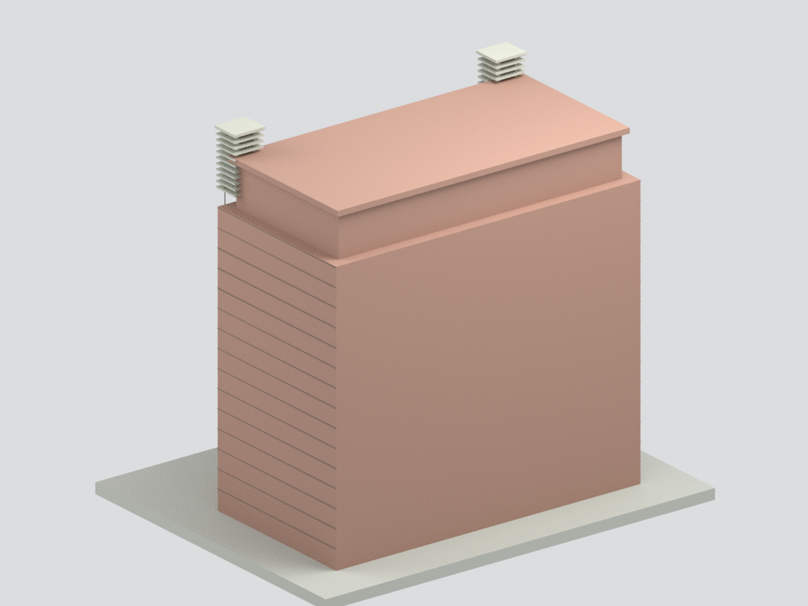
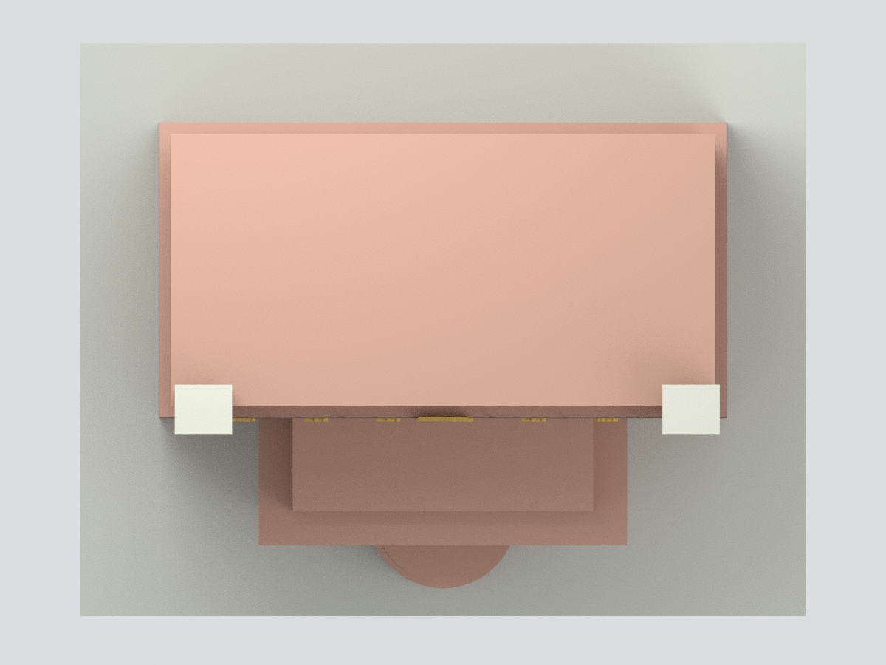

# 國立高雄大學正門中央警衛室及門塔

## 模型預覽

| 模型預覽 | 正面 | 警衛室細部 |
|---|---|---|
|  |  |  |
| 側視 | 未確認反面中性處理 | 頂視 |
|  |  |  |

目前網格使用六種表面色（3MF色表另保留一個未使用的中性屋頂色）。

本件為楠梓校本部正門的**中央核心歷史外觀近似**，不是整條校門、外側長牆或完整入口道路。未測繪、未核為2026現況、未實體試印。

## 下載
- [STL](model.stl)；[多色3MF](model.3mf)；[Blender](scene.blend)
- [建模程式](build_model.py)、[渲染程式](render_model.py)、[重建字形](make_signage.py)
- [尺寸及網格](build-summary.json)、[幾何QA](QA.md)、[來源與限制](SOURCES.md)、[SHA256](SHA256SUMS)

## 範圍與可信度
- 官照支持：矩形有厚度門塔、上部後退屏牆、兩個前角格柵燈架、六字校名、前方警衛室薄簷、弧形玻璃及側旁窄窗。
- 模型校名採 Noto Serif CJK 替代字型，非原書法；校徽僅保留方形底牌，不虛構低解析標誌細節。
- 第4張夜景仍可見同款題字面，無法唯一判定前／背方位；不得把它算作確證背面。夜景旁邊低翼和高燈柱未加入中央模型；不鏡像複製成背面建築。
- 進深、絕對尺寸、格柵片數、石材分格均估計。未確認反面採中性封閉，不代表確認無窗。
- 外側門柱、長校名牆、阻車桿、車道、植栽、屋頂設備與室內均不在本件範圍。
- 無第三方來源照片嵌入模型或公開套件。六張預覽皆由實際交付網格渲染。

## 列印
單一封閉連通幾何僅代表網格與格式完整，不保證可直接列印。燈架格柵、字形、窄窗框與懸挑簷部較細，請依尺度、噴嘴及材質評估支撐與加粗。3MF含基礎材質色表，不是特定切片器多噴頭設定；未進行實體試印或全域最小壁厚認證。

## 重建
以含 numpy、trimesh、manifold3d 的 Python 執行 build_model.py，再執行 validate_model.py。signage-geometry.json 為已保存的替代字形幾何；需要重建字形時，以 Blender 執行 make_signage.py，需系統 NotoSerifCJK-Bold.ttc。再由 Blender 執行 render_model.py、重開scene.blend執行verify_scene.py。隱藏可編輯部件為布林合併前重疊部件，不能直接當獨立列印件。
