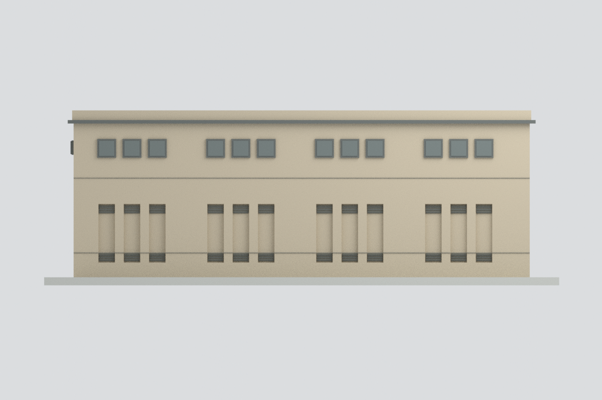
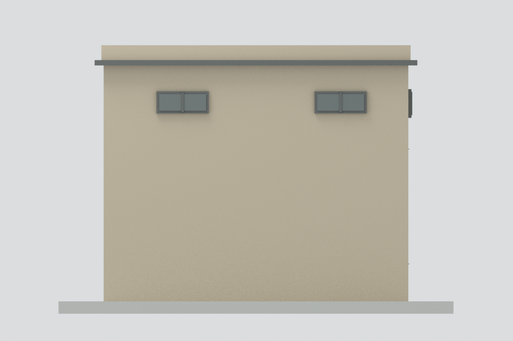
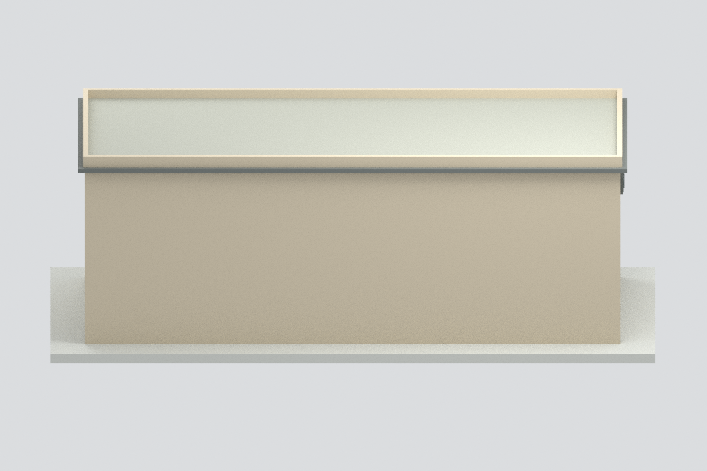
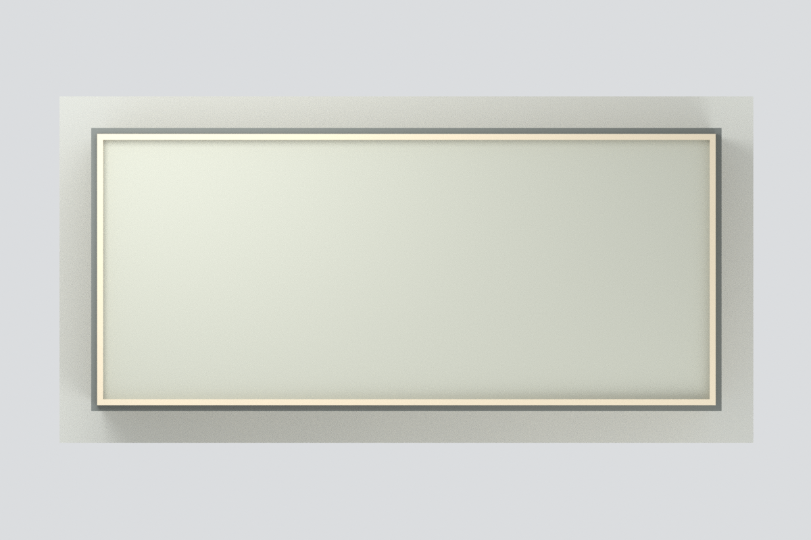
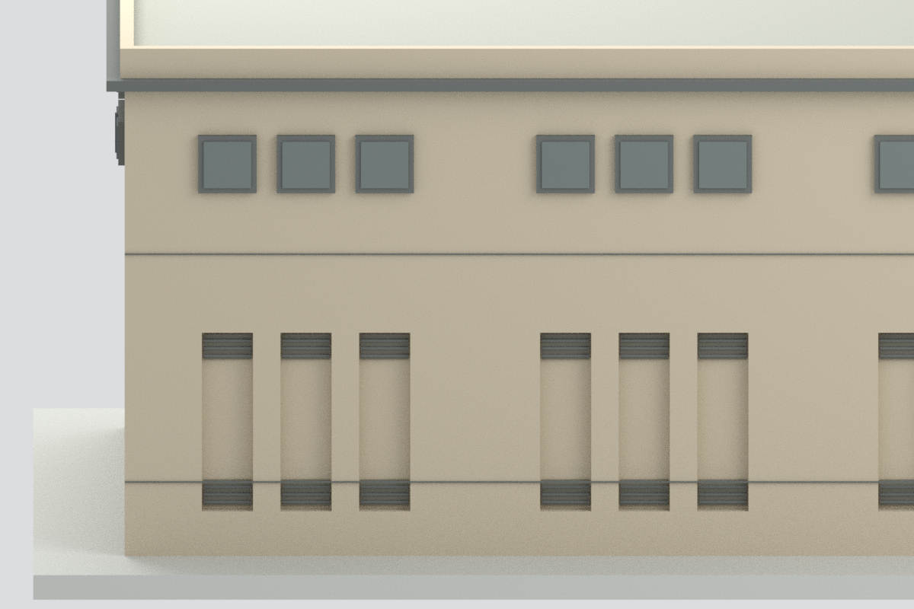

# 國立高雄大學總配電站：歷史照片有界外觀近似

這是可審視的外觀模型，不是全棟精確還原、竣工測繪或 2026 年現況模型。未見背面與另一短端面採中性封閉；不能把空白牆當成實景確認。

## 已完成
- STL、六色基礎材質 3MF、Blender 原始檔、可重建 Python 程式、六張實際模型預覽。
- 已見長立面採四組三窗及下方凹槽／百葉；保守取照片可見節奏，不宣稱完整立面的總窗數已證實。
- 短端面採照片可見兩組雙聯上窗；本機左右端映射屬示意，不能視作方位定位已證明。
- 平屋頂輪廓由官方 NLSC 航照交叉核對；設備、天線、風車、樹木、地下室及內部電力設備不復原。

## 尺寸與限制
- 本機外牆約 31 × 13.5 m、最高女兒牆約 11.38 m，全部為航照／照片比例估計，非建築圖面或現場量測。
- 模型以每估計公尺 5.5 mm 縮放，含展示底座約 192.5 × 96.25 × 65.62 mm。
- 歷史官照未標拍攝日期；NLSC 圖層有 2024 浮水印，但不能據此認定實際拍攝日期。兩者不是同一次現況調查。
- 未知背面與另一短端的門窗、已見短端下方被遮住的百葉位置、完整窗總數仍未確定。沒有把缺口鏡射補造。
- 未實體試印／切片；凹槽、百葉與細線為展示比例簡化，不作最小壁厚或列印成功保證。主體為實心外觀殼；隱藏的 editable 部件為重疊建構件，不是可單獨列印的分件包。
- 3MF 已做 core XML 與數值核對，沒有宣稱 lib3mf 全規格驗證。

## 檔案
[STL](model.stl) · [3MF](model.3mf) · [Blender](scene.blend) · [來源](SOURCES.md) · [QA](QA.json)

| 主視角 | 已見長立面 | 已見短端面 |
|---|---|---|
|  |  |  |
| 中性未復原背面 | 屋頂 | 已見立面細節 |
|  |  |  |

重建：使用 numpy、trimesh、manifold3d 執行 build_model.py，再使用 Blender 4.3 執行 render_model.py；幾何核驗執行 validate_model.py，Blender 重開核驗執行 verify_scene.py。
