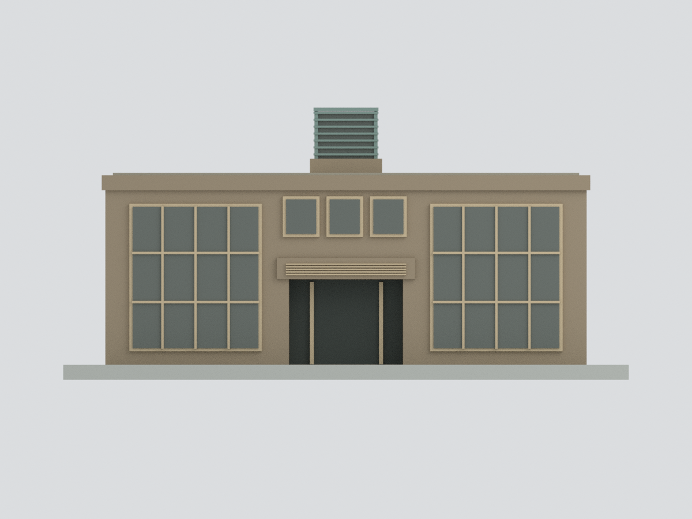
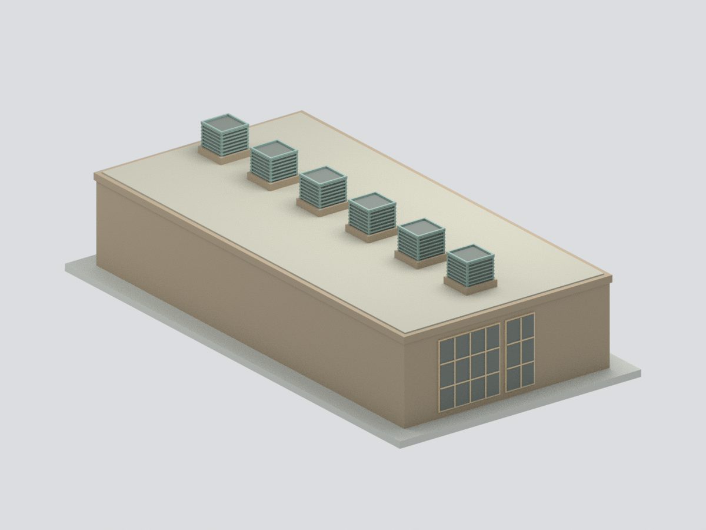
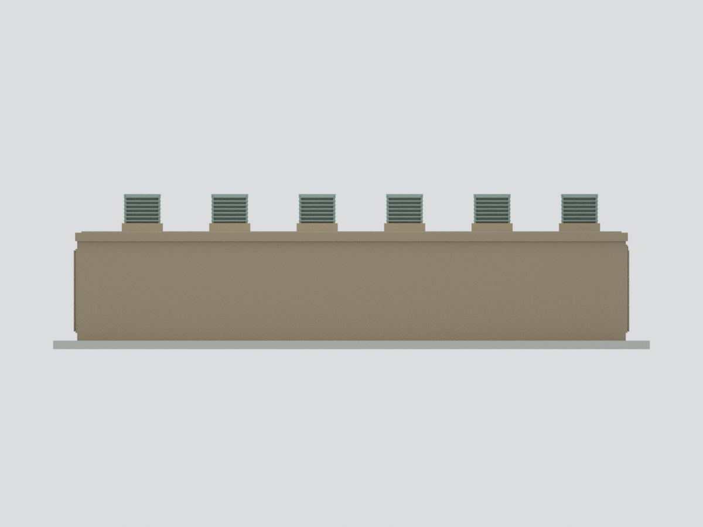
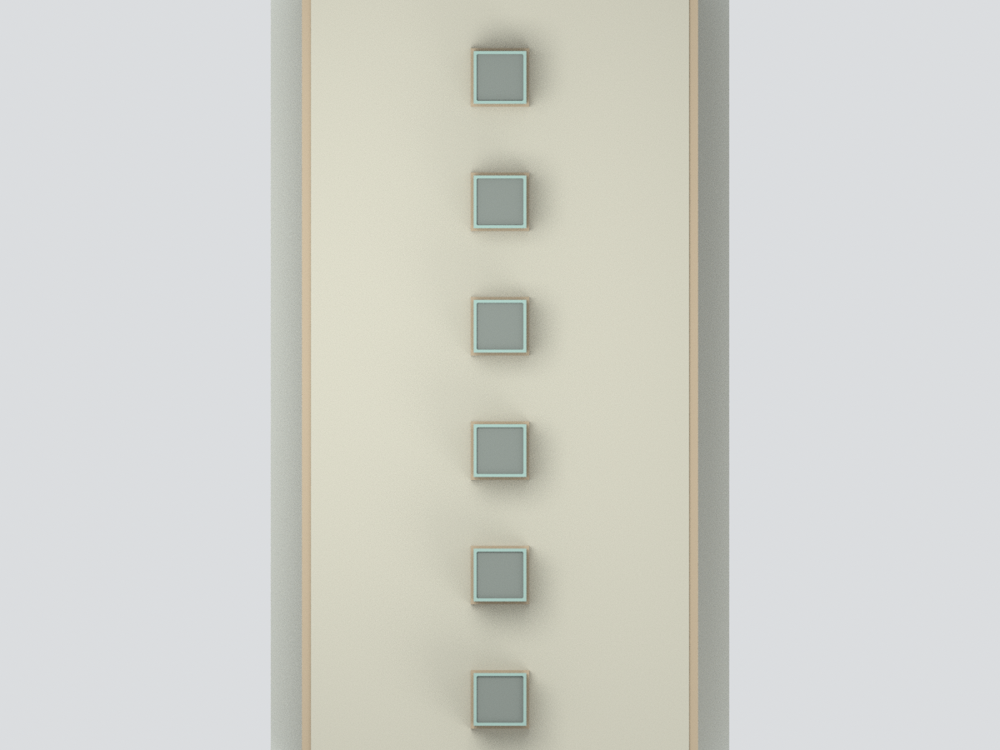
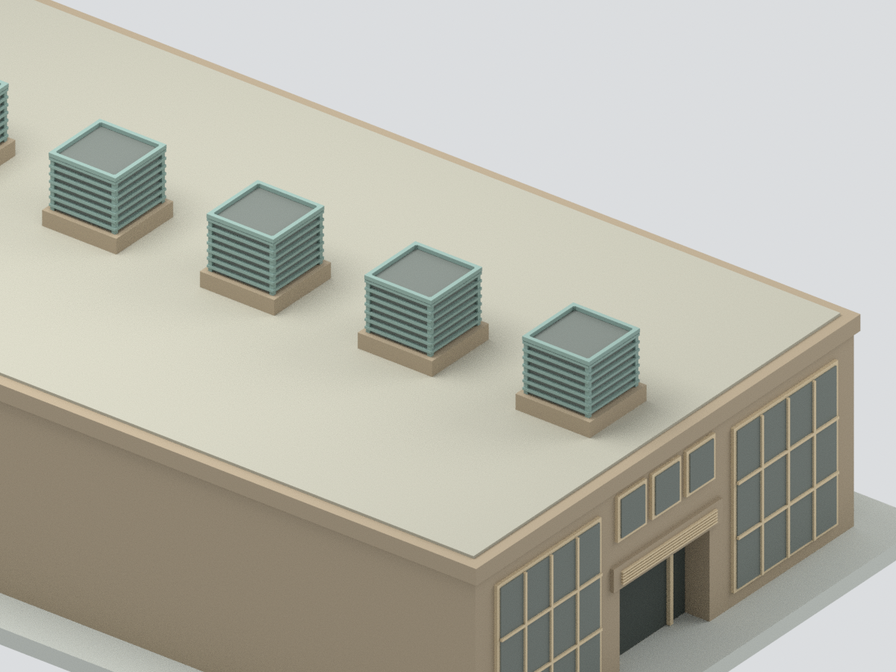

# 國立高雄大學污水及中水處理場主建物：歷史照片外觀近似

此模型只呈現官方歷史照片中的地上主建物，不是整座污水／中水處理場、現況測繪、精確全棟復原或運作設備模型。沒有地下池槽、前方花台／水池、管路、植栽及室內機電。未攝清楚的長側採中性封閉，不能把空白牆當成已確認的實景。

## 已完成範圍
- STL、七色基礎材質 3MF、可編輯 Blender 場景與重建 Python、六張實際模型渲染。
- 主入口中央凹入門洞、門上三個獨立上窗、兩側高窗網格。右側 4欄×3列有照片支持；左側局部受植栽遮蔽，採同寬可見格線支持的近似節奏，不宣稱逐格全部證實。
- 屋頂單列六個方罩由遠景照片可辨；間距、截面和葉片數簡化。方罩內部為實心背板，不是功能性通風設備，沒有把屋頂設備內部當作已知。
- 第四張照片透視支持推定另一短端的一部分，僅做已見寬窗 4×3 與窄窗 2×3；其絕對平面掛位仍是示意。畫面裁切外及植栽遮蔽區不補造窗列。

## 尺度、年代及列印限制
- 設計參考主體 16 × 32 × 6.2 m、方罩頂約 8.55 m，皆為照片比例估計而非實測尺寸；主體正面寬／高約 2.58。沒有由未確認的總樓地板面積反推尺寸。
- 每估計公尺縮為 5 mm，含展示底座約 94 × 174 × 45.25 mm；底座非實際場區地形。
- 官方舊頁未提供照片拍攝日期。公開航照用來檢視校址環境，不足以唯一對應歷史方罩建物的屋頂；沒有把後來太陽能板和歷史照片拼接宣稱同一時點現況。
- 未實體試印或切片測試；浮雕窗框／百葉、頂部細框為顯示用途簡化。幾何封閉與連通並不保證任意印表機、比例、材料的列印成功，也不是最小壁厚認證。
- 3MF 為 core 基礎材質，已用 XML 和數值比對，未宣稱通過 lib3mf 全規格驗證。部分切片器需要自行指定線材顏色。
- BLEND 中隱藏部件是可編輯的原始重疊建構件，不是已切分的獨立列印件；預設可見物件為與 STL/3MF 相同的布林合併網格。

## 檔案與預覽
[STL](model.stl) · [七色 3MF](model.3mf) · [Blender](scene.blend) · [來源](SOURCES.md) · [QA](QA.json)

| 主視角 | 主入口立面 | 推定另一短端局部 |
|---|---|---|
|  |  |  |
| 遮蔽長側中性處理 | 頂視圖 | 方罩細節 |
|  |  |  |

重建：使用 numpy、trimesh、manifold3d 執行 build_model.py；Blender 4.3 執行 render_model.py。幾何格式核驗使用 validate_model.py；以 Blender 重開 scene.blend 後執行 verify_scene.py。輸出模型使用 mm。
