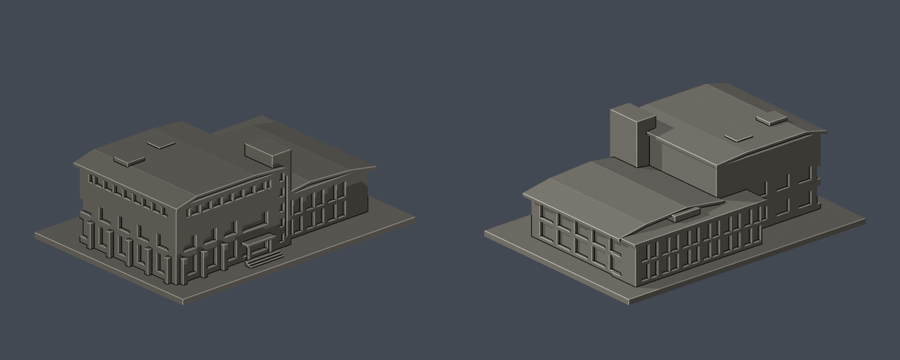

# 體育健康休閒多功能教學大樓

國立高雄大學／楠梓校本部。自主建立的照片外觀近似模型；不是測繪、竣工BIM或全校完成。

[STL](model.stl) · [可編修Blender網格](scene.blend) · [正投影](previews/elevation.png) · [反面正投影](previews/rear_elevation.png) · [頂視](previews/top.png)

## 建模範圍與來源限度
- 高館、低館（泳池所在）、接合服務塔與後側低層玻璃翼合併成一件外觀近似模型；泳池不另計棟。
- 保留：高低館的折弧屋簷、突出接合塔、上端水平高窗、下層深凹開口、粗柱墩、低館大窗與背側玻璃翼。服務塔頂z=53mm；主館靠塔簷頂z=46.1mm，高差6.9mm，是照片比例估計而非實測。
- 整體進深、低館後翼平面與弧形曲率為照片近似；高館完整背立面受低館遮擋，背側僅留克制少量開口。屋頂設備、落水管、字牌及獨立欄杆未細建，未取得全屋頂空拍/竣工圖。
- 主要外觀來源是官方舊版「校舍現況」四張實拍，攝影日期未標。115年官方校圖僅確認館名/位置仍列示，不是2026拍攝的證據。本模型不宣稱最新設備或小改建已全部核對。
- [逐來源、立面與年代](sources.json)。不散布第三方原照片；未使用他人的3D網格。

## 列印提示
- STL座標單位：毫米；含底座 150 × 108 × 53 mm，最長150mm。每館獨立比例，不是全校統一縮尺。
- 底座朝下，厚3mm。屋簷、門口小雨棚與深窗上緣有懸空，應檢查支撐。主屋頂片厚約1.6mm，窗槅約1.1mm並帶背托；小雨棚柱1.5mm。
- 請在實際切片器檢查層高、線寬、橋接、支撐接觸及細部解析；縮小會使窗框與屋簷變薄。
- 沒有實體試印或Cura/Prusa工具路徑測試。數位QA不保證任意印表機/材料都能直接列印，亦不宣稱無需支撐。

## 自行重建
Python 3.12與[requirements.txt](requirements.txt)，Blender 4.3.2。先執行python build_model.py，接著blender -b -t 2 -P render_preview.py，執行blender -b -t 2 -P render_elevations.py補渲染正反正投影，再執行python run_all_checks.py。參數script從基本布林幾何重建STL/OBJ；scene.blend是匯入實際STL的可編修三角網格，並包含拍攝相機。

## 驗證
- [validation.json](validation.json)：原STL法向/繞序、每邊兩面、頂點link單一環、水密、單一連通表面殼、正體積、150mm含底座、獨立重建SHA及saved Blend和STL幾何一致。
- [valid-sections.json](valid-sections.json)：z=0.071mm起，每0.2mm截面，265層；逐段degree2、個別Polygon與組合Polygon均需有效，沒有buffer(0)修補或吞掉錯誤。
- [thin-feature-check.json](thin-feature-check.json)：canonical固定方向邊插值，1.0mm節距，以0.8mm參考寬度形態opening輔助篩檢，53層、最高面積損失0.0942%。此結果不是全面最小壁厚保證；尖角損失亦包含其中。
- [qa-summary.json](qa-summary.json)彙總。任一子檢查非0退出或checks出現false就拒絕通過。[逐檔SHA](SHA256SUMS)
