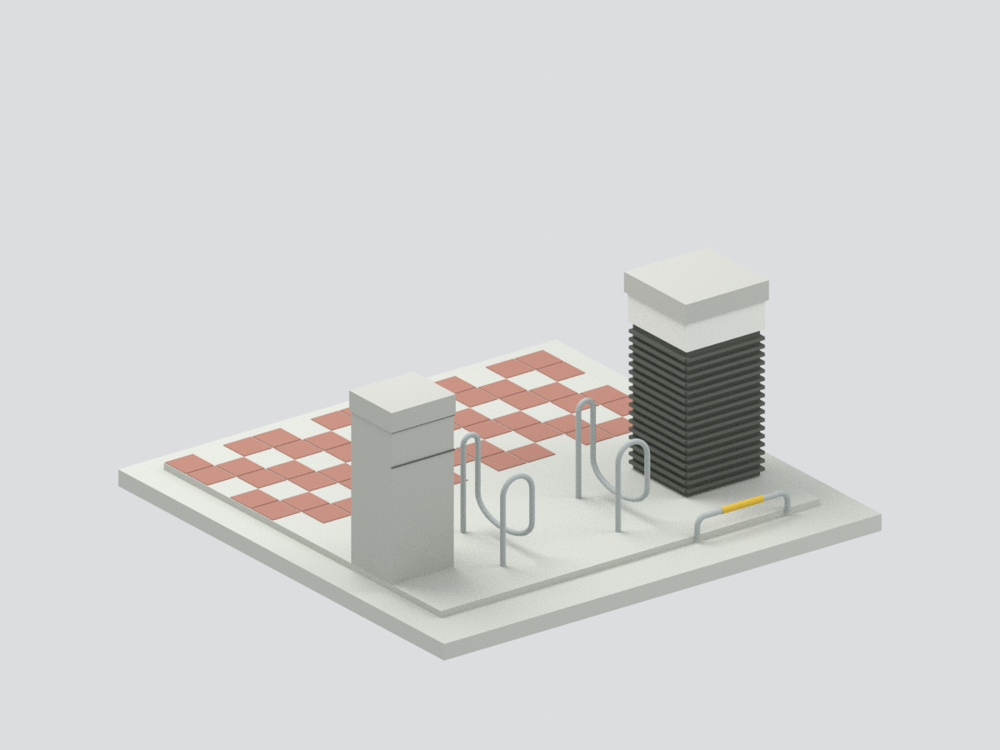
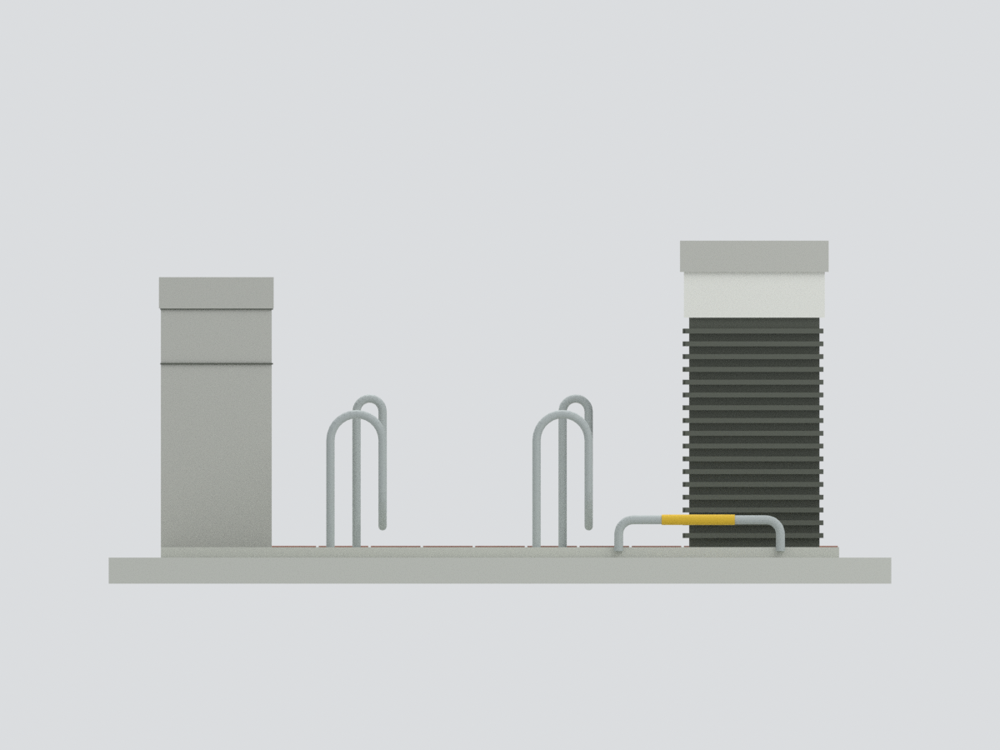
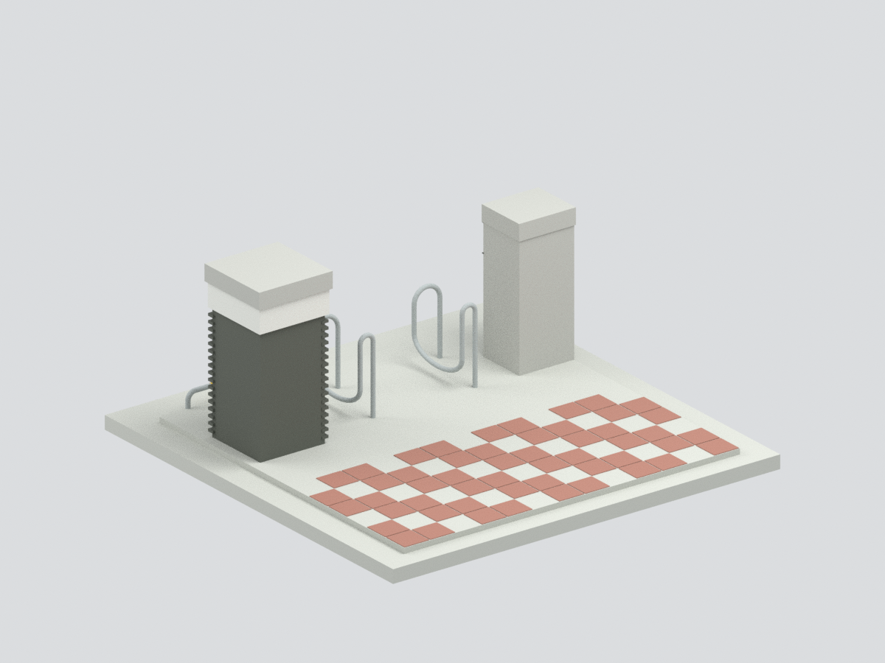
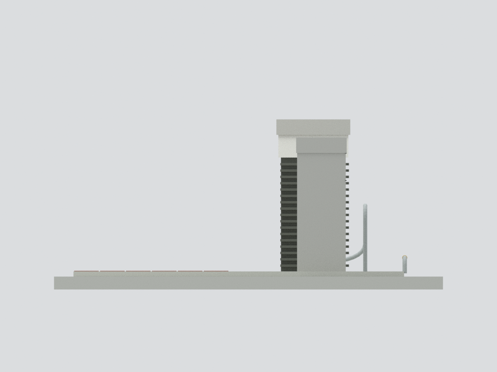
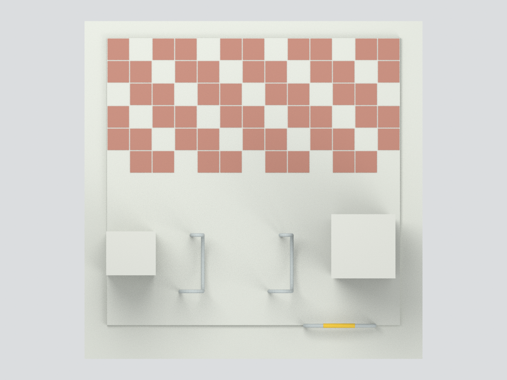
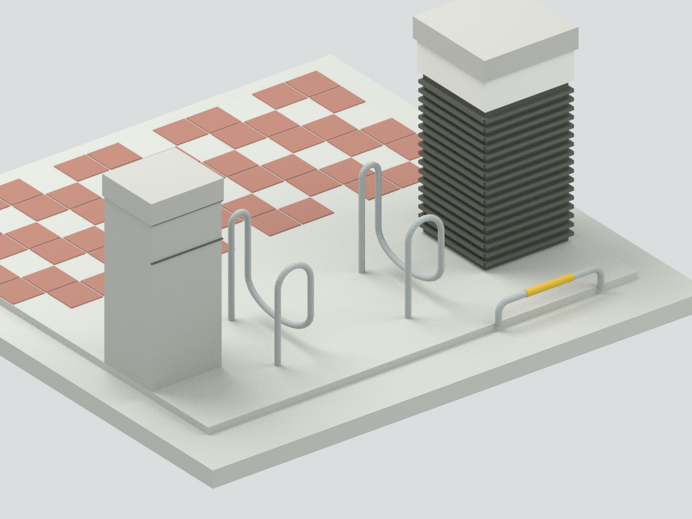

# 國立高雄大學西門行人入口門柱與車阻核心

官方歷史照片支持的有界入口構造近似，不是獨立館舍，不含背景綜合第一大樓、整條道路或西門全景。四張照片未標攝影日期，不能當作2026現況。

| 實際模型 | 實際模型 | 實際模型 |
| :---: | :---: | :---: |
|  |  |  |
|  |  |  |

## 下載
[STL](model.stl) · [七色3MF](model.3mf) · [Blender](scene.blend) · [建模程式](build_model.py) · [SHA256](SHA256SUMS)

## 已見與近似範圍
- 已見左淺灰石柱、右暗色橫柵門柱及白色上帶/石帽，兩柱不對稱。右柱只在已見正面與側面建橫柵，未知背面中性。
- 第3張來源可見左右兩組複合銀色曲管車阻，各有前大弧與後窄高迴轉、低處返彎；不是四個獨立普通U。模型以連續返彎簡化，遮蔽處的連接/落地拓樸未證實，不可當實際管件施工圖。
- 右前一支低矮倒U橫管有黃色套管。模型管徑加粗、彎曲段離散化，未量測。
- 左柱被來源畫面裁切，完整寬度/深度、柱間距、曲管進深、鋪面與整體尺寸皆估計。底座為展示支承；背景自行車架、柵欄、燈柱、樹木及建築不納入。
- 模型含底座尺寸約 90.00×90.00×39.45 mm。非測繪比例認證。

## QA與列印限制
單一封閉連通、15346三角面；STL逐三角、核心3MF頂點/三角/面材質及Blender重開另驗。這是檔案與幾何通過，不是完整實景拓樸驗證或實體試印。

未試印，細管/返彎/百葉有斷裂及支撐風險，不保免支撐/全域最小壁厚。3MF含面材質，不保證任何廠切片器會自動分配料槽。隱藏原創預聯集部件便於編輯，不是分件列印成品。

## 重建
以含numpy/trimesh/manifold3d的Python執行build_model.py，再用Blender執行render_model.py；validate_model.py與verify_scene.py核對網格及場景。

[來源](SOURCES.md) · [幾何QA](QA.json) · [外觀QA](visual-review.json)
