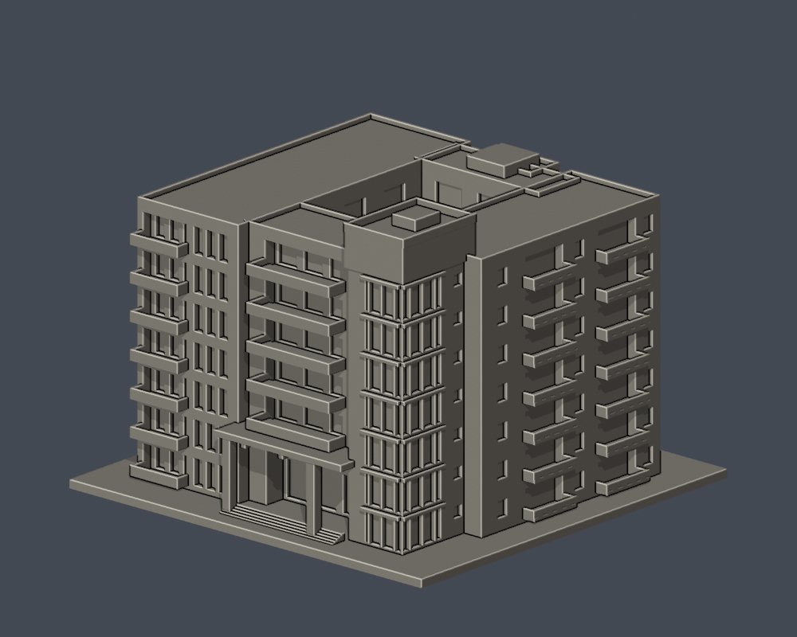
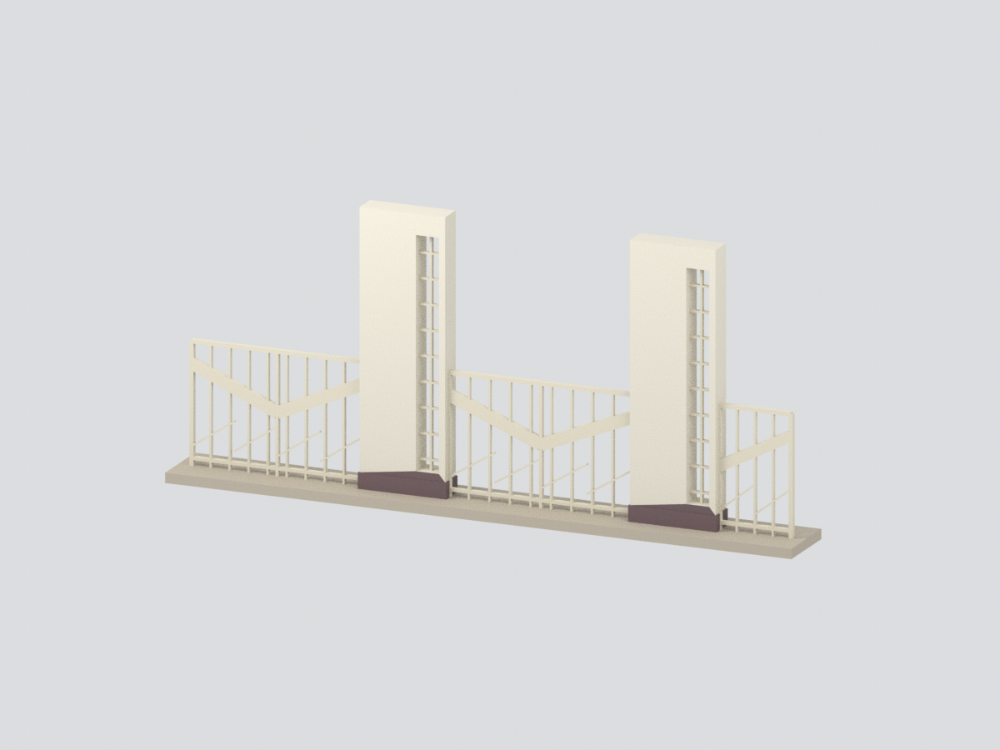

# 和平校區

現行收錄 **3 套模型包**；數量不等於完整建築棟數，亦非全校／校區完成。新件與既有件的年代、截段範圍及未試印限制請閱各模型頁。

### 既有批次來源與列印限制（數量為各批歷史範圍，非現行總數）

高雄市苓雅區和平一路116號。已建2件外觀近似模型，其餘仍待逐棟製作。

## 模型圖鑑

| 建築模型 | 建築模型 | 建築模型 |
| :---: | :---: | :---: |
| 模型預覽 行政大樓・圖書館・教育大樓複合體  | 模型預覽 新研究大樓（2020年啟用館）  |  **[國立高雄師範大學｜和平校區｜歷史舊校門主體](buildings/nknu-historical-gate-main-assembly/README.md)** |

模型預覽

- [行政大樓・圖書館・教育大樓複合體](buildings/nknu-administration-complex/README.md)
- [新研究大樓（2020年啟用館）](buildings/nknu-new-research-building/README.md)

[回學校圖鑑](../README.md) · [逐項未完成範圍](../remaining-buildings.md)
