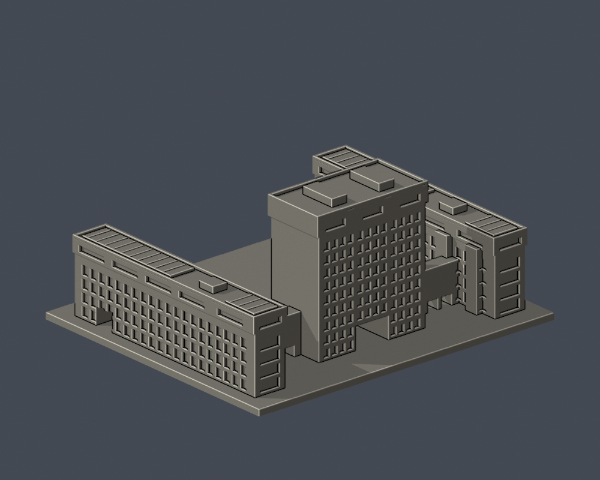
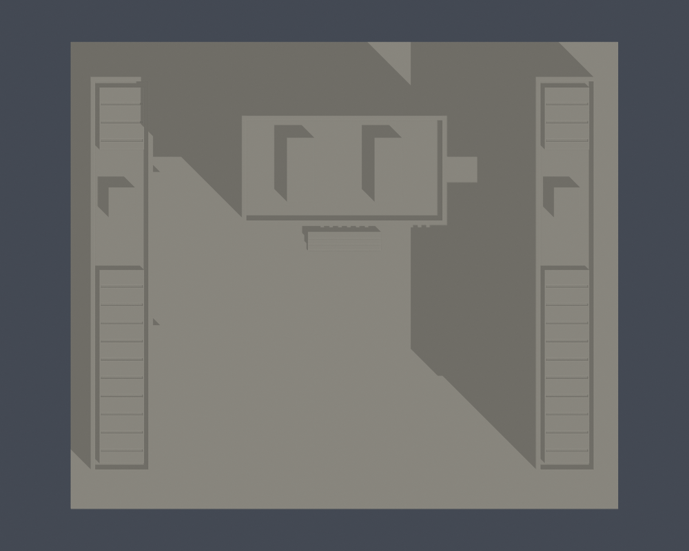

# 行政大樓・圖書館・教育大樓複合體

國立高雄師範大學／和平校區，首批單件自主近似外觀模型。三棟及兩側低連廊合併為一件，沒有把圖書館或教育大樓再次計作另件。不是全校完成，也不是測繪模型。

| 模型預覽 | 模型預覽 | 模型預覽 |
| :---: | :---: | :---: |
|   |  |  |

[正立面](previews/elevation.png) · [俯視](previews/top.png) · [STL](model.stl) · [可編修Blend](scene.blend)

| 模型預覽 | 模型預覽 | 模型預覽 |
| :---: | :---: | :---: |
| 正立面  | 俯視  |  |

## 保留與不確定處
- 10層主塔、5層平行側翼、開放前庭、低連廊、主塔三組深凹窗、上端冠頂及一樓中央穿通川堂。
- 官方公開平面約束塔樓長寬、側翼細長比例、連接及服務凸出；高度、細部比例仍為照片估算。
- 官方招生空拍可見太陽能板與屋頂女牆。本模型把板桌改為有實心背托的淺凸紋；未建小型機電、配管、冷氣、字牌、人物、樹木、圓環或旗桿。
- 完整背面未取得實拍；背側、外側窗列依平面與前側節奏簡化。雙翼的局部窗數及屋頂設備不是現況竣工圖。
- 2014相簿實拍及未標攝影日期的官方招生空拍為主要視覺來源；2023刊出的1984落成照只作歷史沿革輔證。不能稱2026完整現況重建。

## 列印提示
- STL單位：毫米。含底座外包尺寸150 × 128 × 67 mm，各館獨立比例，並非統一全校縮尺。
- 底座朝下。主塔川堂約16.8mm跨距、連廊與側翼穿堂、冠頂及窗緣出挑可能需要支撐；請於切片器實際檢查橋接與支撐位置。
- 設計女牆約1.25mm、頂層窗格約1.0mm，太陽能淺紋僅視覺細節；縮小模型會降低可解析性。
- 沒有坡屋頂尖端。本件沒有最後不足0.2mm坡頂尖端的特殊警示。
- 數位幾何檢查不是Cura/Prusa實際工具路徑，也未做實體試印。不能保證任何材料或印表機均可直接列印。

## 重建與驗證
Python 3.12、Blender 4.3.2；依requirements.txt安裝Python套件。執行build_model.py會自主重建STL與OBJ；render_preview.py匯入實際STL，輸出正背頂圖與可編修網格scene.blend。

依序執行：python build_model.py；blender -b -t 2 -P render_preview.py；python validate_model.py；python check_valid_sections.py；python thin_canonical_v2.py。

[validation.json](validation.json)驗證原STL法向、繞序、水密、每邊兩面、頂點link單環、單一表面殼、正體積、150mm上限、獨立重建SHA及Blend幾何一致。0.2mm截面採z=0.071mm起始，逐環及組合Polygon fail-closed有效性驗證。[valid-sections.json](valid-sections.json)含335層結果。

[thin-feature-check.json](thin-feature-check.json)採canonical固定邊插值、1.0mm節距與0.8mm形態opening參考寬度，最大面積損失0.406%，沒有超過1%的抽樣層。此篩檢會涵蓋尖角損失，並非全面最小壁厚或完整切片驗證。

[來源與年代](sources.json) · [逐檔SHA](SHA256SUMS)
