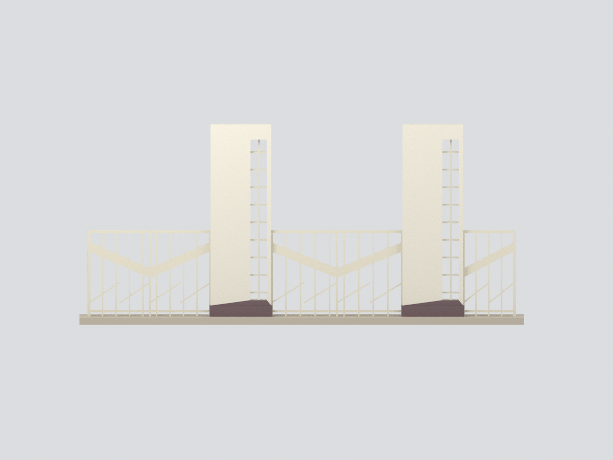

# 國立高雄師範大學｜和平校區｜歷史舊校門主體

**歷史狀態研究模型：此舊校門已於 1982 年拆除，不是現況校門。**

依高師大總務處公開的兩張歷史外觀照片，建立兩座主門柱與左、中、右三跨門扇的照片比例近似模型。官方說明將其歸於女子師範學校時期、修澤蘭設計；後於民國 71 年行政大樓新建時拆除。本模型不是實測、工程復原或原設計圖的數位化。

## 保留與省略
- 保留兩座寬板狀門柱、窄豎向透空框、深色柱腳、左中門扇主要 V 形寬框及右側窄門斜框。
- 兩柱採同一名義高度；照片中的透視高低差不能視為現場量測。柱厚、開口、跨度與欄杆粗細均為名義比例。
- 細金屬格柵採減量直欄與少量斜線；不是原本不規則紋樣的精確複製，數量不可作現場清點依據。
- 不復刻校名字跡、柱面浮雕、粗糙飾面及細小金屬裝飾；沒有擅加屋頂、橫跨門樓或警衛室。
- 範圍是主門柱與三跨門扇組合，不包括兩側完整校界圍牆、校名牆、郵筒、庭院、植栽與後方校舍；不是完整基地模型。
- 背面僅延續名義板厚及穿透構件，不補造未見裝飾、機構或空間。門扇以照片中的關閉狀態固定呈現，不能轉動。
- 淺色主體、深色柱腳和欄杆顏色來自褪色照片的近似判讀，未校色；不宣稱歷史原色已確定。
- 長條底板為作者列印連通支撐，不是歷史路面或原基礎。尚未試印，細欄杆需要依製程檢查；幾何 QA 不保證實物列印成功或結構安全。

## 模型預覽

以下為本套件模型的實際渲染，非建築現場照片；建模範圍與限制仍以本文說明為準。

## 檔案
`model.stl` 為單一連通網格；`model.3mf` 含四類近似色彩及毫米單位；`scene.blend` 含實際輸出網格與隱藏施工分件；`build_model.py`、`render_model.py` 可重建模型和六張圖。原始歷史照片不附入模型包，不作貼圖。

詳見 [SOURCES.md](SOURCES.md)、[REBUILD.md](REBUILD.md) 與各 QA JSON。
