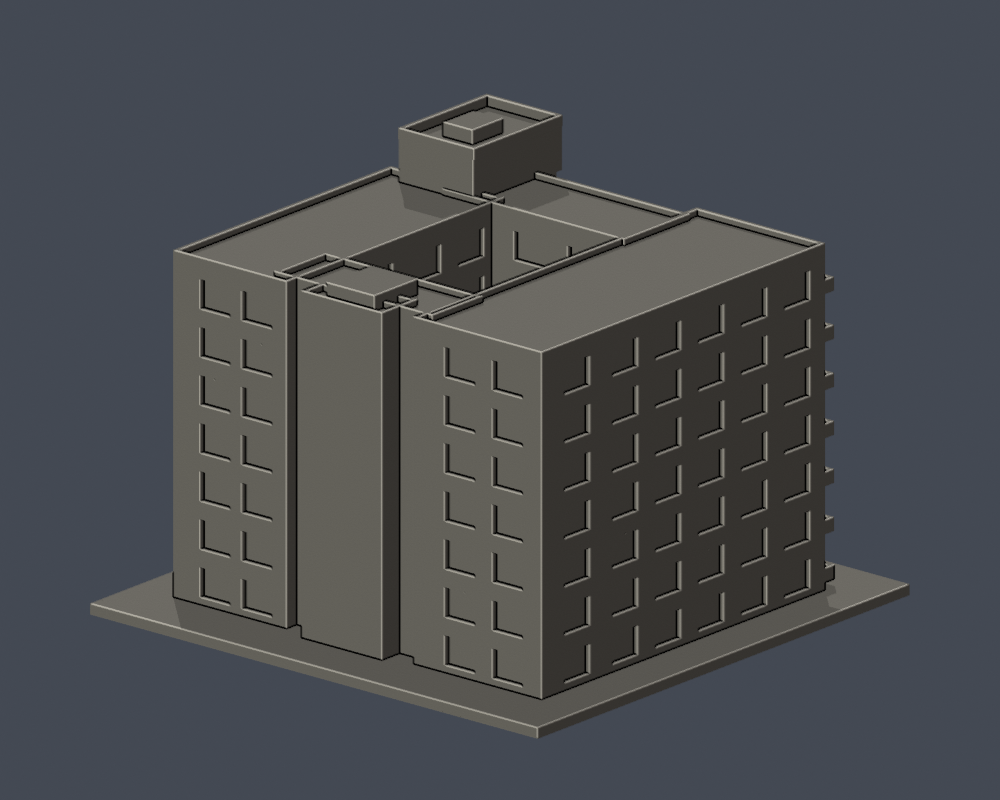

# 新研究大樓（2020年啟用館）

國立高雄師範大學／和平校區。自主製作的完整外部量體近似，包含開放中庭；不是2016年拆改前的舊研究大樓，不是建築測繪或全校完成。

 

[正立面](previews/elevation.png) · [俯視](previews/top.png) · [STL](model.stl) · [可編修Blend](scene.blend)

## 外觀與證據界線
- 保留七層、成列深陽台、轉角玻璃梯塔、雙層入口柱廊、主要立面退縮、屋頂女牆／梯間及開放中庭。
- 2020官方竣工空拍與2026官方公告附件的地面實拍提供前面、右側及屋頂證據；公告附件未標拍攝日期，不能當2026新拍。
- 3F與4F／5F公開平面支持中庭挑空、前後梯間與退縮量體；模型以近似比例整理，局部進深和高度未經測量。
- 背面及左側未取得完整實拍，窗口由平面與可見立面推定，並非測得實際窗數。
- 鐵欄杆改為約1.2–1.3mm的連續實心矮欄；窗框加粗且有背托。玻璃是凹窗幾何，沒有貼圖。空調、細配管、字牌與樓外車道／景觀省略。
- 屋頂中庭保持開放到底座上緣，不用實心方盒或封頂取代；室內房間沒有重建。

## 列印提示
- STL單位毫米；含底座150 × 147 × 110.9 mm。單棟獨立縮尺，不可與其他館按同一比例組整校。
- 底座朝下。陽台板、側廊、入口大跨度遮棚及玻璃塔窗緣需在切片器檢查支撐／橋接；從中庭或凹陽台拆支撐可能較難，請先規劃。
- 欄牆約1.2mm，主要柱約3.5mm，屋頂女牆約1.3mm。不要任意縮小後仍假設細節可印。
- 沒有坡屋頂尖端，沒有不足最後0.2mm一層的坡頂專屬警示。
- 沒有Cura/Prusa工具路徑驗證或實體試印；數位合格不等於保證列印成功。

## 重建與數位QA
Python 3.12依requirements.txt；Blender 4.3.2。執行python build_model.py；blender -b -t 2 -P render_preview.py；python validate_model.py；python check_valid_sections.py；python thin_canonical_v2.py。

scene.blend是由實際交付STL匯入的可編修網格，參數重建來源為build_model.py。正背頂PNG均由實際STL渲染。

[validation.json](validation.json)：原始法向／繞序、非退化面、水密、每邊兩面、頂點link單環、單一表面殼、正體積、150mm上限、重建SHA及Blend一致均通過。[valid-sections.json](valid-sections.json)：z=0.071mm起、0.2mm間距，共555截面逐環與組合Polygon閉合／有效，不repair或吞掉invalid。

[thin-feature-check.json](thin-feature-check.json)：canonical固定邊插值、1.0mm節距、0.8mm形態opening參考，最大面積損失0.116%以下，0層超過1%。此法會受尖角影響，不是全面最小壁厚檢驗。

[來源與年代](sources.json) · [SHA清單](SHA256SUMS)
