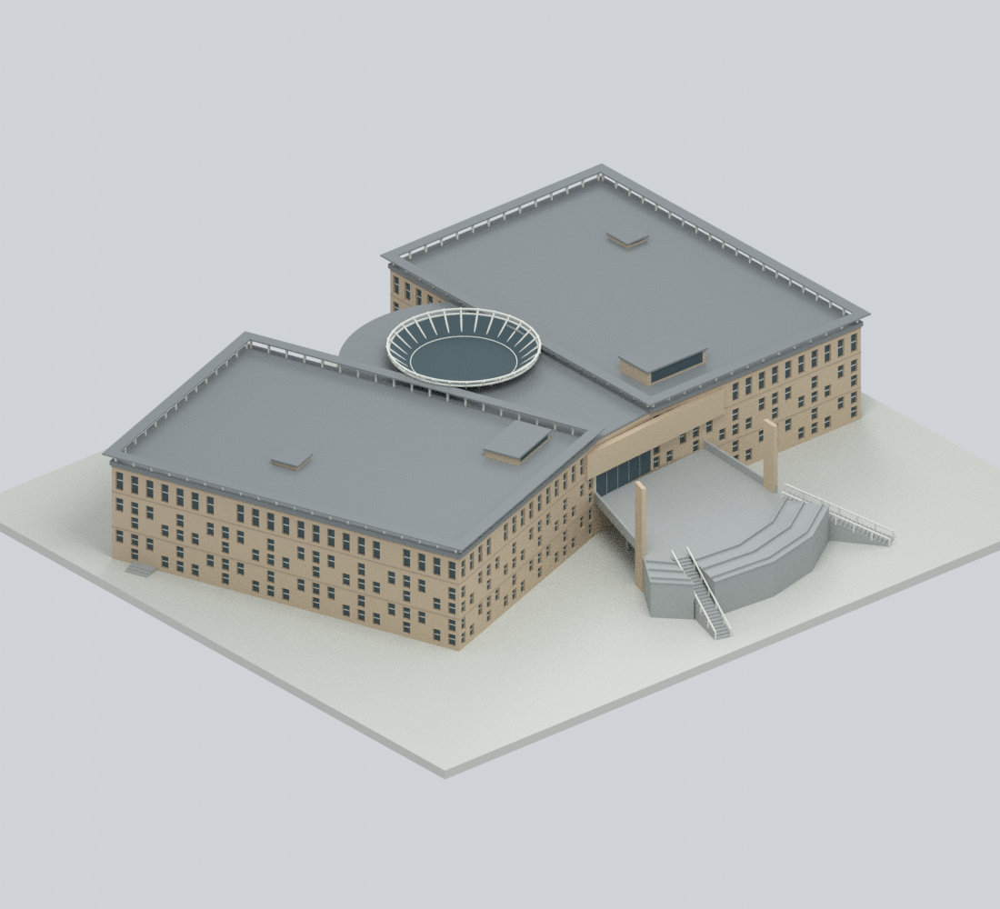
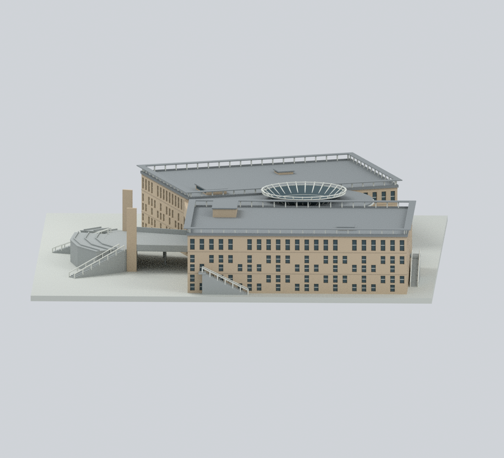
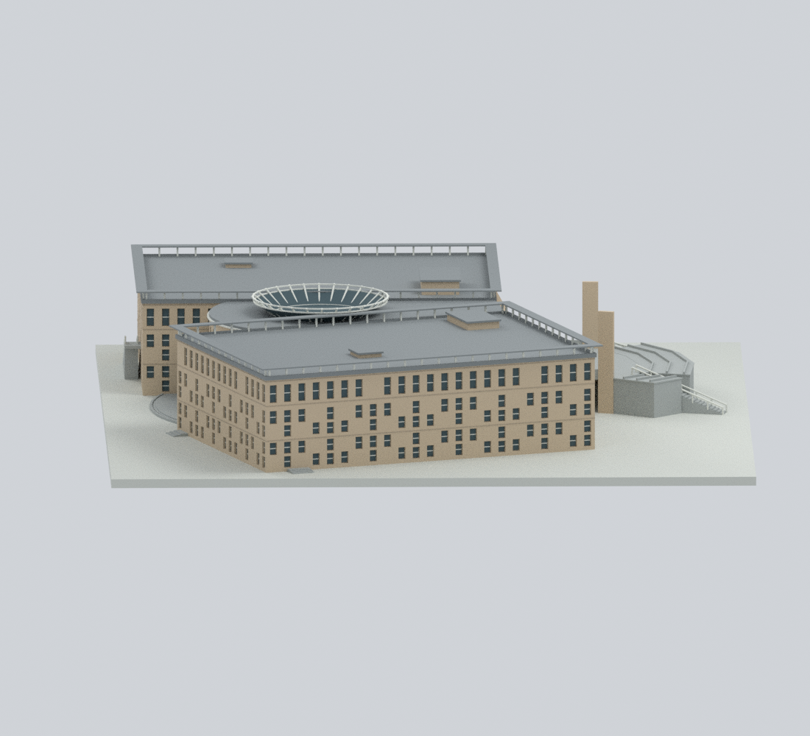
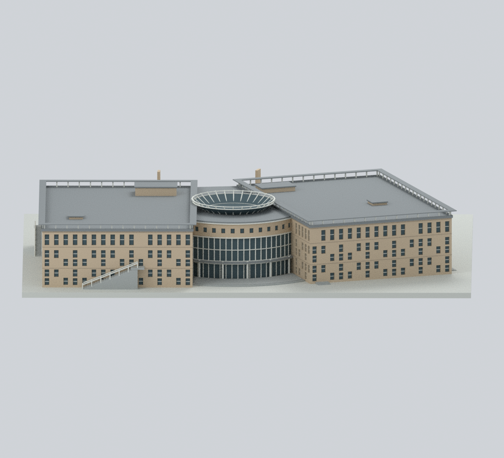
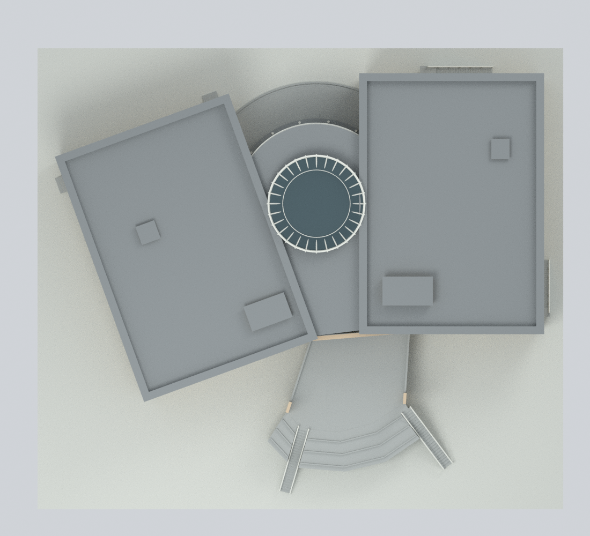
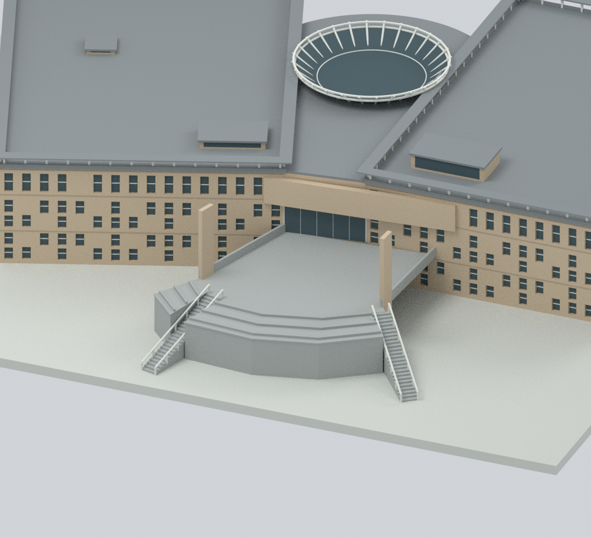
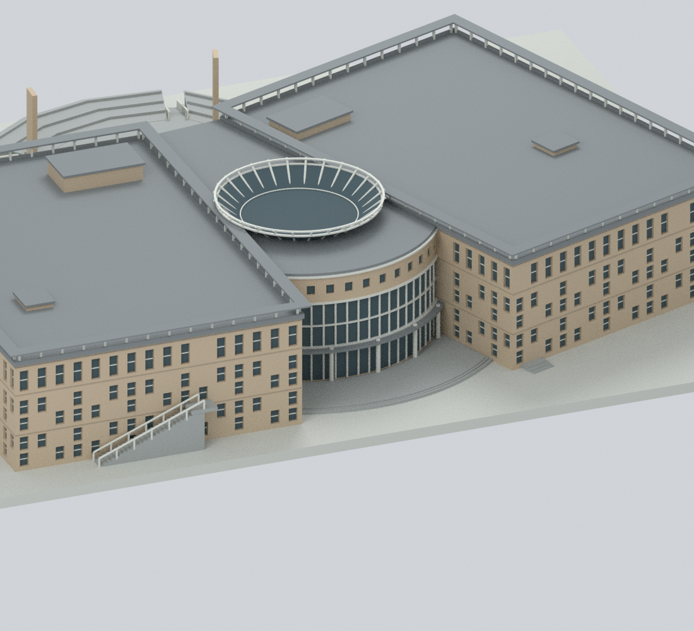
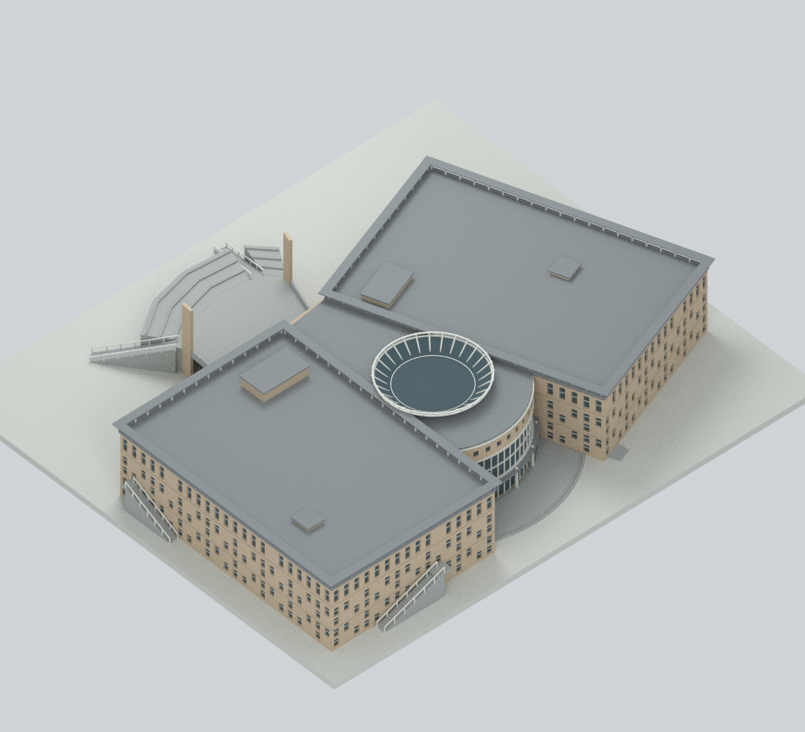
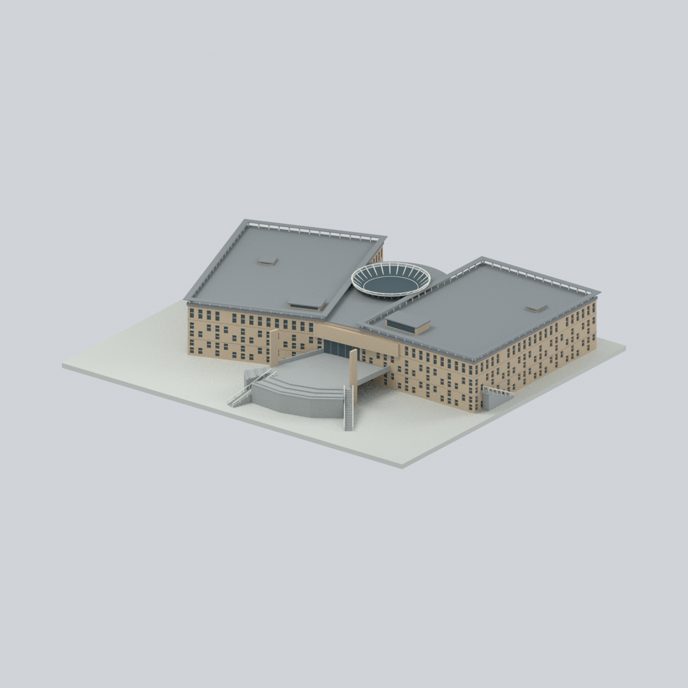

# 國立高雄師範大學燕巢校區圖資大樓

## 模型預覽

| 入口正面 | 整體斜視 | 側視 A |
|---|---|---|
|  |  |  |
| **側視 B** | **後側全景** | **俯視** |
|  |  |  |
| **入口平台與通道** | **後側弧形大廳** | **屋頂斜視** |
|  |  |  |

**整棟可見地上外觀的彩色比例近似模型，表達約 2011–2012 年完工期樣貌。** 不是和平校區圖書館，也不是經確認的 2026 現況、測繪模型或竣工圖。兩翼、中央大廳、完整屋頂、入口平台／通道、外階梯及後側露台均納入；不虛構不可見的 B1。

## 首頁與圖鑑代表角度



首頁與校級／校區圖鑑仍選用**同一座燕巢圖資大樓**，只改用獨立的代表視角。以聯大八甲北大門代表圖為基準：相對入口平台正面偏轉約 **36.87°**、俯視 **23.43°**，採正交投影與 **1200 × 1200** 畫布，完整保留底座。此模型局部 −Y 朝前方入口平台、+Y 朝後側凸弧大廳，代表相機採 `camera − look_at = (180, −240, 130)`；這是建築局部方向，不是測量地理方位。

原本九張建築檢視圖（含 `previews/front.png`）、STL、彩色 3MF、原生 Blender、網格、7 種材質、隱藏建構分件、照明與背景均不變。只調整相機、置中與取景；不新增模型件數，也不增加列印或現況驗證聲明。

使用原交付場景與網格獨立重渲染：

```bash
blender --disable-autoexec --background --factory-startup --python-exit-code 1 --python render_homepage_preview.py
```

可在命令末尾加 `-- --out /path/to/output`，輸出到另一目錄；`--source` 可指定原場景與 `mesh-data.npz` 所在目錄。腳本先逐元素核對場景頂點、三角面與材質索引，並在渲染前後比對所有可見／隱藏網格、材質節點、照明與背景簽章，不儲存或覆寫原 `.blend`。

本次已完成獨立程序重複渲染的像素／PNG 位元組一致性、從原公開網格重建原生場景後的單張代表圖重現、幾何不匹配負控制，以及全部十張 PNG 的中繼資料檢查，見 [`qa/homepage-camera-validation.json`](qa/homepage-camera-validation.json) 與 [`qa/homepage-cover-verification.json`](qa/homepage-cover-verification.json)。`reproduce.py` 已串接此獨立 renderer；乾淨重建與 PNG 檢查的預期數量增為十張，原九視角及既有技術檢查均保留。

**驗證範圍：** 此次僅為代表角度變更，原幾何、STL、3MF、原生檔與九張檢視圖逐檔雜湊未變，因此未重新執行完整建模、自交或切片幾何檢查。既有 `qa/clean-public-rebuild-validation.json` 保留為原九張檢視圖的歷史完整重建結果，不把它改寫成此次十張完整重建已執行的證明；此次十圖的 PNG 中繼資料結果另已實際更新。

## 九視角實際模型渲染

下列預覽由本模型及純色材質實際渲染，不是來源照片。`east`、`west`、`south` 僅為模型局部視角檔名，**不代表測量地理方位**。


## 檔案與尺度

- `nknu-yanchao-library-information.stl`：單色幾何網格。
- `nknu-yanchao-library-information.3mf`：逐三角面指定基礎材質的真正彩色 3MF；不是把 STL 改副檔名。**基礎材質不等於噴頭／線材設定**，切片器可能需要重新映射顏色。
- `nknu-yanchao-library-information.blend`：可編輯 Blender 原生檔，含顯示用合併網格、材質、相機、燈光，以及預設隱藏的原始建模分件。分件集合含布林合併前重疊，不應直接當作最終列印網格。
- `parameters.json`、`build_model.py`、`render_model.py`、`export_3mf.py`、`reproduce.py`：參數化重建程式；`mesh-data.npz`、`construction-parts.json`、`editable-parts.json` 保留幾何、材質與分件資訊。
- `sources.json`、`evidence-map.json`：公開來源連結、各部位依據與解讀限制；`qa/`：實際執行的技術檢查輸出。

輸出單位為 **mm**，約 **1:400**（參數的 1 m 對應模型 2.5 mm）。支撐底板為 **245 × 215 mm**；底板不是實際建築基座、B1、基礎或量測地形。圖上的 **4660 × 3240 cm 是尺寸鏈跨度**，不是自動等同外牆或挑簷外緣；外牆、屋頂與平台另依圖面比例近似。

## 哪些特徵被保留

- 不同方向的完整圖書館翼、資訊翼與中央接合；沒有以單翼鏡射代替另一側。
- 入口上層平台、下方通道、凹入門面、高薄翼牆與成對入口階梯；空隙不是填滿的實心台座。
- 中央封閉大廳、後側凸弧玻璃、上方實牆小窗、淡色支柱、弧形露台與淺階。中央不是露天中庭。
- 兩翼完整灰色屋面、柱支撐的架高周邊薄帶、可辨識的屋頂小量體，以及帶凹入玻璃面的圓形採光環與斜撐；架高薄帶不是整片實心屋頂，中央採光構造不是通用圓頂。
- 平面所示翼外逃生梯／淺階與立即可見的基部接合。

**前方外弧在 2F 圖中是花台／坡道，不是房間或新增樓層。** 模型以示意擋土、鋪面及低矮花台邊銜接入口平台，兩側階梯路徑保留；這不構成完整景觀或坡道工程模型。

## 不確定性與製作限制

1. **三組立面窗帶不等於三層樓。** 官方資料為地上二層加 B1；最低弧形玻璃門對應 1F 大廳／露台，不能據此宣稱露出的地下層。未取得的 B1 輪廓不向下套用 1F 平面製造。
2. 高度、屋面微坡、外牆偏移、樓梯標高／級數／踏步及細接縫是估計。樓梯位置與方向有平面依據，但實心下側為製作簡化，非實際結構或法規合規設計。
3. 開窗深度與錯落節奏簡化；暖米色外牆、深綠灰玻璃、淡色支柱和灰屋面取自實際完工照的未校色觀察，不是材料色票。玻璃採不透明純色，不重建室內。
4. 111-2／112-1 學年度空間盤點圖是後來的行政資料，不證明當年度重新測量，也不是屋頂圖。微小設備與 2026 年變更不臆測補入。
5. 兩份官方資料分別記載 **6,884.74 m²** 與 **7,481 m²**；保留差異，不平均，也不拿總樓地板面積硬套外部輪廓。
6. 最細部分構件約 **0.6 mm**，縮放、噴嘴與材料會影響完整性。入口平台下方、屋簷與採光環的懸挑需要支撐／橋接評估；不能為了免支撐而封住真實通道。幾何檢查不等於切片器路徑、設定或實體列印已成功。

## 可重現建置

使用 Python 3.12、`requirements-model.txt` 所列套件，以及獨立安裝的 **Blender 4.3.2**。重建只需要本目錄的公開程式與數值資料，**不需要下載照片、圖面、網路資源或 Blender 外掛**。

```bash
python -m venv .venv
. .venv/bin/activate
pip install -r requirements-model.txt
python reproduce.py --out rebuild --blender blender
```

若 `lib3mf` 安裝於另一個 Python，可加 `--export-python /path/to/python`。調整 `parameters.json` 的翼向、輪廓、高度、平台、階梯與構件厚度，或 `build_model.py` 的色盤後，應重新執行完整驗證。

```bash
python verify_reproducibility.py --out . --blender blender
```

乾淨重建檢查會把明確列出的公開程式與參數複製到新目錄，重建後比較幾何陣列、STL 位元組、分件資料，以及十張預覽（原九張建築檢視＋新增代表圖）的**像素與 PNG 位元組**。略過較慢檢查的開發模式不能視為完整通過。

## 技術驗證如何查閱

結果以 `qa/` 中對應的實際 JSON 報告為準；本說明不以預定步驟取代已執行結果，也不宣稱實體列印成功。

| 項目 | 實際報告 |
|---|---|
| 封閉性、正體積、非流形邊／頂點、退化／重複面 | `qa/mesh-validation.json` |
| 水平截面、細節／懸挑篩檢與空隙／實體射線 | `qa/slice-thickness-screen.json`、`qa/open-ray-validation.json` |
| STL 自交及正負控制組 | `qa/self-intersection-validation.json`、`qa/self-intersection-controls.json` |
| 3MF 嚴格讀回、逐面顏色與 round-trip | `qa/3mf-validation.json` |
| 原生檔與陣列一致、頂點／材質／分件修改後儲存重開 | `qa/blend-validation.json`、`qa/native-edit-validation.json` |
| 實際重開交付場景渲染、乾淨公開輸入重建 | `qa/saved-scene-render-validation.json`、`qa/clean-public-rebuild-validation.json` |
| 所有固定字元陣列的完整 SDNA／乾淨出廠檔對照、PNG 中繼資料 | `qa/raw-path-buffer-validation.json`、`qa/png-metadata-validation.json` |

SDNA 檢查遞迴涵蓋內嵌結構與完整固定緩衝區，包含 NUL 後的殘留位元組，並有污染負控制；並非僅搜尋兩個路徑字串。它不取代原生檔外部媒體檢查或所有檔案內容檢查。

## 來源、時期與權利

主要依據為高師大總務處的[新建工程資料](https://c.nknu.edu.tw/affair/Page.aspx?Kind=maintain&PN=95&SN=14)、其官方簡報與施工成果照片，以及[官方平面圖索引](https://c.nknu.edu.tw/affair/Page.aspx?Kind=maintain&PN=117&SN=16)和 1F／2F 空間盤點圖。完整直接 URL、文件日期與對應特徵見 `sources.json`、`evidence-map.json`。

2011 年建築工程完工、後續各工種完成及 2012 年驗收屬不同階段；2012-03-26 簡報所列 2012-05-02 開館日是當時的預定日期，不當作已獨立核實的實際開館日。照片個別拍攝日未確定，因此稱為「2011–2012 完工期近似」，不冠以「2026 最新現況」。

**公開可瀏覽不等於自由再散布授權。** 網站、圖面、照片及文件權利仍屬高師大及各創作者；未確認來源素材有開放再散布授權，來源連結也不授予重製權。本目錄只提供獨立建模幾何、原創純色材質、重建程式、技術 QA 與實際模型渲染，**不含來源照片、圖面像素、PDF、簡報頁面、裁切影像或來源衍生貼圖**。
