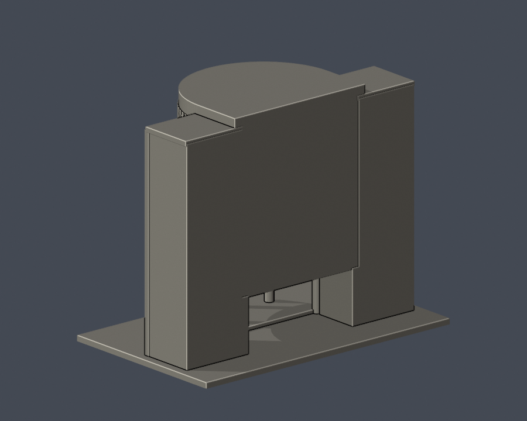

# 國立高雄科技大學｜行政大樓中央曲面入口段

校區：建工校區。建築實體：建工行政大樓。

**本件是局部外觀段，不是整棟測繪；全校尚未完成。** 只含中央曲面入口投影、其左右各兩跨短段與前弧柱廊；全長辦公翼、完整中庭和屋頂天窗不納入，背面是截斷封口。

## 實際 STL 外觀

| 正面 | 背面 |
|---|---|
|  |  |

[正立面](previews/elevation.png)｜[頂視](previews/top.png)

## 檔案與尺度

- [model.stl](model.stl)：毫米（mm），含底座 150 × 94 × 121.2 mm，最長150mm
- [scene.blend](scene.blend)：同一STL匯入的可編輯網格，可編輯頂點，不是原建築CAD
- [獨立參數生成程式](build_model.py)｜[固定依賴](requirements.txt)
- [來源、日期及範圍](sources.json)｜[逐檔SHA256](SHA256SUMS.txt)

各館獨立縮尺。原建築尺寸未測量；圖面只作體量與棟界參照，不能用於工程、結構或測量。單色模型用凹槽與框體區別實牆和玻璃，無原材質貼圖。

## 主要特徵

- 中央五條連續曲面玻璃帶，對應第三至第七樓的可見窗帶；底部為兩層高挑空，不把七樓用途數畫成七條中央窗帶。
- 前弧五支主柱、寬穿堂及弧形入口階；鄰接翼段有七列窗，主柱跨與細窗梃分別處理。
- 最高一層同時向前及左右擴徑，並提高至其他層上方；下方保留短放射托梁。

## 證據限制與省略

- 原照片未標攝影日期；2025研討會網站年份不是拍攝年份。原圖未有可用EXIF拍攝資訊。
- 中央曲面弧度、柱距、進深及左右截取範圍為照片與疏散圖近似；細窗梃加粗及減量，不聲稱逐片玻璃尺寸完全相同。
- 完整中庭／天窗、後側立面、全長兩翼、室內、文字、植栽與設備不重建。底層穿堂保留開放，而上層背面是局部截斷面。
- 2024平面只有疏散示意用途；並非比例可靠的竣工圖。

## 列印前須知

底座朝下。先用自己的切片軟體檢查尺寸、細件解析度、橋接與支撐。柱廊、挑空、雨遮、陽台、屋頂欄杆與擴徑懸挑可能需要支撐，拆支撐時可能損傷細件。細框已粗化，但材料、噴嘴、層高和工具路徑仍會影響結果。

**數位QA不等同實體試印，不能保證免支撐或成功列印。** 0.8mm參考寬度的XY形態opening是輔助篩檢，不是全面最小壁厚、強度或Cura／Prusa工具路徑證明。

## 重建與數位QA

安裝 requirements.txt 的Python 3.12環境後執行 python build_model.py。使用Blender 4.3.2執行 blender -b -t 2 -P render_preview.py，從實際STL產生四視圖及可編輯scene.blend。python run_checks.py 執行所有檢查；任一失敗非零退出。驗證會產生報告，請在副本操作，不改凍結原包。

- [原始網格／保存normal與winding／重建SHA／Blend一致](validation.json)／[程式](validate_model.py)
- [0.2mm全層閉環及個別、合成Polygon valid](contour-validity-check.json)／[程式](check_contour_validity.py)
- [canonical fail-closed v3](thin-feature-check.json)／[原程式](check_thin_features.py)
- [canonical SHA與結果嚴格檢查](strict-thin-check.json)／[程式](check_thin_strict.py)
- [額外0.2mm全層thin](thin-all-layers-check.json)／[程式](check_thin_all_layers.py)
- [完整QA摘要](QA-summary.json)

原網格單殼、水密、每邊2面、vertex link單環、原法向與winding一致及正體積通過；未用修補修改輸入網格。所有輪廓從z=0.071mm起、以0.2mm逐層檢查；invalid立即失敗，不以buffer(0)或make_valid放行。獨立重建STL SHA一致，保存Blend幾何與STL一致。

第三方照片及PDF不重新散布，只附來源URL與證據摘要。這是自建的近似建築外觀模型，非官方或授權測繪成果。

[回校區](../../README.md)｜[回學校圖鑑](../../../README.md)
