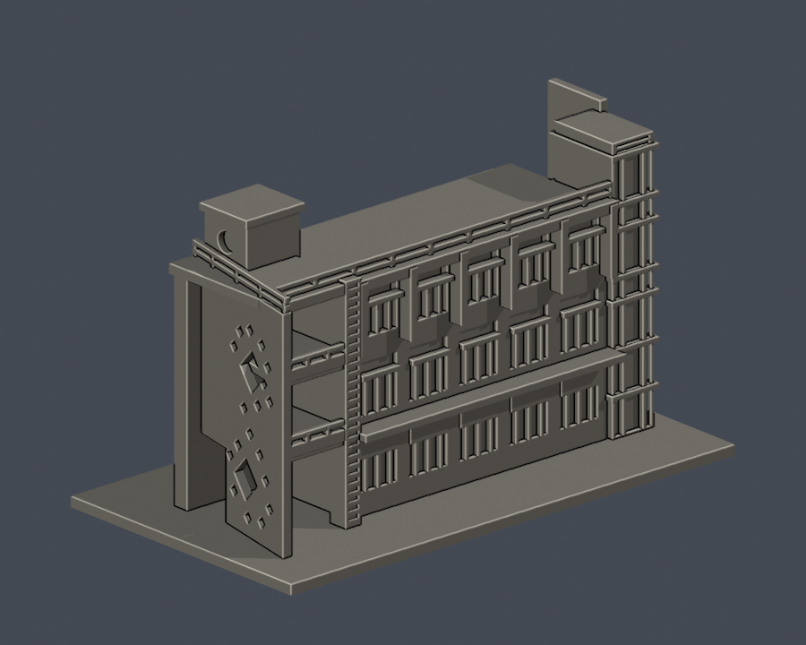
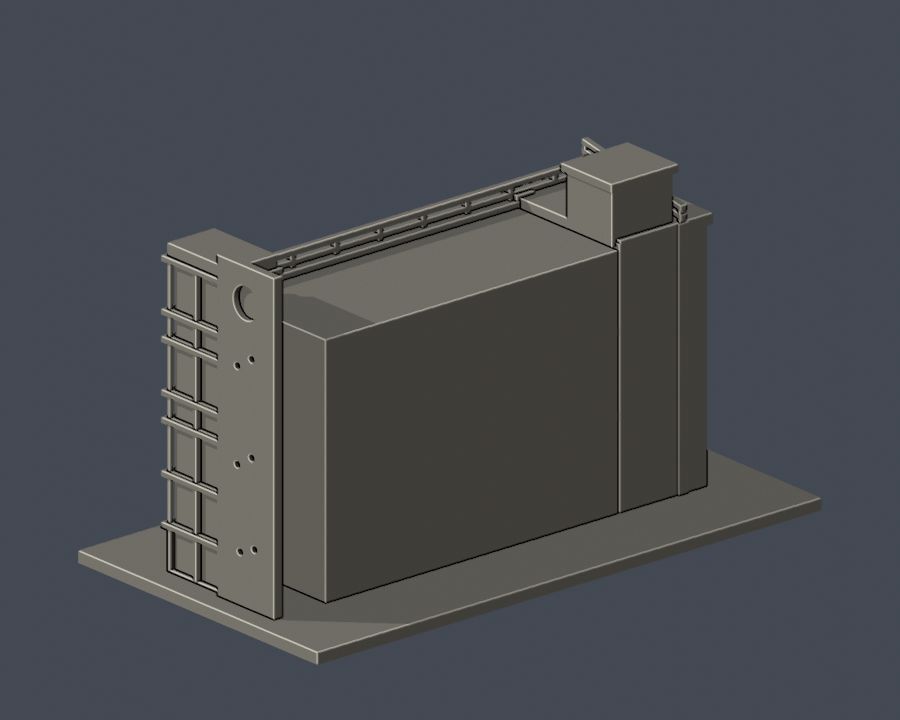
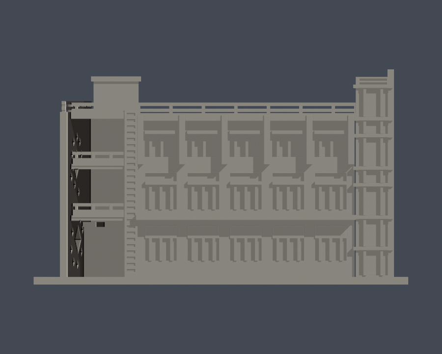
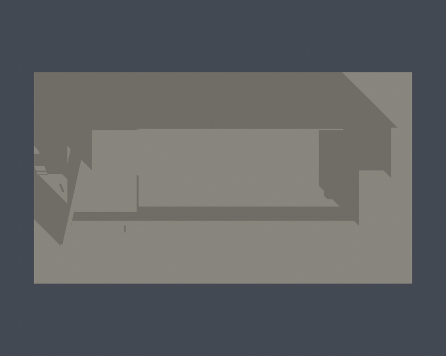

# 國立高雄科技大學｜水食實習大樓長立面暨入口段

校區：楠梓校區。建築實體：水產食品科學系實習大樓（環安圖稱水食工廠）。

**本件是局部外觀段，不是整棟測繪；全校尚未完成。** 只含實拍長立面、左端斜切菱形穿孔入口牆及挑空陽台、右端玻璃梯塔與可見屋頂退台。後側平行實驗翼、完整內廊和未見後立面不納入；背面為截斷封口。

## 實際 STL 外觀

| 模型預覽 | 模型預覽 | 模型預覽 |
| :---: | :---: | :---: |
| 正面  | 背面  |  |

[正立面](previews/elevation.png)｜[頂視](previews/top.png)

| 模型預覽 | 模型預覽 | 模型預覽 |
| :---: | :---: | :---: |
| 正立面  | 頂視  |  |

## 檔案與尺度

- [model.stl](model.stl)：毫米（mm），含底座 150 × 84 × 86 mm，最長150mm
- [scene.blend](scene.blend)：同一STL匯入的可編輯網格，可編輯頂點，不是原建築CAD
- [獨立參數生成程式](build_model.py)｜[固定依賴](requirements.txt)
- [來源、日期及範圍](sources.json)｜[逐檔SHA256](SHA256SUMS.txt)

各館獨立縮尺。原建築尺寸未測量；圖面只作體量與棟界參照，不能用於工程、結構或測量。單色模型用凹槽與框體區別實牆和玻璃，無原材質貼圖。

## 主要特徵

- 主樓三列各五組深凹窗；中列與上列保留橫向氣窗／窗帶分隔，不能誤當額外樓層。透視造成近大遠小不直接當五跨真實不等寬。
- 左端大型挑空、兩層陽台、全高窄百葉帶，以及斜切入口牆上兩簇大小不同的菱形穿孔。
- 右端玻璃梯塔有入口上方六段加地面入口一段，共七段不等高玻璃／平台帶；含兩段短帶，是梯間節奏，不是七層主樓。
- 主屋頂欄杆、左退縮服務核、較高右端梯塔與側板圓形孔保留高差；細欄杆加粗。

## 證據限制與省略

- 官方系所照片為帶邊框排版圖，實拍未標拍攝日期、原檔無可用EXIF日期；不以網頁查閱日當現況攝影日。
- 環安樓層图共1、2、3、R四頁，R是屋頂；本模型不是四層一般教室。
- 主樓深窗不是整面開放柱廊，只有左端入口後的挑空和陽台保持真開口。窗梃、菱形邊緣、欄杆及小圓孔為列印尺度近似。
- 平面顯示後方另有平行翼及中廊，完整外觀未取得多面實拍，故排除而非虛構背面窗列。精確進深、設備與室內未重建。
- 屋頂小機房的深度、入口牆開孔細位置與局部玻璃分格為照片估計；文字、藍白波浪材質、排風管及空調設備省略。

## 列印前須知

底座朝下。先用自己的切片軟體檢查尺寸、細件解析度、橋接與支撐。柱廊、挑空、雨遮、陽台、屋頂欄杆與擴徑懸挑可能需要支撐，拆支撐時可能損傷細件。細框已粗化，但材料、噴嘴、層高和工具路徑仍會影響結果。

**數位QA不等同實體試印，不能保證免支撐或成功列印。** 0.8mm參考寬度的XY形態opening是輔助篩檢，不是全面最小壁厚、強度或Cura／Prusa工具路徑證明。

## 重建與數位QA

安裝 requirements.txt 的Python 3.12環境後執行 python build_model.py。使用Blender 4.3.2執行 blender -b -t 2 -P render_preview.py，從實際STL產生四視圖及可編輯scene.blend。python run_checks.py 執行所有檢查；任一失敗非零退出。驗證會產生報告，請在副本操作，不改凍結原包。

- [原始網格／保存normal與winding／重建SHA／Blend一致](validation.json)／[程式](validate_model.py)
- [0.2mm全層閉環及個別、合成Polygon valid](contour-validity-check.json)／[程式](check_contour_validity.py)
- [canonical fail-closed v3](thin-feature-check.json)／[原程式](check_thin_features.py)
- [canonical SHA與結果嚴格檢查](strict-thin-check.json)／[程式](check_thin_strict.py)
- [額外0.2mm全層thin](thin-all-layers-check.json)／[程式](check_thin_all_layers.py)
- [完整QA摘要](QA-summary.json)

原網格單殼、水密、每邊2面、vertex link單環、原法向與winding一致及正體積通過；未用修補修改輸入網格。所有輪廓從z=0.071mm起、以0.2mm逐層檢查；invalid立即失敗，不以buffer(0)或make_valid放行。獨立重建STL SHA一致，保存Blend幾何與STL一致。

第三方照片及PDF不重新散布，只附來源URL與證據摘要。這是自建的近似建築外觀模型，非官方或授權測繪成果。

[回校區](../../README.md)｜[回學校圖鑑](../../../README.md)
